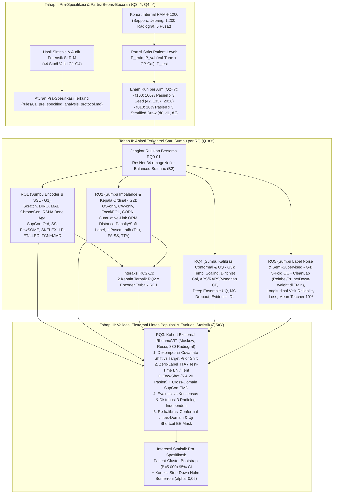
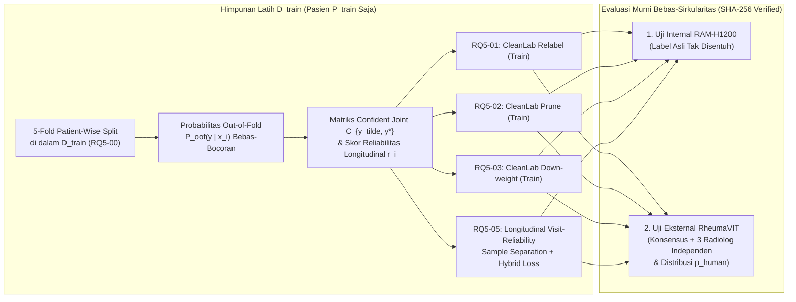

# BAB III: METODOLOGI PENELITIAN DAN FORMULASI MATEMATIS EKSPERIMEN

Bab ini menguraikan secara komprehensif desain penelitian, karakteristik kohort data internal (**`RAM-H1200`** [@Yang2026RAMH1200]) dan kohort validasi eksternal lintas populasi (**`RheumaVIT`** [@Stolpovsky2023RheumaVIT]), protokol pemisahan data tingkat pasien, serta **formulasi matematis eksak** untuk seluruh arsitektur, fungsi objektif, algoritma kalibrasi/prediksi konformal, dan mekanisme koreksi derau label yang diuji pada Pertanyaan Penelitian **`RQ1` hingga `RQ5`**. Seluruh prosedur eksperimen dan pengujian hipotesis pada bab ini tunduk secara mengikat pada dokumen aturan pra-spesifikasi di [`rules/01_pre_specified_analysis_protocol.md`](../rules/01_pre_specified_analysis_protocol.md) yang dikunci sebelum eksekusi *run* komputasi pertama.

---

## 3.1 Desain Penelitian dan Kerangka Kerja Eksperimen Terpadu

### 3.1.1 Paradigma Metodologis: Menjawab Enam Celah Kualitas Literatur (`Q1–Q6`)

Sebagaimana dibuktikan melalui audit verifikasi teks penuh atas 44 studi valid dalam *Systematic Literature Review Metodologis* (`SLR-M`, Bab II), literatur *deep learning* untuk grading keparahan radiografi muskuloskeletal saat ini menderita empat kelemahan metodologis utama: (1) pencampuran berbagai modifikasi arsitektur dan fungsi rugi secara sekaligus tanpa isolasi komponen (`18,2%` studi tanpa ablasi terkontrol), (2) ketiadaan kuantifikasi varians antar-*seed* (`56,8%` studi hanya melaporkan satu *run*), (3) kebocoran data tingkat pasien akibat pembagian acak tingkat citra atau *oversampling* pra-split (`70,5%` studi tidak menjamin *patient-level split*), serta (4) bias sirkularitas akibat modifikasi label himpunan uji pada studi *CleanLab/relabeling* (`M042` [@M042], `M117` [@M117], `M272` [@M272]) dan minimnya validasi eksternal lintas populasi (`0%` pada studi Artritis Reumatoid).

Untuk mengatasi seluruh kelemahan tersebut secara sistematis, penelitian ini dirancang sebagai **studi eksperimental ablasi faktor-tunggal terkontrol (*controlled single-axis factorial ablation*) yang dilengkapi validasi eksternal lintas populasi dan pengujian multi-radiolog**. Kerangka kerja penelitian secara menyeluruh ditunjukkan pada diagram alir di bawah ini:

### 3.1.2 Formulasi Matematis Umum Tugas Grading Ordinal Erosi Tingkat Sendi

Misalkan sebuah pengamatan pada tingkat *Region of Interest* (ROI) sendi tangan ke-$j \in \{1, \dots, J_p\}$ dari pasien $p \in \mathcal{P}$ pada kunjungan waktu pemeriksaan ke-$t \in \{1, \dots, T_p\}$ dinyatakan sebagai tupel $(x_{p,t,j}, y_{p,t,j}, a_{p,t,j})$, di mana:
- $x_{p,t,j} \in \mathbb{R}^{C \times H \times W}$ adalah potongan citra radiograf (*cropped joint ROI*) berukuran $H \times W$ piksel (dengan $C=3$ kanal hasil replikasi intensitas *grayscale* terstandarisasi untuk kompatibilitas arsitektur pralatih);
- $a_{p,t,j} \in \mathcal{A}$ menyatakan identitas jenis anatomi sendi (misalnya MCP 1–5, PIP 2–5, IP ibu jari, atau zona pergelangan tangan);
- $y_{p,t,j} \in \mathcal{Y} = \{0, 1, \dots, K-1\}$ adalah label keparahan erosi tulang menurut metode Sharp/van der Heijde (SvdH) [@vanderHeijde2000SvdH] yang bersifat **diskret dan terurut sempurna**:
  $$0 \prec 1 \prec 2 \prec \dots \prec K-1$$

Pada skema skoring SvdH tangan standar, skor erosi per sendi bernilai bulat dari $0$ hingga $5$ [@vanderHeijde2000SvdH]. Namun, mengikuti konvensi benchmark resmi `RAM-H1200` (`ramscore`) [@Yang2026RAMH1200] akibat kelangkaan ekstrem sendi dengan skor $5$ murni pada kohort klinis modern, kelas keparahan ekstrem $4$ dan $5$ digabungkan menjadi kelas **`Grade 4+`**, sehingga ruang label terdiri atas $K = 5$ kelas ordinal:
$$\mathcal{Y} = \{0 \text{ (Normal)}, \; 1 \text{ (Erosi Diskret Dini)}, \; 2 \text{ (Erosi Sedang)}, \; 3 \text{ (Erosi Lanjut)}, \; 4+ \text{ (Destruksi Berat/Ankilosis)}\}$$

Untuk kemudahan notasi pada subbab berikutnya, indeks komposit $(p, t, j)$ ditulis sebagai indeks sampel $i \in \{1, \dots, N\}$ dengan tetap mempertahankan fungsi pemetaan pasien $\text{pat}(i) = p \in \mathcal{P}$. Sebuah model *deep learning* didekomposisi menjadi dua komponen berparameter $\Theta = (\theta, \phi)$:
1. **Pengekstrak Fitur Visual (*Visual Backbone / Encoder*):**
   $$\mathbf{h}_i = f_\theta(x_i) \in \mathbb{R}^D$$
   yang memetakan citra ROI sendi $x_i$ ke vektor representasi laten berdimensi $D$ (misalnya $D = 512$ untuk `ResNet-34` dan $D = 384$ untuk `ViT-Small/16`).
2. **Kepala Prediksi Ordinal/Klasifikasi (*Classification / Ordinal Regression Head*):**
   $$\mathbf{z}_i = g_\phi(\mathbf{h}_i) \in \mathbb{R}^M$$
   yang menghasilkan vektor keluaran berdimensi $M$ (dengan $M = K$ untuk kepala berbasis logit multikelas/Dirichlet, $M = K - 1$ untuk kepala ambang biner `Ordinal BCE / CORAL` dan `CORN`, atau $M = 1$ skalar beserta $K-1$ parameter ambang $\boldsymbol{\theta}_{\text{cut}}$ untuk kepala `Cumulative-Link ORM`). Vektor keluaran $\mathbf{z}_i$ selanjutnya dipetakan oleh operator dekoder probabilistik $\Psi: \mathbb{R}^M \to \Delta^{K-1}$ ke simpleks probabilitas prediksi:
   $$\hat{\mathbf{p}}(x_i) = \big(\hat{p}_0(x_i), \hat{p}_1(x_i), \dots, \hat{p}_{K-1}(x_i)\big)^\top \in \Delta^{K-1}, \quad \sum_{c=0}^{K-1} \hat{p}_c(x_i) = 1, \quad \hat{p}_c(x_i) \ge 0$$

---

## 3.2 Karakteristik Dataset, Pra-pemrosesan ROI Sendi, dan Partisi Tingkat Pasien

### 3.2.1 Kohort Internal Multi-Pusat: `RAM-H1200` (Sapporo, Jepang)

Pelatihan, pemilihan hiperparameter, dan evaluasi uji internal dilaksanakan pada dataset benchmark publik **`RAM-H1200`** (*Rheumatoid Arthritis Multi-Task Hand 1200*) yang dirilis oleh Yang et al. [@Yang2026RAMH1200]. `RAM-H1200` merupakan kohort radiografi tangan multi-pusat yang dikumpulkan dari **6 pusat medis di Sapporo, Jepang**, mencakup **1.200 radiograf tangan** dari pasien Artritis Reumatoid dengan karakteristik unik yang krusial bagi desain eksperimen tesis ini:
1. **Anotasi Multi-Tugas Lengkap per Sendi:** Setiap radiograf dilengkapi kotak pembatas (*bounding box*) lokasi sendi tangan, skor keparahan erosi tulang SvdH per sendi, skor penyempitan celah sendi (*Joint Space Narrowing*, JSN), serta masker segmentasi instan tulang tangan utuh.
2. **Masker Piksel Erosi Tulang (*Pixel-Level Bone Erosion [BE] Masks*):** Berbeda dengan dataset radiografi OA/RA lain yang hanya menyediakan label tingkat sendi, `RAM-H1200` menyediakan masker biner tingkat piksel $\mathbf{M}_{\text{BE}} \in \{0, 1\}^{H \times W}$ yang menandai lokasi anatomis persis dari cekungan erosi kortikal. Fitur ini dimanfaatkan secara langsung pada protokol uji diagnostik *shortcut learning* **`RQ3-05`** (Subbab 3.8.5).
3. **Rekaman Kunjungan Longitudinal dan Diagnosis Inkonsistensi Label:** Sebagian pasien pada `RAM-H1200` memiliki rangkaian radiograf dari beberapa kunjungan waktu berurutan ($t_1 < t_2 < \dots$). Sebagaimana telah diidentifikasi pada Bab I, pemeriksaan transisi skor erosi per sendi antarkunjungan pada data internal mengungkap bahwa **47% sendi yang diberi label `Grade 1` pada kunjungan $t$ berubah kembali menjadi `Grade 0` pada kunjungan $t+1$**. Mengingat erosi tulang kortikal pada RA jarang mengalami remineralisasi sempurna dalam waktu singkat, temuan ini memberikan bukti kuantitatif langsung mengenai tingginya *aleatoric/reader label noise* di perbatasan `Grade 0` dan `Grade 1`, yang menjadi landasan metode **`RQ5-05`** (Subbab 3.7.3).

### 3.2.2 Kohort Validasi Eksternal Lintas Populasi: `RheumaVIT` (Moskow, Rusia)

Untuk mengisi kekosongan validasi eksternal pada literatur RA (`0/5` studi RA di SLR-M memiliki validasi eksternal), seluruh model yang dilatih pada `RAM-H1200` dievaluasi lintas benua dan lintas populasi pada dataset **`RheumaVIT`** [@Stolpovsky2023RheumaVIT]. Kohort ini dikumpulkan secara independen di ***V.A. Nasonova Research Institute of Rheumatology* (Moskow, Rusia)** antara tahun 2019 dan 2022, terdiri atas **330 radiograf tangan bilateral** (mencakup 42 ROI sendi per pemeriksaan bilateral, atau $>13.800$ potongan sendi).

Keunggulan metodologis paling penting dari `RheumaVIT` adalah ketersediaan **dua lapisan anotasi pakar**:
1. **Label Konsensus Pakar ($y_i^{\text{cons}}$):** Skor SvdH acuan yang telah disepakati bersama untuk evaluasi standar lintas-domain (`RQ3-01` s/d `RQ3-03`).
2. **Anotasi Independen dari Tiga Radiolog Pakar ($y_i^{(R_1)}, y_i^{(R_2)}, y_i^{(R_3)}$):** Setiap sendi dinilai secara terpisah oleh tiga radiolog muskuloskeletal berpengalaman. Ketersediaan tiga pembaca independen ini memungkinkan tesis ini menghitung batas atas kinerja manusia (*Leave-One-Reader-Out [LORO] Human Ceiling*) sekaligus mengevaluasi model terhadap **distribusi probabilitas ketidaksepakatan manusia** $\mathbf{p}_{\text{human}}(x_i)$ pada **`RQ3-04`** dan **`RQ5-E`**.

| Karakteristik | Kohort Internal: **`RAM-H1200`** [@Yang2026RAMH1200] | Kohort Eksternal: **`RheumaVIT`** [@Stolpovsky2023RheumaVIT] | Implikasi Metodologis pada Tesis |
|---|---|---|---|
| **Asal Geografis & Demografi** | Sapporo, Jepang (Asia Timur, 6 pusat medis) | Moskow, Rusia (Eropa Timur, *V.A. Nasonova Inst.*) | Menguji ketahanan model terhadap pergeseran anatomi populasi dan protokol akuisisi sinar-X (`RQ3`) |
| **Jumlah Radiograf** | 1.200 radiograf tangan | 330 radiograf tangan bilateral ($\approx 660$ tangan) | Skala evaluasi internal dan eksternal yang memadai untuk *patient-cluster bootstrap* |
| **Anotasi Tingkat Sendi** | Skor erosi SvdH (0–4+) & JSN + *Bounding Box* | Skor erosi SvdH & JSN pada 42 sendi per studi bilateral | Memungkinkan evaluasi *zero-shot* dan *few-shot* langsung per ROI sendi |
| **Struktur Pembaca (*Readers*)** | Skor acuan klinis terverifikasi | **Konsensus + 3 Radiolog Pakar Independen ($R_1, R_2, R_3$)** | Menjadi jangkar kebenaran multi-pembaca untuk menguji klaim koreksi *label noise* (`RQ5-E`, `RQ3-04`) |
| **Atribut Tambahan Unik** | **Kunjungan longitudinal** & **Masker piksel erosi (`BE mask`)** | Variabilitas kontras alat X-ray klinis nyata | Mendukung penyelarasan longitudinal (`RQ1-12, RQ5-05`) dan uji *shortcut* piksel (`RQ3-05`) |

### 3.2.3 Pra-pemrosesan ROI Sendi, Resep Augmentasi Ber-Seed, dan Partisi Tingkat Pasien

1. **Ekstraksi dan Standarisasi Potongan ROI Sendi:**
   Setiap ROI sendi dipotong berdasarkan koordinat kotak pembatas teranotasi dengan *padding* kontekstual sebesar $15\%$ di sekeliling tepi sendi untuk mempertahankan korteks periartikular, lalu diubah ukurannya (*bilinear interpolation*) menjadi resolusi standar $H \times W = 224 \times 224$ piksel. Intensitas piksel setiap potongan ROI dinormalisasi ke rentang $[0, 1]$ menggunakan pemotongan persentil kontras lokal $[p_{1}, p_{99}]$ (untuk meredam artefak huruf timbal penanda sisi `L/R`), kemudian distandarisasi per kanal menggunakan rata-rata $\mu_{\text{train}}$ dan simpangan baku $\sigma_{\text{train}}$ yang dihitung murni dari himpunan latih $\mathcal{D}_{\text{train}}$.
2. **Resep Augmentasi Daring Terkunci (*Seeded `base` Augmentation Recipe*):**
   Berdasarkan hasil penyaringan eksperimen pendahuluan `E8`, seluruh *run* di semua RQ menggunakan transformasi augmentasi daring `base` yang sama pada saat pelatihan:
   - Pembalikan horizontal acak (*random horizontal flip*) dengan probabilitas $p = 0,5$;
   - Transformasi afinitas acak: rotasi $\theta_{\text{rot}} \sim \mathcal{U}(-15^\circ, +15^\circ)$, translasi $(\delta_x, \delta_y) \sim \mathcal{U}(-5\%, +5\%)$, dan penskalaan $\alpha_{\text{scale}} \sim \mathcal{U}(0,90, 1,10)$;
   - *Photometric / Intensity Jitter* ringan: penyesuaian kecerahan dan kontras $\pm 10\%$ serta transformasi gamma $\gamma_{\text{int}} \sim \mathcal{U}(0,9, 1,1)$ yang menjaga visibilitas trabekula dan tepi kortikal.
   Generator bilangan acak untuk augmentasi di-seed secara deterministik menggunakan kombinasi `(seed, epoch, sample_idx)` sehingga setiap arm dalam satu tabel ablasi menerima urutan perturbasi geometris yang sepenuhnya sebanding.
3. **Partisi *Strict Patient-Level* dan Enam *Run* per Arm:**
   Sesuai Pasal 2 [`rules/01_pre_specified_analysis_protocol.md`](../rules/01_pre_specified_analysis_protocol.md), himpunan pasien $\mathcal{P}$ pada `RAM-H1200` dipartisi secara ketat pada tingkat pasien menjadi $\mathcal{P}_{\text{train}}$ ($70\%$), $\mathcal{P}_{\text{val}}$ ($15\%$, yang dibagi lagi secara terstratifikasi tingkat pasien menjadi $50\%$ $\mathcal{D}_{\text{val-tune}}$ dan $50\%$ $\mathcal{D}_{\text{cal}}$ untuk kalibrasi konformal), serta $\mathcal{P}_{\text{test}}$ ($15\%$). Setiap arm dievaluasi pada **6 run**:
   $$\text{Runs}(\text{Arm}) = \underbrace{\big\{(\text{f100}, d=0, s) \mid s \in \{42, 1337, 2026\}\big\}}_{\text{3 Seed pada 100\% Pasien Latih}} \cup \underbrace{\big\{(\text{f010}, d, s=42) \mid d \in \{0, 1, 2\}\big\}}_{\text{3 Stratified Patient Draw pada 10\% Pasien Latih}}$$

---

## 3.3 Konfigurasi Rujukan Bersama (`RQ0-01`) dan Standar Hiperparameter Pelatihan

Untuk menjamin bahwa setiap efek yang terukur pada `RQ1` hingga `RQ5` memiliki pembanding yang bebas dari perancu (*confounder*), ditetapkan arm rujukan bersama **`RQ0-01`**:
- **Encoder ($f_\theta$):** `ResNet-34` pralatih terawasi pada `ImageNet-1K` ($D = 512$).
- **Kepala & Fungsi Rugi ($g_\phi, \mathcal{L}$):** Proyeksi linear tunggal $\mathbf{z}_i = \mathbf{W}\mathbf{h}_i + \mathbf{b} \in \mathbb{R}^K$ yang dilatih dengan **`Balanced Softmax / Logit Adjustment` (`B2`)** [@Menon2021LogitAdjustment; @Ren2020BalancedSoftmax]. Misalkan $N_c$ adalah jumlah sampel latih pada kelas $c \in \{0, \dots, K-1\}$ di dalam $\mathcal{D}_{\text{train}}$ (atau $\mathcal{D}_{\text{train}}^{(d)}$ pada rezim 10% label) dan $\pi_c = N_c / \sum_{k=0}^{K-1} N_k$ adalah prior empiris kelas latih. Fungsi rugi `B2` dengan suhu penyesuaian prior $\tau_{\text{LA}} = 1,0$ didefinisikan sebagai:
  $$\mathcal{L}_{\text{B2}}(x_i, y_i; \Theta) = -\log \frac{\exp\big(z_{i, y_i} + \tau_{\text{LA}} \log \pi_{y_i}\big)}{\sum_{k=0}^{K-1} \exp\big(z_{i, k} + \tau_{\text{LA}} \log \pi_k\big)} = -\log \frac{\pi_{y_i}^{\tau_{\text{LA}}} e^{z_{i, y_i}}}{\sum_{k=0}^{K-1} \pi_k^{\tau_{\text{LA}}} e^{z_{i, k}}}$$
  Pada saat inferensi di himpunan validasi dan uji, prediksi yang konsisten secara Bayes terhadap metrik *balanced accuracy* (*uniform prior*) diperoleh langsung dari logit mentah $\mathbf{z}_i$ tanpa offset prior latih:
  $$\hat{y}_i^{\text{bal}} = \arg\max_{c \in \{0, \dots, K-1\}} z_{i, c}, \qquad \hat{p}_c^{\text{bal}}(x_i) = \frac{\exp(z_{i, c})}{\sum_{k=0}^{K-1} \exp(z_{i, k})}$$
  sedangkan distribusi probabilitas pada prior populasi sumber diperoleh kembali melalui $z_{i, c}^{\text{src}} = z_{i, c} + \log \pi_c$. Sifat dekomposisi eksak antara *likelihood ratio* visual $\mathbf{z}_i$ dan prior kelas $\log \boldsymbol{\pi}$ inilah yang menjadikan `B2` sangat ideal baik sebagai baseline ketidakseimbangan (`RQ2`) maupun untuk dekomposisi *Prior Shift vs. Covariate Shift* pada validasi eksternal (`RQ3-01`).

**Standar Hiperparameter Optimisasi yang Dikunci di Seluruh Arm:**
- **Optimizer:** `AdamW` ($\beta_1 = 0,9, \beta_2 = 0,999, \epsilon = 10^{-8}$) dengan peluruhan bobot (*weight decay*) $\lambda_{\text{wd}} = 10^{-4}$ untuk `ResNet-34` dan $\lambda_{\text{wd}} = 0,05$ untuk keluarga `ViT`.
- **Jadwal Laju Pembelajaran (*Learning Rate Schedule*):** Pemanasan linear (*linear warmup*) selama 5 epoch pertama dilanjutkan dengan peluruhan *Cosine Annealing* menuju $\eta_{\min} = 10^{-6}$:
  $$\eta(t) = \eta_{\min} + \frac{1}{2}(\eta_{\max} - \eta_{\min})\left(1 + \cos\left(\frac{t - T_{\text{warm}}}{T_{\max} - T_{\text{warm}}}\pi\right)\right), \quad t \ge T_{\text{warm}}$$
  dengan $\eta_{\max} = 3 \times 10^{-4}$ untuk `ResNet-34` dan $\eta_{\max} = 1 \times 10^{-4}$ (disertai *layer-wise decay* $\xi = 0,75$) untuk `ViT`.
- **Ukuran *Mini-Batch* dan Presisi:** Ukuran *batch* $B_{\text{batch}} = 64$ dengan *Automatic Mixed Precision* (`FP16`) pada kartu grafis tunggal NVIDIA RTX 3060 (12 GB VRAM).

---

## 3.4 Formulasi Matematis Eksperimen `RQ1`: Pre-training, Self-Supervised Learning, dan Strategi Transfer (Kelompok `G1`)

Pada seluruh eksperimen `RQ1` (`RQ1-01` s/d `RQ1-13`), kepala klasifikasi hilir dikunci pada `B2` (`Balanced Softmax`) sehingga setiap perubahan pada `BACC4` dan `QWK` murni mencerminkan kualitas representasi visual $\mathbf{h}_i = f_\theta(x_i)$.

### 3.4.1 Self-Supervised Pre-training Dalam-Domain (`DINO`, `MAE`, dan `DINO + ChronoCon`: `RQ1-02..06`)

Sebagai pembanding SSL dalam-domain yang diimpor dari artefak pralatih tanpa label (`E1`, di mana bobot di-hash dengan `SHA-256` dan di-*fine-tune* ulang menggunakan resep seragam):
1. **Self-Distillation with No Labels (`DINO`, `RQ1-02` [`ResNet-34`] & `RQ1-06` [`ViT-S/16`]) [@Caron2021DINO]:**
   Jaringan siswa (*student*) $f_{\theta_s}$ dilatih untuk menyamai distribusi keluaran jaringan guru (*teacher* EMA $\theta_t \leftarrow \lambda \theta_t + (1-\lambda)\theta_s$) yang telah dipusatkan (*centered* dengan vektor $\mathbf{c}$) dan dipertajam dengan suhu $\tau_t < \tau_s$ lintas potongan global $x^g$ dan lokal $x^l$:
   $$\mathcal{L}_{\text{DINO}}(\theta_s) = \sum_{x \in \{x_1^g, x_2^g\}} \sum_{\substack{x' \in \mathcal{V} \\ x' \ne x}} - P_t(x)^\top \log P_s(x'), \quad P_t(x) = \text{softmax}\!\left(\frac{h_{\theta_t}(x) - \mathbf{c}}{\tau_t}\right)$$
2. **Masked Autoencoders (`MAE`, `RQ1-05` [`ViT-S/16`]) [@He2022MAE]:**
   Sebanyak $75\%$ *patch* citra ROI sendi disembunyikan secara acak (himpunan indeks tersembunyi $\mathcal{M}$), dan encoder `ViT-S` hanya memproses $25\%$ *patch* terlihat sebelum dekoder ringan merekonstruksi intensitas piksel ternormalisasi $\hat{x}_p$ pada *patch* yang disembunyikan:
   $$\mathcal{L}_{\text{MAE}} = \frac{1}{|\mathcal{M}|} \sum_{p \in \mathcal{M}} \big\| \hat{x}_p - \text{norm}(x_p) \big\|_2^2$$
3. **`DINO + ChronoCon` (`RQ1-03`):** Menggabungkan objektif `DINO` dengan regularisasi kontras kronologis antarkunjungan pada pasien yang sama.

### 3.4.2 Intermediate Supervised Transfer pada Radiograf Tangan (`RSNA Pediatric Bone Age`, `RQ1-07`)

Mengadopsi bukti terverifikasi dari **`M005`** [@M005] bahwa pra-pelatihan terawasi antara (*intermediate task-specific transfer*) pada dataset radiograf tangan skala besar menyelaraskan filter konvolusional dengan morfologi falang, metakarpal, dan karpal sebelum memasuki tugas SvdH yang berlabel terbatas:
- **Tahap 1 (Pra-pelatihan Antara pada `RSNA Bone Age` [@Halabi2019RSNA]):** Backbone `ResNet-34` berinisialisasi `ImageNet-1K` dilengkapi kepala regresi skalar $\hat{a}_i = \mathbf{w}_{\text{ba}}^\top f_\theta(x_i^{\text{RSNA}}) + b_{\text{ba}}$ (dengan kovariat jenis kelamin biner $s_i \in \{0, 1\}$) dan dilatih pada $N_{\text{RSNA}} = 14.036$ radiograf tangan untuk meminimalkan fungsi rugi *Smooth-$L_1$ (Huber)* terhadap usia tulang aktual $a_i \in [0, 228]$ bulan:
  $$\mathcal{L}_{\text{RSNA}}(\theta, \mathbf{w}_{\text{ba}}) = \frac{1}{N_{\text{RSNA}}} \sum_{i=1}^{N_{\text{RSNA}}} \ell_\delta(\hat{a}_i - a_i), \quad \ell_\delta(e) = \begin{cases} \frac{1}{2\delta} e^2, & \text{jika } |e| < \delta \\ |e| - \frac{1}{2}\delta, & \text{jika } |e| \ge \delta \end{cases}$$
- **Tahap 2 (*Downstream SvdH Fine-Tuning*):** Kepala regresi usia tulang dilepas, bobot konvolusional $\theta_{\text{RSNA}}^*$ digunakan untuk menginisialisasi `ResNet-34` (`--init-from`), lalu seluruh jaringan di-*fine-tune* dengan kepala `B2` pada `RAM-H1200`.

### 3.4.3 Foundation Model Muskuloskeletal Berskala Besar (`SKELEX ViT-L`, `RQ1-11`, dan `BiomedCLIP / RAD-DINO`, `RQ1-13`)

Untuk menguji apakah skala pra-pelatihan jutaan radiograf muskuloskeletal mampu mengatasi kelangkaan kelas erosi lanjut:
- **Arm `RQ1-11` (`SKELEX` [@M015]):** Mengimpor bobot publik **`SKELEX`** (`ViT-Large/16` yang dilatih dengan objektif MAE pada **1,29 juta radiograf muskuloskeletal** tanpa label di Seoul National University Hospital [@M015]). Sesuai protokol efisiensi komputasi, dilakukan pengukuran profil memori dan waktu 1 epoch terlebih dahulu pada RTX 3060 (dengan *gradient checkpointing* dan akumulasi gradien $4 \times 16 = 64$), kemudian dievaluasi dalam dua mode: (a) `Linear Probe` (encoder `SKELEX` dibekukan) dan (b) `End-to-End Fine-Tuning + LLRD`.
- **Arm `RQ1-13` (Prioritas B — `BiomedCLIP` & `RAD-DINO` Di-*fine-tune* [@M157]):** Pada SLR-M, studi **`M157`** [@M157] membuktikan bahwa *embedding* beku dari `BiomedCLIP` dan `RAD-DINO` kalah telak dari CNN yang di-*fine-tune* (`QWK 0,551` vs. `0,880`), namun `M157` tidak pernah menguji versi *fine-tuned*-nya. Arm ini menguji kedua *foundation model* tersebut dengan *fine-tuning* penuh berbasis `LLRD`.

### 3.4.4 Grade-Distance-Weighted Supervised Contrastive Learning (`SupCon-Ord`, `RQ1-08`)

Pembelajaran kontras terbimbing standar (`SupCon` [@Khosla2020SupCon]) memperlakukan semua kelas negatif secara setara: bagi jangkar `Grade 3`, sampel `Grade 2` ditolak sama kerasnya dengan sampel `Grade 0`, sehingga menghancurkan struktur topologi ordinal pada ruang *embedding*. Mengadopsi dan menyempurnakan ide dari **`M219`** [@M219], **`M082†`** [@M082], dan **`M166†`** [@M166], tesis ini merumuskan **Ordinal-Distance-Weighted Supervised Contrastive Loss (`SupCon-Ord`)**.

Misalkan dalam suatu *mini-batch* beranggotakan $2B_{\text{batch}}$ tampilan teraugmentasi terdapat vektor proyeksi ternormalisasi-$L_2$ $\mathbf{v}_i = \text{proj}(f_\theta(x_i)) / \|\text{proj}(f_\theta(x_i))\|_2 \in \mathbb{S}^{d_p - 1}$ ($d_p = 128$). Himpunan indeks positif $\mathcal{P}(i) = \{p \in \mathcal{I} \setminus \{i\} : y_p = y_i\}$ berisi sampel lain dengan grade erosi yang sama, sedangkan untuk setiap sampel negatif $k \in \mathcal{N}(i) = \{k \in \mathcal{I} \setminus \{i\} : y_k \ne y_i\}$, didefinisikan **bobot tolakan berbasis jarak ordinal**:
$$w_{ik}^{\text{ord}} = 1 + \beta_{\text{ord}} \left(\frac{|y_i - y_k|}{K - 1}\right)^{\gamma_{\text{ord}}}$$
dengan $\beta_{\text{ord}} = 2,0$ dan $\gamma_{\text{ord}} = 1,0$. Fungsi rugi `SupCon-Ord` dirumuskan sebagai:
$$\mathcal{L}_{\text{SupCon-Ord}} = \sum_{i \in \mathcal{I}} \frac{-1}{|\mathcal{P}(i)|} \sum_{p \in \mathcal{P}(i)} \log \frac{\exp(\mathbf{v}_i^\top \mathbf{v}_p / \tau_c)}{\sum_{p' \in \mathcal{P}(i)} \exp(\mathbf{v}_i^\top \mathbf{v}_{p'} / \tau_c) + \sum_{k \in \mathcal{N}(i)} w_{ik}^{\text{ord}} \exp(\mathbf{v}_i^\top \mathbf{v}_k / \tau_c)}$$
dengan suhu kontras $\tau_c = 0,10$. Karena pasangan negatif dengan perbedaan keparahan ekstrem (misalnya $|y_i - y_k| = 4$) memiliki faktor pengali $w_{ik}^{\text{ord}} = 3,0$ pada penyebut *log-sum-exp*, gradien dorongan menjauh (*repulsive force*) menjadi jauh lebih kuat dibandingkan terhadap kelas tetangga ($|y_i - y_k| = 1 \implies w_{ik}^{\text{ord}} = 1,5$), sehingga memaksa manifold fitur $\mathbf{h}_i$ tersusun secara kontinu dari `Grade 0` hingga `Grade 4+`. Objektif pelatihan gabungan adalah:
$$\mathcal{L}_{\text{RQ1-08}} = \mathcal{L}_{\text{B2}} + \lambda_{\text{sc}} \mathcal{L}_{\text{SupCon-Ord}}, \quad \lambda_{\text{sc}} = 0,5$$

### 3.4.5 Self-Supervised Normality Learning dari Sendi Sehat (`SS-FewSOME`, `RQ1-09`)

Pada dataset erosi RA seperti `RAM-H1200`, lebih dari $75\%$ sendi berada pada kondisi sehat (`Grade 0`), sedangkan kelas erosi berat sangat langka. Mengadaptasi metode **`SS-FewSOME`** dari Belton et al. (**`M197`** [@M197], yang meningkatkan AUC deteksi dari `56,7%` ke `81,0%` pada 5 *seed*), dominasi kelas `Grade 0` diubah dari "masalah ketidakseimbangan" menjadi **sumber informasi pemodelan normalitas**:
1. **Tahap 1 (*Compact Normality Hypersphere Learning*):**
   Pada himpunan sendi normal di data latih $\mathcal{D}_{\text{train}}^{(0)} = \{x_i \in \mathcal{D}_{\text{train}} : y_i = 0\}$, pusat bola normalitas (*normality center*) $\mathbf{c}_0 \in \mathbb{S}^{D-1}$ dihitung sebagai rata-rata fitur ternormalisasi-$L_2$ dari *pass* awal:
   $$\mathbf{c}_0 = \frac{\sum_{x_i \in \mathcal{D}_{\text{train}}^{(0)}} \tilde{\mathbf{h}}_i}{\left\|\sum_{x_i \in \mathcal{D}_{\text{train}}^{(0)}} \tilde{\mathbf{h}}_i\right\|_2}, \quad \tilde{\mathbf{h}}_i = \frac{f_\theta(x_i)}{\|f_\theta(x_i)\|_2}$$
   Encoder dilatih dengan objektif *Dual-Center Contrastive* [@M197] yang menarik seluruh sendi normal (`Grade 0`) mendekati $\mathbf{c}_0$ dan mendorong sampel anomali/erosi mendekati pusat abnormal $\mathbf{c}_{\text{anom}} = -\mathbf{c}_0$:
   $$\mathcal{L}_{\text{norm}}(x_i, y_i) = \mathbb{I}[y_i = 0] \cdot \big(1 - \tilde{\mathbf{h}}_i^\top \mathbf{c}_0\big) + \mathbb{I}[y_i > 0] \cdot \max\!\big(0, \; m_{\text{anom}} - \|\tilde{\mathbf{h}}_i - \mathbf{c}_0\|_2\big)^2$$
2. **Tahap 2 (*Normality-Distance Severity Gating*):**
   Untuk setiap sendi $x_i$, jarak kosinus terhadap pusat sendi sehat $d_0(x_i) = 1 - \tilde{\mathbf{h}}_i^\top \mathbf{c}_0 \in [0, 2]$ berfungsi sebagai **skor keparahan kontinu berbasis anomali**. Skor skalar $d_0(x_i)$ digabungkan (*concatenated* dan digunakan sebagai modulasi *gate* $\sigma(w_g d_0(x_i) + b_g)$) ke dalam fitur masukan kepala `B2`:
   $$\mathbf{z}_i = \mathbf{W}\big[\mathbf{h}_i \,;\, d_0(x_i)\big] + \mathbf{b}_g \cdot d_0(x_i)$$

### 3.4.6 Strategi Penyetelan Lapisan: `Linear Probe`, `LP-FT`, `LLRD`, dan `Gradual Unfreezing` (`RQ1-10`)

Penyetelan langsung (*end-to-end fine-tuning*) dengan laju pembelajaran seragam pada kepala yang diinisialisasi secara acak dapat menghasilkan gradien awal yang besar dan merusak fitur pralatih (*feature distortion*), terutama pada kelas minoritas dan distribusi lintas-domain [@Kumar2022LPFT]. Sebaliknya, membekukan *backbone* sepenuhnya (*frozen linear probe*) terbukti gagal menangkap detail halus spasi sendi dan korteks tulang pada **`M157`** [@M157]. Oleh karena itu, `RQ1-10` membandingkan secara terkontrol empat rezim pada `ImageNet ResNet-34` dan encoder SSL terbaik dari `RQ1-02..06`:
1. **`Frozen Linear Probe`:** $\theta$ dibekukan sepenuhnya ($\nabla_\theta \mathcal{L} = \mathbf{0}$); hanya parameter kepala $\phi$ yang dioptimalkan selama $E$ epoch.
2. **`LP-FT` (*Linear Probe then Fine-Tune* [@Kumar2022LPFT]):**
   - **Fase 1 ($E_{\text{LP}} = 10$ epoch):** $\theta$ dibekukan, kepala $\phi$ dilatih hingga konvergen ke $\phi_{\text{LP}}^*$ dengan $\eta = 10^{-3}$.
   - **Fase 2 ($E_{\text{FT}} = E - 10$ epoch):** Seluruh parameter $(\theta, \phi)$ dibuka dan dilatih bersama dari $(\theta_{\text{pre}}, \phi_{\text{LP}}^*)$ dengan $\eta_{\max} = 10^{-4}$.
3. **`LLRD` (*Layer-wise Learning Rate Decay*):** Laju pembelajaran untuk blok/lapisan ke-$l \in \{1, \dots, L\}$ (dengan $L$ adalah lapisan paling dekat ke kepala) diluruhkan secara eksponensial:
   $$\eta_l = \eta_{\text{head}} \cdot \xi^{L - l}, \quad \xi = 0,75$$
4. **`Gradual Unfreezing` (`M269` [@M269; @Howard2018ULMFiT]):** Membuka pembekuan blok jaringan secara bertahap dari blok terdalam (`Stage 4` $\to$ `Stage 3` $\to$ `Stage 2` $\to$ `Stage 1`) setiap $\Delta E = 5$ epoch.

### 3.4.7 Penyelarasan Representasi Progresi Longitudinal via `TCN + MMD` (`RQ1-12`, Prioritas B)

Pada eksperimen pendahuluan `E9`, memaksa urutan skor per sendi secara monotonik antarkunjungan gagal memberikan peningkatan karena tingginya fluktuasi label `Grade 1 <-> Grade 0`. Mengadopsi kerangka kerja Konwer et al. (**`M335`** [@M335], CVPR 2022), informasi kunjungan longitudinal pada `RAM-H1200` dimanfaatkan bukan dengan memaksa label monotonik, melainkan dengan **menyelaraskan distribusi ruang fitur citra tunggal (*snapshot*) terhadap representasi lintasan progresi penyakit (*temporal progression representation*)**:
1. Untuk sub-himpunan pasien latih yang memiliki sekuens kunjungan $(x_{p,1,j}, x_{p,2,j}, \dots, x_{p,T_p,j})$, sebuah *Temporal Convolutional Network* (TCN) kausal berdilasi dengan *multi-head self-attention* $f_{\text{TCN}}$ memetakan sekuens fitur ke vektor konteks progresi $\mathbf{u}_{p,t,j} = f_{\text{TCN}}(\mathbf{h}_{p,1,j}, \dots, \mathbf{h}_{p,t,j}) \in \mathbb{R}^D$.
2. Sebuah proyektor rekalibrasi $r_\psi(\mathbf{h}_i)$ pada cabang citra tunggal dilatih agar distribusi fitur citra tunggal $\mathcal{H}_S = \{r_\psi(\mathbf{h}_i)\}$ sejajar dengan distribusi fitur progresi temporal $\mathcal{U}_T = \{\mathbf{u}_i\}$ menggunakan kuadrat **Maximum Mean Discrepancy (`MMD`)** [@Gretton2012MMD; @M335] pada *Reproducing Kernel Hilbert Space* ($\mathcal{H}_k$) dengan kernel campuran Gaussian RBF $k(\mathbf{a}, \mathbf{b}) = \sum_{m=1}^{N_\sigma} \exp(-\|\mathbf{a} - \mathbf{b}\|_2^2 / 2\sigma_m^2)$:
   $$\mathcal{L}_{\text{MMD}}^2(\mathcal{H}_S, \mathcal{U}_T) = \left\| \frac{1}{|\mathcal{H}_S|} \sum_{\tilde{\mathbf{h}} \in \mathcal{H}_S} \phi_k(\tilde{\mathbf{h}}) - \frac{1}{|\mathcal{U}_T|} \sum_{\mathbf{u} \in \mathcal{U}_T} \phi_k(\mathbf{u}) \right\|_{\mathcal{H}_k}^2$$
3. Objektif total pelatihan adalah $\mathcal{L}_{\text{RQ1-12}} = \mathcal{L}_{\text{B2}} + \lambda_{\text{mmd}} \mathcal{L}_{\text{MMD}}^2$ ($\lambda_{\text{mmd}} = 0,2$). **Keunggulan praktis utama:** pada saat inferensi uji (baik di `RAM-H1200` maupun di `RheumaVIT` yang bersifat *cross-sectional*), cabang TCN tidak diperlukan sama sekali; model cukup mengeksekusi cabang citra tunggal $g_\phi(r_\psi(f_\theta(x_i)))$.

---

## 3.5 Formulasi Matematis Eksperimen `RQ2`: Penanganan Ketidakseimbangan Kelas dan Regresi/Klasifikasi Ordinal (Kelompok `G2`)

Pada seluruh eksperimen `RQ2-01` s/d `RQ2-12`, pengekstrak fitur visual dikunci pada `ImageNet-1K ResNet-34` untuk mengisolasi efek murni dari strategi penyeimbangan distribusi dan formulasi kepala/loss ordinal.

### 3.5.1 Dekomposisi Penyeimbangan Tingkat Data vs. Tingkat Fungsi Rugi (`RQ2-01..04, 07`)

Dalam eksperimen awal tesis, konfigurasi `B1` menggabungkan *oversampling* dan *class weighting* secara bersamaan. Namun, sintesis SLR-M mengungkap temuan krusial: pada **`M041`** [@M041], `Oversampling` murni (`OS-only`) merupakan strategi paling konsisten pada sendi jari OA ($p=0,015$), sedangkan pada **`M071`** [@M071] (Tabel 4 hlm. 15), penambahan *class weighting* di atas kepala ordinal justru **menjatuhkan Macro-F1 sebesar $-5,0\%$** (`68,60% -> 63,60%`). Untuk menguji hipotesis ini secara eksak, komponen-komponen tersebut didekomposisi menjadi lima arm terpisah:

1. **`RQ2-01` (`CE Polos` / *Unweighted Nominal Cross-Entropy*):**
   Sampling *mini-batch* seragam $p_{\text{sample}}(i) = 1 / N_{\text{train}}$ dengan fungsi rugi:
   $$\mathcal{L}_{\text{CE}}(x_i, y_i) = -\log \hat{p}_{y_i}(x_i), \quad \hat{p}_c(x_i) = \frac{e^{z_{i,c}}}{\sum_{k=0}^{K-1} e^{z_{i,k}}}$$
2. **`RQ2-03` (`Oversampling Murni / OS-Only`, tanpa *Class Weight* [@M041; @M141; @M222]):**
   Fungsi rugi tetap menggunakan bobot kelas seragam ($w_c = 1$), tetapi probabilitas penarikan sampel $i$ ke dalam *mini-batch* pada `WeightedRandomSampler` diatur berbanding terbalik dengan frekuensi kelasnya di $\mathcal{D}_{\text{train}}$:
   $$p_{\text{sample}}(i) = \frac{N_{y_i}^{-\gamma_{\text{os}}}}{\sum_{j=1}^{N_{\text{train}}} N_{y_j}^{-\gamma_{\text{os}}}}, \quad \gamma_{\text{os}} = 1,0$$
3. **`RQ2-04` (`Class Weight Murni / CW-Only`, tanpa *Oversampling* [@M071]):**
   Sampling *mini-batch* tetap alami ($p_{\text{sample}}(i) = 1 / N_{\text{train}}$), tetapi fungsi rugi diberi bobot terbalik ternormalisasi:
   $$\mathcal{L}_{\text{CW-CE}}(x_i, y_i) = - w_{y_i} \log \hat{p}_{y_i}(x_i), \quad w_c = \frac{N_{\text{train}}}{K \cdot N_c}$$
4. **`RQ2-02` (`B1 Asli`: `OS + CW` pada Kepala `Ordinal BCE`):** Menggabungkan $p_{\text{sample}}(i) \propto N_{y_i}^{-1}$ dan bobot pos/neg per ambang biner.
5. **`RQ2-07` (`Undersampling Grade 0` / Rotasi Mayoritas `E7` [@C007]):** Mempertahankan seluruh sampel kelas minoritas ($y_i \ge 1$) di setiap epoch dan memutar sub-sampel acak dari `Grade 0` dengan rasio $r_0 : \sum_{c \ge 1} N_c = 2 : 1$ menggunakan seed deterministik per epoch.

### 3.5.2 Balanced Softmax (`B2`) dan Decoupled Classifier Retraining (`cRT B6`, `RQ2-06`)

Selain `B2` (`RQ0-01`, Persamaan di §3.3), diuji paradigma dua-tahap **Decoupled Representation and Classifier (`cRT`, `RQ2-06`)** [@Kang2020Decoupling]:
- **Tahap 1 (*Instance-Balanced Representation Learning*):** Jaringan $f_\theta$ dan kepala awal $g_{\phi_0}$ dilatih dengan sampling alami tanpa *oversampling* agar filter konvolusional mempelajari struktur anatomi sendi tanpa terdistorsi oleh pengulangan citra minoritas yang berlebihan.
- **Tahap 2 (*Class-Balanced Classifier Retraining*):** Parameter *backbone* $\theta^*$ dibekukan sepenuhnya, dan kepala linear $g_\phi$ diinisialisasi ulang lalu dilatih selama 15 epoch menggunakan `WeightedRandomSampler` ($\gamma_{\text{os}} = 1,0$) dan *cosine annealing* cepat.

### 3.5.3 Focal Loss (`FL`) dan Focal Ordinal Loss (`FOL`: `RQ2-08` & `RQ2-09`)

Untuk meredam dominasi gradien dari ribuan sendi `Grade 0` yang "mudah dikenali" ($\hat{p}_0(x_i) \to 1$) sekaligus menghukum kesalahan yang melompati banyak tingkat keparahan ordinal, diuji formulasi **Focal Loss** [@Lin2017Focal; @M100] dan **Focal Ordinal Loss (`FOL`)** yang diadaptasi dari Liu et al. (**`M132`** [@M132]):
$$\mathcal{L}_{\text{FOL}}(x_i, y_i) = - \alpha_{y_i} \big(1 + \omega_{\text{ord}}(y_i, \hat{y}_i)\big) \big(1 - \hat{p}_{y_i}(x_i)\big)^\gamma \log \hat{p}_{y_i}(x_i)$$
di mana:
- $\gamma = 2,0$ adalah parameter pemfokusan (*focusing parameter*) yang menekan kontribusi sampel mudah secara eksponensial;
- $\omega_{\text{ord}}(y_i, \hat{y}_i) = \frac{|y_i - \hat{y}_i|^q}{K - 1}$ (dengan $\hat{y}_i = \arg\max_c \hat{p}_c(x_i)$ dan $q \in \{1, 2\}$) adalah penalti jarak ordinal dinamis [@M132] yang memperbesar gradien apabila prediksi saat ini berada jauh dari kelas sebenarnya;
- Pada **`RQ2-08`**, `FOL` dijalankan dengan sampling alami ($\alpha_c = 1$); sedangkan pada **`RQ2-09`**, `FOL` dikombinasikan dengan **`WeightedRandomSampler` (`FL + OS`)** untuk menguji temuan sinergis dari **`M041`** [@M041] dan **`C093`** [@C093] bahwa *Focal Loss* mempertajam batas keputusan kelas menengah sementara *Oversampling* memastikan keterwakilan kelas langka di setiap *mini-batch*.

### 3.5.4 Tiga Keluarga Kepala Regresi Ordinal: `Ordinal BCE (B0/CORAL)`, `CORN (B4)`, dan `Cumulative-Link ORM` (`RQ2-05, RQ2-10, RQ2-12`)

Alih-alih memprediksi $K$ kelas secara nominal, regresi ordinal memodelkan struktur urutan $0 \prec 1 \prec \dots \prec K-1$. Tesis ini membandingkan secara langsung tiga formulasi matematis kepala ordinal:

1. **Ambang Biner Kumulatif (`Ordinal BCE B0` / `CORAL` [@Cao2020CORAL; @M039; @C007]):**
   Label $y_i \in \{0, \dots, K-1\}$ dikodekan menjadi $K-1$ target biner kumulatif $t_{i, k} = \mathbb{I}[y_i > k]$ untuk $k \in \{0, \dots, K-2\}$. Kepala menghasilkan $K-1$ logit $\mathbf{z}_i \in \mathbb{R}^{K-1}$ dengan $\hat{q}_{i, k} = \sigma(z_{i, k}) = \hat{P}(Y > k \mid x_i)$:
   $$\mathcal{L}_{\text{OBCE}}(x_i, y_i) = -\sum_{k=0}^{K-2} \Big[ t_{i, k} \log \sigma(z_{i, k}) + (1 - t_{i, k}) \log\big(1 - \sigma(z_{i, k})\big) \Big]$$
2. **Conditional Ordinal Regression for Neural Networks (`CORN + Logit Adjustment`, `B4 / RQ2-05` [@Shi2023CORN; @M091]):**
   Pada `Ordinal BCE` tanpa kendala bobot bersama, probabilitas kumulatif dapat melanggar sifat monotonik ($\hat{P}(Y > k+1) > \hat{P}(Y > k)$). `CORN` (**`M091`** [@M091]) menyelesaikan masalah ini dengan memodelkan **probabilitas bersyarat** $q_{i, k} = P(Y > k \mid Y \ge k, x_i) = \sigma(z_{i, k}^{\text{cond}})$ pada himpunan bagian bersyarat $\mathcal{S}_k = \{i : y_i \ge k\}$. Dengan aturan rantai probabilitas, peluang tak-bersyarat dijamin selalu monotonik:
   $$\hat{P}(Y > k \mid x_i) = \prod_{m=0}^{k} \sigma\big(z_{i, m}^{\text{cond}}\big), \qquad \hat{p}_c(x_i) = \hat{P}(Y > c - 1 \mid x_i) - \hat{P}(Y > c \mid x_i)$$
   (dengan konvensi $\hat{P}(Y > -1 \mid x_i) = 1$ dan $\hat{P}(Y > K-1 \mid x_i) = 0$). Fungsi rugi `CORN` dihitung hanya atas sampel yang memenuhi syarat $y_i \ge k$:
   $$\mathcal{L}_{\text{CORN}} = -\frac{1}{\sum_{m=0}^{K-2} |\mathcal{S}_m|} \sum_{k=0}^{K-2} \sum_{i \in \mathcal{S}_k} \Big[ \mathbb{I}[y_i > k] \log \sigma(z_{i, k}^{\text{cond}}) + \mathbb{I}[y_i = k] \log\big(1 - \sigma(z_{i, k}^{\text{cond}})\big) \Big]$$
   Pada `RQ2-12` (Prioritas B, menguji **`C015`** [@C015]), kepala `CORN` ditambahkan sebagai *auxiliary regularizer* ($\mathcal{L} = \mathcal{L}_{\text{B2}} + 0,5 \mathcal{L}_{\text{CORN}}$) di samping kepala utama `B2`.
3. **Cumulative-Link Ordinal Regression Module (`ORM` dengan *Learnable Cut-Points*, `RQ2-10` [@M089]):**
   Berdasarkan bukti paling konsisten di seluruh `SLR-M`—di mana Yong et al. (**`M089`** [@M089]) membuktikan bahwa modul `ORM` meningkatkan `QWK` dan menurunkan `MAE` pada **21 dari 21 arsitektur CNN** (termasuk peningkatan `QWK` sebesar $+0,0610$ pada `ResNet-34`)—diformulasikan model *Proportional Odds / Cumulative-Link* tingkat dalam.
   Jaringan memproyeksikan fitur $\mathbf{h}_i \in \mathbb{R}^D$ ke **satu nilai skalar keparahan laten tunggal**:
   $$\eta_i = g_\phi(\mathbf{h}_i) = \mathbf{w}_{\text{orm}}^\top \mathbf{h}_i \in \mathbb{R}$$
   Untuk membagi garis bilangan real menjadi $K$ interval kelas ordinal, didefinisikan $K-1$ titik potong (*cut-points* / ambang batas) yang dapat dipelajari dan dijamin **terurut secara ketat** ($-\infty = \theta_0 < \theta_1 < \theta_2 < \dots < \theta_{K-1} < \theta_K = +\infty$) melalui parameterisasi *softplus* atas vektor tak-berkendala $(\theta_1, \delta_2, \dots, \delta_{K-1}) \in \mathbb{R}^{K-1}$:
   $$\theta_k = \theta_1 + \sum_{m=2}^{k} \log\big(1 + \exp(\delta_m)\big), \quad \text{untuk } k = 2, \dots, K-1$$
   Probabilitas kumulatif didefinisikan melalui fungsi *link* logistik $\sigma(u) = (1 + e^{-u})^{-1}$:
   $$\hat{P}(Y \le c \mid x_i) = \sigma\big(\theta_{c+1} - \eta_i\big), \quad c \in \{0, \dots, K-2\}$$
   Sehingga peluang kelas ke-$c$ diperoleh dari selisih nilai fungsi distribusi kumulatif yang berdekatan:
   $$\hat{p}_c^{\text{ORM}}(x_i) = \sigma\big(\theta_{c+1} - \eta_i\big) - \sigma\big(\theta_c - \eta_i\big), \quad c \in \{0, \dots, K-1\}$$
   Karena $\theta_{c+1} > \theta_c$ selalu terpenuhi oleh konstruksi *softplus*, $\hat{p}_c^{\text{ORM}}(x_i) > 0$ dan $\sum_{c=0}^{K-1} \hat{p}_c^{\text{ORM}}(x_i) = 1$ dijamin secara matematis pada setiap iterasi pelatihan. Untuk menggabungkan `ORM` dengan ketahanan terhadap *class imbalance*, fungsi rugi *Cumulative-Link* dilengkapi dengan bobot keseimbangan prior kelas:
   $$\mathcal{L}_{\text{ORM}}(x_i, y_i) = - w_{y_i}^{\text{bal}} \log \Big( \sigma\big(\theta_{y_i + 1} - \eta_i\big) - \sigma\big(\theta_{y_i} - \eta_i\big) + \epsilon \Big)$$

### 3.5.5 Distance-Penalty Ordinal Loss (`M305`) dan Distribusi Target *Ordinal Soft Labels* (`RQ2-11`)

Mengadopsi bukti dari Aktemur & Oksuz (**`M305`** [@M305], yang mengungguli CE di **8 dari 8 arsitektur**), **`M266†`** [@M266], dan **`C047`** [@C047], arm `RQ2-11` menguji dua mekanisme yang menanamkan metrik jarak ordinal langsung ke dalam vektor target:
1. **Distance-Weighted Penalty Matrix Loss (`M305` [@Chen2019KneeOA; @M305]):**
   Didefinisikan matriks penalti simetris $\mathbf{M} \in \mathbb{R}^{K \times K}$ dengan entri $M_{y, k} = |y - k|^p + 1$ ($p = 2$). Fungsi rugi menghukum massa probabilitas $\hat{p}_k(x_i)$ yang ditempatkan model pada kelas $k$ yang jauh dari $y_i$:
   $$\mathcal{L}_{\text{DistOrd}}(x_i, y_i) = \sum_{k=0}^{K-1} M_{y_i, k} \cdot \hat{p}_k(x_i) - \lambda_{\text{ce}} \log \hat{p}_{y_i}(x_i)$$
2. **Ordinal Soft Label Encoding (Gaussian/SORD, Binomial, dan Beta [@Diaz2019SORD; @M266; @C047]):**
   Menggantikan target *one-hot* $\mathbf{e}_{y_i}$ dengan distribusi target unimodal terurut $\mathbf{q}^{\text{ord}}(y_i) = \big(q_0(y_i), \dots, q_{K-1}(y_i)\big)^\top \in \Delta^{K-1}$:
   - *Formulasi Gaussian/SORD:*
     $$q_k^{\text{Gauss}}(y_i) = \frac{\exp\big(-|k - y_i|^2 / (2\sigma_{\text{ord}}^2)\big)}{\sum_{m=0}^{K-1} \exp\big(-|m - y_i|^2 / (2\sigma_{\text{ord}}^2)\big)}, \quad \sigma_{\text{ord}} = 0,65$$
   - *Formulasi Beta-Binomial (`M266†`, `C047`):*
     $$q_k^{\text{Beta}}(y_i) = \binom{K-1}{k} \frac{\text{B}\big(k + \alpha(y_i), \; K - 1 - k + \beta(y_i)\big)}{\text{B}\big(\alpha(y_i), \; \beta(y_i)\big)}$$
     dengan parameter bentuk $\alpha(y_i), \beta(y_i)$ yang menempatkan modus distribusi tepat pada $y_i / (K-1)$. Jaringan dilatih dengan meminimalkan divergensi Kullback-Leibler (atau *cross-entropy* berbobot prior `B2`) terhadap $\mathbf{q}^{\text{ord}}(y_i)$:
     $$\mathcal{L}_{\text{SoftOrd}}(x_i, y_i) = -\sum_{k=0}^{K-1} q_k^{\text{ord}}(y_i) \log \frac{\pi_k e^{z_{i,k}}}{\sum_{m=0}^{K-1} \pi_m e^{z_{i,m}}}$$

### 3.5.6 Inferensi Pasca-Latih Tanpa Pelatihan Ulang (`RQ2-P`: Penyetelan Ambang Validasi, `FAISS k-NN` `KneeRAC`, dan `TTA`)

Seluruh tiga metode pada `RQ2-P` beroperasi **murni pada tahap inferensi (`0 jam GPU pelatihan`)** menggunakan logit dan fitur *embedding* yang telah disimpan:
1. **Penyetelan Ambang Keputusan per Kelas di Validasi (`RQ2-Pa` [@M071; @M052]):**
   Mencari vektor penggeser logit $\boldsymbol{\delta}^* = (\delta_0^*, \delta_1^*, \dots, \delta_{K-1}^*) \in \mathbb{R}^K$ (dengan kendala $\delta_0^* = 0$) yang memaksimalkan metrik primer `BACC4` pada himpunan validasi $\mathcal{D}_{\text{val}}$:
   $$\boldsymbol{\delta}^* = \arg\max_{\boldsymbol{\delta} \in \mathbb{R}^K} \text{BACC4}\!\left(\Big\{ \arg\max_{c} \big(z_{i, c}^{\text{val}} + \delta_c\big), \; y_i^{\text{val}} \Big\}_{i \in \mathcal{D}_{\text{val}}}\right)$$
   Vektor $\boldsymbol{\delta}^*$ kemudian dikunci dan diterapkan pada logit himpunan uji $\mathcal{D}_{\text{test}}$ dan `RheumaVIT`.
2. **Retrieval-Augmented Classification via `FAISS k-NN` (`RQ2-Pb`, adaptasi `KneeRAC` [@M161]):**
   Mengadopsi temuan Thonglek & Wisitkatanyuchai (**`M161`** [@M161], yang meningkatkan akurasi pada 13 dari 17 arsitektur), seluruh vektor *embedding* ternormalisasi-$L_2$ dari himpunan latih $\{\tilde{\mathbf{h}}_j^{\text{train}}, y_j^{\text{train}}\}_{j=1}^{N_{\text{train}}}$ diindeks ke dalam struktur pencarian cepat `FAISS IndexFlatIP`. Untuk setiap sampel uji $x_i$ dengan *embedding* $\tilde{\mathbf{h}}_i$, diambil $k = 25$ tetangga terdekat $\mathcal{N}_k(\tilde{\mathbf{h}}_i) \subset \mathcal{D}_{\text{train}}$ dan dihitung distribusi suara tetangga berbobot kemiripan kosinus serta prior kelas:
   $$\hat{p}_c^{\text{kNN}}(x_i) = \frac{\pi_c^{-1} \sum_{j \in \mathcal{N}_k(\tilde{\mathbf{h}}_i)} \mathbb{I}[y_j^{\text{train}} = c] \cdot \exp\!\big(\tilde{\mathbf{h}}_i^\top \tilde{\mathbf{h}}_j^{\text{train}} / \tau_{\text{knn}}\big)}{\sum_{m=0}^{K-1} \pi_m^{-1} \sum_{j \in \mathcal{N}_k(\tilde{\mathbf{h}}_i)} \mathbb{I}[y_j^{\text{train}} = m] \cdot \exp\!\big(\tilde{\mathbf{h}}_i^\top \tilde{\mathbf{h}}_j^{\text{train}} / \tau_{\text{knn}}\big)}$$
   Prediksi akhir diperoleh melalui interpolasi cembung $\hat{\mathbf{p}}^{\text{RAC}}(x_i) = (1 - \lambda_{\text{knn}})\hat{\mathbf{p}}^{\text{bal}}(x_i) + \lambda_{\text{knn}}\hat{\mathbf{p}}^{\text{kNN}}(x_i)$ dengan $(k, \tau_{\text{knn}}, \lambda_{\text{knn}})$ dipilih pada $\mathcal{D}_{\text{val}}$.
3. **Test-Time Augmentation (`RQ2-Pc` [@C093]):**
   Mengikuti bukti empiris **`C093`** [@C093] (yang menunjukkan peningkatan konsisten di seluruh model dan rezim *sampling*), setiap citra uji $x_i$ ditransformasikan ke dalam $V = 6$ tampilan deterministik $\{T_1(x_i), \dots, T_6(x_i)\}$ (citra asli, cermin horizontal, rotasi $\pm 5^\circ$, dan skala $0,95\times / 1,05\times$), lalu distribusi prediksinya dirata-ratakan pada ruang logit ternormalisasi:
   $$\overline{\mathbf{z}}_i^{\text{TTA}} = \frac{1}{V} \sum_{v=1}^{V} g_\phi\!\big(f_\theta(T_v(x_i))\big)$$

---

## 3.6 Formulasi Matematis Eksperimen `RQ4`: Kalibrasi Probabilitas, Prediksi Konformal, dan Kuantifikasi Ketidakpastian (Kelompok `G3`)

Dalam alur kerja reumatologi klinis, sistem *Computer-Aided Diagnosis* (CAD) tidak cukup hanya mengeluarkan satu tebakan grade titik $\hat{y}_i$, melainkan wajib menyajikan: (1) probabilitas terkalibrasi $\tilde{\mathbf{p}}(x_i)$ yang mencerminkan peluang kebenaran empiris, (2) himpunan prediksi interval ordinal $\mathcal{C}_{1-\alpha}(x_i) \subseteq \{0, \dots, K-1\}$ dengan jaminan matematis memuat grade sebenarnya minimal $1-\alpha = 90\%$ dari waktu, serta (3) skor ketidakpastian $U(x_i) \in \mathbb{R}_{\ge 0}$ untuk merujuk (*triage*) sendi yang ambigu ke radiolog pakar.

### 3.6.1 Kalibrasi Probabilitas Pasca-Latih: `Temperature Scaling + Pemulihan Log-Prior` vs. `Vector / Dirichlet Calibration` (`RQ4-P1` & `RQ4-P2`)

Karena pelatihan `B2` (*Balanced Softmax*) mengoptimalkan ruang logit $\mathbf{z}_i$ terhadap prior kelas seragam untuk memaksimalkan sensitivitas kelas minoritas, probabilitas mentah $\text{softmax}(\mathbf{z}_i)$ secara sengaja memperbesar peluang kelas erosi langka relatif terhadap prevalensi populasi alami. Oleh sebab itu, kalibrasi probabilitas pada himpunan validasi $\mathcal{D}_{\text{val-tune}}$ dibandingkan melalui dua formulasi:

1. **`Temperature Scaling` dengan Pemulihan Log-Prior (`RQ4-P1` [@Guo2017Calibration; @Menon2021LogitAdjustment]):**
   Untuk kalibrasi pada distribusi alami populasi (di mana prior kelas $\pi_c$ berlaku) maupun distribusi seimbang, suhu skalar tunggal $T > 0$ dan faktor pengali prior $\gamma_{\text{prior}} \in \mathbb{R}$ dioptimalkan dengan meminimalkan *Negative Log-Likelihood* (`NLL`) pada $\mathcal{D}_{\text{val-tune}}$ menggunakan algoritma L-BFGS:
   $$\tilde{p}_c^{\text{TS}}(x_i) = \frac{\exp\!\left(\frac{z_{i, c}}{T} + \gamma_{\text{prior}} \log \pi_c\right)}{\sum_{k=0}^{K-1} \exp\!\left(\frac{z_{i, k}}{T} + \gamma_{\text{prior}} \log \pi_k\right)}, \qquad (T^*, \gamma_{\text{prior}}^*) = \arg\min_{T > 0, \gamma_{\text{prior}}} -\frac{1}{|\mathcal{D}_{\text{val-tune}}|} \sum_{i \in \mathcal{D}_{\text{val-tune}}} \log \tilde{p}_{y_i}^{\text{TS}}(x_i)$$
2. **Kalibrasi Multikelas `Vector / Dirichlet Calibration` dengan Regularisasi ODIR (`RQ4-P2` [@Kull2019Dirichlet]):**
   *Temperature Scaling* hanya menggunakan satu parameter skalar $T$ sehingga tidak dapat mengoreksi bias kalibrasi asimetris antarkelas (misalnya model yang terlalu percaya diri pada `Grade 1` tetapi kurang percaya diri pada `Grade 3`). Mengacu pada Kull et al. [@Kull2019Dirichlet] (menggantikan sitasi `M095` yang telah dicabut pada audit forensik), *Dirichlet Calibration* memetakan vektor log-probabilitas $\ln \hat{\mathbf{p}}(x_i) \in \mathbb{R}^K$ melalui transformasi linear penuh $\mathbf{W}_{\text{Dir}} \in \mathbb{R}^{K \times K}$ dan vektor intersep $\mathbf{b}_{\text{Dir}} \in \mathbb{R}^K$:
   $$\tilde{\mathbf{p}}^{\text{Dir}}(x_i) = \text{softmax}\!\Big(\mathbf{W}_{\text{Dir}} \ln \hat{\mathbf{p}}(x_i) + \mathbf{b}_{\text{Dir}}\Big)$$
   Untuk mencegah *overfitting* pada kelas erosi langka di $\mathcal{D}_{\text{val-tune}}$, digunakan regularisasi **Off-Diagonal and Intercept Regularization (`ODIR`)** [@Kull2019Dirichlet]:
   $$\mathcal{L}_{\text{Dir}}(\mathbf{W}_{\text{Dir}}, \mathbf{b}_{\text{Dir}}) = -\frac{1}{|\mathcal{D}_{\text{val-tune}}|} \sum_{i \in \mathcal{D}_{\text{val-tune}}} \log \tilde{p}_{y_i}^{\text{Dir}}(x_i) + \lambda_{\text{od}} \frac{1}{K(K-1)} \sum_{c \ne k} (W_{\text{Dir}, c, k})^2 + \lambda_{\text{int}} \frac{1}{K} \sum_{c=0}^{K-1} (b_{\text{Dir}, c})^2$$
   Kasus khusus di mana elemen luar-diagonal dipaksa bernilai nol ($W_{\text{Dir}, c, k} = 0$ untuk $c \ne k$) menghasilkan **Vector Scaling**.

### 3.6.2 Split Conformal Prediction untuk Grading Ordinal: `Contiguous Ordinal APS`, `RAPS`, `Mondrian Conformal`, dan Re-kalibrasi Lintas-Domain (`RQ4-P3`)

Mengacu pada kerangka *Split Conformal Prediction* [@Vovk2005Conformal; @Romano2020APS; @Angelopoulos2021RAPS] dan bukti terverifikasi dari Fall & Faye (**`M110`** [@M110]), himpunan kalibrasi $\mathcal{D}_{\text{cal}} = \{(x_i, y_i)\}_{i=1}^{n_{\text{cal}}}$ yang terpisah dari $\mathcal{D}_{\text{val-tune}}$ digunakan untuk menghitung skor non-konformitas $s(x_i, y_i) \in \mathbb{R}$. Untuk tingkat kesalahan target $\alpha = 0,10$ (jaminan cakupan $1 - \alpha = 90\%$), tesis ini membandingkan tiga prosedur konstruksi himpunan prediksi beserta protokol adaptasi lintas-domainnya:

1. **Contiguous Ordinal Adaptive Prediction Sets (`Ordinal APS`):**
   Agar himpunan prediksi selalu membentuk **interval ordinal yang menyatu (kontigu)** $[L(x_i), U(x_i)] = \{c \in \mathcal{Y} : L(x_i) \le c \le U(x_i)\}$ (sehingga klinisi tidak pernah menerima himpunan yang melompat secara tidak logis seperti $\{0, 3\}$ tanpa menyertakan $\{1, 2\}$), skor non-konformitas didefinisikan sebagai $1$ dikurangi massa probabilitas terkalibrasi dari rentang kontigu terkecil yang berpusat di sekitar prediksi modus $\hat{y}(x_i) = \arg\max_c \tilde{p}_c(x_i)$ dan mencakup kelas sejati $y_i$:
   $$s_{\text{Ord-APS}}(x_i, y_i) = 1 - \sum_{c = \min(\hat{y}(x_i), y_i)}^{\max(\hat{y}(x_i), y_i)} \tilde{p}_c(x_i)$$
2. **Regularized Adaptive Prediction Sets (`RAPS`, adaptasi `M110` [@Angelopoulos2021RAPS; @M110]):**
   Misalkan probabilitas kelas diurutkan menurun sebagai $\tilde{p}_{(1)}(x_i) \ge \tilde{p}_{(2)}(x_i) \ge \dots \ge \tilde{p}_{(K)}(x_i)$ dan $\text{rank}_{x_i}(y)$ menyatakan peringkat kelas $y$ dalam urutan tersebut ($\text{rank}_{x_i}(y) \in \{1, \dots, K\}$). `RAPS` menambahkan penalti regularisasi $\lambda_{\text{reg}} > 0$ untuk setiap kelas di luar peringkat $k_{\text{reg}}$ guna memangkas himpunan prediksi yang terlalu lebar:
   $$s_{\text{RAPS}}(x_i, y_i) = \sum_{r=1}^{\text{rank}_{x_i}(y_i) - 1} \tilde{p}_{(r)}(x_i) + u_i \cdot \tilde{p}_{(\text{rank}_{x_i}(y_i))}(x_i) + \lambda_{\text{reg}} \max\!\big(0, \; \text{rank}_{x_i}(y_i) - k_{\text{reg}}\big)$$
   dengan variabel acak seragam $u_i \sim \mathcal{U}(0, 1)$ untuk pemecah seri teracak (*randomized tie-breaking*), $k_{\text{reg}} = 2$, dan $\lambda_{\text{reg}} = 0,02$. Kuantil empiris sampel-hingga (*finite-sample quantile*) dihitung pada $\mathcal{D}_{\text{cal}}$:
   $$\hat{q}_{1-\alpha} = \text{Quantile}\!\left(\frac{\lceil (n_{\text{cal}} + 1)(1 - \alpha) \rceil}{n_{\text{cal}}} \,;\, \big\{s(x_i, y_i)\big\}_{i=1}^{n_{\text{cal}}}\right)$$
   Himpunan prediksi untuk sampel uji baru $x_{\text{test}}$ adalah $\mathcal{C}_{1-\alpha}(x_{\text{test}}) = \{y \in \mathcal{Y} : s(x_{\text{test}}, y) \le \hat{q}_{1-\alpha}\}$.
3. **Class-Conditional (`Mondrian`) Conformal Prediction untuk Menjamin Cakupan Kelas Erosi Minoritas:**
   Prediksi konformal marginal (`APS` dan `RAPS` standar) hanya menjamin cakupan rata-rata $\mathbb{P}(Y \in \mathcal{C}_{1-\alpha}(X)) \ge 1 - \alpha$. Pada distribusi *long-tailed* di mana $>75\%$ sendi adalah `Grade 0`, jaminan marginal $90\%$ dapat dicapai secara semu dengan memberikan cakupan $98\%$ pada `Grade 0` namun hanya $45\%$ pada `Grade 2–4+`. Untuk mengatasi celah kritis ini, diterapkan **Mondrian Conformal Prediction** [@Vovk2005Conformal]: himpunan kalibrasi dibagi per kelas (atau per strata keparahan $\mathcal{D}_{\text{cal}}^{(c)} = \{i \in \mathcal{D}_{\text{cal}} : y_i = c\}$ dengan ukuran $n_{\text{cal}}^{(c)}$), lalu dihitung kuantil spesifik-kelas $\hat{q}_{1-\alpha}^{(c)}$:
   $$\hat{q}_{1-\alpha}^{(c)} = \text{Quantile}\!\left(\frac{\lceil (n_{\text{cal}}^{(c)} + 1)(1 - \alpha) \rceil}{n_{\text{cal}}^{(c)}} \,;\, \big\{s(x_i, c)\big\}_{i \in \mathcal{D}_{\text{cal}}^{(c)}}\right), \quad \forall c \in \{0, \dots, K-1\}$$
   Pada saat inferensi, kandidat kelas $c$ dimasukkan ke dalam himpunan prediksi jika dan hanya jika skornya tidak melebihi kuantil kelas $c$ tersebut:
   $$\mathcal{C}_{1-\alpha}^{\text{Mondrian}}(x_{\text{test}}) = \Big\{ c \in \{0, \dots, K-1\} \;:\; s(x_{\text{test}}, c) \le \hat{q}_{1-\alpha}^{(c)} \Big\}$$
   Prosedur ini secara teoretis menjamin $\mathbb{P}\big(Y \in \mathcal{C}_{1-\alpha}^{\text{Mondrian}}(X) \mid Y = c\big) \ge 1 - \alpha$ untuk **setiap kelas erosi $c$ secara individual**.
4. **Re-kalibrasi Kuantil Konformal Lintas-Domain pada `RheumaVIT` (*Cross-Domain Conformal Re-calibration*):**
   Ketika model yang dikalibrasi pada `RAM-H1200` (Jepang) langsung diuji pada `RheumaVIT` (Rusia), asumsi *exchangeability* antara $\mathcal{D}_{\text{cal}}$ dan $\mathcal{D}_{\text{ext}}$ dilanggar oleh *domain shift*, sehingga cakupan aktual berisiko jatuh di bawah $90\%$. Protokol `RQ4-P3` menguji apakah dengan mengambil **hanya $n_{\text{ext}} \in \{5, 20\}$ pasien kalibrasi dari `RheumaVIT`** untuk menghitung ulang kuantil $\hat{q}_{1-\alpha}^{\text{ext}}$ (**tanpa melatih ulang bobot jaringan sama sekali, `0 jam GPU`**), jaminan cakupan $90\%$ pada sisa pasien `RheumaVIT` dapat dipulihkan sepenuhnya.

### 3.6.3 Kuantifikasi Ketidakpastian (`Deep Ensemble`, `MC Dropout`, dan `Evidential DL`) serta Rujukan Selektif (`RQ4-P4, RQ4-01, RQ4-02`)

Tiga paradigma kuantifikasi ketidakpastian dievaluasi untuk menghasilkan skor ketidakpastian skalar $U(x_i)$ guna menyusun kurva *Risk-Coverage* [@Geifman2017Selective]:

1. **`Deep Ensemble` Antar-Seed (`RQ4-P4`, Tanpa Pelatihan Tambahan `0 Jam GPU`):**
   Memanfaatkan $M = 3$ model yang telah dilatih pada 3 *seed* berbeda $\{42, 1337, 2026\}$ di setiap arm. Misalkan $\hat{\mathbf{p}}^{(m)}(x_i)$ adalah vektor probabilitas dari *seed* ke-$m$ dan $\bar{\mathbf{p}}(x_i) = \frac{1}{M}\sum_{m=1}^M \hat{\mathbf{p}}^{(m)}(x_i)$. Tiga ukuran ketidakpastian diekstraksi:
   - *Total Predictive Entropy:*
     $$\mathcal{H}\big[\bar{\mathbf{p}}(x_i)\big] = -\sum_{c=0}^{K-1} \bar{p}_c(x_i) \log \bar{p}_c(x_i)$$
   - *Epistemic Mutual Information (BALD):*
     $$\mathcal{I}(Y; \Theta \mid x_i) = \mathcal{H}\big[\bar{\mathbf{p}}(x_i)\big] - \frac{1}{M} \sum_{m=1}^{M} \mathcal{H}\big[\hat{\mathbf{p}}^{(m)}(x_i)\big]$$
   - *Ordinal Expected Score Variance:* Misalkan skor harapan kontinu pada *seed* ke-$m$ adalah $\hat{\mu}^{(m)}(x_i) = \sum_{c=0}^{K-1} c \cdot \hat{p}_c^{(m)}(x_i)$, maka varians ordinal antar-*seed* adalah:
     $$U_{\text{ord-var}}(x_i) = \frac{1}{M - 1} \sum_{m=1}^{M} \Big(\hat{\mu}^{(m)}(x_i) - \bar{\mu}(x_i)\Big)^2$$
2. **`Monte Carlo (MC) Dropout` (`RQ4-01`, adaptasi `M130` & `M039` [@Gal2016Dropout; @M130; @M039; @M110]):**
   Menyisipkan lapisan *Dropout* ($p_{\text{drop}} = 0,25$) sebelum proyeksi kepala klasifikasi dan mempertahankan status aktifnya saat inferensi untuk melakukan $T_{\text{MC}} = 20$ *stochastic forward passes* $\{\hat{\mathbf{p}}^{(t)}(x_i)\}_{t=1}^{T_{\text{MC}}}$ pada satu model tunggal, lalu menghitung $\mathcal{H}[\bar{\mathbf{p}}]$, $\mathcal{I}(Y; \Theta \mid x_i)$, dan $U_{\text{ord-var}}(x_i)$ dengan rumus yang identik.
3. **`Evidential Deep Learning` (`EDL`, `RQ4-02` Prioritas B, adaptasi `M270` [@Sensoy2018Evidential; @M270; @M110]):**
   Menggantikan *softmax* standar dengan aktivasi non-negatif untuk menghasilkan vektor bukti (*evidence*) $\mathbf{e}_i = \text{softplus}(\mathbf{z}_i) \in \mathbb{R}_{\ge 0}^K$ yang memparameterisasi distribusi Dirichlet $\text{Dir}(\mathbf{p}_i \mid \boldsymbol{\alpha}_i)$ di atas simpleks probabilitas dengan konsentrasi $\alpha_{i, c} = e_{i, c} + 1$. Kekuatan Dirichlet total dan **ketidakpastian kehampaan bukti (*vacuity uncertainty*)** diperoleh dalam satu kali *forward pass*:
   $$S_i = \sum_{c=0}^{K-1} \alpha_{i, c}, \qquad \hat{p}_c^{\text{EDL}}(x_i) = \frac{\alpha_{i, c}}{S_i}, \qquad u_{\text{EDL}}(x_i) = \frac{K}{S_i} \in (0, 1]$$
   Jaringan dilatih dengan meminimalkan risiko Bayes kesalahan kuadrat ditambah regularisasi divergensi KL bertahap ($\lambda_{\text{kl}} = \min(1, t / 10)$) menuju distribusi Dirichlet seragam $\text{Dir}(\mathbf{1})$ pada bukti yang salah ($\tilde{\alpha}_{i, c} = y_{i, c} + (1 - y_{i, c})\alpha_{i, c}$) [@Sensoy2018Evidential; @M270]:
   $$\mathcal{L}_{\text{EDL}}(x_i, y_i) = \sum_{c=0}^{K-1} \left[ \big(y_{i, c} - \hat{p}_c^{\text{EDL}}(x_i)\big)^2 + \frac{\hat{p}_c^{\text{EDL}}(x_i)\big(1 - \hat{p}_c^{\text{EDL}}(x_i)\big)}{S_i + 1} \right] + \lambda_{\text{kl}} \, \text{KL}\!\Big(\text{Dir}(\mathbf{p}_i \mid \tilde{\boldsymbol{\alpha}}_i) \;\big\|\; \text{Dir}(\mathbf{p}_i \mid \mathbf{1})\Big)$$

**Formulasi Rujukan Selektif (*Selective Prediction / Clinical Triage*):**
Untuk ambang ketidakpastian $\tau_u$, himpunan sendi yang diprediksi secara otomatis oleh AI adalah $\mathcal{S}(\tau_u) = \{i \in \mathcal{D}_{\text{test}} : U(x_i) \le \tau_u\}$, sementara sisanya $\mathcal{D}_{\text{test}} \setminus \mathcal{S}(\tau_u)$ dirujuk ke radiolog. Cakupan otomatisasi $\text{Cov}(\tau_u) = |\mathcal{S}(\tau_u)| / |\mathcal{D}_{\text{test}}|$ dan risiko selektif $\mathcal{R}(\tau_u)$ (diukur dengan $1 - \text{BACC4}$ atau `MAE` pada $\mathcal{S}(\tau_u)$) diintegrasikan di seluruh $\tau_u$ untuk menghasilkan **Area Under the Risk-Coverage Curve (`AURC`)** [@Geifman2017Selective]:
$$\text{AURC} = \int_{0}^{1} \mathcal{R}\big(\tau_u(c)\big) \, dc$$

---

## 3.7 Formulasi Matematis Eksperimen `RQ5`: Mitigasi Derau Label, Reliabilitas Longitudinal, dan Pembelajaran Semi-Terbimbing (Kelompok `G4`)

Sebagaimana diatur dalam **Pasal 4 [`rules/01_pre_specified_analysis_protocol.md`](../rules/01_pre_specified_analysis_protocol.md)** dan dibuktikan melalui audit forensik Bab II atas **`M042`** [@M042], **`M117`** [@M117], dan **`M272`** [@M272], seluruh algoritma estimasi dan mitigasi derau label pada `RQ5` dijalankan **100% di dalam himpunan latih $\mathcal{D}_{\text{train}}$**, sementara label $\mathcal{D}_{\text{val}}$, $\mathcal{D}_{\text{test}}$ (`RAM-H1200`), dan $\mathcal{D}_{\text{ext}}$ (`RheumaVIT`) bersifat **tak tersentuh (*untouched / read-only*)**.

### 3.7.1 Confident Learning (`CleanLab`) Bebas-Bocoran via 5-Fold Patient-Wise Out-of-Fold (`RQ5-00` s/d `RQ5-03`)

Mengacu pada teori *Confident Learning* oleh Northcutt et al. [@Northcutt2021ConfidentLearning] dan menguji secara jujur klaim **`M272`** [@M272]:
1. **Estimasi Probabilitas *Out-of-Fold* Tingkat Pasien (`RQ5-00`):**
   Himpunan pasien latih $\mathcal{P}_{\text{train}}$ dibagi menjadi $K_{\text{fold}} = 5$ lipatan saling lepas $\mathcal{P}_{\text{train}}^{(1)}, \dots, \mathcal{P}_{\text{train}}^{(5)}$. Untuk setiap lipatan $f \in \{1, \dots, 5\}$, model rujukan `ResNet-34 + B2` dilatih pada $\mathcal{P}_{\text{train}} \setminus \mathcal{P}_{\text{train}}^{(f)}$ dan menghasilkan vektor probabilitas *out-of-fold* $\hat{\mathbf{p}}^{\text{oof}}(x_i) \in \Delta^{K-1}$ untuk setiap sendi $i$ milik pasien di $\mathcal{P}_{\text{train}}^{(f)}$.
2. **Konstruksi Matriks *Confident Joint* $\mathbf{C}_{\tilde{y}, y^*}$:**
   Untuk setiap kelas label pengamatan (yang berpotensi *noisy*) $\tilde{y} = c \in \{0, \dots, K-1\}$, dihitung ambang kepercayaan diri ekspektasi (*expected self-confidence threshold*) $t_c$:
   $$t_c = \frac{1}{|\mathcal{D}_{\text{train}}^{(\tilde{y}=c)}|} \sum_{x_i \in \mathcal{D}_{\text{train}}^{(\tilde{y}=c)}} \hat{p}_c^{\text{oof}}(x_i)$$
   Matriks *Confident Joint* $\mathbf{C} \in \mathbb{N}^{K \times K}$ menghitung jumlah sampel dengan label pengamatan $\tilde{y} = c$ yang memiliki probabilitas *out-of-fold* pada kelas laten sebenarnya $y^* = k$ melebihi ambang $t_k$:
   $$C_{c, k} = \Big|\Big\{ x_i \in \mathcal{D}_{\text{train}}^{(\tilde{y}=c)} \;:\; \hat{p}_k^{\text{oof}}(x_i) \ge t_k \;\text{ dan }\; k = \arg\max_{\substack{m \in \mathcal{Y} : \hat{p}_m^{\text{oof}}(x_i) \ge t_m}} \hat{p}_m^{\text{oof}}(x_i) \Big\}\Big|$$
   Dari matriks $\mathbf{C}$ dan skor kualitas label *normalized margin* $q_{\text{margin}}(x_i, \tilde{y}_i) = \hat{p}_{\tilde{y}_i}^{\text{oof}}(x_i) - \max_{k \ne \tilde{y}_i} \hat{p}_k^{\text{oof}}(x_i)$, diidentifikasi himpunan indeks sampel latih yang diduga kuat mengalami salah label $\mathcal{I}_{\text{issue}} \subset \mathcal{D}_{\text{train}}$.
3. **Tiga Arm Perlakuan `CleanLab` di Dalam $\mathcal{D}_{\text{train}}$:**
   - **`RQ5-01` (`CleanLab Relabel`):** Untuk setiap $i \in \mathcal{I}_{\text{issue}}$ yang memenuhi syarat konfidensi tinggi $\hat{p}_{y_i^*}^{\text{oof}}(x_i) \ge t_{y_i^*}$ dan dibatasi pada perpindahan tetangga ordinal $|y_i^* - \tilde{y}_i| \le 2$, label latih diganti menjadi $\tilde{y}_i^{\text{new}} = \arg\max_k \hat{p}_k^{\text{oof}}(x_i)$.
   - **`RQ5-02` (`CleanLab Prune`):** Membuang seluruh sampel $i \in \mathcal{I}_{\text{issue}}$ dari $\mathcal{D}_{\text{train}}$ dan melatih model pada himpunan bersih $\mathcal{D}_{\text{train}} \setminus \mathcal{I}_{\text{issue}}$.
   - **`RQ5-03` (`CleanLab Down-weight`):** Mempertahankan seluruh sampel latih dan label aslinya, namun mengalikan fungsi rugi setiap sampel $i \in \mathcal{D}_{\text{train}}$ dengan bobot kepercayaan diri *out-of-fold* yang dibatasi:
     $$\mathcal{L}_{\text{RQ5-03}} = \frac{1}{N_{\text{train}}} \sum_{i=1}^{N_{\text{train}}} w_i^{\text{CL}} \cdot \mathcal{L}_{\text{B2}}(x_i, \tilde{y}_i), \qquad w_i^{\text{CL}} = \text{clip}\!\left(\frac{\hat{p}_{\tilde{y}_i}^{\text{oof}}(x_i)}{t_{\tilde{y}_i}}, \; w_{\min}=0,2, \; w_{\max}=1,0\right)$$

### 3.7.2 Label Smoothing dan *Reader-Agreement-Informed Ordinal Soft Labels* (`RQ5-04`)

Mengadopsi ablasi **`M238`** [@M238] (di mana penghapusan *label smoothing* menurunkan F1 sebesar $-1,6\%$) dan **`M044`** [@M044], arm `RQ5-04` menguji peredaman kepercayaan diri berlebih (*overconfidence*) terhadap label berderau melalui dua skema:
1. **Uniform Label Smoothing ($\varepsilon = 0,10$ [@Szegedy2016LabelSmoothing; @M238]):**
   $$q_k^{\text{LS}}(y_i) = (1 - \varepsilon)\mathbb{I}[k = y_i] + \frac{\varepsilon}{K}$$
2. **Reader-Agreement-Informed Ordinal Soft Labels:**
   Karena ketidaksepakatan pembaca manusia dan fluktuasi kunjungan terkonsentrasi paling berat pada kelas perbatasan erosi dini (`Grade 1`), lebar sebaran Gaussian ordinal $\sigma_{y_i}$ dibuat bergantung pada reliabilitas kelas $y_i$ (lebih lebar pada `Grade 1`, $\sigma_1 = 0,75$, dibandingkan pada `Grade 0` sehat jelas, $\sigma_0 = 0,35$, atau `Grade 2–4+`, $\sigma_c = 0,50$):
   $$q_k^{\text{RA-Soft}}(y_i) = \frac{\exp\!\big(-|k - y_i|^2 / (2\sigma_{y_i}^2)\big)}{\sum_{m=0}^{K-1} \exp\!\big(-|m - y_i|^2 / (2\sigma_{y_i}^2)\big)}$$

### 3.7.3 Pemisahan Sampel Berbasis Reliabilitas Kunjungan Longitudinal dan Fungsi Rugi Hibrida (`RQ5-05`)

Untuk mengatasi secara langsung temuan diagnostik pada `RAM-H1200`—di mana **47% sendi berlabel `Grade 1` mengalami "regresi semu" menjadi `Grade 0` pada kunjungan berikutnya**—serta mengadaptasi prinsip pemisahan sampel reliabilitas tinggi dari Wang et al. (**`M200†`** [@M200], *IEEE JBHI* 2022), dirancang algoritma **Longitudinal Visit-Reliability Sample Separation (`RQ5-05`)**:

1. **Skor Konsistensi Biologis Longitudinal ($\rho_{\text{long}}(p, t, j)$):**
   Untuk setiap sendi $j$ dari pasien latih $p \in \mathcal{P}_{\text{train}}$ yang memiliki lebih dari satu kunjungan ($T_p \ge 2$, dengan waktu kunjungan terurut $t_1 < t_2 < \dots < t_{T_p}$), didefinisikan indikator pelanggaran monotonisitas biologis (*implausible regression*) ketika skor menurun pada kunjungan sesudahnya ($y_{p, t+1, j} < y_{p, t, j}$) atau melonjak turun-naik (*zig-zag* seperti $1 \to 0 \to 1$):
   $$\delta_{\text{reg}}(p, t, j) = \max_{t' > t} \max\!\big(0, \; y_{p, t, j} - y_{p, t', j}\big) + \max_{t'' < t} \max\!\big(0, \; y_{p, t'', j} - y_{p, t, j}\big)$$
   Skor konsistensi longitudinal didefinisikan sebagai:
   $$\rho_{\text{long}}(p, t, j) = \exp\!\big(-\kappa_{\text{long}} \cdot \delta_{\text{reg}}(p, t, j)\big) \in (0, 1], \quad \kappa_{\text{long}} = 0,7$$
   (Untuk pasien latih dengan kunjungan tunggal $T_p = 1$, ditetapkan nilai netral $\rho_{\text{long}} = 1,0$).
2. **Skor Reliabilitas Gabungan dan Pemisahan Himpunan Latih ($\mathcal{D}_{\text{clean}}$ vs. $\mathcal{D}_{\text{ambig}}$):**
   Skor reliabilitas total setiap sampel latih $i = (p, t, j)$ menggabungkan konsistensi longitudinal $\rho_{\text{long}}(i)$ dan probabilitas *out-of-fold* $\hat{p}_{y_i}^{\text{oof}}(x_i)$:
   $$r_i = \big(\rho_{\text{long}}(i)\big)^{\nu} \cdot \left(\frac{\hat{p}_{y_i}^{\text{oof}}(x_i)}{t_{y_i}}\right)^{1 - \nu}, \quad \nu = 0,5$$
   Berdasarkan ambang reliabilitas $\tau_{\text{rel}}$, himpunan latih dipisahkan menjadi:
   - **Himpunan Yakin ($\mathcal{D}_{\text{clean}} = \{i \in \mathcal{D}_{\text{train}} : r_i \ge \tau_{\text{rel}}\}$):** Dilatih dengan fungsi rugi terawasi penuh $\mathcal{L}_{\text{B2}}(x_i, y_i)$.
   - **Himpunan Ambigu/Transisi Semu ($\mathcal{D}_{\text{ambig}} = \{i \in \mathcal{D}_{\text{train}} : r_i < \tau_{\text{rel}}\}$):** Alih-alih dipaksa mengikuti label tunggal $y_i$ yang meragukan (misalnya sendi yang berfluktuasi antara `Grade 1` dan `Grade 0`), sampel ini dilatih menggunakan **target lunak konsensus temporal-model** $\tilde{\mathbf{q}}_i = r_i \mathbf{e}_{y_i} + (1 - r_i)\hat{\mathbf{p}}^{\text{EMA}}(x_i)$ serta regularisasi konsistensi terhadap augmentasi ganda:
   $$\mathcal{L}_{\text{RQ5-05}} = \frac{1}{|\mathcal{D}_{\text{clean}}|} \sum_{i \in \mathcal{D}_{\text{clean}}} \mathcal{L}_{\text{B2}}(x_i, y_i) + \frac{1}{|\mathcal{D}_{\text{ambig}}|} \sum_{j \in \mathcal{D}_{\text{ambig}}} \Big[ r_j \mathcal{L}_{\text{B2}}(x_j, y_j) + (1 - r_j) \, \text{KL}\!\big(\hat{\mathbf{p}}_{\text{EMA}}(\mathcal{A}_1(x_j)) \;\big\|\; \hat{\mathbf{p}}_\Theta(\mathcal{A}_2(x_j))\big) \Big]$$

### 3.7.4 Pembelajaran Semi-Terbimbing `Mean-Teacher` (`RQ5-06`) dan *Self-Distillation* Ensemble (`RQ5-07`)

1. **Semi-Supervised `Mean-Teacher` dengan Regularisasi Konsistensi pada Rezim 10% dan 25% Label (`RQ5-06` [@Tarvainen2017MeanTeacher; @M061; @M077; @M185]):**
   Berdasarkan bukti kuat dari Raisuddin et al. (**`M061`** [@M061], peningkatan *Balanced Accuracy* $+4,21\%$ hingga $+11,35\%$ pada anggaran ~10% label), Lu (**`M077`** [@M077]), dan Raghaw et al. (**`M185`** [@M185]), pada rezim efisiensi label `f010` ($10\%$ pasien latih berlabel $\mathcal{D}_L = \mathcal{D}_{\text{train}}^{(d)}$), sisa $90\%$ pasien latih di dalam $\mathcal{P}_{\text{train}} \setminus \mathcal{P}_{\text{train}}^{(d)}$ dimanfaatkan sebagai **himpunan tak berlabel $\mathcal{D}_U$**.
   - Jaringan siswa (*student*) berparameter $\Theta_t$ diperbarui dengan gradien *backpropagation*, sedangkan jaringan guru (*teacher*) berparameter $\Theta'_t$ diperbarui sebagai *Exponential Moving Average* (EMA) dari bobot siswa setiap langkah iterasi $t$:
     $$\Theta'_t = \alpha_{\text{ema}} \Theta'_{t-1} + (1 - \alpha_{\text{ema}}) \Theta_t, \quad \alpha_{\text{ema}} = 0,995$$
   - Untuk setiap citra tak berlabel $x_u \in \mathcal{D}_U$, guru memproses versi augmentasi lemah $\mathcal{A}_{\text{weak}}(x_u)$ untuk menghasilkan distribusi target lunak yang telah disesuaikan priornya $\hat{\mathbf{q}}_u = \hat{\mathbf{p}}_{\Theta'_t}^{\text{bal}}(\mathcal{A}_{\text{weak}}(x_u))$, sedangkan siswa memproses versi augmentasi kuat $\mathcal{A}_{\text{strong}}(x_u)$.
   - Untuk mencegah konfirmasi bias pada prediksi guru yang sangat tidak pasti, diterapkan gerbang kepercayaan diri $\mathbb{I}[\max_c \hat{q}_{u, c} \ge \tau_{\text{conf}}]$ ($\tau_{\text{conf}} = 0,60$, mengikuti prinsip penyaringan ambang pada `M185` [@M185]):
     $$\mathcal{L}_{\text{RQ5-06}} = \frac{1}{|\mathcal{B}_L|} \sum_{(x_i, y_i) \in \mathcal{B}_L} \mathcal{L}_{\text{B2}}(x_i, y_i; \Theta_t) + w_{\text{cons}}(t) \frac{1}{|\mathcal{B}_U|} \sum_{x_u \in \mathcal{B}_U} \mathbb{I}\!\big[\max_c \hat{q}_{u, c} \ge \tau_{\text{conf}}\big] \cdot \text{KL}\!\Big(\hat{\mathbf{q}}_u \;\Big\|\; \hat{\mathbf{p}}_{\Theta_t}^{\text{bal}}(\mathcal{A}_{\text{strong}}(x_u))\Big)$$
     dengan jadwal pemanasan Gaussian $w_{\text{cons}}(t) = w_{\max} \exp\!\big(-5(1 - \min(1, t/T_{\text{ramp}}))^2\big)$, $w_{\max} = 1,0$.
2. **Teacher-Student Self-Distillation dari Ensemble 3 Seed ke Model Tunggal (`RQ5-07` Prioritas B [@Hinton2015Distillation; @M157; @M071]):**
   Mengadopsi parameter terverifikasi dari **`M157`** [@M157] (suhu distilasi $T_{\text{kd}} = 7,0$ dan bobot $\alpha_{\text{kd}} = 0,8$, yang meningkatkan `QWK` dari `0,524` ke `0,551`), distribusi rata-rata logit dari ensemble 3 *seed* guru $\overline{\mathbf{z}}_i^{\text{ens}} = \frac{1}{3}\sum_{m=1}^3 \mathbf{z}_i^{(m)}$ digunakan untuk melatih satu model siswa tunggal:
   $$\mathcal{L}_{\text{KD}}(x_i, y_i) = (1 - \alpha_{\text{kd}}) \mathcal{L}_{\text{B2}}(x_i, y_i) + \alpha_{\text{kd}} T_{\text{kd}}^2 \, \text{KL}\!\left(\text{softmax}\!\left(\frac{\overline{\mathbf{z}}_i^{\text{ens}}}{T_{\text{kd}}}\right) \;\Bigg\|\; \text{softmax}\!\left(\frac{\mathbf{z}_i^{\text{student}}}{T_{\text{kd}}}\right)\right)$$

---

## 3.8 Protokol Validasi Eksternal Lintas Populasi (`RQ3-01..05`) dan Evaluasi Multi-Radiolog (`RheumaVIT`)

Untuk menjawab ketiadaan validasi eksternal pada literatur RA (`0/5` studi di SLR-M) serta menguji ketahanan lintas populasi dari Sapporo, Jepang (`RAM-H1200`) ke Moskow, Rusia (`RheumaVIT`), dirancang **lima protokol eksplorasi validasi eksternal (`RQ3-01` s/d `RQ3-05`)**.

### 3.8.1 Dekomposisi *Covariate Shift* vs. *Target Prior Shift* (`RQ3-01`)

Ketika model yang dilatih pada populasi sumber $\mathcal{S}$ (`RAM-H1200`, distribusi $P_{\mathcal{S}}(X, Y)$) diuji pada populasi target $\mathcal{T}$ (`RheumaVIT`, distribusi $P_{\mathcal{T}}(X, Y)$), penurunan kinerja (*domain drop*) berasal dari kombinasi dua faktor: (1) **pergeseran kovariat pencitraan** $P_{\mathcal{S}}(X \mid Y) \ne P_{\mathcal{T}}(X \mid Y)$ (perbedaan alat sinar-X dan anatomi) serta (2) **pergeseran prior prevalensi kelas** $\pi_c^{\mathcal{S}} \ne \pi_c^{\mathcal{T}}$.

Dengan memanfaatkan sifat dekomposisi Bayes dari logit `B2` ($\mathbf{z}_i^{\text{bal}} \approx \log P(X \mid Y=c) + \text{konstanta}$), setiap run dievaluasi pada `RheumaVIT` di bawah tiga aturan keputusan tanpa mengubah bobot jaringan:
1. **Prediksi Prior Sumber (*Source-Prior Logits*):**
   $$\hat{y}_i^{\text{src}} = \arg\max_{c} \big(z_{i, c}^{\text{bal}} + \log \pi_c^{\text{RAM-H1200}}\big)$$
2. **Prediksi Prior Seimbang (*Balanced / Uniform-Prior Logits*):**
   $$\hat{y}_i^{\text{bal}} = \arg\max_{c} z_{i, c}^{\text{bal}}$$
3. **Prediksi Prior Target Terestimasi (*Few-Shot / Oracle Target-Prior Adjusted Logits*):**
   $$\hat{y}_i^{\text{tgt}} = \arg\max_{c} \big(z_{i, c}^{\text{bal}} + \log \hat{\pi}_c^{\text{RheumaVIT}}\big)$$
Selisih kinerja antara (1), (2), dan (3) mengkuantifikasi secara eksak berapa persen degradasi lintas-negara yang semata-mata disebabkan oleh perbedaan prevalensi keparahan penyakit (*prior shift*) dibandingkan degradasi fitur visual (*covariate shift*).

### 3.8.2 Adaptasi Waktu-Uji Tanpa Label: `TTA`, `Test-Time BatchNorm Adaptation`, dan `Tent` (`RQ3-02`)

Pada skenario klinis di mana rumah sakit baru di negara target belum memiliki label SvdH sama sekali (*zero-label target regime*), diuji tiga metode adaptasi waktu-uji pada arm terbaik `RQ1` dan `RQ2`:
1. **Multi-View Test-Time Augmentation (`TTA` [@C093]):** Merata-ratakan prediksi lintas $V=6$ transformasi afinitas/kontras (§3.5.6).
2. **Bayesian Test-Time BatchNorm Adaptation (`TT-BN` [@Schneider2020TTABN]):**
   Mengadaptasi statistik rata-rata dan varians lapisan *Batch Normalization* $(\mu_l, \sigma_l^2)$ terhadap pergeseran distribusi intensitas sinar-X `RheumaVIT` dengan mencampurkan statistik populasi sumber $(\mu_{l, \mathcal{S}}, \sigma_{l, \mathcal{S}}^2)$ dan statistik *batch* target $(\mu_{l, \mathcal{B}}, \sigma_{l, \mathcal{B}}^2)$ menggunakan prior kekuatan sampel $N_0 = 64$:
   $$\tilde{\mu}_l = \frac{N_0}{N_0 + |\mathcal{B}|} \mu_{l, \mathcal{S}} + \frac{|\mathcal{B}|}{N_0 + |\mathcal{B}|} \mu_{l, \mathcal{B}}, \qquad \tilde{\sigma}_l^2 = \frac{N_0}{N_0 + |\mathcal{B}|} \sigma_{l, \mathcal{S}}^2 + \frac{|\mathcal{B}|}{N_0 + |\mathcal{B}|} \sigma_{l, \mathcal{B}}^2$$
3. **Fully Test-Time Entropy Minimization (`Tent` [@Wang2021Tent]):**
   Memperbarui hanya parameter skala dan geser afinitas BatchNorm $(\gamma_{\text{BN}}, \beta_{\text{BN}})$ selama 1 epoch tanpa label dengan meminimalkan entropi Shannon prediksi:
   $$\min_{\gamma_{\text{BN}}, \beta_{\text{BN}}} -\frac{1}{|\mathcal{B}|} \sum_{x_i \in \mathcal{B}} \sum_{c=0}^{K-1} \hat{p}_c(x_i) \log \hat{p}_c(x_i)$$

### 3.8.3 Adaptasi *Few-Shot* (5 dan 20 Pasien `RheumaVIT`) dengan *Cross-Domain Supervised Contrastive Learning* + *Earth Mover's Distance* (`RQ3-03`)

Ketika rumah sakit target bersedia menganotasi sejumlah kecil pasien kalibrasi ($N_{\text{few}} \in \{5, 20\}$ pasien `RheumaVIT`, ditarik dalam 3 *stratified draw* acak dan dievaluasi pada sisa $330 - N_{\text{few}}$ pasien), dibandingkan dua strategi:
1. **Standard Few-Shot Fine-Tuning (`E4` / adaptasi `M091` [@M091]):** Menyetel ulang model terbaik pada $N_{\text{few}}$ pasien selama 10 epoch dengan laju pembelajaran rendah $\eta = 5 \times 10^{-5}$.
2. **Cross-Domain Supervised Contrastive Adaptation + Ordinal EMD (`M219` [@M219]):**
   Mengadopsi kerangka kerja Liu et al. (**`M219`** [@M219], yang meningkatkan `QWK` lintas-dataset dari `0,678` ke `0,732`), setiap *mini-batch* menggabungkan sampel sumber $\mathcal{B}_{\mathcal{S}} \subset \mathcal{D}_{\text{train}}^{\text{RAM-H1200}}$ dan sampel target berlabel sedikit $\mathcal{B}_{\mathcal{T}} \subset \mathcal{D}_{\text{few}}^{\text{RheumaVIT}}$. Jaringan dioptimalkan dengan gabungan tiga suku fungsi rugi:
   $$\mathcal{L}_{\text{RQ3-03}} = \mathcal{L}_{\text{B2}}(\mathcal{B}_{\mathcal{S}} \cup \mathcal{B}_{\mathcal{T}}) + \lambda_{\text{cd-sc}} \mathcal{L}_{\text{SupCon-Ord}}^{\mathcal{S} \leftrightarrow \mathcal{T}}(\mathcal{B}_{\mathcal{S}} \cup \mathcal{B}_{\mathcal{T}}) + \lambda_{\text{emd}} \mathcal{L}_{\text{EMD}}(\mathcal{B}_{\mathcal{S}} \cup \mathcal{B}_{\mathcal{T}})$$
   di mana:
   - $\mathcal{L}_{\text{SupCon-Ord}}^{\mathcal{S} \leftrightarrow \mathcal{T}}$ menarik *embedding* sendi pasien Rusia (`RheumaVIT`) agar berimpit langsung dengan *embedding* sendi pasien Jepang (`RAM-H1200`) yang memiliki grade SvdH sama, sembari menolak grade berbeda dengan bobot jarak $w_{ik}^{\text{ord}} = 1 + \beta_{\text{ord}}|y_i - y_k|/(K-1)$ (§3.4.4);
   - $\mathcal{L}_{\text{EMD}}$ adalah **Squared Earth Mover's Distance (Wasserstein-1 pada garis ordinal 1D)** [@M219] antara fungsi distribusi kumulatif (CDF) prediksi dan CDF target *one-hot*:
     $$\mathcal{L}_{\text{EMD}}(x_i, y_i) = \sum_{k=0}^{K-1} \left( \sum_{m=0}^{k} \hat{p}_m(x_i) - \mathbb{I}[y_i \le k] \right)^2, \quad \lambda_{\text{emd}} = 0,1$$

### 3.8.4 Evaluasi terhadap Jangkar 3 Radiolog Independen dan Distribusi Probabilitas Pakar (`RQ3-04` & `RQ5-E`)

Memanfaatkan ketersediaan anotasi dari **tiga radiolog pakar independen** ($R_1, R_2, R_3$) pada `RheumaVIT` [@Stolpovsky2023RheumaVIT], dilakukan tiga analisis evaluasi tingkat pakar (`0 jam GPU`):
1. **Kesepakatan Pasangan Pakar (*Pairwise Inter-Reader Agreement*):** Menghitung `QWK`, `BACC4`, dan `MAE` untuk pasangan $(R_1, R_2)$, $(R_1, R_3)$, dan $(R_2, R_3)$.
2. **Batas Atas Manusia *Leave-One-Reader-Out* (`LORO Human Ceiling`):**
   Untuk setiap pembaca $R_m \in \{R_1, R_2, R_3\}$, kinerjanya dievaluasi terhadap konsensus dua pembaca lainnya $R_{-m}$, lalu dibandingkan langsung dengan kinerja model AI terhadap $R_{-m}$ yang sama:
   $$\Delta_{\text{human-AI}} = \frac{1}{3} \sum_{m=1}^{3} \Big( \text{QWK}\big(\hat{y}_{\text{AI}}, \, y^{(R_{-m})}\big) - \text{QWK}\big(y^{(R_m)}, \, y^{(R_{-m})}\big) \Big)$$
3. **Evaluasi terhadap Distribusi Probabilitas Empiris 3 Pembaca (`RQ5-E`):**
   Untuk setiap sendi $x_i \in \mathcal{D}_{\text{ext}}$, ketiga anotasi pakar membentuk distribusi probabilitas empiris manusia $\mathbf{p}^{\text{human}}(x_i) \in \Delta^{K-1}$ dengan komponen:
   $$p_c^{\text{human}}(x_i) = \frac{1}{3} \sum_{m=1}^{3} \mathbb{I}\!\big[y_i^{(R_m)} = c\big], \quad c \in \{0, \dots, K-1\}$$
   Kedekatan distribusi probabilitas terkalibrasi model $\tilde{\mathbf{p}}(x_i)$ terhadap distribusi ketidaksepakatan ketiga radiolog diukur menggunakan **Soft Multi-Reader Brier Score** dan **Kullback-Leibler Divergence** (dengan peredam Laplace $\epsilon = 10^{-3}$):
   $$\text{Brier}_{\text{human}} = \frac{1}{N_{\text{ext}}} \sum_{i=1}^{N_{\text{ext}}} \sum_{c=0}^{K-1} \Big(\tilde{p}_c(x_i) - p_c^{\text{human}}(x_i)\Big)^2, \qquad \text{KL}\!\big(\mathbf{p}^{\text{human}} \,\|\, \tilde{\mathbf{p}}\big) = \frac{1}{N_{\text{ext}}} \sum_{i=1}^{N_{\text{ext}}} \sum_{c=0}^{K-1} p_c^{\text{human}}(x_i) \log \frac{p_c^{\text{human}}(x_i) + \epsilon}{\tilde{p}_c(x_i) + \epsilon}$$

### 3.8.5 Uji Diagnostik *Shortcut Learning* via *Pixel-Level Bone Erosion (BE) Lesion Masking* (`RQ3-05`)

Terinspirasi dari temuan Prezja et al. (**`M249`** [@M249]) bahwa jaringan saraf konvolusional sering kali tetap memprediksi tingkat keparahan ekstrem meskipun celah sendi telah dihapus karena mengandalkan *shortcut* latar belakang, tesis ini merancang **Uji Intervensi Kausal Tingkat Piksel (`RQ3-05`)** dengan memanfaatkan masker piksel erosi tulang (**`BE mask`** $\mathbf{M}_{\text{BE}} \in \{0, 1\}^{H \times W}$) dan masker instan tulang ($\mathbf{M}_{\text{bone}} \in \{0, 1\}^{H \times W}$) pada himpunan uji `RAM-H1200` [@Yang2026RAMH1200]:

1. **Intervensi Penghapusan Lesi Kontrafaktual (*Lesion-Erased Counterfactual*, $x_i^{\text{no-BE}}$):**
   Pada sendi uji yang memiliki erosi positif ($y_i \ge 1$), piksel di dalam masker erosi $\mathbf{M}_{\text{BE}}$ digantikan dengan intensitas rata-rata trabekula tulang sehat di sekitarnya $\bar{I}_{\text{bone}}(x_i)$ (ditambah tekstur derau Gaussian lokal $\sigma_{\text{bone}}$):
   $$x_i^{\text{no-BE}} = \big(\mathbf{1} - \mathbf{M}_{\text{BE}}\big) \odot x_i + \mathbf{M}_{\text{BE}} \odot \big(\bar{I}_{\text{bone}}(x_i) + \boldsymbol{\eta}_{\text{tex}}\big)$$
   Model yang benar-benar mempelajari bukti patologis kortikal **wajib mengalami penurunan tajam** pada skor prediksi harapan $\hat{\mu}(x_i^{\text{no-BE}}) \ll \hat{\mu}(x_i)$ menuju `Grade 0`. Sebaliknya, apabila model tetap memprediksi `Grade 3` atau `Grade 4+` setelah seluruh piksel erosi dihapus, maka model terbukti mengandalkan *shortcut* non-erosi (seperti osteopenia difus atau subluksasi global).
2. **Intervensi Penghapusan Latar Belakang Non-Tulang (*Background-Erased Counterfactual*, $x_i^{\text{bone-only}}$):**
   Seluruh piksel di luar masker tulang ($\mathbf{1} - \mathbf{M}_{\text{bone}}$) dinolkan: $x_i^{\text{bone-only}} = \mathbf{M}_{\text{bone}} \odot x_i$.
3. **Rasio Ketergantungan Bukti Kausal (*Causal Lesion Reliance Ratio*, $\text{CLRR}$):**
   $$\text{CLRR}(\text{Model}) = \frac{\mathbb{E}_{y_i \ge 1}\big[\big|\hat{\mu}(x_i) - \hat{\mu}(x_i^{\text{no-BE}})\big|\big]}{\mathbb{E}_{y_i \ge 1}\big[\big|\hat{\mu}(x_i) - \hat{\mu}(x_i^{\text{no-BE}})\big|\big] + \mathbb{E}_{y_i \ge 1}\big[\big|\hat{\mu}(x_i) - \hat{\mu}(x_i^{\text{bone-only}})\big|\big]} \in [0, 1]$$
   Nilai $\text{CLRR} \to 1$ membuktikan bahwa model bertumpu pada lesi erosi sejati dan bukan pada artefak latar belakang.

---

## 3.9 Formulasi Matematis Metrik Evaluasi dan Pengujian Statistik Pra-Spesifikasi

### 3.9.1 Metrik Klasifikasi Seimbang dan Urutan Ordinal

Misalkan $\mathbf{O} \in \mathbb{N}^{K \times K}$ adalah matriks konfusi pada himpunan evaluasi berukuran $N$, di mana $O_{c, k} = \sum_{i=1}^N \mathbb{I}[y_i = c \land \hat{y}_i = k]$ menyatakan jumlah sendi dengan kelas sebenarnya $c$ yang diprediksi sebagai kelas $k$, dan $N_c = \sum_{k=0}^{K-1} O_{c, k}$ adalah jumlah sampel kelas $c$.

1. **Macro-Averaged Balanced Recall (`BACC` / `BACC4`):**
   $$\text{BACC} = \frac{1}{|\mathcal{C}_{\text{eval}}|} \sum_{c \in \mathcal{C}_{\text{eval}}} \text{Recall}_c = \frac{1}{|\mathcal{C}_{\text{eval}}|} \sum_{c \in \mathcal{C}_{\text{eval}}} \frac{O_{c, c}}{N_c}$$
   (Reported baik pada seluruh 5 kelas $c \in \{0, 1, 2, 3, 4+\}$ maupun pada 4 strata evaluasi standar `ramscore` `BACC4` agar sepenuhnya kompatibel dengan eksperimen dasar).
2. **Quadratic Weighted Cohen's Kappa (`QWK` [@Cohen1968WeightedKappa]):**
   Didefinisikan matriks bobot ketidaksepakatan kuadratik $W_{c, k} = \frac{(c - k)^2}{(K - 1)^2}$ dan matriks frekuensi harapan di bawah independensi $E_{c, k} = \frac{1}{N} \big(\sum_{m=0}^{K-1} O_{c, m}\big)\big(\sum_{m=0}^{K-1} O_{m, k}\big)$. Maka:
   $$\text{QWK} = 1 - \frac{\sum_{c=0}^{K-1} \sum_{k=0}^{K-1} W_{c, k} \, O_{c, k}}{\sum_{c=0}^{K-1} \sum_{k=0}^{K-1} W_{c, k} \, E_{c, k}} \in [-1, 1]$$
3. **Mean Absolute Error (`MAE`) dan Within-$\pm 1$ Grade Accuracy ($\text{Acc}_{\pm 1}$):**
   $$\text{MAE} = \frac{1}{N} \sum_{i=1}^{N} |y_i - \hat{y}_i|, \qquad \text{Acc}_{\pm 1} = \frac{1}{N} \sum_{i=1}^{N} \mathbb{I}\!\big[|y_i - \hat{y}_i| \le 1\big]$$

### 3.9.2 Metrik Kalibrasi Probabilitas dan Himpunan Prediksi Konformal

1. **Expected Calibration Error (`ECE` dengan $B_{\text{bin}} = 15$ Bin Adaptif [@Guo2017Calibration]):**
   Partisikan sampel evaluasi ke dalam $B_{\text{bin}} = 15$ *bin* $I_1, \dots, I_{B_{\text{bin}}}$ berdasarkan tingkat keyakinan puncak $\hat{conf}_i = \max_c \tilde{p}_c(x_i)$:
   $$\text{ECE} = \sum_{b=1}^{B_{\text{bin}}} \frac{|I_b|}{N} \Big| \text{acc}(I_b) - \text{conf}(I_b) \Big|, \quad \text{acc}(I_b) = \frac{1}{|I_b|}\sum_{i \in I_b} \mathbb{I}[\hat{y}_i = y_i], \quad \text{conf}(I_b) = \frac{1}{|I_b|}\sum_{i \in I_b} \hat{conf}_i$$
2. **Multi-Class Brier Score:**
   $$\text{Brier} = \frac{1}{N} \sum_{i=1}^{N} \sum_{c=0}^{K-1} \big(\tilde{p}_c(x_i) - \mathbb{I}[y_i = c]\big)^2$$
3. **Metrik Konformal (Cakupan Empiris Marginal, Cakupan Bersyarat Kelas Minoritas $\text{Cov}_{\ge 2}$, dan Efisiensi Ukuran Himpunan):**
   $$\text{Cov}_{\text{marg}} = \frac{1}{N} \sum_{i=1}^{N} \mathbb{I}\!\big[y_i \in \mathcal{C}_{1-\alpha}(x_i)\big], \qquad \text{Cov}_{\ge 2} = \frac{1}{|\{i : y_i \ge 2\}|} \sum_{i : y_i \ge 2} \mathbb{I}\!\big[y_i \in \mathcal{C}_{1-\alpha}(x_i)\big], \qquad \overline{|\mathcal{C}|} = \frac{1}{N} \sum_{i=1}^{N} \big|\mathcal{C}_{1-\alpha}(x_i)\big|$$

### 3.9.3 Inferensi Statistik: *Patient-Level Cluster Bootstrap* ($B = 5.000$) dan Koreksi *Step-Down Holm-Bonferroni*

Sesuai Pasal 6 [`rules/01_pre_specified_analysis_protocol.md`](../rules/01_pre_specified_analysis_protocol.md), untuk memperhitungkan korelasi intra-pasien antar-sendi pada tangan kiri/kanan dan kunjungan berulang [@Efron1993Bootstrap; @M015; @M157]:
1. **Resampling Klaster Tingkat Pasien:**
   Misalkan himpunan uji terdiri atas $P_{\text{eval}}$ pasien unik $\mathcal{P}_{\text{eval}} = \{p_1, \dots, p_{P_{\text{eval}}}\}$, di mana setiap pasien $p$ memiliki himpunan indeks sendi $\mathcal{J}_p$. Pada setiap iterasi *bootstrap* $b \in \{1, \dots, B\}$ ($B = 5.000$), ditarik sampel acak dengan pengembalian sebanyak $P_{\text{eval}}$ pasien:
   $$\mathcal{P}^{*(b)} = \big(p_1^{*(b)}, p_2^{*(b)}, \dots, p_{P_{\text{eval}}}^{*(b)}\big), \quad p_r^{*(b)} \stackrel{\text{i.i.d.}}{\sim} \text{Uniform}(\mathcal{P}_{\text{eval}})$$
   Himpunan multiset pengamatan sendi untuk replikasi ke-$b$ adalah $\mathcal{D}^{*(b)} = \bigsqcup_{r=1}^{P_{\text{eval}}} \mathcal{J}_{p_r^{*(b)}}$.
2. **Interval Kepercayaan 95% dan Uji Selisih Berpasangan ($\Delta$):**
   Untuk setiap arm perlakuan $A$ dan arm rujukan $R$ (`RQ0-01`), metrik rata-rata lintas *seed* $\bar{m}_A^{*(b)}$ dan $\bar{m}_R^{*(b)}$ dihitung pada multiset pasien $\mathcal{D}^{*(b)}$ yang **sama persis**, menghasilkan distribusi selisih berpasangan $\Delta^{*(b)} = \bar{m}_A^{*(b)} - \bar{m}_R^{*(b)}$. Interval kepercayaan 95% untuk $\Delta$ diberikan oleh:
   $$\text{CI}_{95\%}(\Delta) = \Big[ \text{Quantile}_{0,025}\big(\{\Delta^{*(b)}\}_{b=1}^B\big), \;\; \text{Quantile}_{0,975}\big(\{\Delta^{*(b)}\}_{b=1}^B\big) \Big]$$
3. **Koreksi Multi-Hipotesis *Step-Down Holm-Bonferroni* [@Holm1979]:**
   Di dalam setiap keluarga RQ yang menguji $M$ hipotesis perbandingan terhadap `RQ0-01`, nilai-$p$ dua sisi mentah $p_1, \dots, p_M$ diurutkan menjadi $p_{(1)} \le p_{(2)} \le \dots \le p_{(M)}$. Hipotesis ke-$(j)$ ditolak pada taraf signifikansi keluarga $\alpha_{\text{FWER}} = 0,05$ jika dan hanya jika:
   $$p_{(i)} \le \frac{\alpha_{\text{FWER}}}{M - i + 1} \quad \text{untuk seluruh } i = 1, 2, \dots, j$$

---

## 3.10 Ringkasan Matriks Terpadu Eksperimen `RQ0–RQ5` dan Jadwal Eksekusi Komputasi

Tabel di bawah ini merangkum seluruh konfigurasi eksperimen pada Bab III beserta pemetaan kode *run*, persamaan matematis acuan, dan estimasi waktu komputasi pada satu unit GPU NVIDIA RTX 3060 (12 GB VRAM):

| Keluarga / Kode Arm | Deskripsi Perlakuan Metodologis | Sumbu yang Diubah | Subbab & Persamaan Acuan | Jumlah Run | Estimasi Jam GPU |
|---|---|---|---|---|---|
| **`RQ0-01` (Jangkar)** | `ResNet-34` (`ImageNet-1K`) + `Balanced Softmax` (`B2`), augmentasi `base` ber-seed | Titik Rujukan Bersama | §3.3 | 6 | 1,9 jam |
| **`RQ1-01..06`** | `Scratch`, `DINO R34`, `DINO+ChronoCon R34`, `ImageNet ViT-S`, `MAE ViT-S`, `DINO ViT-S` (+ `LLRD`) | Encoder & SSL Dalam-Domain | §3.4.1 | $6 \times 6 = 36$ | 14,4 jam |
| **`RQ1-07`** | Intermediate Supervised Transfer pada `RSNA Pediatric Bone Age` ($n=14.036$) $\to$ SvdH (`M005`) | Pre-training Tugas Antara Tangan | §3.4.2 | Pre-train + 6 | 2,9 jam |
| **`RQ1-08`** | `SupCon-Ord + B2`: Supervised Contrastive dengan tolakan negatif berbobot jarak grade (`M219`) | Loss Representasi Ordinal | §3.4.4 | 6 | 2,5 jam |
| **`RQ1-09`** | `SS-FewSOME`: SSL Normalitas pada sendi `Grade 0` + *gating* jarak pusat normal (`M197`) | SSL Berbasis Normalitas | §3.4.5 | Pre-train + 6 | 3,9 jam |
| **`RQ1-10`** | Ablasi Strategi Penyetelan: `Frozen Linear Probe` vs. `LP-FT` pada `ImageNet` & Encoder SSL Terbaik (`M157, M269`) | Jadwal Pembekuan Lapisan | §3.4.6 | $4 \times 6 = 24$ | 7,6 jam |
| **`RQ1-11`** | `SKELEX` (`ViT-L` Foundation Model 1,29 Juta Radiograf MSK): `Linear Probe` & `FT + LLRD` (`M015`) | Skala Foundation Model MSK | §3.4.3 | $2 \times 6 = 12$ | *Ukur 1 epoch* |
| **`RQ1-12..13` (B)** | Penyelarasan Progresi Longitudinal `TCN + MMD` (`M335`) & Fine-tuning `BiomedCLIP / RAD-DINO` (`M157`) | Penyelarasan Temporal & VLM | §3.4.3, §3.4.7 | $3 \times 6 = 18$ | 9,0 jam |
| **`RQ2-01..04, 07`** | Dekomposisi `CE Polos`, `B1 (OS+CW)`, `OS-Only` (`M041`), `CW-Only` (`M071`), & `Undersampling Grade 0` (`C007`) | Penyeimbangan Data vs. Loss | §3.5.1 | $5 \times 6 = 30$ | 9,5 jam |
| **`RQ2-05..06`** | `B4 CORN + Logit Adjustment` (`M091`) & `B6 Decoupled cRT` | Kepala Kondisional & Dekopel | §3.5.2, §3.5.4 | $2 \times 6 = 12$ | 3,8 jam |
| **`RQ2-08..09`** | `Focal Ordinal Loss (FOL)` murni (`M132`) & `Focal Loss + Oversampling` (`M041, C093`) | Pemfokusan Sampel Sulit + OS | §3.5.3 | $2 \times 6 = 12$ | 3,8 jam |
| **`RQ2-10`** | Kepala *Cumulative-Link Ordinal Regression Module* (`ORM`) dengan $K-1$ *learnable cut-points* (`M089`) | Proyeksi Skalar + Cut-Points | §3.5.4 | 6 | 1,9 jam |
| **`RQ2-11..12`** | `Distance-Penalty Ordinal Loss` / `Ordinal Soft Labels` (`M305, M266†, C047`) & `B2 + Aux CORN` (`C015`) | Matriks Jarak & Target Lunak | §3.5.4, §3.5.5 | $2 \times 6 = 12$ | 3,8 jam |
| **`RQ2-13`** | **Interaksi `RQ1 × RQ2`:** 2 Kepala/Loss Terbaik `RQ2` $\times$ Encoder Terbaik `RQ1` | Sinergi Lintas-Sumbu | §3.1.1, Pasal 6 | $2 \times 6 = 12$ | 4,0–5,8 jam |
| **`RQ2-P`** | Pasca-Latih: `Validation Threshold Tuning` (`M071`), `FAISS k-NN KneeRAC` (`M161`), & `TTA` (`C093`) | Dekoding & Retrieval Inferensi | §3.5.6 | Analisis | **0 jam GPU** |
| **`RQ3-01..05`** | Validasi Eksternal `RheumaVIT`: Dekomposisi Prior Shift, `Zero-Label TTA/TT-BN/Tent`, `Few-Shot 5/20 + Cross-Domain SupCon-EMD` (`M219`), Jangkar 3 Radiolog, & Uji *Shortcut* `BE Mask` (`M249`) | Ketahanan & Adaptasi Lintas-Negara | §3.8.1–§3.8.5 | Inferensi + Few-Shot | 4,8 jam |
| **`RQ4-P1..P4`** | Pasca-Latih: `Temp. Scaling + Prior`, `Dirichlet Cal.`, `Conformal APS / RAPS / Mondrian` (`M110`) + Re-kalibrasi `RheumaVIT`, & `Deep Ensemble UQ` | Kalibrasi, Conformal, & UQ Pasca-Latih | §3.6.1–§3.6.3 | Analisis | **0 jam GPU** |
| **`RQ4-01..02`** | `MC Dropout` di Kepala (`M130, M039`) & `Evidential Deep Learning` (`EDL`, `M270`) + Kurva *Risk-Coverage* | UQ Stokastik & Dirichlet Bukti | §3.6.3 | $2 \times 6 = 12$ | 3,8 jam |
| **`RQ5-00..03`** | 5-Fold Patient-Wise OOF + `CleanLab Relabel`, `Prune`, & `Down-weight` di Train (**Uji Asli Tak Disentuh**, `M272`) | Koreksi Derau Label Bebas-Bocoran | §3.7.1 | 5 Fold + $3 \times 6$ | 8,3 jam |
| **`RQ5-04..05`** | `Label Smoothing / Reader Soft Labels` (`M238`) & Pemisahan Reliabilitas Kunjungan Longitudinal (`Grade 1->0`, `M200†`) | Regularisasi Target & Longitudinal | §3.7.2, §3.7.3 | $2 \times 6 = 12$ | 3,8 jam |
| **`RQ5-06..07` & `RQ5-E`** | Semi-Supervised `Mean-Teacher` 10%/25% Label (`M061, M077`), `Self-Distillation` (`M157`), & Evaluasi Distribusi 3 Radiolog `RheumaVIT` | Konsistensi Tak Berlabel & Multi-Pembaca | §3.7.4, §3.8.4 | $6 + 6$ + Analisis | 5,9 jam |

---

## 3.11 Ringkasan Bab III

Bab ini telah menetapkan metodologi penelitian yang utuh, transparan, dan bebas dari kebocoran evaluasi untuk menjawab kelima pertanyaan penelitian tesis (`RQ1–RQ5`). Melalui penguncian protokol pra-spesifikasi ([`rules/01_pre_specified_analysis_protocol.md`](../rules/01_pre_specified_analysis_protocol.md)), partisi *strict patient-level* (`Q3_patient = Y`), pemisahan validasi-kalibrasi (`Q4_valsel = Y`), larangan mutlak modifikasi label himpunan uji pada eksperimen derau label (`RQ5`), serta lima protokol validasi eksternal lintas populasi dari `RAM-H1200` (Jepang) ke `RheumaVIT` (Rusia) yang memanfaatkan anotasi tiga radiolog independen dan masker piksel erosi (`BE mask`), desain eksperimen ini siap dieksekusi secara bertahap mulai dari eksperimen tanpa biaya pelatihan (`Tahap 0–1`) hingga pelatihan penuh seluruh matriks ablasi (`Tahap 2–5`).
