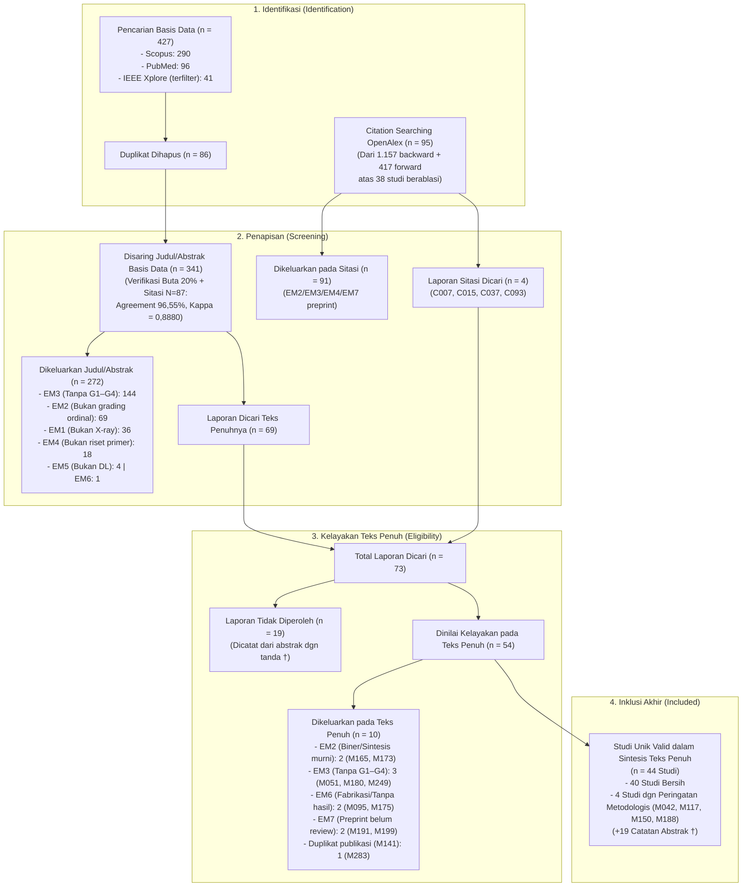

# BAB II: TINJAUAN PUSTAKA DAN SYSTEMATIC LITERATURE REVIEW METODOLOGIS (SLR-M)

Bab ini menguraikan landasan klinis penilaian radiografis Artritis Reumatoid (RA), karakteristik dataset benchmark yang digunakan, serta pelaksanaan dan hasil sintesis **Systematic Literature Review Metodologis (SLR-M)** periode 2021–2026 yang disusun mengikuti pedoman pelaporan **PRISMA 2020** [@Page2021PRISMA] dan **Synthesis Without Meta-analysis (SWiM)** [@Campbell2020SWiM]. Seluruh kandidat metode pada studi ablasi tesis ini (`RQ1–RQ5`) diturunkan secara objektif dari temuan empiris dan audit forensik pada SLR-M ini.

---

## 2.1 Landasan Klinis Skoring Erosi Tulang Artritis Reumatoid dan Dataset Benchmark

### 2.1.1 Sistem Skoring Sharp/van der Heijde (SvdH) dan Variabilitas Pengamat
Kerusakan struktural sendi pada pasien RA mencerminkan akumulasi proses inflamasi sinovial (*pannus*) yang menginvasi tulang subkondral (menyebabkan **erosi tulang kortikal**) dan merusak kartilago artikular (menyebabkan **penyempitan celah sendi** atau *joint space narrowing* [JSN]) [@vanderHeijde2000SvdH]. Sistem skoring **Sharp/van der Heijde (SvdH)** [@vanderHeijde2000SvdH] merupakan instrumen radiografis yang paling luas digunakan dalam uji klinis reumatologi. Pada radiograf tangan bilateral, skor erosi SvdH mengevaluasi 16 lokasi sendi per tangan (10 sendi MCP dan PIP jari ke-1 hingga ke-5, sendi IP ibu jari, serta 6 area tulang karpal/pergelangan tangan: *multangular, navicular, lunate, radius, ulna*, dan basis metakarpal I) [@vanderHeijde2000SvdH; @Yang2026RAMH1200].

Setiap sendi tangan diberi nilai **ordinal diskret $y \in \{0, 1, 2, 3, 4, 5\}$**:
- **Grade 0:** Normal, tidak tampak diskontinuitas kortikal.
- **Grade 1:** Erosi diskret berukuran kecil yang jelas memutus tepi kortikal tulang.
- **Grade 2–3:** Erosi yang lebih luas, dinilai berdasarkan proporsi permukaan sendi yang mengalami dekalsifikasi/kerusakan kortikal (masing-masing mencakup sekitar $<50\%$ dan $>50\%$ setengah permukaan sendi).
- **Grade 4–5:** Erosi masif yang meluas melewati lebih dari separuh permukaan tulang hingga destruksi atau kolaps komplit struktur sendi [@vanderHeijde2000SvdH].

Tantangan klinis utama dari metode SvdH terletak pada sifat ambang batas antara **Grade 0 (normal)** dan **Grade 1 (erosi dini)** serta antara grade menengah yang berdekatan. Karena erosi dini berukuran sangat kecil (sering kali $<1–2\text{ mm}$) dan sangat dipengaruhi oleh sedikit rotasi posisi tangan atau variasi kontras sinar-X, tingkat kesepakatan antarpembaca (*inter-reader reliability*) pada tingkat sendi tunggal jauh lebih rendah daripada korelasi skor total tingkat pasien (*Intraclass Correlation Coefficient* [ICC] atau *Pearson Correlation Coefficient* [PCC] skor total dapat mencapai $0,90–0,97$ [@M005], namun kesepakatan Cohen's/Quadratic Weighted Kappa [QWK] per sendi atau per grade ordinal berkisar antara $0,56–0,82$ [@M091; @M150; @Stolpovsky2023RheumaVIT]).

### 2.1.2 Perbandingan Dataset Radiografi Tangan RA (`RAM-H1200`, `RheumaVIT`, dan Dataset Publik Terkait)
Berbeda dengan domain osteoartritis lutut yang memiliki repositori raksasa seperti *Osteoarthritis Initiative* (OAI) dan *Multicenter Osteoarthritis Study* (MOST), ketersediaan dataset publik radiografi tangan RA dengan anotasi SvdH tingkat sendi sangat terbatas [@Yang2026RAMH1200; @Stolpovsky2023RheumaVIT]. **Tabel 2.1** merangkum perbandingan antara kohort internal tesis (**RAM-H1200** [@Yang2026RAMH1200]), kohort validasi eksternal utama (**RheumaVIT** [@Stolpovsky2023RheumaVIT]), serta dataset RA lain yang ditemukan dalam literatur SLR-M (`M003/M005`, `M100`, `M222`, `C007`).

**Tabel 2.1.** Perbandingan Karakteristik Dataset Radiografi Artritis Reumatoid dalam Tesis dan Literatur SLR-M.

| Nama Dataset / Studi Acuan | Institusi & Negara Asal | Ukuran Sampel (Citra / Sendi) | Granularitas Anotasi SvdH/mTSS | Keunggulan & Peran dalam Tesis |
|---|---|---|---|---|
| **RAM-H1200** [@Yang2026RAMH1200] | **6 Pusat Medis di Wilayah Sapporo, Jepang** | **1.200** radiograf tangan ($\pm 15.000+$ ROI sendi latih/uji; memiliki kunjungan longitudinal) | Skor erosi SvdH & JSN **per sendi**, kotak ROI sendi, segmentasi instans tulang, & **masker erosi tingkat piksel (*pixel-level BE masks*)** | **Kohort Pengembangan & Ablasi Internal Utama (`RQ0, RQ1, RQ2, RQ4, RQ5`)** serta uji diagnostik *shortcut learning* dengan masker erosi (`RQ3-05`). |
| **RheumaVIT** [@Stolpovsky2023RheumaVIT] | **V.A. Nasonova Research Institute of Rheumatology, Moskow, Rusia** | **330** radiograf tangan bilateral (2019–2022), **42 sendi** (21 per tangan) | Kotak pembatas 42 sendi + label erosi & JSN per sendi oleh **3 radiolog ahli independen** + konsensus | **Kohort Validasi Eksternal Lintas Populasi Utama (`RQ3`)** & jangkar evaluasi distribusi 3 radiolog (`RQ3-04`, `RQ5-E`). |
| **RAM-W600** [@Yang2026RAMH1200] | Multi-pusat, Jepang | **600** radiograf pergelangan tangan (*wrist*) | Segmentasi tulang karpal & skor erosi SvdH pergelangan tangan | Opsi eksplorasi generalisasi lintas-anatomi (`E6abl` / `RQ3`). |
| **Z. Wang 2022 (`ldy07/RA-Dataset`)** [@M003; @M005] | Publik (Tiongkok) | **3.818** (dibersihkan menjadi **2.849**) radiograf tangan bilateral | **Skor SvdH total per tangan** (0–280, regresi kontinu & 10 kelas keparahan); **tanpa** label per sendi | Digunakan pada `M003` dan `M005`; berpotensi untuk uji agregasi skor total tingkat tangan. |
| **RA2-DREAM (`CLEAR & TETRAD`)** [@C007] | Multi-pusat klinis, Amerika Serikat (Synapse `syn20545111`) | **367** pasien (**1.468** radiograf: 734 tangan, 734 kaki) | Skor SvdH erosi (0–5 tangan, 0–10 kaki) & JSN (0–4) per sendi | Digunakan pada `C007` (Tan et al., 2023); akses terbatas melalui kompetisi/DUA Synapse. |
| **Taipei VGH (`RA_PaperData`)** [@M222] | Taipei Veterans General Hospital, Taiwan | **823** radiograf tangan 12-bit (**24.690** ROI sendi dari 30 sendi/citra) | 3 kelas mTSS JSN (*Healthy* [0], *Mild* [1–2], *Severe* [3–4]) | Digunakan pada `M222` (Lien et al., 2025); kode & struktur model publik di GitHub. |
| **Düsseldorf Cohort** [@M100] | University Hospital Düsseldorf, Jerman | **300** radiograf tangan bilateral dari **119** pasien (**9.600** sendi) | Skor erosi SvdH 0–5 pada 32 sendi tangan/pergelangan tangan (75,26% Grade 0) | Digunakan pada `M100` (adakan split tingkat pasien: 83 latih / 12 val / 24 uji); dataset privat. |

Sebagaimana terlihat pada **Tabel 2.1**, pasangan **`RAM-H1200` (Jepang) $\to$ `RheumaVIT` (Rusia)** menyediakan skenario pengujian generalisasi lintas benua yang sangat ideal karena memadukan: (1) anotasi ROI sendi dan masker erosi piksel pada kohort sumber, dengan (2) anotasi 3 radiolog independen pada kohort target eksternal.

---

## 2.2 Metodologi *Systematic Literature Review* Metodologis (SLR-M)

### 2.2.1 Rasional dan Pertanyaan Tinjauan
Karena literatur *deep learning* yang spesifik membahas grading erosi RA tingkat sendi masih sangat sedikit, SLR-M memperluas ruang lingkup pencarian ke seluruh tugas **grading keparahan ordinal radiografi konvensional muskuloskeletal** (meliputi Kellgren-Lawrence [KL 0–4] dan OARSI pada osteoartritis lutut, tangan, atau pinggul, serta SvdH/mTSS pada RA) yang dipublikasikan pada periode **2021–2026**. Pertanyaan utama SLR-M adalah:

> *"Metode deep learning apa saja yang digunakan dalam empat kelompok metodologi—(**G1**) Pre-training & Self-Supervised Learning, (**G2**) Penanganan Class Imbalance & Ordinalitas, (**G3**) Kalibrasi, Kuantifikasi Ketidakpastian & Prediksi Selektif, serta (**G4**) Mitigasi Derau Label & Teacher-Student—untuk meningkatkan kinerja grading ordinal radiografi muskuloskeletal, seberapa besar efek terablasinya terhadap baseline pada split yang sama, dan apakah peningkatan tersebut teruji pada kohort eksternal?"*

### 2.2.2 Kriteria Kelayakan, Sumber Pencarian, dan Kode Eksklusi
Sesuai protokol PRISMA-P (`protocol/01_protocol_PRISMA-P.md`), studi dinyatakan layak (*eligible*) apabila: (1) terbit tahun 2021–2026 dalam bahasa Inggris sebagai artikel jurnal atau prosiding konferensi penuh yang telah melalui *peer-review*, (2) menggunakan modalitas radiografi konvensional (X-ray), (3) mengerjakan tugas grading/klasifikasi keparahan ordinal multi-derajat per sendi atau per citra (bukan sekadar deteksi biner sehat vs. sakit), (4) menerapkan minimal satu metode dari kelompok `G1–G4`, dan (5) melaporkan evaluasi kuantitatif. Tujuh kode alasan eksklusi ditetapkan secara ketat:
- **`EM1`:** Modalitas bukan radiografi polos (misalnya hanya MRI, CT, USG, DXA, atau termografi).
- **`EM2`:** Tugas bukan grading ordinal multi-kelas (misalnya hanya klasifikasi biner `KL01 vs KL234`, hanya segmentasi, deteksi fraktur, atau evaluasi kualitas citra sintetis tanpa classifier hilir).
- **`EM3`:** Tidak menerapkan metode `G1–G4` yang dianalisis (misalnya hanya memakai inisialisasi ImageNet standar dan Cross-Entropy sebagai *default* tanpa modifikasi/ablasi metode `G1–G4`).
- **`EM4`:** Bukan riset primer (artikel *review*, editorial, surat, atau studi yang ditarik/*retracted*).
- **`EM5`:** Bukan model *deep learning*.
- **`EM6`:** Tanpa hasil evaluasi kuantitatif yang valid (atau terbukti memuat fabrikasi hasil).
- **`EM7`:** Di luar rentang tahun, bahasa, atau tipe publikasi (termasuk naskah *preprint* arXiv yang belum melalui *peer-review*).

Pencarian dilakukan pada tiga basis data utama: **Scopus** (`290` rekaman), **PubMed/MEDLINE** (`96` rekaman), dan **IEEE Xplore** (`310` rekaman awal; `41` rekaman relevan setelah deduplikasi DOI terhadap Scopus dan penyaringan blok `DL + G1–G4`), ditambah satu putaran *backward and forward citation searching* menggunakan OpenAlex API terhadap 38 studi berablasi (`1.157` sitasi mundur + `417` sitasi maju $\to$ `95` kandidat baru setelah filter tugas dan modalitas).

### 2.2.3 Instrumen Penilaian Kualitas Bukti Enam Butir (`Q1–Q6`)
Mengingat tujuan SLR-M adalah mengevaluasi klaim peningkatan metodologis (bukan akurasi diagnostik klinis tunggal seperti pada QUADAS-2), setiap studi dinilai menggunakan **Checklist Kualitas Metodologis 6 Butir (`Q1–Q6`)**:
1. **`Q1_abl` (Ablasi Terkontrol):** Apakah kontribusi metode `G1–G4` diuji terhadap baseline tanpa metode tersebut pada *split* dan resep pelatihan yang identik?
2. **`Q2_runs` (Multi-Run / Estimasi Varians):** Apakah hasil dilaporkan lintas $>1$ *random seed* / lipatan *cross-validation* (dengan SD/SE) atau dilengkapi interval kepercayaan (*bootstrap CI*)?
3. **`Q3_patient` (Split Tingkat Pasien):** Apakah pemisahan data *train/validation/test* dijamin pada tingkat pasien/subjek sehingga tidak ada citra kontralateral atau kunjungan berulang dari pasien yang sama yang bocor antar-partisi?
4. **`Q4_valsel` (Seleksi Hiperparameter di Validasi):** Apakah pemilihan *checkpoint*, hiperparameter, atau ambang keputusan dilakukan murni pada himpunan validasi tanpa mengintip himpunan uji?
5. **`Q5_ext` (Validasi Eksternal):** Apakah model diuji pada kohort rumah sakit, pusat akuisisi, atau dataset independen di luar kohort pelatihan?
6. **`Q6_code` (Ketersediaan Kode/Bobot Publik):** Apakah repositori kode sumber atau bobot model pra-latih tersedia secara publik?

### 2.2.4 Verifikasi Antar-Penilai (*Blinded Verification*) dan Alur PRISMA 2020
Untuk menjamin objektivitas dan menanggulangi keterbatasan peninjau tunggal, protokol verifikasi tiga lapis (`verification/04_verification_report.md`) telah dijalankan:
1. **Verifikasi Buta (*Blind Verification*) Screening Judul/Abstrak ($N = 87$):** Sampel acak 20% rekaman basis data ($n = 68$) ditambah 19 rekaman *citation searching* dinilai secara buta tanpa akses ke kunci awal. Kesepakatan keseluruhan mencapai **96,55% (84/87)** dengan **Cohen's $\kappa = 0,8880$** (*almost perfect agreement*, melampaui ambang batas protokol $\ge 0,80$) dan **PABAK $= 0,9310$**. Sensitivitas penapisan awal terhadap inklusi auditor adalah **100,0% (15/15, nol *false negative*)**. Tiga ketidaksepakatan biner (`M173, M199, M222`) diselesaikan melalui pemeriksaan naskah lengkap: `M173` [@M173] terkonfirmasi eksklusi `EM2` (murni evaluasi fidelitas GAN tanpa classifier grading), `M199` [@M199] terkonfirmasi eksklusi `EM7` (preprint arXiv anonim belum peer-review), sementara `M222` [@M222] terkonfirmasi inklusi `G2` karena memuat ablasi eksplisit *downsampling* vs. `WeightedRandomSampler` + *class-weighted CE* pada Tabel 2 teks penuhnya.
2. **Verifikasi Matriks Ekstraksi 17 Studi Prioritas A ($204$ Sel):** Pemeriksaan langsung terhadap PDF/XML penuh menghasilkan tingkat kesepakatan langsung **88,73% (181/204 sel)** dan akurasi faktual pada sel yang telah diekstraksi sebesar **95,26% (181/190 sel)**, sekaligus melengkapi 14 sel yang sebelumnya berstatus belum terambil (`U` / *numbers not extracted*) dan mengoreksi 9 ketidakakuratan angka/atribut (`verification/02_extraction_check.csv`).
3. **Audit Kelayakan Penuh atas Seluruh 54 Berkas Teks Penuh (`verification/03_fulltext_criteria_verification.csv`):** Dari 73 laporan kandidat (69 basis data + 4 sitasi), 19 laporan tidak dapat diperoleh karena kendala akses langganan (`papers/00_TODO_user_download.md`, dicatat terpisah dari abstrak dengan tanda †), dan **54 laporan dinilai pada teks penuh**. Pemeriksaan naskah lengkap mengeluarkan **10 berkas** (`Tabel 2.2`) dan mempertahankan **44 studi unik terverifikasi** (`40` studi bersih + `4` studi dengan bendera peringatan metodologis `M042, M117, M150, M188`).

**Tabel 2.2.** Rincian Alasan Eksklusi 10 Berkas pada Tahap Pemeriksaan Teks Penuh (`verification/04_verification_report.md` §4.1).

| ID Studi | Sitasi & Tahun | Kode Eksklusi | Alasan Objektif Berdasarkan Pemeriksaan Naskah Lengkap (`papers/`) |
|---|---|---|---|
| **`M165`** | [@M165] (2022) | `EM2` | Meskipun menguji augmentasi WGAN-GP pada 14.148 radiograf lutut, pemeriksaan §2 (hlm. 5) dan Tabel 6 membuktikan lapisan keluaran jaringan hanya memiliki 1 unit *sigmoid* yang melakukan **klasifikasi biner (`KL01` vs. `KL234`)**, bukan grading multi-derajat. |
| **`M173`** | [@M173] (2026) | `EM2` | Hanya mengevaluasi fidelitas visual citra sintetis (`StyleGAN3`, `Stable Diffusion + CycleGAN`, `DCGAN`) menggunakan FID, *Visual Turing Test*, dan sudut JLCA tanpa pernah melatih atau menguji classifier grading KL (diakui di hlm. 123). |
| **`M051`** | [@M051] (2025) | `EM3 / EM6` | Seluruh 4 backbone CNN selalu dibekukan (*frozen*) tanpa ablasi strategi *freezing/fine-tuning* (`G1`), hanya merotasi fungsi aktivasi (`Swish, ReLU, ELU`), dan Tabel I hanya melaporkan akurasi latih/validasi tanpa hasil himpunan uji. |
| **`M180`** | [@M180] (2026) | `EM3` | Tabel 1 (hlm. 9) mengonfirmasi model dilatih dari inisialisasi acak dengan *Categorical Cross-Entropy* standar dan optimasi metaheuristik SBOA tanpa satu pun metode `G1–G4` (serta memuat persamaan matematis yang rusak di §3.2–3.5). |
| **`M249`** | [@M249] (2024) | `EM3` | Melatih satu model standar `EfficientNetV2-M` dengan Cross-Entropy pada 18 transformasi pemotongan/penghapusan ROI untuk mendiagnosis *shortcut learning* pada Grad-CAM; tidak mengusulkan metode `G1–G4` untuk meningkatkan grading (namun diadopsi sebagai protokol uji diagnostik pada `RQ3-05`). |
| **`M095`** | [@M095] (2026) | `EM6 (Fabrikasi)` | **Terbukti naskah hasil fabrikasi LLM:** Tabel 11 (hlm. 883) memuat placeholder prompt yang belum diganti (`"[X] ... [ F ]"`, `"[X] ... [ TMI ]"`), §6.9 (hlm. 882) mengakui panel gambar adalah *"synthetic illustrative mockups"*, dan Tabel 9 mengklaim adaptasi BatchNorm saat uji mengurangi jumlah parameter model dari 31,8M menjadi 30,4M. |
| **`M175`** | [@M175] (2025) | `EM6 (Fabrikasi)` | Bagian *Result Analysis* (§V hlm. 808) kosong dari tabel, grafik, maupun angka eksperimen dan ditulis dalam bentuk kalimat rencana masa depan (*"Accuracy... will be computed"*), namun §VI tiba-tiba mengklaim akurasi `98,97%`. |
| **`M191`** | [@M191] (2025) | `EM7 + EM2/EM3` | Naskah di `papers/M191.pdf` adalah preprint arXiv (`arXiv:2311.05798v1`) yang menggunakan translasi `CycleGAN` semata-mata sebagai serangan adversarial 1-shot untuk mengecoh classifier 3-kelas tetap, bukan untuk meningkatkan grading. |
| **`M199`** | [@M199] (2025) | `EM7` | Naskah kiriman konferensi anonim di arXiv (`arXiv:2502.01972v1`, penulis `"Anonymous"`, hlm. 9 menulis *"If a paper is accepted..."*) yang belum melalui proses *peer-review* pada versi yang diunduh. |
| **`M283`** | [@M283] (2025) | `Duplikat M141` | Merupakan publikasi ulang dari studi *KneeXNeT* yang metode, gambar (Figs. 1–5), dan angka tabelnya identik kata demi kata dengan **`M141`** [@M141]; dihitung satu kali sebagai `M141`. |

---

## 2.3 Sintesis Terstruktur Empat Kelompok Metode (`G1–G4`)

Mengikuti pedoman **SWiM** [@Campbell2020SWiM], karena heterogenitas arsitektur tulang punggung, definisi partisi data, serta metrik pelaporan tidak memungkinkan meta-analisis efek tunggal yang bermakna, sintesis disajikan secara terstruktur per kelompok metodologi (`G1–G4`) dengan mengelompokkan studi menurut **keluarga metode**, **arah dan besaran efek terhadap baseline yang sebanding (`Q1_abl`)**, serta **kualitas bukti (`Q1–Q6`)**.

### 2.3.1 Kelompok G1: Pre-training, Transfer Learning, dan Self-Supervised Learning (SSL)
Kelompok `G1` mencakup 15 studi teks penuh terverifikasi (`M003, M005, M015, M071, M091, M141, M153, M157, M161, M185, M197, M201, M219, M306, M335`) ditambah 5 rekaman abstrak (`M014†, M082†, M083†, M166†, M280†`). Lima temuan metodologis utama muncul dari sintesis kelompok ini (**Tabel 2.3**):

1. **Keunggulan *Domain-Specific MSK Foundation Model* vs. Kelemahan *Frozen General-Medical Embeddings*:**
   - **`M015`** [@M015] (*SKELEX*, *npj Digital Medicine* 2026) melatih *Masked Autoencoder* (`ViT-Large` [@He2022MAE]) secara berkelanjutan pada **1,29 juta radiograf muskuloskeletal tanpa label (`SNUH-1M`)** dan mengevaluasinya pada 12 tugas hilir (termasuk grading KL OA lutut $n=8.260$) dengan pemisahan tingkat pasien yang ketat (`Q3_patient = Y`) dan 5.000 *bootstrap CI*. Dibandingkan dengan inisialisasi `ViT-MAE` ImageNet-1K di bawah protokol pelatihan yang identik, `SKELEX` memberikan peningkatan relatif rata-rata **`+6,21%`** serta mengungguli model pra-latih medis umum (`Radio-DINO`), dengan keuntungan paling menonjol pada rezim fraksi label rendah (10%–25%).
   - Sebaliknya, **`M157`** [@M157] (44.985 radiograf lutut OAI dari 4.508 pasien, *strict patient-level split*, 1.000 *bootstrap CI*) membuktikan bahwa penggunaan **embedding beku (*frozen embeddings*)** dari foundation model medis umum (`BiomedCLIP` dan `RAD-DINO`) yang dipasangkan dengan classifier `XGBoost`/MLP **kalah jauh** dibandingkan *end-to-end fine-tuning* CNN standar (`ConvNeXt-Small` mencapai $\text{QWK} = 0,880 [0,871–0,888]$, $\text{Acc} = 70,4\%$; `ResNet-18` mencapai $\text{QWK} = 0,874$, sedangkan `BiomedCLIP` beku hanya mencapai $\text{QWK} = 0,524$ dan `RAD-DINO` beku $\text{QWK} = 0,521$). Temuan gabungan `M015` dan `M157` menegaskan bahwa bobot pra-latih domain medis **wajib di-*fine-tune*** (misalnya dengan *Layer-wise Learning Rate Decay* [`LLRD`] atau *Linear-Probe then Fine-Tune* [`LP-FT`]), bukan sekadar dibekukan.
2. **Efektivitas *Intermediate Supervised Transfer Learning* pada Anatomi Tangan:**
   - Pada domain spesifik RA, **`M005`** [@M005] menunjukkan bahwa melakukan *transfer learning* bertahap dari `ImageNet` $\to$ **dataset publik radiograf tangan `RSNA Pediatric Bone Age` ($n = 14.036$)** $\to$ `RA SvdH` (dengan berbagai skema *layer unfreezing* dan *stacking ensemble*) berhasil mencapai korelasi Pearson **$\text{PCC} = 0,925$** dan $\text{RMSE} = 18,02$, menyamai tingkat kesepakatan antar-radiolog manusia ($\text{PCC} = 0,97, \text{RMSE} = 18,75$). Karena `RSNA Bone Age` terdiri atas radiograf tangan berjumlah besar dan terbuka untuk umum, pendekatan ini menawarkan jembatan representasi anatomi tangan yang sangat murah bagi `RAM-H1200`.
3. **Pembelajaran Kontras Terbimbing Sadar-Jarak Ordinal (*Distance-Weighted Supervised Contrastive Learning*):**
   - Standar *Supervised Contrastive Learning* (`SupCon` [@Khosla2020SupCon]) menarik sampel sekelas dan menolak seluruh kelas lain dengan bobot yang sama. **`M219`** [@M219] memperbaiki kelemahan ini untuk skala keparahan ordinal dengan memperkenalkan **bobot negatif yang proporsional terhadap jarak grade $|y_i - y_j|$** yang dipadukan dengan regularisasi *Earth Mover's Distance* (EMD), sehingga meningkatkan `QWK` lintas-dataset dari `0,678` menjadi **`0,732`** dan menurunkan `MAE` dari `0,598` menjadi **`0,525`**. Pendekatan serupa pada abstrak `M082†` [@M082], `M166†` [@M166], dan `M280†` [@M280] mengonfirmasi bahwa representasi kontras memperjelas batas antara grade normal (`0`) dan erosi/OA dini (`1–2`).
4. **SSL Berbasis Normalitas (*Anomaly-Inspired SSL*) untuk Dataset yang Didominasi Kelas Sehat:**
   - **`M197`** [@M197] (*SS-FewSOME*, *Artificial Intelligence in Medicine* 2025) memanfaatkan fakta bahwa citra sendi sehat (`Grade 0`) sangat melimpah: model dilatih secara *self-supervised* hanya menggunakan $<3\%$ citra lutut sehat untuk mempelajari pusat hipersfer representasi "normal", di mana jarak fitur suatu sendi terhadap pusat normal langsung merepresentasikan skor keparahan penyakit kontinu. Pada *patient-level split* lintas 5 *random seeds*, pendekatan ini melesatkan AUROC deteksi OA dari `56,7%` menjadi **`81,0%` (+24,3 poin)** dan memiliki kode sumber publik.
5. **Penyelarasan Progresi Longitudinal (`TCN + MMD`) dan *Pretext Task* Anatomis Gratis:**
   - **`M335`** [@M335] (CVPR 2022) melatih `Self-supervised ViT (SiT)` dengan rekonstruksi bercak terkorupsi + kontras SimCLR pada 23.008 citra lutut, lalu menyelaraskan fitur citra tunggal ke representasi progresi penyakit longitudinal dari *Temporal ConvNet* (`TCN`) menggunakan *Maximum Mean Discrepancy* (`MMD`). Saat inferensi (yang hanya membutuhkan satu citra tunggal), penyelarasan temporal ini menaikkan *Balanced Accuracy* dari `0,7850` menjadi **`0,8216`** dan Kappa dari `0,6492` menjadi **`0,7357`**, serta mengalahkan CORAL dan KL-divergence pada ablasi fungsi penyelarasan.
   - **`M153`** [@M153] (*Computers in Biology and Medicine* 2023) menggabungkan rekonstruksi *Dual-Channel Adversarial Autoencoder* (`DC-AAE`) dengan tugas bantu (*pretext task*) gratis berupa identifikasi sisi anatomi (lutut kiri vs. kanan), yang memberikan kenaikan akurasi terablasi dari `73,00%` menjadi **`75,53%`** pada 5-fold CV tingkat subjek. Untuk `M003` [@M003], cabang bantu *Dense Relative Localization* (`Drloc`) menurunkan RMSE SvdH total dari `19,69` menjadi `17,60`.

**Tabel 2.3.** Sintesis Bukti Terverifikasi Kelompok G1 (Pre-training, Transfer Learning, dan Self-Supervised Learning).

| Keluarga Metode G1 | Studi Terverifikasi | Desain & Temuan Ablasi Kunci terhadap Baseline | Kualitas (`Q1/Q2/Q3/Q5/Q6`) | Implikasi untuk `RQ1` Tesis |
|---|---|---|---|---|
| **Foundation Model MSK Spesifik-Domain (`MAE`)** | `M015` [@M015] | `SKELEX` (`ViT-L` MAE pada 1,29 juta X-ray MSK) unggul rata-rata **`+6,21%`** atas inisialisasi `ImageNet-MAE` dengan protokol identik; gain terbesar pada label 10%–25%. | `Y / Y / Y / Y / Y` | Diuji sebagai `RQ1-11` (`Linear Probe` & `Fine-Tune + LLRD` setelah uji memori 1 epoch). |
| **Embedding Foundation Model Medis Beku** | `M157` [@M157] | Embedding beku `BiomedCLIP` (`QWK 0,524`) & `RAD-DINO` (`QWK 0,521`) + XGBoost/MLP **kalah telak** dari `ConvNeXt-S` (`QWK 0,880`) & `ResNet-18` (`QWK 0,874`) yang di-*fine-tune*. | `Y / Y / Y / N / N` | Bukti negatif penting: foundation model tidak boleh hanya dibekukan; diuji *fine-tuning* di `RQ1-10` & `RQ1-13`. |
| **Transfer Bertahap Anatomi Tangan (`Bone Age`)** | `M005` [@M005] | `ImageNet` $\to$ `RSNA Bone Age` ($n=14.036$) $\to$ `RA SvdH` mencapai `PCC 0,925, RMSE 18,02` (mendekati kesepakatan antar-radiolog `PCC 0,97`). | `Y / N / N / N / N` | Diadopsi sebagai kandidat Prioritas A (`RQ1-07`) karena kesamaan anatomi radiograf tangan. |
| **Supervised Contrastive Sadar-Jarak Ordinal** | `M219` [@M219], (`M082†, M166†, M280†`) | `SupCon` lintas-domain dengan negatif berbobot jarak KL + EMD menaikkan `QWK` dari `0,678` ke **`0,732`** dan menurunkan `MAE` `0,598` $\to$ `0,525`. | `Y / N / U / Y / N` | Diadopsi dan dimodifikasi untuk ROI sendi sebagai `RQ1-08` (dan untuk adaptasi domain di `RQ3-03`). |
| **SSL Berbasis Normalitas (`Grade 0` Center)** | `M197` [@M197] | `SS-FewSOME` (dilatih hanya pada $<3\%$ sendi sehat + pseudo-label) meningkatkan AUROC deteksi OA `56,7%` $\to$ **`81,0%`** (5 seed $\pm$ SD). | `Y / Y / Y / N / Y` | Diadopsi sebagai `RQ1-09`: memanfaatkan dominasi sendi `Grade 0` pada `RAM-H1200`. |
| **Penyelarasan Temporal (`TCN + MMD`) & Pretext Spasial** | `M335` [@M335], `M153` [@M153], `M003` [@M003], `M185` [@M185] | `M335`: penyelarasan MMD ke sekuens kunjungan menaikkan `BA 0,785` $\to$ `0,822`, `Kappa 0,649` $\to$ `0,736`. `M153`: tugas bantu sisi anatomi `+2,53%` akurasi. `M003`: `Drloc` menurunkan RMSE `-7,4%`. | `M335: Y/Y/U/N/N` `M153: Y/Y/Y/Y/N` | `M335` menjadi kandidat `RQ1-12` (alternatif `ChronoCon` tanpa paksaan monotonik per sendi). |
| **Vision-Language Pre-training / Fine-tuning (`CLIP`)** | `M201` [@M201], `M306` [@M306], `M071` [@M071] | `M201`: fine-tuning CLIP + templat teks KL mencapai akurasi eksternal **`76,94%`** vs. ViT `73,7%` & ResNet50 `68,3%`. `M306`: VLP + *hard negative captions* menaikkan *zero-shot* `45%` $\to$ `55%`. | `M201: Y/N/N/Y/N` `M306: Y/N/U/N/N` | Dicatat sebagai kandidat eksploratif (`C`) dan landasan distilasi teks. |

---

### 2.3.2 Kelompok G2: Penanganan Ketidakseimbangan Kelas (*Class Imbalance*) dan Keparahan Ordinal
Kelompok `G2` merupakan kelompok terbesar dalam SLR-M, mencakup 30 studi teks penuh (25 studi valid + 5 studi yang dieksklusi/diperingatkan karena kebocoran pra-split) dan 12 rekaman abstrak. Sintesis bukti terverifikasi (**Tabel 2.4**) mengungkap temuan kunci berikut:

1. **Dekomposisi *Data-Level Oversampling* vs. *Loss-Level Class Weighting* (Mengapa Keduanya Harus Diuji Terpisah):**
   - Pada studi yang paling dekat secara anatomis dengan tesis kita—yaitu **`M041`** [@M041] (grading KL 0–4 pada ROI sendi jari DIP osteoartritis tangan, *strict patient-level split*, 6 lengan $\times$ 3 run)—penulis mengablasi *Oversampling* murni (`OS-only`, menggandakan KL3 $\times 5$ dan KL4 $\times 10$), *Focal Loss* murni (`FL-only`), dan data sintetis `CycleGAN` yang divalidasi reumatolog (`SD`). Hasilnya membuktikan bahwa **`OS-only` adalah strategi tunggal paling konsisten**: meningkatkan F1 kelas minoritas `KL3` dari `0,280 ± 0,062` menjadi **`0,447 ± 0,061` ($p = 0,015$)**, F1 `KL4` dari `0,573` menjadi **`0,750`** (recall `93,3%`), dan F1 OA dari `0,416` menjadi **`0,588` ($p = 0,031$)**.
   - Pada domain RA tangan, **`M222`** [@M222] (24.690 ROI sendi dari 823 radiograf tangan) melakukan ablasi faktorial $2 \times 3$ yang membandingkan *complete downsampling* (500 ROI/kelas) melawan `WeightedRandomSampler` + *class-weighted CE* lintas 3 arsitektur (`ViT`, `EfficientNetV2`, dan `EfficientNetV2 + Attention`), di mana strategi berbobot melesatkan *Macro Accuracy* dari `53%` $\to$ **`80%`** (ViT), `48%` $\to$ **`86%`** (EfficientNetV2), dan `72%` $\to$ **`88%`** (EfficientNetV2 + Attention). Demikian pula **`C093`** [@C093] (1.000 *bootstrap CI*) membuktikan bahwa `WeightedRandomSampler` di atas Focal Loss meningkatkan sensitivitas kelas menengah `G2` dari `63,31%` menjadi **`75,80%`** dan Macro-Recall dari `79,92%` menjadi `81,26%`.
   - **Temuan Peringatan Kritis dari `M071` [@M071]:** Pada Tabel 4 (hlm. 15) `M071`, ketika penulis menambahkan *class weighting* `[1.0, 1.5, 1.5, 1.0, 1.0]` secara langsung di atas kepala ordinal `ViT-CORAL`, **Macro-F1 justru anjlok sebesar `-5,0%` (`68,60%` $\to$ `63,60%`)** akibat pembengkakan *false positive* pada kelas tengah (`KL1/KL2`), sebelum akhirnya dipulihkan oleh distilasi pengetahuan dan penyetelan ambang validasi! Bukti kontras antara `M041/M222` dan `M071` ini menjadi alasan ilmiah utama mengapa lengan `B1` di tesis wajib dipecah menjadi **`Oversampling Murni (RQ2-03)`** dan **`Class Weight Murni (RQ2-04)`**.
2. **Perilaku Komplementer *Focal Loss* dan *Focal Ordinal Loss* (`FOL`):**
   - Verifikasi teks penuh pada **`M041`** [@M041] (Tabel 4 & 6) mengoreksi persepsi awal tentang *Focal Loss* [@Lin2017Focal]: lengan `FL-only` ($\gamma = 2,94$) sebenarnya mencapai **recall `KL3` tertinggi di antara seluruh lengan tunggal (`0,510` vs. baseline `0,203`, F1 `0,427` vs. `0,280`)**, tetapi lemah pada kelas ambang `KL1` (`F1 0,167` vs. `0,267`) dan kelas ekstrem `KL4`. Ketika `Focal Loss` digabungkan dengan *oversampling* (`SD + OS + FL`), F1 `KL3` mencapai nilai tertinggi **`0,527 ± 0,051` ($p = 0,048$)**.
   - **`M132`** [@M132] menggabungkan penalti jarak ordinal tetap (*Fixed-Penalty Loss*, FPL) dengan pembobotan dinamis *Focal Loss* menjadi **Focal Ordinal Loss (`FOL`)**. Diuji pada 6 arsitektur CNN $\times$ 10 ulangan independen, `FOL` secara konsisten menurunkan *Mean Squared Error* (MSE) sebesar **12,11%–18,82%** dan menaikkan QWK dibanding CE maupun FPL (mis. pada `ResNet-18`: MSE turun dari `0,678 ± 0,045` [CE] menjadi **`0,598 ± 0,048`** [FOL], dan Kappa naik dari `0,774 ± 0,014` menjadi **`0,794 ± 0,097`**). Pada erosi tangan RA, **`M100`** [@M100] memadukan Focal Loss dengan *Adaptive IoU Thresholding* pada RetinaNet (split tingkat pasien), meningkatkan mAP dari `0,25` menjadi **`0,81 ± 0,18`** dan korelasi peringkat Kendall's $\tau = 0,92$.
3. **Konsistensi Tinggi Kepala Regresi Ordinal (*Cumulative-Link*, `CORN`, `CORAL`, dan *Distance-Penalty*):**
   - **`M089`** [@M089] mengevaluasi **Ordinal Regression Module (`ORM`)** berbasis model *Cumulative-Link* (mengeluarkan 1 logit skalar tunggal $f(x) \in \mathbb{R}$ yang dibandingkan terhadap $K-1$ *cut-points* terurut $\theta_1 < \theta_2 < \dots < \theta_{K-1}$) lintas **21 arsitektur CNN** pada himpunan uji OAI ($n = 1.656$). Penggantian kepala CE standar dengan `ORM + Cumulative-Link loss` **memperbaiki MAE dan QWK pada seluruh 21 dari 21 jaringan (100% konsisten)**, dengan rata-rata kenaikan $\Delta\text{QWK} = +0,0441$ (rentang $+0,0183$ hingga $+0,0825$). Khusus pada arsitektur rujukan tesis kita (**`ResNet-34`**), `ORM` menurunkan MAE dari `0,444` menjadi **`0,389`** dan meningkatkan QWK dari `0,7704` menjadi **`0,8314` (+0,0610)**!
   - **`M091`** [@M091] mengablasi fungsi rugi **CORN** (*Conditional Ordinal Regression for Neural Networks* [@Shi2023CORN]) melawan Cross-Entropy lintas 4 arsitektur Vision Transformer (`ViT-B/16`, `Swin-L`, `PCPVT-L`, `DaViT`) dengan uji ANOVA dan Tukey HSD: `CORN` meningkatkan akurasi dan QWK secara signifikan ($p < 0,05$) pada keempat model (mis. `ViT`: akurasi `73%` $\to$ **`83%`**, Kappa `0,86` $\to$ **`0,92`**; `DaViT`: akurasi `89%` $\to$ **`93%`**, Kappa `0,96`).
   - **`M039`** [@M039] membuktikan bahwa mengganti kepala ordinal **CORAL** [@Cao2020CORAL] kembali menjadi Cross-Entropy menurunkan QWK sebesar **`-0,068` ($p < 0,001$)**.
   - **`M305`** [@M305] melakukan ablasi terkontrol $8 \times 2$ antara Cross-Entropy dan **Distance-Weighted Ordinal Loss** (matriks penalti $5 \times 5$ proporsional terhadap jarak kelas) lintas 8 arsitektur (`ResNet-152`, `DenseNet-201`, `EfficientNet-B0/B7`, `ConvNeXt V1/V2`, `ResNeXt50`): loss ordinal meningkatkan Macro-F1 dan menurunkan MAE pada **8 dari 8 arsitektur** (mis. `EfficientNet-B7` Macro-F1 `68,23%` $\to$ `71,25%`, MAE `0,36` $\to$ `0,32`). Sementara itu, abstrak **`M266†`** [@M266] dan preprint **`C047`** menunjukkan bahwa **Soft Label Ordinal** (distribusi Beta, Binomial, atau Gaussian di sekitar grade benar) secara konsisten mengungguli target *one-hot* nominal.
4. **Intervensi Pasca-Latih Tanpa Biaya Pelatihan Ulang (`Threshold Tuning`, `FAISS k-NN`, dan `TTA`):**
   - **`M161`** [@M161] (*KneeRAC*) membuktikan bahwa mengambil embedding dari backbone beku dan menggabungkannya dengan konteks $k=25$ tetangga terdekat menggunakan indeks **FAISS k-NN** meningkatkan akurasi 5-fold CV pada **13 dari 17 arsitektur** (mis. `EfficientNet-B0` naik dari `83,51%` menjadi **`86,81%`**).
   - **`C093`** [@C093] membuktikan bahwa **Test-Time Augmentation (`TTA`)** meningkatkan akurasi uji secara konsisten di seluruh model dan skema sampling (`ConvNeXt-Tiny` mencapai `83,8%`), sedangkan penggabungan *weighted ensemble* tidak memberikan keunggulan yang signifikan secara statistik di atas model tunggal terbaik berdasarkan 1.000 *bootstrap 95% CI*.
   - **`M071`** [@M071] dan **`M052†`** [@M052] menunjukkan bahwa menyetel ambang keputusan (*decision thresholds*) pada himpunan validasi secara langsung meningkatkan Macro-F1 tanpa perlu melatih ulang jaringan.

**Tabel 2.4.** Sintesis Bukti Terverifikasi Kelompok G2 (Penanganan Ketidakseimbangan Kelas dan Keparahan Ordinal).

| Keluarga Metode G2 | Studi Terverifikasi | Desain & Temuan Ablasi Kunci terhadap Baseline | Kualitas (`Q1/Q2/Q3/Q5/Q6`) | Implikasi untuk `RQ2` Tesis |
|---|---|---|---|---|
| **Dekomposisi `Oversampling` vs. `Class Weighting`** | `M041` [@M041], `M071` [@M071], `M141` [@M141], `M222` [@M222], `C093` [@C093] | `M041` (DIP tangan): `OS-only` menaikkan `KL3 F1 0,280 -> 0,447` ($p=0,015$) & `OA F1 0,416 -> 0,588` ($p=0,031$). `M222` (RA mTSS): `WeightedSampler + CW-CE` menaikkan Macro-Acc `+16%` s/d `+38%`. **Tetapi `M071`:** `CW` di atas CORAL menurunkan Macro-F1 **`-5,0%`**. | `M041: Y/Y/Y/N/N` `M222: Y/N/U/N/Y` `C093: Y/Y/N/N/Y` | Memecah `B1` menjadi `RQ2-03 (OS-only)` dan `RQ2-04 (CW-only)`. |
| **`Focal Loss` & `Focal Ordinal Loss (FOL)`** | `M132` [@M132], `M041` [@M041], `M100` [@M100], `C093` [@C093] | `M132` (6 CNN $\times$ 10 run): `FOL` menurunkan MSE 12–19% & menaikkan Kappa `0,774 -> 0,794`. `M041`: `FL-only` terbaik di recall KL3 (`0,510`), dan `OS + FL` mencapai `KL3 F1 0,527` ($p=0,048$). | `M132: Y/Y/U/N/N` `M100: Y/U/Y/N/N` | Diuji sebagai `RQ2-08 (Focal / FOL)` dan `RQ2-09 (Focal + Oversampling)`. |
| **Kepala *Cumulative-Link* (`ORM`)** | `M089` [@M089] | `ORM + Cumulative-Link loss` memperbaiki QWK & MAE pada **21/21 jaringan CNN** (rata-rata $\Delta\text{QWK} = +0,0441$; pada `ResNet-34` QWK `0,7704 -> 0,8314`). | `Y / N / U / N / N` | Kandidat Prioritas A (`RQ2-10`): hanya mengganti lapisan proyeksi akhir. |
| **Kepala `CORN`, `CORAL`, & *Distance-Penalty / Soft Label*** | `M091` [@M091], `M039` [@M039], `M305` [@M305], `C015` [@C015], (`M266†, C047`) | `M091`: `CORN` > CE di 4/4 ViT ($p<0,05$). `M039`: `CORAL` > CE (`+0,068` QWK, $p<0,001$). `M305`: *Distance-Penalty* > CE di 8/8 backbone. (`C015` multi-head memiliki `Q1_abl = N`). | `M091: Y/N/N/Y/N` `M039: Y/Y/U/Y/N` `M305: Y/N/U/N/N` | Melengkapi `B0/B3/B4` dengan `RQ2-11` (*Distance-Penalty & Soft Label Ordinal*) dan `RQ2-12` (multi-head regularizer). |
| **Inferensi Pasca-Latih (`Threshold Tuning`, `FAISS k-NN`, `TTA`)** | `M071` [@M071], `M161` [@M161], `C093` [@C093], (`M052†`) | `M161`: `FAISS k-NN` naik pada 13/17 backbone (`+3,3%` di EfficientNet-B0). `C093`: `TTA` konsisten menaikkan akurasi; ensemble tidak unggul signifikan atas model tunggal berdasarkan bootstrap CI. | `M161: Y/Y/N/N/N` `C093: Y/Y/N/N/Y` | Seluruhnya diuji pada `RQ2-P` dengan biaya **0 Jam GPU**. |

---

### 2.3.3 Kelompok G3: Kalibrasi Probabilitas, Kuantifikasi Ketidakpastian (UQ), dan Prediksi Selektif/Conformal
Kelompok `G3` mencakup 7 studi teks penuh (`M039, M061, M110, M130, M160, M238, M270`) dan 4 rekaman abstrak (`M001†, M052†, M083†, M280†`) setelah mengeluarkan paper fabrikasi `M095`. Sintesis kelompok ini (**Tabel 2.5**) menunjukkan tiga temuan penting:

1. **Jaminan Cakupan Formal melalui *Conformal Prediction* (`RAPS`) vs. Kebutuhan *Calibration Split*:**
   - **`M110`** [@M110] melakukan perbandingan langsung antara *Split Conformal Prediction* menggunakan **Regularized Adaptive Prediction Sets (`RAPS` [@Angelopoulos2021RAPS])**, *Monte Carlo (MC) Dropout*, dan *Evidential Deep Learning* (`EDL`) pada tiga skema grading KL lutut (dengan memisahkan **1.000 citra kalibrasi** dari 2.614 citra validasi pada Eksperimen 3). Ketiga metode menghasilkan akurasi titik yang sebanding, namun hanya `RAPS` yang memberikan jaminan cakupan matematis terukur, mencapai cakupan empiris **`0,91–0,93`** pada target $1-\alpha = 0,90$.
   - Meskipun demikian, `M110` hanya mengevaluasi cakupan marginal rata-rata pada himpunan uji internal. Pada distribusi yang sangat timpang seperti `RAM-H1200` (>75% `Grade 0`), cakupan marginal 90% dapat dicapai dengan mudah hanya dengan mencakup `Grade 0` secara sempurna sambil gagal mencakup kelas erosi berat (`Grade 2–4+`). Oleh sebab itu, tesis ini memperluas `M110` dengan menguji **Class-Conditional (Mondrian) Conformal Prediction** serta **re-kalibrasi konformal lintas rumah sakit (`RQ4-P2` & `RQ4-P3`)**.
2. **Ketidakpastian *MC Dropout* sebagai Prediktor Kesalahan dan *Uncertainty Gating*:**
   - **`M130`** [@M130] (grading OA pinggul pada 4-fold CV tingkat pasien $\times$ 15 ulangan) memvalidasi secara kuantitatif bahwa varians prediksi dari *MC Dropout* berkorelasi kuat dengan kesalahan klasifikasi model, sehingga efektif digunakan untuk menapis prediksi yang berisiko salah sebelum diserahkan ke klinisi.
   - **`M039`** [@M039] (2.703 radiograf dari 3 pusat medis, uji eksternal $n=750$) mengintegrasikan *MC Dropout uncertainty gating* untuk mengatur bobot fusi fitur visual (`Swin-B`) dan klinis; penghapusan modul ketidakpastian ini pada studi ablasi menurunkan QWK secara signifikan sebesar **`-0,040` ($p < 0,001$)**.
   - **`M061`** [@M061] menggunakan ketidakpastian total dan epistemik dari *MC Dropout* (`ENT-MCD` dan `MI-MCD`) untuk memilih sampel paling informatif dalam *active learning* lintas situs.
3. **Evidential Deep Learning (`EDL`) dan Celah Evaluasi *Deep Ensemble*:**
   - **`M270`** [@M270] memparameterisasi distribusi Dirichlet melalui lapisan bukti ReLU ($e_k \ge 0$, ketidakpastian keputusan total $u = K / \sum (e_k + 1)$) dalam satu *forward pass*. Pada Tabel 2 `M270`, rata-rata ketidakpastian $u$ terbukti selalu lebih tinggi pada sampel yang salah diklasifikasikan dibanding sampel yang benar (`0,59` vs. `0,43` pada grading 3-kelas `KL2/3/4`).
   - **Celah Mencolok di SLR-M:** Tidak ada satu pun studi dari 44 studi valid di SLR-M yang mengevaluasi **Deep Ensemble antar-seed** sebagai estimator ketidakpastian untuk kurva *risk-coverage* / rujukan selektif (studi ensemble seperti `M141` dan `C093` hanya mengevaluasi akurasi titik). Karena protokol tesis kita sudah melatih 3 *seed* per lengan, evaluasi *Deep Ensemble UQ* (`RQ4-P4`) dapat dilakukan dengan **0 jam GPU tambahan**.

**Tabel 2.5.** Sintesis Bukti Terverifikasi Kelompok G3 (Kalibrasi, Kuantifikasi Ketidakpastian, dan Prediksi Selektif).

| Keluarga Metode G3 | Studi Terverifikasi | Desain & Temuan Ablasi Kunci terhadap Baseline | Kualitas (`Q1/Q2/Q3/Q5/Q6`) | Implikasi untuk `RQ4` Tesis |
|---|---|---|---|---|
| **Conformal Prediction (`Split CP / RAPS`)** | `M110` [@M110] | Memisahkan 1.000 citra kalibrasi; `RAPS` mencapai cakupan empiris **`0,91–0,93`** pada target $0,90$, memberikan jaminan formal yang tidak dimiliki MCD/EDL. | `Y / N / U / N / N` | Diuji pada `RQ4-P2` (`Ordinal APS` vs. `RAPS` vs. `Mondrian` per grade) & `RQ4-P3` (re-kalibrasi di `RheumaVIT`), **0 GPU**. |
| **MC Dropout (`Error Prediction`, `Gating`, & `Risk-Coverage`)** | `M130` [@M130], `M039` [@M039], `M110` [@M110], `M061` [@M061], (`M280†`) | `M130` (15 ulangan, split pasien): varians MCD memprediksi kesalahan klasifikasi. `M039`: menghapus gating MCD menurunkan QWK `-0,040` ($p<0,001$). | `M130: Y/Y/Y/N/P` `M039: Y/Y/U/Y/N` | Diuji sebagai `RQ4-01` (kurva *risk-coverage* & `AUROC Uncertainty -> Error` di internal dan `RheumaVIT`). |
| **Evidential Deep Learning (`EDL` Dirichlet)** | `M270` [@M270], `M110` [@M110] | `M270`: ketidakpastian subjektif $u = K/S$ secara konsisten memisahkan prediksi salah vs. benar (`0,59` vs. `0,43` pada 3-kelas KL), hanya butuh 1 *forward pass*. | `M270: N/N/N/N/N` `M110: Y/N/U/N/N` | Kandidat Prioritas B (`RQ4-02`). |
| **Deep Ensemble Antar-Seed & Kalibrasi Multikelas (`Dirichlet/Vector`)** | Celah SLR-M + [@Kull2019Dirichlet] | Belum ada studi SLR-M yang menguji *Deep Ensemble* untuk kurva rujukan selektif (*sitasi `M095` dicabut karena fabrikasi*). | — | Diuji pada `RQ4-P1` & `RQ4-P4` (**0 GPU**, memanfaatkan 3 seed per lengan). |

---

### 2.3.4 Kelompok G4: Mitigasi Derau Label (*Label Noise*), Distilasi Pengetahuan, dan Pembelajaran Semi-Terbimbing
Kelompok `G4` mencakup 15 studi teks penuh (`M042, M044, M061, M071, M077, M106, M117, M153, M155, M157, M185, M197, M238, M269, M272`) dan 2 rekaman abstrak (`M200†, M266†`). Sintesis kelompok ini (**Tabel 2.6**) menghasilkan pelajaran metodologis yang sangat berharga:

1. **Pembelajaran Semi-Terbimbing (*Consistency Regularization / Mean-Teacher*) pada Rezim Label Rendah (10%–25% Label):**
   - **`M061`** [@M061] (*ISBI* 2022) mengevaluasi penggabungan *deep active learning* dan *semi-supervised consistency regularization* pada OAI dengan pemisahan tingkat pasien (Sites A–D sebagai data latih $n=8.050$) dan pengujian lintas-situs pada **Site E ($n=953$)** lintas 5 *random seeds*. Pada anggaran label sekitar **10% (800 citra berlabel)**, penambahan *consistency regularization* di atas sampel tak berlabel meningkatkan *Balanced Accuracy* dari `52,18 ± 1,83%` menjadi **`56,39 ± 0,59%` (+4,21 poin)** pada `ENT-MCD`, dan pada anggaran sangat kecil (250–500 label) melesatkan *Balanced Accuracy* sebesar **`+5,18%` hingga `+11,35%`** sekaligus menghilangkan kejatuhan performa pada iterasi menengah.
   - **`M077`** [@M077] merata-ratakan prediksi lintas $K$ augmentasi stokastik dari citra tak berlabel sebagai *soft pseudo-label* dan meminimalkan MSE *consistency loss* (5 ulangan pada OAI dan MOST): pada rasio **50% data berlabel**, pendekatan semi-supervised ini mengungguli *supervised-only* secara mencolok (`66%` vs. `58%` di OAI; `71%` vs. `65%` di MOST) dan **menyamai performa pelatihan 100% berlabel hanya dengan 50% label**.
   - **`M185`** [@M185] (*H-SemiS*, *Expert Systems with Applications* 2026) mendekomposisi grading KL 5-kelas menjadi pohon biner hierarkis di mana setiap simpul merupakan jaringan *teacher-student* dengan ambang *confidence* adaptif (`SiRL` $\tau_{80}$) dan rekonstruksi bercak (`MI-Rec`). Pada rasio **20% label**, `H-SemiS` mencapai akurasi `84,9%` (mengungguli *Mean-Teacher* standar `80,3%` dan 12 baseline lain), dengan ablasi dekomposisi hierarkis menyumbang `+7,7%` (`84,9%` vs. `77,2%`). Temuan gabungan `M061`, `M077`, `M153`, dan `M185` memberikan landasan kuat bagi lengan **`RQ5-06` (*Mean-Teacher / Consistency Regularization* pada rezim 10% dan 25% label `RAM-H1200`)**.
2. **Label Smoothing, *Ordinal Soft Labels*, dan Distilasi Pengetahuan (*Teacher-Student KD*):**
   - **`M238`** [@M238] melakukan ablasi *leave-one-out* satu komponen (Tabel 6, hlm. 1306) yang membuktikan bahwa penghapusan **Label Smoothing ($\varepsilon = 0,1$)** menurunkan akurasi dari `93,4%` menjadi `91,8%` (`-1,6%`) dan Macro-F1 dari `92,6%` menjadi `91,0%`. Resep serupa digunakan pada **`M044`** [@M044] yang berhasil mempertahankan generalisasi lintas-kohort pada MOST (`Acc 86,2%, Macro-F1 83,9%`).
   - **`M157`** [@M157] membuktikan bahwa **Teacher-Student Knowledge Distillation** ($T = 7, \alpha = 0,8$) dari *teacher* multimodal (citra + teks klinis OARSI) ke *student* khusus citra meningkatkan seluruh metrik grading 5-kelas KL secara konsisten (`QWK` naik dari `0,524` menjadi **`0,551`**, Macro-F1 naik dari `0,427` menjadi **`0,478`**). Pada **`M071`** [@M071], distilasi pengetahuan memulihkan Macro-F1 dari `63,6%` menjadi `65,0%`.
3. **Koreksi Derau Label (`CleanLab` [@Northcutt2021ConfidentLearning]) dan Pemisahan Sampel Berbasis Reliabilitas (`M200†`):**
   - Tiga studi (`M042, M117, M272`) menerapkan deteksi/koreksi label otomatis, namun ketiganya memiliki cacat evaluasi karena ikut memodifikasi label uji (dibahas mendalam pada Subbab 2.4.3). Khusus pada **`M272`** [@M272], penulis juga melaporkan eksperimen kontrol yang sangat jujur pada §4.3 (Tabel 3, hlm. 15): ketika `CleanLab` **hanya** diterapkan pada himpunan latih dan model dievaluasi pada **himpunan uji asli yang tidak disentuh**, akurasi hanya bergeser sedikit dan **tidak signifikan secara statistik (uji McNemar $p = 0,076$)**.
   - Sebagai alternatif terhadap penggantian label keras (*hard relabeling*), **`M200†`** [@M200] (*IEEE JBHI* 2022) memisahkan sampel pelatihan secara dinamis menjadi kelompok "yakin" (*highly confident*) dan "tidak yakin" untuk dilatih dengan fungsi rugi hibrida. Dalam tesis ini (`RQ5-05`), gagasan `M200†` diperkuat secara spesifik-domain dengan memanfaatkan **ketidakkonsistenan kunjungan longitudinal `RAM-H1200`** (seperti transisi semu `Grade 1` $\to$ `Grade 0`) sebagai indikator ketidakandalan label.

**Tabel 2.6.** Sintesis Bukti Terverifikasi Kelompok G4 (Mitigasi Derau Label, Distilasi Pengetahuan, dan Semi-Supervised Learning).

| Keluarga Metode G4 | Studi Terverifikasi | Desain & Temuan Ablasi Kunci terhadap Baseline | Kualitas (`Q1/Q2/Q3/Q5/Q6`) | Implikasi untuk `RQ5` Tesis |
|---|---|---|---|---|
| **Confident Learning (`CleanLab`)** | `M272` [@M272], `M042` [@M042], `M117` [@M117] | Lonjakan `+13%` s/d `+24%` berasal dari modifikasi label uji; pada **label uji asli (`M272` §4.3)** perbedaan **tidak signifikan ($p = 0,076$)**. | `M272: Y/N/N/N/N` `M042: Y/Y/N/N/N` `M117: N/U/N/N/N` | Diuji secara ketat hanya pada data latih via 5-fold OOF (`RQ5-00..03`: `Relabel` vs. `Prune` vs. `Down-weight`), dievaluasi pada label uji asli & 3 radiolog `RheumaVIT`. |
| **Semi-Supervised *Consistency / Mean-Teacher* (Label 10%–25%)** | `M061` [@M061], `M077` [@M077], `M185` [@M185], `M153` [@M153] | `M061` (split pasien, uji Site E, 5 seed): pada ~10% label, *consistency regularization* menaikkan BA **`+4,21%` s/d `+11,35%`**. `M077`: 50% label SSL menyamai 100% supervised. `M185`: `H-SemiS` unggul di 20% label. | `M061: Y/Y/Y/Y/N` `M077: Y/Y/N/N/N` `M185: Y/N/N/Y/Y` | Kandidat Prioritas A (`RQ5-06`) untuk memanfaatkan 90%/75% pasien latih `RAM-H1200` yang tidak berlabel pada rezim 10%/25%. |
| **Pemisahan Sampel Berbasis Reliabilitas** | `M200†` [@M200], `M042` [@M042] | Memisahkan sampel latih yakin vs. meragukan secara dinamis agar model tidak menghafal label yang salah. | Abstrak (`JBHI` Q1) | Dimodifikasi pada `RQ5-05` dengan menggabungkan *confidence* OOF dan reliabilitas transisi kunjungan longitudinal (`Grade 1 -> 0`). |
| **Label Smoothing & *Ordinal Soft Labels*** | `M238` [@M238], `M044` [@M044], (`M266†, C047`) | `M238` (Tabel 6): menghapus *label smoothing* ($\varepsilon=0,1$) menurunkan akurasi `-1,6%` & F1 `-1,6%`. | `M238: Y/N/Y/N/N` `M044: Y/Y/Y/Y/Y` | Diuji sebagai `RQ5-04` (termasuk lebar *soft label* yang disetel dari ketidaksepakatan pembaca). |
| **Teacher-Student Knowledge Distillation** | `M157` [@M157], `M071` [@M071], `M155` [@M155] | `M157` (split pasien, 1.000 bootstrap CI): distilasi $T=7, \alpha=0,8$ menaikkan QWK `0,524 -> 0,551` & F1 `0,427 -> 0,478`. (`M155` tanpa ablasi). | `M157: Y/Y/Y/N/N` `M071: Y/N/N/N/Y` | Kandidat `RQ5-07` (*self-distillation* dari ensemble 3 seed ke model tunggal). |

---

## 2.4 Audit Kualitas Bukti (`Q1–Q6`), Sintesis Validasi Eksternal, dan Analisis Forensik Bias Literatur

### 2.4.1 Ringkasan Kualitas Bukti pada 44 Studi Valid (`Q1–Q6`)
**Tabel 2.7** merangkum distribusi pemenuhan keenam kriteria kualitas metodologis pada 44 studi unik yang lolos verifikasi teks penuh (`verification/03_fulltext_criteria_verification.csv`).

**Tabel 2.7.** Distribusi Pemenuhan Kriteria Kualitas Bukti (`Q1–Q6`) pada 44 Studi Valid SLR-M.

| Dimensi Kualitas Metodologis | Ya (`Y`) | Tidak (`N`) | Tidak Jelas / Sebagian (`U` / `P`) | Temuan Kritis untuk Perancangan Protokol Tesis |
|---|---:|---:|---:|---|
| **`Q1_abl`:** Ablasi terkontrol pada *split* yang sama | **36 (81,8%)** | 8 (18,2%) | 0 (0,0%) | Mayoritas studi melakukan ablasi komponen, namun `M106 [loss G2], M117, M150, M155, M269, M270, C007, C015` tidak mengisolasi komponen utamanya. |
| **`Q2_runs`:** Multi-seed ($\ge 3$ run/fold) atau CI dilaporkan | **19 (43,2%)** | 20 (45,5%) | 5 (11,4%) | Lebih dari separuh studi bergantung pada 1 *seed* tunggal. Tesis wajib memakai **3 seed (100%) + 3 draw (10%) + *bootstrap CI***. |
| **`Q3_patient`:** Pemisahan data tingkat pasien (*patient-level split*) | **13 (29,5%)** | 21 (47,7%) | 10 (22,7%) | **70,5% studi tidak menjamin bebas kebocoran pasien.** Hanya 13 studi (`M015, M041, M044, M061, M100, M130, M153, M157, M197, M238` + 3 lainnya) yang memisahkan per pasien. |
| **`Q4_valsel`:** Hiperparameter/ambang dipilih murni di validasi | **6 (13,6%)** | 0 (0,0%) | 38 (86,4%) | Sebagian besar studi tidak mendokumentasikan aturan penghentian dini atau pemilihan ambang. Tesis mengunci aturan ini di `rules/` sebelum pelatihan. |
| **`Q5_ext`:** Validasi eksternal lintas pusat/kohort | **11 (25,0%)** | 33 (75,0%) | 0 (0,0%) | **Hanya 11 studi yang melakukan uji eksternal, dan 0 di antaranya pada RA.** (`M130` dikoreksi menjadi `N` karena kohort 52 pasien berasal dari RS yang sama). |
| **`Q6_code`:** Kode sumber atau bobot tersedia publik | **8 (18,2%)** | 34 (77,3%) | 2 (4,5%) | Hanya `M015, M044, M071, M106, M185, M197, M222, C093` (serta sebagian `M003, M130`) yang menyediakan kode/bobot publik. |

---

### 2.4.2 Sintesis Mendalam 11 Studi dengan Validasi Eksternal Terverifikasi (`Q5_ext = Y`)
Karena ketahanan lintas populasi (`RQ3`) merupakan fokus utama tesis ini, seluruh **11 studi** yang terverifikasi memiliki evaluasi lintas pusat atau lintas dataset dianalisis secara khusus pada **Tabel 2.8**.

**Tabel 2.8.** Karakteristik, Besaran *Domain Drop*, dan Mekanisme Adaptasi pada 11 Studi SLR-M dengan Validasi Eksternal Terverifikasi (`Q5_ext = Y`).

| ID Studi | Kelompok | Kohort Sumber (Internal) $\to$ Kohort Target (Eksternal) | Performa Internal vs. Eksternal (*Domain Drop*) | Mekanisme Mitigasi / Adaptasi Pergeseran Domain & Pelajaran untuk `RQ3` Tesis |
|---|---|---|---|---|
| **`M015`** [@M015] | `G1` | `SNUH-1M` (Korea Selatan) + publik $\to$ Multi-pusat tumor tulang & OAI | `SKELEX` mempertahankan keunggulan `+6,21%` dan kalibrasi lebih baik lintas kohort eksternal. | Pre-training SSL skala besar pada radiograf MSK beragam menghasilkan fitur anatomis yang lebih invarian terhadap perbedaan alat sinar-X. |
| **`M039`** [@M039] | `G2, G3` | 2 pusat medis (5-fold CV) $\to$ **Pusat medis ke-3 independen ($n=750$)** (`total n=2.703`) | Mencapai **`QWK = 0,900`** pada pusat eksternal ($n=750$). | Kombinasi kepala ordinal `CORAL` (`+0,068` QWK) dan *MC-dropout uncertainty gating* (`+0,040` QWK) mencegah *overconfidence* pada pusat eksternal. |
| **`M044`** [@M044] | `G2, G4` | `OAI` ($n=9.786$, split pasien) $\to$ **Kohort `MOST` ($n=1.950$)** | Internal: `Acc 0,939, Macro-F1 0,926` $\to$ Eksternal MOST: **`Acc 0,862 (-7,7%), Macro-F1 0,839 (-8,7%)`**. | *Weighted random sampling + class-weighted CE + label smoothing* pada split pasien yang bersih menghasilkan *domain drop* moderat ($\approx 8\%$). |
| **`M061`** [@M061] | `G4, G3` | `OAI Sites A–D` ($n=8.050$, split pasien) $\to$ **`OAI Site E` ($n=953$, situs akuisisi terpisah)** | Pada 100% label: `BA = 64,13%` di Site E; pada ~10% label (800 sampel): `SSL + ENT-MCD` mencapai **`BA = 56,39%`** vs. tanpa SSL `52,18%`. | Regularisasi konsistensi semi-supervised di atas data tak berlabel secara nyata meningkatkan generalisasi pada situs akuisisi yang belum pernah dilihat. |
| **`M091`** [@M091] | `G2, G1` | `OAI` ($n=8.260$ latih/val, $1.526$ uji) $\to$ **Campuran `CHECK + CGMH-OA (Taiwan) + G&A (Swedia)`** | Internal: `Acc 83%–93%` $\to$ Eksternal *Zero-Shot*: **`Acc 61,0% (-22% s/d -32%)`** $\to$ Setelah **5 epoch fine-tuning**: **`Acc 73,0% (+12,0%)`**. | **Bukti kunci untuk `RQ3-03`:** *Zero-shot transfer* lintas negara mengalami kejatuhan tajam, namun hanya 5 epoch penyetelan ringan mampu memulihkan $+12$ poin akurasi. |
| **`M106`** [@M106] | `G2, G1, G4` | `OAI SetI` ($n=8.260$) $\to$ **Kohort RS privat `MHKOA` ($n=160$ X-ray)** | Internal OAI: `Acc 72,10% (QWK 0,86)` $\to$ Eksternal MHKOA: **`Acc 65,62% (-6,48%)`**. | Penajaman tepi (*Osteo-Attention Edge Detector*) + loss ordinal membantu mempertahankan struktur batas tulang lintas rumah sakit. |
| **`M153`** [@M153] | `G1, G4` | Uji dua arah: **`OAI + CHECK (tak berlabel)` $\leftrightarrow$ `MOST`** (split subjek) | Internal OAI: `Acc 75,53%` $\to$ Uji di MOST: **`Acc 73,76% (-1,77%)`**. Internal MOST: `Acc 76,43%` $\to$ Uji di OAI: **`Acc 71,03% (-5,40%)`**. | Rekonstruksi autoencoder adversarial + tugas bantu identifikasi sisi anatomi pada data tak berlabel (`CHECK`) bertindak sebagai regularizer domain yang sangat kuat (`drop < 5,5%`). |
| **`M155`** [@M155] | `G2, G4` | `OSAIL KOA` ($n=5.000$) $\to$ **Dataset eksternal independen ($n=2.000$)** | Internal: `Acc 0,7258, F1 0,6852, MCC 0,6305` $\to$ Eksternal: **`Acc 0,6854 (-4,0%), F1 0,6556 (-3,0%), MCC 0,5641`**. | Resampling hibrida + FPN multi-skala + distilasi pengetahuan menjaga penurunan akurasi di kisaran $4\%$. |
| **`M185`** [@M185] | `G1, G2, G4` | Uji dua arah: **`OAI` ($n=15.186$) $\leftrightarrow$ `DKXI` (India, $n=2.133$)** | `H-SemiS` mempertahankan akurasi tertinggi pada pengujian silang `OAI -> DKXI` dan `DKXI -> OAI` dibanding 13 baseline (Tabel 9 hlm. 19). | Dekomposisi biner hierarkis + rekonstruksi bercak (`MI-Rec`) meningkatkan ketahanan lintas populasi (AS $\leftrightarrow$ India). |
| **`M201`** [@M201] | `G1` | `OAI` ($n=8.260$, 5-fold CV citra) $\to$ **Kohort klinis `Gornale / DKXI` ($n=1.650$)** | Internal CV (bocor citra): `96,91%` $\to$ Eksternal independen: **CLIP `76,94% (F1 76,66%)`** vs. ViT `73,7%`, ResNet50 `68,3%`, VGG19 `63,0%`. | Penulis mencatat bahwa evaluasi internal dengan split citra menggelembungkan akurasi sebesar **10%–20%**; penyelarasan fitur visual ke deskripsi teks klinis (`CLIP`) mengurangi *overfitting* domain. |
| **`M219`** [@M219] | `G1, G2` | Adaptasi dua arah: **`KneeKL (OAI)` $\leftrightarrow$ `MedicalExpert-I (Mendeley)`** | *Source-only* ke *Merged source+target*: **`+0,218 / +0,209 QWK`**. Dengan **Cross-Domain SupCon berbobot jarak KL + EMD**: `QWK` naik lagi dari `0,678` ke **`0,732 (+0,054)`**, `MAE` turun `0,598 -> 0,525`. | **Bukti kunci untuk `RQ3-03`:** Ketika tersedia sedikit sampel target berlabel (*few-shot*), penyaringan sampel sumber + `SupCon` lintas-domain berbobot jarak grade jauh mengungguli *fine-tuning* biasa. |

Dari **Tabel 2.8**, terlihat jelas bahwa besarnya *domain drop* pada literatur berkisar antara **4% hingga 8%** apabila kohort internal dibagi secara ketat per pasien (`M044, M106, M153, M155`), namun membengkak menjadi **20% hingga 32%** apabila kohort internal mengalami kebocoran tingkat citra (`M091, M201`). Temuan ini semakin memperkuat keputusan tesis kita untuk menggunakan *strict patient-level split* pada `RAM-H1200` dan mengadopsi mekanisme `M091` serta `M219` pada eksperimen adaptasi `RheumaVIT`.

---

### 2.4.3 Analisis Forensik Bias Sirkularitas dan Kebocoran Data di Literatur
Salah satu kontribusi terpenting dari audit verifikasi SLR-M (`verification/04_verification_report.md` §3) adalah terungkapnya tiga patologi metodologis yang menyebabkan klaim performa tidak realistis (melampaui batas kesepakatan antar-radiolog manusia $\text{QWK} \approx 0,56–0,82$) di literatur:

#### 1. Bias Sirkularitas Modifikasi Label Himpunan Uji (*Test-Set Label Modification Circularity* — `M042, M117, M272`)
Pada kelompok `G4` (*label noise*), tiga studi melaporkan peningkatan akurasi yang tampak luar biasa setelah menerapkan pembersihan/koreksi label otomatis (**Tabel 2.9**). Namun, pemeriksaan forensik terhadap bagian metode dan diskusi masing-masing naskah lengkap membuktikan bahwa **ketiga studi tersebut memodifikasi label pada himpunan uji**:

**Tabel 2.9.** Bukti Forensik Modifikasi Label Himpunan Uji pada Studi *Label Noise* di SLR-M (`verification/04_verification_report.md` §3.2).

| ID Studi | Metode Koreksi Label | Mekanisme Korupsi Himpunan Uji di Naskah Lengkap | Klaim pada Label Uji yang Diubah vs. Realitas pada Label Uji Asli |
|---|---|---|---|
| **`M042`** [@M042] | *Cascade Deep Metric Learning* (`VGG19 Cascade-I` OOF relabeling $\to$ `VGG19 Cascade-II`) | **§III.A (hlm. 34020):** Menggabungkan seluruh 8.260 citra (`train 5.778 + val 826 + test 1.656`) menjadi satu kumpulan sebelum menjalankan 5-fold OOF `VGG19 Cascade-I` untuk membuang 6 citra dan **mengubah label 286 citra** ke grade tetangganya, lalu membagi ulang kumpulan yang sudah direlabeli menjadi 70/10/20% (`1.594` citra uji). | Klaim pada label uji hasil relabeling: akurasi melonjak **`+24,13%`** (`57,99% -> 82,12%`, `QWK 0,789 -> 0,935`). **Performa pada label uji klinis asli tidak pernah dilaporkan.** (`VGG19 Cascade-II` hanya menebak prediksi `VGG19 Cascade-I`). |
| **`M272`** [@M272] | *Outlier removal* + `CleanLab` *Confident Learning* pada `EfficientNet-B5` | **§3.2.2 (hlm. 10) & §4.4 (hlm. 16):** Menjalankan `CleanLab` pada himpunan latih, validasi, dan uji, yang **menimpa 364 dari 1.656 label himpunan uji (`22,0%`)** dan 214 dari 826 label validasi (`25,9%`). | Klaim pada label uji yang ditimpa `CleanLab`: akurasi naik `66,36% -> 82,07%` ($p = 3,37 \times 10^{-14}$). **Realitas pada label uji asli yang tidak disentuh (§4.3 hlm. 15, Tabel 3): peningkatan akurasi TIDAK signifikan secara statistik (uji McNemar $p = 0,076$)!** |
| **`M117`** [@M117] | *Autoencoder + Isolation Forest* (~3% dibuang) + `CleanLab-Plus` (384 direlabeli, 179 dibuang) | **Methods (hlm. 3) & Fig. 4 (hlm. 6):** Pembersihan dan relabeling diterapkan lintas 5-fold CV termasuk pada lipatan evaluasi (*"held-out CleanLab-Plus test set"*), serta diakui secara eksplisit pada *Discussion* (hlm. 7 baris 340–347) tanpa ablasi terpisah (`Q1_abl = N`). | Klaim akurasi `88,52%` (`Macro-F1 0,8804`) diukur terhadap lipatan uji yang sampel sulit/berisiknya telah dibuang atau diubah oleh algoritma. |

Temuan pada **Tabel 2.9** memiliki implikasi fundamental bagi desain **RQ5** tesis ini:
1. Hampir seluruh lonjakan akurasi $+13\%$ hingga $+24\%$ yang diklaim di literatur `CleanLab` radiografi muskuloskeletal berasal dari **penggantian label uji klinis asli dengan label yang disukai oleh model**, bukan dari peningkatan kemampuan generalisasi model.
2. Oleh karena itu, dalam tesis ini ditetapkan **Aturan Emas Evaluasi `RQ5`**: deteksi derau label (`CleanLab` 5-fold Out-of-Fold dan skor reliabilitas kunjungan) **hanya boleh menyentuh himpunan latih (`train set`)**, sedangkan himpunan validasi dan uji internal (`RAM-H1200`) wajib tetap murni.
3. Lebih jauh lagi, karena label uji internal sendiri mengandung *annotator noise* yang dapat menyembunyikan manfaat pelatihan tahan-derau (sebagaimana dihipotesiskan dari hasil $p = 0,076$ pada `M272`), pengujian seluruh model `RQ5` terhadap **konsensus dan distribusi probabilitas 3 radiolog independen pada kohort eksternal `RheumaVIT` (`RQ5-E`)** memberikan tolok ukur kebenaran klinis yang bebas dari bias sirkularitas.

#### 2. Kebocoran Pra-Split (*Pre-Split Resampling/Augmentation Leakage*)
Audit naskah lengkap juga mengungkap mengapa beberapa studi dengan CNN sederhana melaporkan akurasi 5-kelas KL $>93\%–98\%$ yang mustahil secara klinis:
- **`M162`** [@M162] (mengklaim akurasi `96,51%` dan `AUROC 1,00` dengan `KOC_Net + SMOTE-Tomek`): Pemeriksaan Algoritma 2 (hlm. 15) membuktikan bahwa langkah `SMOTE-Tomek` (`step H2`) dijalankan pada seluruh dataset **sebelum** pembagian *train/validation* (`step H4`), sehingga sampel interpolasi sintetis di himpunan uji merupakan salinan langsung dari tetangga di himpunan latih.
- **`M160`** [@M160] (§3.2 Tabel 1 hlm. 6): Melakukan *oversampling* setiap kelas menjadi tepat 1.500 citra/kelas **sebelum** pembagian 70/10/20% (menghasilkan tepat 300 citra uji per kelas).
- **`M275`** [@M275] (§III-B Tabel 1–2 hlm. 62411): Menambahkan citra hasil augmentasi ke dalam himpunan validasi dan uji (jumlah sampel uji ikut membengkak dari 165 menjadi 239 citra).
- **`M188`** [@M188] (Tabel 5 vs. Fig. 10b): Melaporkan angka kurva pelatihan (`mAP 98,8%`) sebagai tabel perbandingan utama, padahal matriks konfusi himpunan uji pada Fig. 10b menunjukkan akurasi kelas `KL2 = 48%, KL3 = 65%, KL4 = 75%`.

---

## 2.5 Pemetaan Bukti SLR-M ke Desain Kandidat Ablasi dan Eksplorasi Validasi Eksternal Tesis

Berdasarkan seluruh sintesis bukti dan temuan audit forensik di atas, kandidat metode yang memiliki dasar bukti terkuat, bebas dari cacat metodologis, dan kompatibel dengan karakteristik `RAM-H1200` (input ROI sendi 5 grade, dominasi `Grade 0`, data kunjungan longitudinal, masker piksel erosi, dan batasan 1 GPU RTX 3060 12 GB) dipetakan ke dalam lima pertanyaan penelitian tesis (**Tabel 2.10**).

**Tabel 2.10.** Pemetaan Komprehensif Bukti SLR-M ke Kandidat Ablasi dan Protokol Validasi Eksternal Tesis (`RQ1–RQ5`).

| RQ Tesis | Kode Lengan Eksperimen | Nama Kandidat Metode / Protokol Evaluasi | Studi Bukti Utama di SLR-M & Rujukan | Rasional Pemilihan & Kontribusi Spesifik pada `RAM-H1200` / `RheumaVIT` |
|---|---|---|---|---|
| **RQ0** | `RQ0-01` | **Baseline Rujukan Bersama:** `ResNet-34` (`ImageNet`) + `B2` (*Balanced Softmax / Logit Adjustment*) + Augmentasi `base` ber-seed | [@Menon2021LogitAdjustment; @Ren2020BalancedSoftmax] | Menjamin pembandingan *apple-to-apple* satu sumbu untuk seluruh `RQ1–RQ5` pada 100% label (3 seed) dan 10% label (3 draw). |
| **RQ1 (`G1`)** | `RQ1-01..06` | **Sumbu Fondasi SSL Eksisting:** `Scratch`, `DINO R34`, `DINO+ChronoCon R34`, `ImageNet ViT-S + LLRD`, `MAE ViT-S + LLRD`, `DINO ViT-S + LLRD` | [@Caron2021DINO; @He2022MAE] | Dilatih ulang dengan seed augmentasi seragam sebagai tolok ukur representasi internal. |
| **RQ1 (`G1`)** | `RQ1-07` | **Intermediate Supervised Transfer (`RSNA Pediatric Bone Age` $\to$ `SvdH`)** | **`M005`** [@M005] | Memanfaatkan 14.036 radiograf tangan publik untuk menjembatani kesenjangan domain `ImageNet` $\to$ anatomi sendi tangan RA. |
| **RQ1 (`G1`)** | `RQ1-08` | **Supervised Contrastive (`SupCon`) + CE dengan Negatif Berbobot Jarak Grade Ordinal** | **`M219`** [@M219], (`M082†, M166†`) | Menstrukturkan ruang fitur agar jarak antar-embedding mencerminkan jarak derajat keparahan erosi $|y_i - y_j|$. |
| **RQ1 (`G1`)** | `RQ1-09` | **Normality-Based SSL (`SS-FewSOME` pada Sendi `Grade 0`) + Skor Jarak Pusat Normal** | **`M197`** [@M197] | Memanfaatkan $>75\%$ sendi `Grade 0` di `RAM-H1200` untuk mempelajari representasi anatomi sehat dan *gating* erosi dini. |
| **RQ1 (`G1`)** | `RQ1-10` | **Ablasi Strategi Fine-Tuning (`Frozen Linear Probe` vs. `LP-FT` vs. `Gradual Unfreezing`)** | **`M157`** [@M157], **`M269`** [@M269], **`M005`** [@M005] | Membuktikan secara terkontrol seberapa besar kerugian pembekuan backbone (`M157`) dibanding `LP-FT` pada encoder terbaik. |
| **RQ1 (`G1`)** | `RQ1-11` | **Foundation Model Radiografi MSK (`SKELEX ViT-L`)** | **`M015`** [@M015] | Menguji transfer dari foundation model 1,29 juta radiograf MSK ke tugas mikro-lesi erosi sendi tangan. |
| **RQ1 (`G1`)** | `RQ1-12` (B) | **Penyelarasan Progresi Longitudinal (`TCN + MMD`)** | **`M335`** [@M335] | Memanfaatkan informasi kunjungan longitudinal `RAM-H1200` melalui kesamaan distribusi MMD tanpa memaksa urutan monotonik per sendi. |
| **RQ2 (`G2`)** | `RQ2-01..07` | **Dekomposisi Penanganan Imbalance:** `CE Polos`, `B1 (CW+OS)`, **`RQ2-03 Oversampling Murni`**, **`RQ2-04 Class-Weight Murni`**, `B4 (CORN+LA)`, `B6 (cRT)`, `E7 (Undersampling Grade 0)` | **`M041`** [@M041], **`M071`** [@M071], **`M222`** [@M222], **`C093`** [@C093], **`C007`** [@C007] | Menjawab kontradiksi literatur mengapa `OS-only` konsisten meningkatkan F1 kelas minoritas (`M041`) sementara `CW` kasar dapat merusak F1 (`M071`). |
| **RQ2 (`G2`)** | `RQ2-08 & 09` | **`Focal Loss` / `Focal Ordinal Loss (FOL)`** Murni & **`Focal + Oversampling`** | **`M132`** [@M132], **`M041`** [@M041], **`M100`** [@M100], **`C093`** [@C093] | Menguji sinergi `Focal Loss` (kuat pada recall grade menengah `KL3` di `M041`) dengan `WeightedRandomSampler`. |
| **RQ2 (`G2`)** | `RQ2-10` | **Kepala Ordinal *Cumulative-Link* (`ORM` dengan $K-1$ *Learnable Cut-Points*)** | **`M089`** [@M089] | Terbukti meningkatkan QWK dan menurunkan MAE pada 21/21 arsitektur CNN (`+0,061` QWK pada `ResNet-34`). |
| **RQ2 (`G2`)** | `RQ2-11` | **Distance-Penalty Ordinal Loss & *Ordinal Soft Labels* (Beta/Gaussian)** | **`M305`** [@M305], **`M091`** [@M091], (`M266†, C047`) | Terbukti unggul pada 8/8 arsitektur di `M305` dan menghaluskan batas keputusan antarkelas bertetangga. |
| **RQ2 (`G2`)** | `RQ2-P` | **Intervensi Pasca-Latih (`0 Jam GPU`):** `Validation Threshold Tuning`, `FAISS k-NN` (`KneeRAC`), & `Test-Time Augmentation (TTA)` | **`M071`** [@M071], **`M161`** [@M161], **`C093`** [@C093], (`M052†`) | Mengekstrak peningkatan performa maksimal dari logit dan embedding yang sudah tersimpan tanpa melatih ulang jaringan. |
| **RQ3** | `RQ3-01..05` | **Lima Protokol Validasi Eksternal (`RAM-H1200` $\to$ `RheumaVIT`):** (1) Dekomposisi *Covariate vs. Prior Shift*, (2) *Zero-Label TTA & TTA-BN*, (3) *Few-Shot 5/20 Pasien & Cross-Domain SupCon*, (4) Jangkar 3 Radiolog, (5) Uji Diagnostik *Pixel-Level BE Lesion Masking* | **`M091`** [@M091], **`M219`** [@M219], **`M044`** [@M044], **`M249`** [@M249], [@Schneider2020TTABN; @Wang2021Tent] | Menjadikan tesis ini studi pertama di bidang RA yang menguji generalisasi lintas benua, mengisolasi penyebab *domain drop*, dan memvalidasi terhadap 3 radiolog eksternal. |
| **RQ4 (`G3`)** | `RQ4-P1..P4` & `RQ4-01` | **Kalibrasi, Conformal, & UQ:** `Temperature vs. Dirichlet Scaling`, `Ordinal APS vs. RAPS vs. Mondrian Conformal`, **Re-kalibrasi Conformal di `RheumaVIT`**, `Deep Ensemble UQ`, & `MC Dropout Risk-Coverage` | **`M110`** [@M110], **`M130`** [@M130], **`M039`** [@M039], [@Angelopoulos2021RAPS; @Kull2019Dirichlet] | Menjamin cakupan $\ge 90\%$ yang adil pada kelas erosi minoritas (`Mondrian`), memulihkan cakupan di RS eksternal dengan 5–20 pasien, dan membangun kurva rujukan klinis. |
| **RQ5 (`G4`)** | `RQ5-00..06` & `RQ5-E` | **Mitigasi Derau Label Bebas-Bocoran:** `CleanLab` 5-fold OOF di Train (`Relabel`, `Prune`, `Down-weight`), `Label Smoothing`, **Pemisahan Reliabilitas Kunjungan Longitudinal**, **`Mean-Teacher` (10% & 25% Label)**, & Evaluasi Distribusi 3 Pembaca `RheumaVIT` | **`M272`** [@M272], **`M061`** [@M061], **`M077`** [@M077], **`M185`** [@M185], **`M238`** [@M238], (`M200†`) | Mengoreksi cacat sirkularitas `M042/M117/M272` dengan mengevaluasi pada label uji asli + distribusi 3 radiolog `RheumaVIT`, serta mengatasi regresi semu `Grade 1 -> 0` (47%). |

---

## 2.6 Ringkasan Bab II

Tinjauan pustaka sistematis (`SLR-M`) atas 44 studi valid periode 2021–2026 membuktikan bahwa meskipun berbagai teknik *self-supervised learning* (`G1`), penyeimbangan distribusi dan regresi ordinal (`G2`), kuantifikasi ketidakpastian/prediksi konformal (`G3`), serta pembelajaran tahan-derau dan semi-terbimbing (`G4`) telah berkembang pesat pada grading osteoartritis lutut, penerapannya pada grading erosi sendi tangan Artritis Reumatoid masih sangat terfragmentasi dan belum pernah diuji dalam kerangka ablasi yang terpadu maupun divalidasi lintas populasi. Lebih jauh lagi, audit forensik pada bab ini berhasil mengidentifikasi kelemahan mendasar di literatur—mulai dari ketiadaan partisi tingkat pasien (70,5%), kebocoran *oversampling* pra-split, hingga modifikasi label himpunan uji pada studi `CleanLab`—yang secara langsung mendasari perancangan metodologi eksperimen ketat pada **Bab III**.
