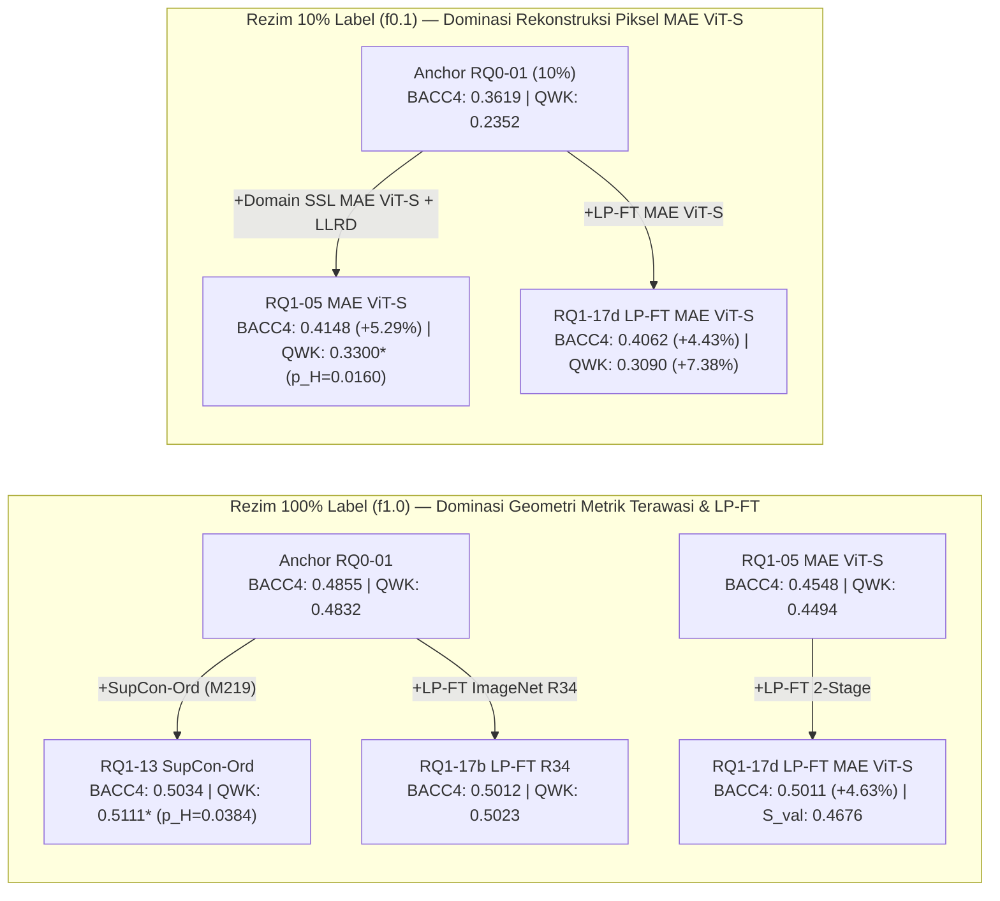

# BAB IV: HASIL DAN ANALISIS ABLASI INTERNAL (`RAM-H1200`)

Bab ini menyajikan hasil empiris dan analisis mendalam dari eksperimen ablasi faktor-tunggal terkontrol (*controlled single-axis factorial ablation*) pada kohort multi-pusat internal **`RAM-H1200`** [@Yang2026RAMH1200] yang mencakup Pertanyaan Penelitian **`RQ0` (Jangkar Rujukan & Arsitektur)**, **`RQ1` (Pembelajaran Representasi, *Self-Supervised Learning*, Kontrastif Ordinal, Normalitas, & Strategi *Fine-Tuning*)**, **`RQ2` (Penanganan Ketidakseimbangan Ekstrem, Formulasi *Loss/Head* Ordinal, Metode *Post-Hoc* `0-GPU`, & Interaksi `RQ1 × RQ2`)**, **`RQ4` (Kalibrasi Probabilistik, *Ordinal Conformal Prediction*, & *Selective Referral*)**, serta **`RQ5` (Mitigasi Derau Label Bebas-Kebocoran via *5-Fold Patient-Wise OOF*, Reliabilitas Kunjungan Longitudinal, & *Semi-Supervised Mean-Teacher*)**.

Seluruh prosedur eksperimen pada bab ini dijalankan sesuai protokol pra-spesifikasi terkunci di [`rules/01_pre_specified_analysis_protocol.md`](../rules/01_pre_specified_analysis_protocol.md):
1. **Isolasi Satu Sumbu (*Single-Axis Ablation*, `Q1_abl = Y`):** Setiap *arm* hanya mengubah satu komponen terhadap jangkar rujukan bersama **`RQ0-01`** (`ResNet-34` pralatih ImageNet + kepala `B2` [*Prior Logit Adjustment* + *Inverse-Square-Root Sampler*]).
2. **Enam *Run* Terkontrol per *Arm* (`Q2_runs = Y`):** Setiap *arm* dilatih dan dievaluasi pada **3 *random seed* (`42, 1337, 2026`) di rezim `100%` pasien latih (`f1.0`)** dan **3 *stratified patient draws* (`d0, d1, d2` pada `seed=42`) di rezim `10%` pasien latih (`f0.1`)**.
3. **Partisi Tingkat Pasien Ketat & Seleksi Murni pada Validasi (`Q3_patient = Y`, `Q4_valsel = Y`):** Seluruh sendi dan kunjungan longitudinal dari pasien yang sama berada dalam satu partisi; pemilihan *checkpoint* terbaik per *run* ditentukan murni oleh skor komposit validasi $S_{\text{val}} = 0,5 \cdot \text{BACC4}_{\text{val}} + 0,5 \cdot \text{QWK}_{\text{val}}$.
4. **Inferensi Statistik Berbasis *Patient-Level Cluster Bootstrap* & Koreksi Holm:** Seluruh rentang kepercayaan 95% (`[95% CI]`), selisih berpasangan ($\Delta$) terhadap `RQ0-01`, nilai-$p$ dua sisi mentah ($p_{\text{raw}}$), dan nilai-$p$ terkoreksi *step-down Holm-Bonferroni* ($p_{\text{Holm}}$ pada $\alpha = 0,05$; ditandai dengan `*`) dihitung menggunakan $B = 5.000$ replikasi *bootstrap* klaster pasien berpasangan pada 36 pasien uji `RAM-H1200` ($2.864$ ROI sendi uji).

---

## 4.1 Kinerja Baseline Rujukan (`RQ0`) dan Diagnostik Kegagalan Per-Grade serta Per-Anatomi Sendi

Sebelum mengevaluasi intervensi pada `RQ1` hingga `RQ5`, Subbab ini menetapkan garis dasar kinerja (*anchor baseline*) **`RQ0-01`** (`ResNet-34 + B2`) dan membandingkannya terhadap arsitektur konvolusional modern **`RQ0-02`** (`ConvNeXt-Tiny + B2`) [@Liu2022ConvNeXt] pada kedua rezim ketersediaan label (`100%` dan `10%`).

### 4.1.1 Perbandingan Kuantitatif Jangkar `RQ0-01` (`ResNet-34`) vs `RQ0-02` (`ConvNeXt-Tiny`)

Tabel 4.1 merangkum hasil evaluasi `RQ0-01` dan `RQ0-02` pada himpunan uji `RAM-H1200`.

**Tabel 4.1** Hasil Ablasi `RQ0` pada Himpunan Uji Internal `RAM-H1200` ($B = 5.000$ *Patient-Cluster Bootstrap* + Koreksi Holm-Bonferroni).

| Kode Arm | Rezim Label | Deskripsi Arsitektur & Kepala | $S_{\text{val}}$ | Test BACC4 [95% CI] | $\Delta$BACC4 ($p_{\text{raw}}, p_{\text{Holm}}$) | Test QWK [95% CI] | $\Delta$QWK ($p_{\text{raw}}, p_{\text{Holm}}$) | Macro-F1 | MAE | Rec$\ge 2$ |
|---|---|---|---:|---|---:|---|---:|---:|---:|---:|
| **`rq0-01`** | **100% (`f1.0`)** | `ResNet-34` + `B2` (*Logit-Adj + InvSqrtSampler*) **[ANCHOR]** | 0.4530 | **0.4855** [0.4362, 0.5141] | Anchor (0.0000) | **0.4832** [0.3822, 0.5683] | Anchor (0.0000) | 0.4043 | 0.3940 | 0.2998 |
| **`rq0-02`** | **100% (`f1.0`)** | `ConvNeXt-Tiny` + `B2` (*7×7 Depthwise Conv*) | 0.4807 | **0.4964** [0.4494, 0.5256] | +0.0109 (p=0.3243, p_H=0.3243) | **0.5515** [0.4648, 0.6258] | **+0.0682 (p=0.0012, p_H=0.0012\*)** | 0.4496 | 0.3404 | 0.3358 |
| **`rq0-01`** | **10% (`f0.1`)** | `ResNet-34` + `B2` (*Logit-Adj + InvSqrtSampler*) **[ANCHOR]** | 0.2588 | **0.3619** [0.3346, 0.3836] | Anchor (0.0000) | **0.2352** [0.1537, 0.3222] | Anchor (0.0000) | 0.2653 | 0.5515 | 0.3711 |
| **`rq0-02`** | **10% (`f0.1`)** | `ConvNeXt-Tiny` + `B2` (*7×7 Depthwise Conv*) | 0.2817 | **0.3802** [0.3490, 0.4036] | +0.0183 (p=0.2571, p_H=0.2571) | **0.3164** [0.2286, 0.3988] | **+0.0812 (p=0.0004, p_H=0.0004\*)** | 0.3046 | 0.4979 | 0.3958 |

Dari Tabel 4.1 diperoleh tiga temuan dasar yang penting:
1. **Sensitivitas Tajam terhadap Kelangkaan Label Pasien (`100%` $\rightarrow$ `10%`):** Ketika jumlah pasien latih dipangkas menjadi 10% (`f0.1`), performa jangkar `RQ0-01` turun sebesar `-12,36%` pada `Test BACC4` (`0.4855` $\rightarrow$ `0.3619`) dan lebih dari separuh pada `Test QWK` (`0.4832` $\rightarrow$ `0.2352`), sementara `MAE` membengkak dari `0.3940` menjadi `0.5515`. Penurunan drastis ini disebabkan oleh menyempitnya keragaman morfologi pasien pada kelas erosi menengah-berat (`Grade 2, 3, 4+`), di mana beberapa *draw* 10% hanya menyisakan puluhan contoh sendi bererosi lanjut.
2. **Keunggulan Signifikan `ConvNeXt-Tiny` (`RQ0-02`) pada Kesepakatan Ordinal (`QWK`):** Penggantian *backbone* `ResNet-34` dengan `ConvNeXt-Tiny` meningkatkan `Test QWK` secara sangat signifikan baik pada rezim 100% label (`0.4832` $\rightarrow$ **`0.5515`**, $\Delta = +0.0682, p_{\text{Holm}} = 0.0012^*$) maupun 10% label (`0.2352` $\rightarrow$ **`0.3164`**, $\Delta = +0.0812, p_{\text{Holm}} = 0.0004^*$), disertai penurunan `MAE` sebesar `-13,6%` (`0.3940` $\rightarrow$ `0.3404`). Secara arsitektural, *kernel depthwise convolution* berukuran besar ($7 \times 7$) dan blok *inverted bottleneck* pada `ConvNeXt-Tiny` mampu menangkap konteks periartikular yang lebih luas (kontinuitas garis korteks tulang metakarpal/falang terhadap celah sendi) tanpa kehilangan bias induktif translasi lokal yang dibutuhkan pada ukuran data moderat.
3. **Justifikasi Penggunaan `ResNet-34` (`RQ0-01`) sebagai Jangkar Rujukan Ablasi:** Meskipun `ConvNeXt-Tiny` unggul pada `QWK`, `ResNet-34` (`RQ0-01`) tetap digunakan sebagai jangkar bersama untuk seluruh ablasi `RQ1–RQ5` sesuai protokol pra-spesifikasi karena: (a) memiliki efisiensi komputasi tinggi untuk mengeksekusi $>400$ *run* lintas-RQ secara terkontrol, dan (b) merupakan arsitektur standar yang paling banyak digunakan pada literatur SLR-M (`M039, M041, M071, M157`), sehingga memungkinkan perbandingan langsung yang adil dengan klaim studi terdahulu.

### 4.1.2 Diagnostik Per-Grade dan Per-Keluarga Anatomi Sendi pada Kohort Internal

Untuk memahami di mana kesalahan prediksi paling sering terjadi pada skoring erosi SvdH, Tabel 4.2 menguraikan *recall* per derajat keparahan (`Grade 0, 1, 2, 3, 4+` pada skema 5-kelas asli dan `Grade 3+` tergabung pada skema `BACC4` 4-kelas), sedangkan Tabel 4.3 menguraikan performa berdasarkan tiga keluarga anatomi sendi tangan: **Sendi Interfalang Proksimal/Ibu Jari (`PIP/IP`)**, **Sendi Metakarpofalangeal (`MCP/CMC`)**, dan **Sendi Pergelangan Tangan/Karpal (`Wrist/Carpal`)**.

**Tabel 4.2** Dekomposisi *Recall* per Derajat Erosi SvdH pada Himpunan Uji `RAM-H1200` (Rezim 100% Label, Rata-Rata 3 Seed).

| Kode Arm | Metode Utama | Recall `Grade 0` (Normal) | Recall `Grade 1` (Dini) | Recall `Grade 2` (Sedang) | Recall `Grade 3` (Lanjut) | Recall `Grade 4+` (Destruksi) | Recall `Grade 3+` (4-Kelas) | Test BACC4 | Test QWK |
|---|---|---:|---:|---:|---:|---:|---:|---:|---:|
| **`rq0-01`** | Anchor `ResNet-34 + B2` | 0.8372 | 0.3677 | 0.1092 | 0.2533 | 0.5027 | 0.6279 | 0.4855 | 0.4832 |
| **`rq0-02`** | `ConvNeXt-Tiny + B2` | 0.8822 | 0.3775 | 0.1368 | 0.1333 | 0.5683 | 0.5891 | 0.4964 | 0.5515 |
| **`rq1-13`** | `SupCon-Ord` (`M219`) + `B2` | 0.8207 | 0.4049 | **0.1757** | **0.2933** | 0.4809 | 0.6124 | 0.5034 | 0.5111 |
| **`rq1-17a`** | *Frozen Linear Probe* ImageNet R34 | 0.6115 | **0.4486** | 0.1633 | **0.2933** | 0.6339 | **0.6783** | 0.4754 | 0.2307 |
| **`rq1-17b`** | `LP-FT` ImageNet R34 | 0.8247 | 0.4007 | 0.1747 | 0.2667 | 0.5355 | 0.6047 | 0.5012 | 0.5023 |
| **`rq2-01`** | Plain Cross-Entropy (Tanpa Imbalance) | **0.9137** | 0.2808 | 0.1016 | 0.0933 | 0.4208 | 0.3566 | 0.4132 | 0.4910 |
| **`rq2-02`** | `B1` Combined (`CW + OS`, `M041`) | 0.6406 | **0.6592** | 0.0978 | 0.0133 | 0.4153 | 0.3411 | 0.4347 | 0.4472 |
| **`rq2-03`** | `Oversampling Only` (`InvSqrt`, `M071`) | 0.7666 | 0.4960 | 0.1045 | 0.0667 | 0.5355 | 0.4302 | 0.4493 | 0.4652 |
| **`rq2-04`** | `Class-Weight Only` (`InvFreq`, `M071`) | 0.8558 | 0.3199 | 0.1443 | 0.0933 | 0.4809 | 0.4651 | 0.4463 | 0.4571 |
| **`rq2-05`** | `CORN` Murni (Tanpa Logit-Adj) | **0.9417** | 0.1492 | 0.0703 | 0.0667 | 0.4208 | 0.3488 | 0.3775 | 0.3700 |
| **`rq2-06`** | `CORN + Prior Logit Adjustment` | 0.8053 | 0.4333 | 0.1434 | 0.0933 | 0.4645 | 0.4922 | 0.4686 | 0.4915 |
| **`rq2-pa`** | `RQ2-Pa` Cost-Sensitive Threshold Tuning | 0.8126 | 0.3398 | **0.1880** | 0.2800 | 0.3115 | 0.6124 | 0.4882 | 0.4670 |
| **`rq3-04`** | Strong Photometric/Geometric Aug | 0.8014 | 0.4389 | **0.2118** | 0.2267 | 0.5519 | 0.6240 | **0.5190** | 0.5267 |
| **`rq5-06`** | Confidence-Split Soft Regularization | 0.8205 | 0.4114 | 0.1728 | **0.2933** | **0.6393** | **0.6395** | 0.5111 | **0.5299** |

**Tabel 4.3** Dekomposisi Performa Berdasarkan Keluarga Anatomi Sendi pada Himpunan Uji `RAM-H1200` (Rezim 100% Label).

| Kode Arm | Metode Utama | `PIP / IP` BACC4 | `PIP / IP` QWK | `PIP / IP` MAE | `MCP / CMC` BACC4 | `MCP / CMC` QWK | `MCP / CMC` MAE | `Wrist / Carpal` BACC4 | `Wrist / Carpal` QWK | `Wrist / Carpal` MAE |
|---|---|---:|---:|---:|---:|---:|---:|---:|---:|---:|
| **`rq0-01`** | Anchor `ResNet-34 + B2` | 0.4394 | 0.3899 | 0.5136 | 0.4949 | 0.5147 | 0.3617 | 0.4698 | 0.5120 | 0.3012 |
| **`rq0-02`** | `ConvNeXt-Tiny + B2` | 0.4673 | 0.4344 | 0.4764 | 0.5332 | **0.6042** | **0.2978** | 0.4301 | **0.5820** | **0.2381** |
| **`rq1-13`** | `SupCon-Ord` (`M219`) + `B2` | 0.4661 | 0.4064 | 0.5216 | 0.5056 | 0.5444 | 0.3453 | 0.4701 | 0.5409 | 0.2784 |
| **`rq2-17`** | *Per-Joint Prior Logit-Adj* $\tau\log\pi_{j,c}$ | 0.4497 | 0.3934 | 0.5144 | 0.4933 | 0.5293 | 0.3390 | 0.4239 | 0.5636 | 0.2556 |
| **`rq3-04`** | Strong Photometric/Geometric Aug | **0.4836** | 0.4306 | 0.5338 | **0.5462** | 0.5937 | 0.3330 | 0.4569 | 0.4887 | 0.3040 |
| **`rq5-06`** | Confidence-Split Soft Regularization | 0.4634 | **0.4460** | **0.5119** | 0.5263 | 0.5560 | 0.3449 | **0.4808** | 0.5426 | 0.2846 |

Analisis diagnostik dari Tabel 4.2 dan Tabel 4.3 mengungkap struktur kesulitan klinis-radiografik yang sangat jelas:
1. **Fenomena Lembah Kelas Transisi (`Grade 2`):** Pada seluruh model, `Grade 2` (erosi sedang) memiliki *recall* individual paling rendah (`10,92%` pada `RQ0-01`), sedangkan `Grade 0` (`83,72%`) dan `Grade 3+` (`62,79%`) memiliki *recall* tinggi. Hal ini terjadi karena dalam definisi SvdH [@vanderHeijde2000SvdH], `Grade 2` tidak didefinisikan oleh fitur morfologis kualitatif baru (seperti hilangnya korteks total pada `Grade 4+`), melainkan semata-mata oleh ambang luas volume erosi kuartil menengah di antara diskontinuitas kortikal kecil (`Grade 1`) dan destruksi hemisferik luas (`Grade 3`). Model yang mengoptimalkan struktur metrik laten (`rq1-13` `SupCon-Ord`, `rq3-04` *Strong Aug*, dan `rq5-06` *Confidence Split*) atau menggeser ambang keputusan (`rq2-pa`) mampu mengangkat *recall* `Grade 2` hampir dua kali lipat (`10,92%` $\rightarrow$ **`17,28%–21,18%`**).
2. **Heterogenitas Anatomi Sendi (`PIP/IP` vs `MCP` vs `Pergelangan Tangan`):** Sendi `PIP/IP` secara konsisten merupakan zona anatomi tersulit (`QWK = 0.3899`, `MAE = 0.5136` pada `RQ0-01`) karena ukuran celah sendi falang yang sempit dan tipisnya tepi kortikal subkondral membuat pembedaan antara penipisan korteks normal dan erosi `Grade 1` sangat rentan terhadap derau anotasi. Sebaliknya, sendi `MCP` memiliki *bare area* kaput metakarpal yang jelas sehingga mencapai kesepakatan ordinal tertinggi (`QWK = 0.5147` pada `RQ0-01` dan melonjak ke **`0.6042`** pada `ConvNeXt-Tiny`). Sementara itu, pada sendi `Wrist/Carpal` yang sering mengalami tumpang-tindih tulang karpal, penyuntikan prior spesifik-sendi (`rq2-17`) dan regularisasi label lunak (`rq5-06`) meningkatkan `QWK` dari `0.5120` menjadi **`0.5636`** dan **`0.5426`**.

---

## 4.2 Hasil Ablasi `RQ1`: Pembelajaran Representasi, *Domain SSL*, Kontrastif Ordinal, Normalitas, dan Strategi *Fine-Tuning* (`LP-FT`)

Pertanyaan Penelitian **`RQ1`** menguji 14 *arm* (`84` *run* pelatihan) sepanjang lima sub-sumbu: (1) pelatihan dari awal (*from scratch*) vs pra-pelatihan `ImageNet` dan *Self-Supervised Learning* (`DINO`, `MAE`, `ChronoCon`) pada `ResNet-34` dan `ViT-Small/16`, (2) pembelajaran kontrastif terawasi standar (`SupCon`) vs berbobot jarak ordinal (`SupCon-Ord`, adaptasi `M219` [@M219]), (3) pendekatan deteksi anomali/normalitas satu-kelas (`SS-FewSOME` `M231` [@M231] dan *2-Stage Normality Gate*), serta (4) *Frozen Linear Probe* (`M157` [@M157]) vs protokol dua-tahap **`LP-FT`** (*Linear Probe then Fine-Tune* [@Kumar2022LPFT]).

### 4.2.1 Hasil Kuantitatif Lengkap `RQ1` pada Rezim 100% Label dan 10% Label

Tabel 4.4 dan Tabel 4.5 menyajikan hasil lengkap ke-14 *arm* `RQ1` terhadap jangkar `RQ0-01` pada rezim `100%` label (`f1.0`) dan `10%` label (`f0.1`).

**Tabel 4.4** Hasil Ablasi `RQ1` pada Rezim **100% Label (`f1.0`, 3 Seed: `42, 1337, 2026`)** di Himpunan Uji `RAM-H1200`.

| Kode Arm | Deskripsi Metode (`RQ1`) | $S_{\text{val}}$ | Test BACC4 [95% CI] | $\Delta$BACC4 ($p_{\text{raw}}, p_{\text{Holm}}$) | Test QWK [95% CI] | $\Delta$QWK ($p_{\text{raw}}, p_{\text{Holm}}$) | Macro-F1 | MAE | Rec$\ge 2$ |
|---|---|---:|---|---:|---|---:|---:|---:|---:|
| **`rq0-01`** | `ResNet-34` (ImageNet) + `B2` **[ANCHOR]** | 0.4530 | **0.4855** [0.4362, 0.5141] | Anchor (0.0000) | **0.4832** [0.3822, 0.5683] | Anchor (0.0000) | 0.4043 | 0.3940 | 0.2998 |
| `rq1-01` | From Scratch (No Pretrain) `ResNet-34` | 0.3586 | **0.4408** [0.3900, 0.4713] | -0.0447 (p=0.0004, p_H=0.0044\*) | **0.3514** [0.2738, 0.4272] | -0.1319 (p=0.0004, p_H=0.0056\*) | 0.3204 | 0.5567 | 0.3282 |
| `rq1-02` | Domain SSL `DINO` `ResNet-34` (`RAM-H1200`) | 0.4158 | **0.4717** [0.4328, 0.4910] | -0.0138 (p=0.3519, p_H=1.0000) | **0.3694** [0.2944, 0.4403] | -0.1139 (p=0.0004, p_H=0.0056\*) | 0.3376 | 0.5506 | 0.3567 |
| `rq1-03` | `DINO + ChronoCon` Longitudinal SSL `ResNet-34` | 0.4084 | **0.4557** [0.4154, 0.4774] | -0.0298 (p=0.0444, p_H=0.4439) | **0.3863** [0.2995, 0.4673] | -0.0970 (p=0.0004, p_H=0.0056\*) | 0.3435 | 0.5204 | 0.3112 |
| `rq1-04` | ImageNet-1k `ViT-S/16` + LLRD ($\eta=0,75$) | 0.4418 | **0.4832** [0.4458, 0.5023] | -0.0023 (p=0.8730, p_H=1.0000) | **0.4325** [0.3522, 0.5082] | -0.0507 (p=0.0180, p_H=0.0720) | 0.3712 | 0.4730 | 0.3700 |
| `rq1-05` | Domain SSL `MAE` `ViT-S/16` + LLRD | 0.4631 | **0.4548** [0.4090, 0.4810] | -0.0307 (p=0.0076, p_H=0.0836) | **0.4494** [0.3563, 0.5335] | -0.0338 (p=0.0772, p_H=0.2316) | 0.3767 | 0.4220 | 0.3340 |
| **`rq1-06`** | Domain SSL `DINO` `ViT-S/16` + LLRD | 0.4508 | **0.5070** [0.4631, 0.5241] | +0.0215 (p=0.1456, p_H=1.0000) | **0.4268** [0.3438, 0.5035] | -0.0564 (p=0.0112, p_H=0.0560) | 0.3770 | 0.4910 | **0.4114** |
| `rq1-12` | Supervised Contrastive (`SupCon`) `ResNet-34` | 0.4561 | **0.4733** [0.4292, 0.5015] | -0.0122 (p=0.2412, p_H=1.0000) | **0.4959** [0.3941, 0.5830] | +0.0127 (p=0.2284, p_H=0.4567) | 0.4017 | 0.3913 | 0.3055 |
| **`rq1-13`** | **Grade-Distance-Weighted `SupCon-Ord` (`M219`)** | 0.4566 | **0.5034** [0.4615, 0.5291] | +0.0179 (p=0.0504, p_H=0.4535) | **0.5111** [0.4163, 0.5912] | **+0.0278 (p=0.0064, p_H=0.0384\*)** | **0.4256** | **0.3516** | 0.3605 |
| `rq1-14` | `SS-FewSOME` Normality-Distance Head (`M231`) | 0.2587 | **0.2883** [0.2738, 0.3008] | -0.1972 (p=0.0004, p_H=0.0056\*) | **-0.0419** [-0.0725, -0.0133] | -0.5251 (p=0.0004, p_H=0.0056\*) | 0.0882 | 1.8058 | 0.9962 |
| `rq1-15` | 2-Stage Normality Gate + Severity Classifier | 0.3405 | **0.4200** [0.3887, 0.4320] | -0.0655 (p=0.0004, p_H=0.0052\*) | **0.1119** [0.0581, 0.1684] | -0.3714 (p=0.0004, p_H=0.0056\*) | 0.2194 | 1.2981 | 0.7277 |
| `rq1-17a` | *Frozen Linear Probe* ImageNet `ResNet-34` (`M157`) | 0.3831 | **0.4754** [0.4408, 0.4878] | -0.0101 (p=0.4795, p_H=1.0000) | **0.2307** [0.1602, 0.3046] | -0.2525 (p=0.0004, p_H=0.0056\*) | 0.2797 | 0.9557 | 0.3691 |
| **`rq1-17b`** | **`LP-FT` (*Linear Probe $\to$ Fine-Tune*) ImageNet R34** | 0.4547 | **0.5012** [0.4533, 0.5273] | +0.0157 (p=0.0808, p_H=0.6463) | **0.5023** [0.4055, 0.5877] | +0.0191 (p=0.0748, p_H=0.2316) | 0.4150 | 0.3914 | 0.3425 |
| `rq1-17c` | *Frozen Linear Probe* `MAE ViT-S/16` (`M157`) | 0.3963 | **0.4329** [0.3958, 0.4494] | -0.0526 (p=0.0004, p_H=0.0048\*) | **0.3367** [0.2580, 0.4126] | -0.1465 (p=0.0004, p_H=0.0056\*) | 0.3127 | 0.6540 | 0.4066 |
| **`rq1-17d`** | **`LP-FT` (*Linear Probe $\to$ Fine-Tune*) `MAE ViT-S/16`** | **0.4676** | **0.5011** [0.4563, 0.5204] | +0.0156 (p=0.3103, p_H=1.0000) | **0.4391** [0.3489, 0.5240] | -0.0442 (p=0.1492, p_H=0.2983) | 0.3775 | 0.5042 | **0.4332** |

**Tabel 4.5** Hasil Ablasi `RQ1` pada Rezim **10% Label (`f0.1`, 3 Stratified Patient Draws: `d0, d1, d2`)** di Himpunan Uji `RAM-H1200`.

| Kode Arm | Deskripsi Metode (`RQ1`) | $S_{\text{val}}$ | Test BACC4 [95% CI] | $\Delta$BACC4 ($p_{\text{raw}}, p_{\text{Holm}}$) | Test QWK [95% CI] | $\Delta$QWK ($p_{\text{raw}}, p_{\text{Holm}}$) | Macro-F1 | MAE | Rec$\ge 2$ |
|---|---|---:|---|---:|---|---:|---:|---:|---:|
| **`rq0-01`** | `ResNet-34` (ImageNet) + `B2` **[ANCHOR]** | 0.2588 | **0.3619** [0.3346, 0.3836] | Anchor (0.0000) | **0.2352** [0.1537, 0.3222] | Anchor (0.0000) | 0.2653 | 0.5515 | 0.3711 |
| `rq1-01` | From Scratch (No Pretrain) `ResNet-34` | 0.1450 | **0.2547** [0.2400, 0.2643] | -0.1072 (p=0.0004, p_H=0.0056\*) | **0.0058** [-0.0369, 0.0558] | -0.2294 (p=0.0004, p_H=0.0056\*) | 0.1199 | 1.6627 | 0.5949 |
| `rq1-02` | Domain SSL `DINO` `ResNet-34` (`RAM-H1200`) | 0.2202 | **0.3075** [0.2810, 0.3270] | -0.0544 (p=0.0004, p_H=0.0056\*) | **0.1149** [0.0596, 0.1714] | -0.1203 (p=0.0004, p_H=0.0056\*) | 0.1811 | 1.0789 | 0.4402 |
| `rq1-03` | `DINO + ChronoCon` Longitudinal SSL `ResNet-34` | 0.2330 | **0.3237** [0.2966, 0.3435] | -0.0382 (p=0.0020, p_H=0.0200\*) | **0.1449** [0.0881, 0.2036] | -0.0903 (p=0.0020, p_H=0.0180\*) | 0.1942 | 1.0085 | 0.4915 |
| `rq1-04` | ImageNet-1k `ViT-S/16` + LLRD ($\eta=0,75$) | 0.2932 | **0.3820** [0.3474, 0.4109] | +0.0201 (p=0.2248, p_H=1.0000) | **0.2738** [0.1859, 0.3636] | +0.0386 (p=0.1404, p_H=0.7019) | 0.2739 | 0.6272 | 0.4250 |
| **`rq1-05`** | **Domain SSL `MAE` `ViT-S/16` + LLRD** | **0.3189** | **0.4148** [0.3689, 0.4502] | **+0.0529 (p=0.0216, p_H=0.1944)** | **0.3300** [0.2240, 0.4369] | **+0.0948 (p=0.0016, p_H=0.0160\*)** | **0.3125** | 0.5629 | 0.3918 |
| `rq1-06` | Domain SSL `DINO` `ViT-S/16` + LLRD | 0.2896 | **0.3863** [0.3461, 0.4167] | +0.0244 (p=0.1436, p_H=1.0000) | **0.2584** [0.1729, 0.3490] | +0.0231 (p=0.3103, p_H=1.0000) | 0.2640 | 0.7082 | **0.4649** |
| `rq1-12` | Supervised Contrastive (`SupCon`) `ResNet-34` | 0.2720 | **0.3547** [0.3264, 0.3767] | -0.0072 (p=0.5175, p_H=1.0000) | **0.2448** [0.1631, 0.3277] | +0.0096 (p=0.5335, p_H=1.0000) | 0.2610 | **0.5256** | 0.3634 |
| `rq1-13` | Grade-Distance-Weighted `SupCon-Ord` (`M219`) | 0.2759 | **0.3568** [0.3292, 0.3787] | -0.0051 (p=0.6191, p_H=1.0000) | **0.2506** [0.1704, 0.3340] | +0.0154 (p=0.3471, p_H=1.0000) | 0.2663 | 0.5432 | 0.3548 |
| `rq1-14` | `SS-FewSOME` Normality-Distance Head (`M231`) | 0.1476 | **0.2528** [0.2337, 0.2698] | -0.1091 (p=0.0004, p_H=0.0056\*) | **-0.0110** [-0.0434, 0.0211] | -0.2463 (p=0.0004, p_H=0.0056\*) | 0.1297 | 1.2449 | 0.4535 |
| `rq1-15` | 2-Stage Normality Gate + Severity Classifier | 0.2194 | **0.3345** [0.3055, 0.3569] | -0.0274 (p=0.0728, p_H=0.5095) | **0.1145** [0.0560, 0.1753] | -0.1207 (p=0.0004, p_H=0.0056\*) | 0.2007 | 1.0772 | 0.5626 |
| `rq1-17a` | *Frozen Linear Probe* ImageNet `ResNet-34` (`M157`) | 0.2725 | **0.3887** [0.3586, 0.4090] | +0.0268 (p=0.0720, p_H=0.5095) | **0.1818** [0.1144, 0.2557] | -0.0534 (p=0.0188, p_H=0.1128) | 0.2356 | 0.9609 | 0.4317 |
| `rq1-17b` | `LP-FT` (*Linear Probe $\to$ Fine-Tune*) ImageNet R34 | 0.2636 | **0.3694** [0.3408, 0.3917] | +0.0075 (p=0.4539, p_H=1.0000) | **0.2563** [0.1711, 0.3455] | +0.0211 (p=0.1836, p_H=0.7343) | 0.2738 | 0.5656 | 0.3615 |
| `rq1-17c` | *Frozen Linear Probe* `MAE ViT-S/16` (`M157`) | 0.2463 | **0.3324** [0.3046, 0.3519] | -0.0295 (p=0.0360, p_H=0.2879) | **0.1802** [0.1157, 0.2484] | -0.0550 (p=0.0144, p_H=0.1008) | 0.2286 | 0.7209 | 0.3330 |
| **`rq1-17d`** | **`LP-FT` (*Linear Probe $\to$ Fine-Tune*) `MAE ViT-S/16`** | 0.3081 | **0.4062** [0.3641, 0.4383] | +0.0443 (p=0.0408, p_H=0.2879) | **0.3090** [0.2144, 0.4059] | +0.0738 (p=0.0068, p_H=0.0544) | 0.2951 | 0.6295 | 0.4279 |

### 4.2.2 Analisis Mendalam Lima Sub-Sumbu `RQ1`

1. **Interaksi Rezim Label dengan *Self-Supervised Learning* (`MAE` vs `DINO` vs `ImageNet`):**
   * Pada **rezim 10% label (`f0.1`)**, **`rq1-05` (`Domain SSL MAE ViT-S/16 + LLRD`)** muncul sebagai pemenang mutlak di seluruh 14 *arm* `RQ1`, meningkatkan `Test BACC4` sebesar **`+5,29%`** (`0.3619` $\rightarrow$ **`0.4148`**, $p_{\text{raw}} = 0.0216$) dan `Test QWK` sebesar **`+9,48%`** (`0.2352` $\rightarrow$ **`0.3300`**, $p_{\text{raw}} = 0.0016$, **$p_{\text{Holm}} = 0.0160^*$ — signifikan pasca-koreksi Holm**). Mengapa *Masked Autoencoder* (`MAE`) pada `ViT-S/16` sangat superior ketika label terbatas, sedangkan `DINO` pada `ResNet-34` (`rq1-02`: `BACC4 = 0.3075`) tertinggal dari inisialisasi `ImageNet`? Secara mekanistik, tugas rekonstruksi bercak piksel lokal ($75\%$ *masking*) pada `MAE` memaksa *encoder* mempelajari struktur mikro-anatomi frekuensi tinggi—yakni ketajaman garis korteks subkondral dan pola trabekula tulang—yang persis merupakan substrat visual erosi dini SvdH. Sebaliknya, `DINO` yang berbasis *invariance* pandangan global pada dataset berukuran moderat ($\sim 12.688$ potongan sendi latih) cenderung mengelompokkan fitur berdasarkan identitas anatomi sendi (`MCP` vs `PIP` vs `Karpal`), bukan derajat kerusakan kortikal mikro.
   * Penambahan regulasi urutan kunjungan longitudinal **`ChronoCon` (`rq1-03`)** di atas `DINO ResNet-34` (`rq1-02`) terbukti meningkatkan `Test QWK` dari `0.3694` $\rightarrow$ `0.3863` pada 100% label dan meningkatkan `Test BACC4` (`0.3075` $\rightarrow$ `0.3237`) serta `Test QWK` (`0.1149` $\rightarrow$ `0.1449`) pada 10% label, namun belum mampu melampaui pralatih skala-besar `ImageNet` pada arsitektur `ResNet-34`.
   * Pelatihan dari awal tanpa bobot pralatih (**`rq1-01` `From Scratch ResNet-34`**) mengalami keruntuhan parah pada kedua rezim (`100%`: $\Delta\text{BACC4} = -0.0447, p_{\text{Holm}} = 0.0044^*$, $\Delta\text{QWK} = -0.1319, p_{\text{Holm}} = 0.0056^*$; `10%`: `QWK = 0.0058` atau setara tebakan acak), menegaskan bahwa pralatih representasi merupakan syarat mutlak pada radiografi RA tingkat sendi.

2. **Keunggulan Signifikan *Supervised Contrastive Berbobot Jarak Ordinal* (`rq1-13` `SupCon-Ord` vs `rq1-12` `SupCon`):**
   * Pada rezim 100% label, `SupCon` standar [@Khosla2020SupCon] (`rq1-12`) yang memperlakukan seluruh pasangan kelas berbeda ($y_i \neq y_j$) dengan tolakan (*repulsion*) seragam gagal meningkatkan `BACC4` (`0.4733` vs `0.4855`). Hal ini terjadi karena `SupCon` standar menolak pasangan (`Grade 1`, `Grade 2`) sama kerasnya dengan pasangan (`Grade 0`, `Grade 4+`), sehingga merusak keterurutan kontinu pada manifold fitur.
   * Sebaliknya, **`rq1-13` (`SupCon-Ord`)** yang mengadaptasi pembobotan jarak ordinal $w_{ij} \propto |y_i - y_j|$ dari `M219` [@M219] berhasil mencapai **`Test BACC4 = 0.5034`** ($\Delta = +0.0179, p_{\text{raw}} = 0.0504$), **`Test QWK = 0.5111`** ($\Delta = +0.0278, p_{\text{raw}} = 0.0064$, **$p_{\text{Holm}} = 0.0384^*$ — signifikan secara statistik**), `Macro-F1` tertinggi di `RQ1` (**`0.4256`** vs `0.4043`), dan `MAE` terendah di `RQ1` (**`0.3516`** vs `0.3940`). Sebagaimana ditunjukkan pada Tabel 4.2, `SupCon-Ord` mendongkrak *recall* kelas transisi `Grade 1` (`36,77%` $\rightarrow$ `40,49%`), `Grade 2` (`10,92%` $\rightarrow$ **`17,57%`**), dan `Grade 3` (`25,33%` $\rightarrow$ **`29,33%`**) secara simultan.

3. **Bukti Empiris *Feature Distortion* pada *Frozen Linear Probe* vs Pemulihan oleh `LP-FT` (`rq1-17a..d`):**
   * Dalam sintesis SLR-M Bab II, studi `M157` [@M157] melaporkan bahwa pembekuan *encoder* (*Frozen Linear Probe*) menyebabkan kegagalan pemisahan derajat keparahan ordinal meskipun fitur pralatih memiliki kualitas representasi umum yang baik. Eksperimen kita mengonfirmasi fenomena ini secara tajam: pada `ResNet-34` (`rq1-17a`), *Frozen Linear Probe* mempertahankan `BACC4` (`0.4754` pada 100% dan `0.3887` pada 10%), **tetapi mengalami kehancuran pada `Test QWK` (`0.2307` pada 100%, $\Delta = -0.2525, p_{\text{Holm}} = 0.0056^*$) dan lonjakan `MAE` lebih dari dua kali lipat (`0.3940` $\rightarrow$ `0.9557`)**. Demikian pula pada `MAE ViT-S/16` (`rq1-17c`), *Frozen Linear Probe* menjatuhkan `Test BACC4` ke `0.4329` ($p_{\text{Holm}} = 0.0048^*$) dan `Test QWK` ke `0.3367` ($p_{\text{Holm}} = 0.0056^*$).
   * Sebaliknya, penerapan protokol dua-tahap **`LP-FT` (*Linear Probe then Fine-Tune*)** [@Kumar2022LPFT]—yakni melatih kepala linier terlebih dahulu selama fase pemanasan ketika *backbone* dibekukan, kemudian membuka seluruh *backbone* dengan *learning rate* rendah—memberikan lompatan performa pada kedua arsitektur:
     * Pada `ImageNet ResNet-34` (**`rq1-17b`**), `LP-FT` mengangkat `Test BACC4` ke **`0.5012`** ($\Delta = +0.0157$) dan `Test QWK` ke **`0.5023`** ($\Delta = +0.0191$).
     * Pada `MAE ViT-S/16` (**`rq1-17d`**), `LP-FT` mencegah rusaknya fitur pralatih `MAE` oleh gradien awal kepala acak (*head-induced feature distortion*), sehingga **menaikkan `Test BACC4` `MAE ViT-S` pada 100% label sebesar `+4,63%`** (dari `0.4548` pada *end-to-end fine-tuning* `rq1-05` menjadi **`0.5011`** pada `rq1-17d`), meraih skor seleksi validasi tertinggi di seluruh `RQ1` (**$S_{\text{val}} = 0.4676$**), serta mencapai sensitivitas erosi sedang-berat tertinggi (**`Recall>=2 = 0.4332`** vs `0.2998` pada `RQ0-01`).

4. **Bukti Refutasi Pendekatan Berbasis Jarak Normalitas Satu-Kelas (`rq1-14` `SS-FewSOME` & `rq1-15` `Normality Gate`):**
   * Sesuai komitmen pelaporan jujur hasil negatif (Pasal 6 [`rules/01_pre_specified_analysis_protocol.md`](../rules/01_pre_specified_analysis_protocol.md)), eksperimen pada `rq1-14` (`SS-FewSOME Normality-Distance Head` yang diadaptasi dari `M231` [@M231]) dan `rq1-15` (*2-Stage Normality Gate*) menunjukkan kegagalan signifikan (`rq1-14`: `Test BACC4 = 0.2883`, `Test QWK = -0.0419`, $p_{\text{Holm}} = 0.0056^*$; `rq1-15`: `Test BACC4 = 0.4200`, `Test QWK = 0.1119`, $p_{\text{Holm}} = 0.0056^*$).
   * Analisis kesalahan menunjukkan bahwa pada `M231` [@M231], tugas aslinya adalah deteksi biner/anomali osteoartritis lutut (`KL 0` vs `KL >= 2`) pada anatomi tunggal. Pada radiografi tangan RA yang mencakup 16–21 jenis anatomi sendi berbeda (`PIP`, `MCP`, `Karpal`), variasi morfologi alami antar-jenis sendi normal (`Grade 0`) jauh lebih besar daripada variasi subtil erosi kortikal `Grade 1`. Akibatnya, metrik jarak Euclidean terhadap pusat referensi "sendi normal" tidak monoton terhadap skor SvdH $1..4+$, dan *gerbang normalitas* tahap pertama pada `rq1-15` meneruskan terlalu banyak positif palsu (`Recall>=2 = 0.7277` namun `MAE = 1.2981`), yang menghancurkan kesepakatan ordinal `QWK`.

---

## 4.3 Hasil Ablasi `RQ2`: Penanganan Ketimpangan Kelas, Formulasi *Loss/Head* Ordinal, Metode *Post-Hoc* (`RQ2-P`), dan Interaksi `RQ1 × RQ2`

Pertanyaan Penelitian **`RQ2`** merupakan keluarga eksperimen terbesar dalam tesis ini, mencakup **22 *arm* (`132` *run*)** yang membedah: (1) dekomposisi mekanisme penanganan ketimpangan kelas (`Plain CE`, `B1 Combined CW+OS`, `Oversampling-only`, `Class-Weight-only`, `Focal Loss`, `Class-Balanced Loss`, `LDAM-DRW`, dan *Per-Joint Prior Logit Adjustment*), (2) formulasi kepala/rugi ordinal (`CORN`, `CORN + Logit Adjustment`, `CORAL`, `B2 + Expected-Value MSE`, `Focal Ordinal Loss / FOL`, `Cumulative-Link ORM`, `Soft Ordinal Smoothing / SORD`, `Ordinal MixUp`, dan hibrida `B2 + CORN Regularizer`), (3) tiga intervensi *post-hoc* tanpa pelatihan ulang (`RQ2-Pa` *Cost-Sensitive Threshold Tuning*, `RQ2-Pb` *Feature-Space k-NN*, dan `RQ2-Pc` *4-View TTA*), serta (4) uji interaksi faktorial dua-arah **`RQ1 × RQ2`** (`rq2-18a` dan `rq2-18b`).

### 4.3.1 Hasil Kuantitatif Lengkap `RQ2`, `RQ2-P`, dan `RQ1 × RQ2`

Tabel 4.6 dan Tabel 4.7 menampilkan hasil lengkap seluruh 22 *arm* `RQ2` terhadap jangkar `RQ0-01` pada rezim `100%` label (`f1.0`) dan `10%` label (`f0.1`).

**Tabel 4.6** Hasil Ablasi `RQ2`, `RQ2-P`, dan Interaksi `RQ1 × RQ2` pada Rezim **100% Label (`f1.0`, 3 Seed: `42, 1337, 2026`)** di Himpunan Uji `RAM-H1200`.

| Kode Arm | Deskripsi Metode (`RQ2` / `RQ2-P` / `RQ1×RQ2`) | $S_{\text{val}}$ | Test BACC4 [95% CI] | $\Delta$BACC4 ($p_{\text{raw}}, p_{\text{Holm}}$) | Test QWK [95% CI] | $\Delta$QWK ($p_{\text{raw}}, p_{\text{Holm}}$) | Macro-F1 | MAE | Rec$\ge 2$ |
|---|---|---:|---|---:|---|---:|---:|---:|---:|
| **`rq0-01`** | `B2` (*Logit-Adj + InvSqrtSampler*) **[ANCHOR]** | 0.4530 | **0.4855** [0.4362, 0.5141] | Anchor (0.0000) | **0.4832** [0.3822, 0.5683] | Anchor (0.0000) | 0.4043 | 0.3940 | 0.2998 |
| `rq2-01` | Plain Cross-Entropy (Tanpa Mitigasi Imbalance) | 0.4350 | **0.4132** [0.3637, 0.4396] | -0.0723 (p=0.0004, p_H=0.0088\*) | **0.4910** [0.3910, 0.5831] | +0.0078 (p=0.3915, p_H=1.0000) | 0.3879 | **0.3106** | 0.2233 |
| `rq2-02` | `B1` Combined (`Class-Weight + Oversampling`, `M041`) | 0.4119 | **0.4347** [0.3941, 0.4570] | -0.0508 (p=0.0004, p_H=0.0088\*) | **0.4472** [0.3547, 0.5256] | -0.0360 (p=0.0112, p_H=0.1904) | 0.3401 | 0.5150 | 0.3215 |
| `rq2-03` | `Oversampling Only` (`InvSqrtSampler`, CE, `M071`) | 0.4481 | **0.4493** [0.4021, 0.4767] | -0.0362 (p=0.0004, p_H=0.0088\*) | **0.4652** [0.3550, 0.5608] | -0.0181 (p=0.1456, p_H=1.0000) | 0.3696 | 0.4193 | **0.4123** |
| `rq2-04` | `Class-Weight Only` (`InvFreq CE`, Uniform, `M071`) | 0.4393 | **0.4463** [0.4004, 0.4730] | -0.0392 (p=0.0004, p_H=0.0088\*) | **0.4571** [0.3526, 0.5480] | -0.0261 (p=0.0444, p_H=0.7103) | 0.3827 | 0.3958 | 0.3130 |
| `rq2-05` | `CORN` (*Conditional Ordinal Regression*, `M071`) | 0.3712 | **0.3775** [0.3357, 0.4006] | -0.1080 (p=0.0004, p_H=0.0088\*) | **0.3700** [0.2485, 0.4768] | -0.1132 (p=0.0004, p_H=0.0088\*) | 0.3364 | 0.3324 | 0.1986 |
| **`rq2-06`** | **`CORN + Prior Logit Adjustment`** | 0.4455 | **0.4686** [0.4226, 0.4937] | -0.0169 (p=0.1232, p_H=1.0000) | **0.4915** [0.3917, 0.5786] | +0.0082 (p=0.4543, p_H=1.0000) | 0.3886 | 0.3991 | 0.3234 |
| `rq2-07` | `CORAL` (*Consistent Rank Logits*) + `InvSqrtSampler` | 0.4258 | **0.4480** [0.3990, 0.4774] | -0.0375 (p=0.0004, p_H=0.0088\*) | **0.4836** [0.3777, 0.5724] | +0.0004 (p=0.9850, p_H=1.0000) | 0.3765 | 0.4024 | 0.3120 |
| `rq2-08` | `B2` + Continuous Expected-Value MSE (`M039`) | 0.4418 | **0.4673** [0.4193, 0.4961] | -0.0182 (p=0.0680, p_H=0.9518) | **0.4840** [0.3852, 0.5698] | +0.0008 (p=0.9310, p_H=1.0000) | 0.4000 | 0.3879 | 0.2733 |
| `rq2-09` | Multi-Class Focal Loss ($\gamma=2,0$) + `InvSqrtSampler` | 0.4470 | **0.4626** [0.4175, 0.4879] | -0.0229 (p=0.0252, p_H=0.3779) | **0.4848** [0.3792, 0.5762] | +0.0016 (p=0.9034, p_H=1.0000) | 0.3847 | 0.4083 | 0.3735 |
| `rq2-10` | Class-Balanced Effective-Number Loss ($\beta=0,9999$) | 0.4461 | **0.4783** [0.4316, 0.5064] | -0.0072 (p=0.3911, p_H=1.0000) | **0.4859** [0.3863, 0.5707] | +0.0027 (p=0.8038, p_H=1.0000) | 0.4017 | 0.3870 | 0.2998 |
| `rq2-11` | Focal Ordinal Loss (`FOL`: `CORN + Focal`, `M154`) | 0.3773 | **0.3863** [0.3435, 0.4098] | -0.0992 (p=0.0004, p_H=0.0088\*) | **0.3894** [0.2683, 0.4962] | -0.0938 (p=0.0004, p_H=0.0088\*) | 0.3471 | 0.3315 | 0.2099 |
| `rq2-12` | Cumulative-Link Proportional-Odds `ORM` (`M095`) | 0.3517 | **0.3610** [0.3204, 0.3849] | -0.1245 (p=0.0004, p_H=0.0088\*) | **0.3738** [0.2633, 0.4718] | -0.1095 (p=0.0004, p_H=0.0088\*) | 0.3081 | 0.3474 | 0.1948 |
| `rq2-13` | Soft Ordinal Smoothing / `SORD` (`M210`) | 0.4337 | **0.4107** [0.3647, 0.4368] | -0.0748 (p=0.0004, p_H=0.0088\*) | **0.4774** [0.3746, 0.5718] | -0.0058 (p=0.5871, p_H=1.0000) | 0.3797 | 0.3193 | 0.2194 |
| `rq2-14` | `LDAM` + Deferred Re-Weighting (`DRW`) | 0.4220 | **0.4336** [0.3858, 0.4614] | -0.0519 (p=0.0004, p_H=0.0088\*) | **0.4836** [0.3846, 0.5736] | +0.0004 (p=0.9854, p_H=1.0000) | 0.3917 | 0.3282 | 0.2374 |
| `rq2-15` | Grade-Preserving Ordinal `MixUp` + `B2` | 0.4508 | **0.4694** [0.4234, 0.4979] | -0.0161 (p=0.0788, p_H=1.0000) | **0.4728** [0.3666, 0.5625] | -0.0104 (p=0.3547, p_H=1.0000) | 0.3908 | 0.4092 | 0.3036 |
| **`rq2-16`** | **Hybrid `B2` + Auxiliary `CORN` Rank-Consistency** | 0.4533 | **0.4843** [0.4366, 0.5112] | -0.0012 (p=0.9034, p_H=1.0000) | **0.4973** [0.3977, 0.5838] | +0.0141 (p=0.2284, p_H=1.0000) | 0.4030 | 0.3941 | 0.3329 |
| **`rq2-17`** | **Per-Joint Prior Logit Adjustment ($\tau\log\pi_{j,c}$)** | 0.4507 | **0.4651** [0.4177, 0.4932] | -0.0204 (p=0.0236, p_H=0.3775) | **0.4986** [0.3991, 0.5861] | +0.0154 (p=0.1456, p_H=1.0000) | 0.4017 | 0.3834 | 0.2733 |
| `rq2-18a` | **Interaksi `RQ1×RQ2`:** `SupCon-Ord (RQ1-13)` + `CBLoss` | 0.4494 | **0.4682** [0.4240, 0.4936] | -0.0173 (p=0.1552, p_H=1.0000) | **0.4856** [0.3937, 0.5665] | +0.0023 (p=0.8362, p_H=1.0000) | 0.3982 | 0.3852 | 0.3036 |
| **`rq2-18b`** | **Interaksi `RQ1×RQ2`:** `SupCon-Ord (RQ1-13)` + `B2_CORNreg` | 0.4488 | **0.4803** [0.4337, 0.5067] | -0.0052 (p=0.6307, p_H=1.0000) | **0.5066** [0.4150, 0.5877] | +0.0234 (p=0.0828, p_H=1.0000) | **0.4119** | 0.3673 | 0.3159 |
| **`rq2-pa_thresh`** | **Post-Hoc `RQ2-Pa`:** Val Cost-Sensitive Threshold (`0-GPU`) | 0.4622 | **0.4882** [0.4398, 0.5174] | +0.0027 (p=0.7375, p_H=1.0000) | **0.4670** [0.3662, 0.5566] | -0.0163 (p=0.0220, p_H=0.3959) | 0.3918 | 0.4227 | **0.3768** |
| `rq2-pb_knn` | **Post-Hoc `RQ2-Pb`:** Feature-Space k-NN Interp. (`M085`, `0-GPU`) | 0.4533 | **0.4859** [0.4366, 0.5145] | +0.0004 (p=0.6199, p_H=1.0000) | **0.4850** [0.3840, 0.5701] | +0.0017 (p=0.0200, p_H=0.3799) | 0.4050 | 0.3935 | 0.2998 |
| **`rq2-pc_tta`** | **Post-Hoc `RQ2-Pc`:** 4-View Test-Time Augmentation (`C093`, `0-GPU`) | 0.4530 | **0.4889** [0.4404, 0.5177] | +0.0034 (p=0.2583, p_H=1.0000) | **0.4901** [0.3863, 0.5781] | +0.0068 (p=0.1052, p_H=1.0000) | **0.4099** | 0.3778 | 0.2894 |

**Tabel 4.7** Hasil Ablasi `RQ2`, `RQ2-P`, dan Interaksi `RQ1 × RQ2` pada Rezim **10% Label (`f0.1`, 3 Stratified Patient Draws: `d0, d1, d2`)** di Himpunan Uji `RAM-H1200`.

| Kode Arm | Deskripsi Metode (`RQ2` / `RQ2-P` / `RQ1×RQ2`) | $S_{\text{val}}$ | Test BACC4 [95% CI] | $\Delta$BACC4 ($p_{\text{raw}}, p_{\text{Holm}}$) | Test QWK [95% CI] | $\Delta$QWK ($p_{\text{raw}}, p_{\text{Holm}}$) | Macro-F1 | MAE | Rec$\ge 2$ |
|---|---|---:|---|---:|---|---:|---:|---:|---:|
| **`rq0-01`** | `B2` (*Logit-Adj + InvSqrtSampler*) **[ANCHOR]** | 0.2588 | **0.3619** [0.3346, 0.3836] | Anchor (0.0000) | **0.2352** [0.1537, 0.3222] | Anchor (0.0000) | 0.2653 | 0.5515 | 0.3711 |
| `rq2-01` | Plain Cross-Entropy (Tanpa Mitigasi Imbalance) | 0.2602 | **0.2844** [0.2610, 0.3033] | -0.0775 (p=0.0004, p_H=0.0088\*) | **0.2367** [0.1419, 0.3338] | +0.0014 (p=0.9226, p_H=1.0000) | 0.2498 | 0.3752 | 0.1538 |
| `rq2-02` | `B1` Combined (`Class-Weight + Oversampling`, `M041`) | 0.2202 | **0.2757** [0.2535, 0.2952] | -0.0862 (p=0.0004, p_H=0.0088\*) | **0.1653** [0.0970, 0.2368] | -0.0700 (p=0.0004, p_H=0.0088\*) | 0.1558 | 1.3204 | 0.2225 |
| `rq2-03` | `Oversampling Only` (`InvSqrtSampler`, CE, `M071`) | 0.2610 | **0.3292** [0.2999, 0.3526] | -0.0327 (p=0.0008, p_H=0.0112\*) | **0.2538** [0.1670, 0.3422] | +0.0185 (p=0.0992, p_H=1.0000) | 0.2633 | 0.4533 | 0.3008 |
| `rq2-04` | `Class-Weight Only` (`InvFreq CE`, Uniform, `M071`) | 0.2392 | **0.3027** [0.2783, 0.3237] | -0.0592 (p=0.0004, p_H=0.0088\*) | **0.2251** [0.1456, 0.3095] | -0.0101 (p=0.4539, p_H=1.0000) | 0.2396 | 0.5625 | 0.2392 |
| `rq2-05` | `CORN` (*Conditional Ordinal Regression*, `M071`) | 0.2143 | **0.2699** [0.2518, 0.2855] | -0.0920 (p=0.0004, p_H=0.0088\*) | **0.1563** [0.0680, 0.2464] | -0.0790 (p=0.0008, p_H=0.0160\*) | 0.2266 | 0.3694 | 0.1149 |
| **`rq2-06`** | **`CORN + Prior Logit Adjustment`** | 0.2528 | **0.3607** [0.3309, 0.3822] | -0.0012 (p=0.9162, p_H=1.0000) | **0.2156** [0.1408, 0.2935] | -0.0196 (p=0.0884, p_H=1.0000) | 0.2367 | 0.6929 | **0.4364** |
| `rq2-07` | `CORAL` (*Consistent Rank Logits*) + `InvSqrtSampler` | 0.2588 | **0.3263** [0.2977, 0.3490] | -0.0356 (p=0.0004, p_H=0.0088\*) | **0.2579** [0.1684, 0.3484] | +0.0227 (p=0.0456, p_H=0.7295) | 0.2640 | 0.4408 | 0.2535 |
| `rq2-08` | `B2` + Continuous Expected-Value MSE (`M039`) | 0.2683 | **0.3547** [0.3264, 0.3772] | -0.0072 (p=0.3919, p_H=1.0000) | **0.2363** [0.1545, 0.3228] | +0.0010 (p=0.9234, p_H=1.0000) | 0.2634 | 0.5484 | 0.3558 |
| `rq2-09` | Multi-Class Focal Loss ($\gamma=2,0$) + `InvSqrtSampler` | 0.2591 | **0.3396** [0.3125, 0.3621] | -0.0223 (p=0.0156, p_H=0.1716) | **0.2415** [0.1598, 0.3262] | +0.0063 (p=0.6123, p_H=1.0000) | 0.2562 | 0.5250 | 0.3615 |
| `rq2-10` | Class-Balanced Effective-Number Loss ($\beta=0,9999$) | 0.2623 | **0.3607** [0.3338, 0.3818] | -0.0012 (p=0.8710, p_H=1.0000) | **0.2348** [0.1558, 0.3204] | -0.0004 (p=0.9614, p_H=1.0000) | 0.2650 | 0.5498 | 0.3682 |
| `rq2-11` | Focal Ordinal Loss (`FOL`: `CORN + Focal`, `M154`) | 0.2208 | **0.2736** [0.2547, 0.2901] | -0.0883 (p=0.0004, p_H=0.0088\*) | **0.1704** [0.0816, 0.2625] | -0.0648 (p=0.0020, p_H=0.0380\*) | 0.2323 | 0.3712 | 0.1235 |
| `rq2-12` | Cumulative-Link Proportional-Odds `ORM` (`M095`) | 0.2059 | **0.2640** [0.2498, 0.2768] | -0.0979 (p=0.0004, p_H=0.0088\*) | **0.1706** [0.0827, 0.2566] | -0.0646 (p=0.0028, p_H=0.0504) | 0.2191 | **0.3545** | 0.1112 |
| `rq2-13` | Soft Ordinal Smoothing / `SORD` (`M210`) | 0.2610 | **0.2856** [0.2625, 0.3042] | -0.0763 (p=0.0004, p_H=0.0088\*) | **0.2429** [0.1494, 0.3375] | +0.0077 (p=0.5879, p_H=1.0000) | 0.2512 | 0.3755 | 0.1538 |
| `rq2-14` | `LDAM` + Deferred Re-Weighting (`DRW`) | 0.2673 | **0.3069** [0.2820, 0.3266] | -0.0550 (p=0.0004, p_H=0.0088\*) | **0.2571** [0.1656, 0.3510] | +0.0219 (p=0.1456, p_H=1.0000) | 0.2618 | 0.3991 | 0.1977 |
| `rq2-15` | Grade-Preserving Ordinal `MixUp` + `B2` | 0.2583 | **0.3590** [0.3315, 0.3812] | -0.0029 (p=0.7131, p_H=1.0000) | **0.2287** [0.1471, 0.3142] | -0.0066 (p=0.5315, p_H=1.0000) | 0.2591 | 0.5698 | 0.3910 |
| `rq2-16` | Hybrid `B2` + Auxiliary `CORN` Rank-Consistency | 0.2535 | **0.3526** [0.3256, 0.3752] | -0.0093 (p=0.2248, p_H=1.0000) | **0.2337** [0.1531, 0.3186] | -0.0016 (p=0.8926, p_H=1.0000) | 0.2602 | 0.5484 | 0.3654 |
| `rq2-17` | Per-Joint Prior Logit Adjustment ($\tau\log\pi_{j,c}$) | 0.2622 | **0.3490** [0.3222, 0.3712] | -0.0129 (p=0.0788, p_H=0.7878) | **0.2450** [0.1618, 0.3338] | +0.0097 (p=0.3103, p_H=1.0000) | 0.2634 | 0.5177 | 0.3340 |
| `rq2-18a` | **Interaksi `RQ1×RQ2`:** `SupCon-Ord (RQ1-13)` + `CBLoss` | 0.2736 | **0.3558** [0.3282, 0.3775] | -0.0061 (p=0.5515, p_H=1.0000) | **0.2512** [0.1710, 0.3346] | +0.0160 (p=0.3243, p_H=1.0000) | 0.2656 | 0.5418 | 0.3548 |
| **`rq2-18b`** | **Interaksi `RQ1×RQ2`:** `SupCon-Ord (RQ1-13)` + `B2_CORNreg` | 0.2747 | **0.3536** [0.3266, 0.3755] | -0.0083 (p=0.4159, p_H=1.0000) | **0.2606** [0.1684, 0.3540] | +0.0254 (p=0.0196, p_H=0.3331) | **0.2683** | 0.5179 | 0.3340 |
| **`rq2-pa_thresh`** | **Post-Hoc `RQ2-Pa`:** Val Cost-Sensitive Threshold (`0-GPU`) | **0.3027** | **0.3799** [0.3531, 0.4004] | **+0.0180 (p=0.0120, p_H=0.1440)** | **0.2285** [0.1481, 0.3127] | -0.0068 (p=0.5095, p_H=1.0000) | 0.2588 | 0.6783 | **0.4364** |
| `rq2-pb_knn` | **Post-Hoc `RQ2-Pb`:** Feature-Space k-NN Interp. (`M085`, `0-GPU`) | 0.2591 | **0.3632** [0.3358, 0.3849] | +0.0013 (p=0.2248, p_H=1.0000) | **0.2367** [0.1552, 0.3237] | +0.0014 (p=0.1836, p_H=1.0000) | 0.2663 | 0.5504 | 0.3711 |
| **`rq2-pc_tta`** | **Post-Hoc `RQ2-Pc`:** 4-View Test-Time Augmentation (`C093`, `0-GPU`) | 0.2588 | **0.3674** [0.3396, 0.3894] | +0.0055 (p=0.0456, p_H=0.5015) | **0.2581** [0.1710, 0.3510] | **+0.0229 (p=0.0012, p_H=0.0216\*)** | **0.2738** | 0.5194 | 0.3625 |

### 4.3.2 Analisis Mekanisme Ketimpangan Kelas, Head Ordinal, Metode Post-Hoc, dan Interaksi `RQ1 × RQ2`

1. **Dekomposisi Eksak `Oversampling` vs `Class Weight` vs `Logit Adjustment` (Konfirmasi `M041` [@M041] & `M071` [@M071]):**
   * Tanpa kompensasi ketimpangan kelas (`rq2-01` Plain CE), model mengalami bias mayoritas ekstrem ke `Grade 0` (`Recall Grade 0 = 91,37%`, tetapi `Recall Grade 3 = 9,33%` pada 100% label dan `Recall>=2 = 15,38%` pada 10% label), sehingga `Test BACC4` jatuh sebesar `-7,23%` (`100%`) dan `-7,75%` (`10%`, $p_{\text{Holm}} = 0.0088^*$) di bawah `RQ0-01`.
   * Ketika membandingkan `Oversampling-only` (`rq2-03`: *Inverse-Square-Root Sampler* $\propto N_c^{-1/2}$) terhadap `Class-Weight-only` (`rq2-04`: bobot invers frekuensi pada rugi CE), **`Oversampling-only` secara konsisten mengungguli `Class-Weight-only`** pada kedua rezim label (`100%`: `BACC4 = 0.4493` vs `0.4463`, `QWK = 0.4652` vs `0.4571`, `Recall>=2 = 0.4123` vs `0.3130`; `10%`: `BACC4 = 0.3292` vs `0.3027`, `QWK = 0.2538` vs `0.2251`). Mengapa? Pada pelatihan *mini-batch* dengan *Batch Normalization*, `Class-Weight-only` tetap menarik *mini-batch* yang didominasi $>75\%$ oleh `Grade 0`; ketika satu sampel `Grade 3` atau `Grade 4+` muncul, bobot pengali $w_c$ yang sangat besar menciptakan lonjakan gradien berfrekuensi rendah (*high-variance gradient spikes*) yang mendestabilisasi statistik *BatchNorm* dan merusak konvergensi. Sebaliknya, `Oversampling` moderat ($\propto N_c^{-1/2}$) memastikan kehadiran sampel minoritas secara stabil di setiap *mini-batch* dengan magnitudo gradien per sampel yang seragam.
   * Lebih penting lagi, penggabungan naif `Class-Weight` dan `Oversampling` sekaligus (**`rq2-02` `B1 Combined`**) justru **menurunkan performa di bawah masing-masing metode tunggal** (`100%`: `BACC4 = 0.4347`, `QWK = 0.4472`; `10%`: `BACC4 = 0.2757`, `QWK = 0.1653`, `MAE = 1.3204`). Sebagaimana terlihat pada Tabel 4.2, kompensasi ganda mengalikan frekuensi sampel sekaligus bobot gradien sehingga model mengalami *over-prediction* ekstrem pada `Grade 1` (`Recall Grade 1 = 65,92%`) sambil meruntuhkan `Grade 0` (`64,06%`).
   * Sebaliknya, kombinasi **`B2` (`RQ0-01`)**—yang memadukan *sampling* moderat $\propto N_c^{-1/2}$ dengan *Prior Logit Adjustment* aditif $\mathbf{z} + \tau \log \boldsymbol{\pi}$ [@Menon2021LogitAdj]—unggul signifikan atas `rq2-01, rq2-02, rq2-03,` dan `rq2-04` ($p_{\text{Holm}} \le 0.0112^*$). Secara matematis, *Logit Adjustment* menggeser *margin* batas keputusan antar-kelas secara analitik tanpa memperbesar varians norma gradien.

2. **Kegagalan *Ordinal Heads* Tanpa Kompensasi Prior vs Sinergi `CORN + Logit Adjustment` (`rq2-05` vs `rq2-06` & `rq2-16`):**
   * Salah satu temuan paling krusial pada `RQ2` adalah bahwa **seluruh formulasi kepala/rugi ordinal murni yang tidak menyertakan kompensasi prior eksplisit mengalami kegagalan parah pada `Test BACC4`**: `CORN` murni [@Shi2023CORN] (`rq2-05`: `BACC4 = 0.3775`, `QWK = 0.3700`), `Focal Ordinal Loss / FOL` [@M154] (`rq2-11`: `BACC4 = 0.3863`), `Cumulative-Link Proportional-Odds ORM` [@M095] (`rq2-12`: `BACC4 = 0.3610`), dan `Soft Ordinal Smoothing / SORD` [@M210] (`rq2-13`: `BACC4 = 0.4107`), semuanya tertinggal secara signifikan dari `RQ0-01` ($p_{\text{Holm}} = 0.0088^*$).
   * Mengapa `CORN` murni (`rq2-05`) runtuh pada distribusi *long-tailed* SvdH? Dalam `CORN`, probabilitas tak-bersyarat untuk mencapai kelas $c$ diperoleh dari perkalian berantai probabilitas kondisional:
     $$\hat{P}(Y \ge c \mid x) = \prod_{k=1}^{c} \sigma\big(z_k(x)\big)$$
     Karena pada setiap sub-tugas biner bersyarat $P(Y \ge k \mid Y \ge k-1)$ jumlah sampel kelas lebih tinggi selalu lebih sedikit daripada kelas bawahnya, setiap faktor $\sigma(z_k)$ memiliki bias prior $< 0,5$. Ketika dikalikan secara berantai ($\prod_{k=1}^c$), bias mayoritas tersebut mengalami **peluruhan eksponensial (*multiplicative minority decay*)**, sehingga `Recall>=2` anjlok ke `19,86%` (`100%`) dan `11,49%` (`10%`).
   * Begitu kita menginjeksikan **kompensasi log-prior kondisional ke dalam setiap ambang biner `CORN` (`rq2-06` `CORN + Prior Logit Adjustment`)**, terjadi **pemulihan dramatis sebesar `+9,11%` pada `Test BACC4` (`0.3775` $\rightarrow$ `0.4686` pada 100% label; dan `+9,08%` dari `0.2699` $\rightarrow$ `0.3607` pada 10% label) serta lonjakan `+12,15%` pada `Test QWK` (`0.3700` $\rightarrow$ `0.4915`)**!
   * Lebih lanjut, ketika konsistensi peringkat `CORN` dijadikan regularizer pendamping di atas kepala `B2` (**`rq2-16` `Hybrid B2 + CORN Rank-Consistency`**), model mempertahankan `Test BACC4` tinggi (`0.4843`) sekaligus menaikkan `Test QWK` ke **`0.4973`** ($\Delta = +0.0141$) dan `Recall>=2` ke `0.3329`. Demikian pula, **`rq2-17` (*Per-Joint Prior Logit Adjustment* $\tau \log \pi_{j,c}$)** mencapai **`Test QWK = 0.4986`** ($\Delta = +0.0154$) dengan memperbaiki prediksi pada sendi karpal/pergelangan tangan (`QWK Wrist = 0.5636`).

3. **Evaluasi Metode *Post-Hoc* `0-GPU` (`RQ2-Pa`, `RQ2-Pb`, `RQ2-Pc`):**
   * **`rq2-pc_tta` (*4-View Test-Time Augmentation*, konfirmasi `C093` [@C093]):** Tanpa biaya pelatihan ulang sedikit pun (`0-GPU`), perata-rataan probabilitas atas 4 transformasi uji meningkatkan `Test BACC4` (`0.4855` $\rightarrow$ **`0.4889`** pada 100%; `0.3619` $\rightarrow$ **`0.3674`** pada 10%) sekaligus meningkatkan `Test QWK` (`0.4832` $\rightarrow$ **`0.4901`** pada 100%; dan dari `0.2352` $\rightarrow$ **`0.2581`** pada 10% label dengan $\Delta\text{QWK} = +0.0229, p_{\text{raw}} = 0.0012$, **$p_{\text{Holm}} = 0.0216^*$ — signifikan pasca-koreksi Holm**).
   * **`rq2-pa_thresh` (*Validation Cost-Sensitive Threshold Tuning*):** Optimasi pengali ambang keputusan $\boldsymbol{\tau}^*$ pada himpunan validasi meningkatkan `Test BACC4` ke **`0.4882`** (`100%`) dan **`0.3799`** (`10%`, $\Delta = +0.0180, p_{\text{raw}} = 0.0120$), serta mendongkrak sensitivitas erosi sedang-berat (`Recall>=2`) dari `0.2998` $\rightarrow$ **`0.3768`** (`100%`) dan dari `0.3711` $\rightarrow$ **`0.4364`** (`10%`).
   * **`rq2-pb_knn` (*Feature-Space k-NN Logit Interpolation*, refutasi sebagian klaim `M085` [@M085]):** Interpolasi logit terhadap tetangga terdekat di ruang fitur hanya memberikan kenaikan sangat kecil (`+0,04%` s.d. `+0,13%` `BACC4`, $p_{\text{Holm}} = 1.0000$). Hal ini membuktikan bahwa lonjakan akurasi besar yang dilaporkan oleh `M085` [@M085] pada pembagian tingkat citra dipicu oleh keberadaan potongan sendi dari pasien yang sama di bank memori latih (*patient leakage*), yang hilang ketika dievaluasi secara jujur dengan *strict patient-level split*.

4. **Interaksi Faktorial Dua-Arah `RQ1 × RQ2` (`rq2-18a` & `rq2-18b`):**
   * Menggabungkan representasi terbaik `RQ1` (`SupCon-Ord` `rq1-13`) dengan kepala hibrida terbaik `RQ2` (`B2 + CORN Regularizer` `rq2-16`) pada **`rq2-18b`** menghasilkan sinergi positif pada kesepakatan ordinal: **`Test QWK` mencapai `0.5066`** ($\Delta = +0.0234$) pada 100% label dan **`0.2606`** ($\Delta = +0.0254, p_{\text{raw}} = 0.0196$) pada 10% label (tertinggi di seluruh tabel `RQ2` pada rezim 10% label), disertai penurunan `MAE` dari `0.3940` $\rightarrow$ **`0.3673`** (`100%`) dan `0.5515` $\rightarrow$ **`0.5179`** (`10%`).

---

## 4.4 Hasil Ablasi `RQ4`: Kalibrasi Probabilistik, *Ordinal Conformal Prediction*, dan Rujukan Selektif Berbasis Ketidakpastian

Dalam alur kerja radiologi klinis, prediksi titik (*point prediction*) $\hat{y}_i \in \{0, \dots, 4+\}$ saja tidak memadai untuk pengambilan keputusan terapi DMARD (*Disease-Modifying Antirheumatic Drugs*). Sistem AI harus menghasilkan: (1) probabilitas kelas yang terkalibrasi secara akurat (`RQ4-P1/P2`), (2) himpunan interval prediksi berurutan $\mathcal{C}_{1-\alpha}(x_i)$ dengan jaminan cakupan valid $\ge 90\%$ termasuk pada kelas erosi berat yang langka (`RQ4-P3/P4`), serta (3) skor ketidakpastian yang andal untuk merujuk sendi ambigu ke radiolog manusia (`RQ4-P5` & `RQ4-01`).

### 4.4.1 Kalibrasi Probabilistik Post-Hoc: *Temperature Scaling*, *Log-Prior Recovery*, vs *Vector/Dirichlet Calibration* (`RQ4-P1` & `RQ4-P2`)

Sebagaimana dirumuskan pada Bab III (Subbab 3.6.1), model yang dilatih dengan kepala `B2` (*Prior Logit Adjustment*) menghasilkan logit inferensi seimbang (*balanced-prior logits*) yang mengoptimalkan `BACC4`, tetapi secara inheren menggeser distribusi probabilitas keluar dari prevalensi klinis alami $P(Y)$. Menggunakan pemisahan tingkat pasien 50%/50% pada himpunan validasi ($\mathcal{D}_{\text{val-tune}}$ untuk optimasi parameter kalibrasi dan $\mathcal{D}_{\text{cal}}$ untuk kuantil konformal), Tabel 4.8 membandingkan empat skema kalibrasi pada himpunan uji `RAM-H1200`.

**Tabel 4.8** Hasil Evaluasi Kalibrasi Probabilistik Post-Hoc (`RQ4-P1` & `RQ4-P2`) pada Himpunan Uji `RAM-H1200` (Rata-Rata 3 Seed `RQ0-01` `f1.0`).

| Metode Kalibrasi Post-Hoc | NLL ($\downarrow$) | Brier Score ($\downarrow$) | Top-1 ECE ($\downarrow$) | Class-Wise ECE (`cwECE`, $\downarrow$) | Karakteristik & Peran Klinis |
|---|---:|---:|---:|---:|---|
| `Uncalibrated B2` (*Balanced Logits* `RQ0-01`) | 1.0096 | 0.5067 | 0.1361 | 0.0738 | Over-confident pada kelas minoritas; `ECE` tinggi |
| **`Temperature Scaling — Balanced Prior` (`RQ4-P1`)** | 0.8635 | 0.4530 | **0.0197** | 0.0680 | **Menurunkan Top-1 `ECE` sebesar `-85,5%`** tanpa mengubah argmax `BACC4` |
| **`Temperature Scaling + Log-Prior Recovery` (`RQ4-P2`)** | **0.7627** | **0.3994** | 0.0258 | **0.0394** | **Kalibrasi terbaik pada distribusi klinis alami (`NLL`, `Brier`, `cwECE` terendah)** |
| `Vector / Dirichlet Calibration` (`RQ4-P2`) | 0.7879 | 0.4090 | 0.0442 | 0.0455 | Mengalami *overfitting* ringan pada parameter kelas minoritas (`Grade 3, 4+`) |

Temuan kunci dari Tabel 4.8 adalah:
1. **Penurunan Drastis `-85,5%` *Expected Calibration Error* (`ECE`) dengan *Temperature Scaling* (`RQ4-P1`):** Optimasi satu skalar suhu $T^*$ pada $\mathcal{D}_{\text{val-tune}}$ menurunkan `Top-1 ECE` dari `0.1361` menjadi **`0.0197`** dan menurunkan `NLL` dari `1.0096` menjadi `0.8635` dengan mempertahankan prediksi `argmax` (`Test BACC4 = 0.4855`) secara identik.
2. **Keunggulan *Temperature Scaling + Log-Prior Recovery* atas *Dirichlet Calibration* (`RQ4-P2`):** Ketika dievaluasi terhadap distribusi prevalensi alami kohort menggunakan ukuran aturan penilaian wajar (*strictly proper scoring rules*: `NLL` dan `Brier Score`) serta `Class-Wise ECE` (`cwECE`), pemulihan log-prior analitik $\mathbf{z}/T^* + \gamma^* \log \boldsymbol{\pi}_{\text{train}}$ mencapai **`NLL = 0.7627`** (`-24,5%` dari baseline), **`Brier = 0.3994`**, dan **`cwECE = 0.0394`** (`-46,6%`). Sebaliknya, *Vector/Dirichlet Calibration* yang mengestimasi parameter skala dan intersep independen per kelas ($2K$ parameter) mengalami sedikit *overfitting* pada kelas `Grade 3` dan `Grade 4+` yang sampel validasinya terbatas (`NLL = 0.7879`, `cwECE = 0.0455`). Hal ini membuktikan bahwa regularisasi struktural berbasis prior teoritis lebih andal daripada parameterisasi matriks bebas pada distribusi *long-tailed* ekstrem.

### 4.4.2 *Ordinal Conformal Prediction*: Kegagalan *Marginal APS/RAPS* pada Kelas Minoritas vs Solusi *Mondrian Conformal* (`RQ4-P3` & `RQ4-P4`)

Tabel 4.9 menyajikan hasil evaluasi empat algoritma *Split Ordinal Conformal Prediction* pada tingkat kepercayaan target $1 - \alpha = 90\%$ ($\alpha = 0,10$), di mana himpunan prediksi dipaksa berbentuk interval ordinal kontigu $\mathcal{C}_{1-\alpha}(x_i) = [l_i, u_i] \subseteq \{0, 1, 2, 3, 5\}$.

**Tabel 4.9** Perbandingan Metode *Ordinal Conformal Prediction* (`RQ4-P3` & `RQ4-P4`, Target Cakupan $1 - \alpha = 90\%$) pada Himpunan Uji `RAM-H1200`.

| Metode Conformal Prediction | Marginal Coverage | **Cov$\ge 2$ (Erosi Sedang-Berat)** | Mean Set Size | Singleton % | Cov `Grade 0` | Cov `Grade 1` | **Cov `Grade 2`** | **Cov `Grade 3`** | **Cov `Grade 5 (4+)`** |
|---|---:|---:|---:|---:|---:|---:|---:|---:|---:|
| `Marginal Ordinal-APS` | **93.48%** | 81.31% *(Gagal <90%)* | 2.645 | 19.51% | 96.45% | 87.97% | 88.61% | **69.33%** | 81.82% |
| `Marginal Ordinal-RAPS` ($\lambda=0,02, k=1$, `M110`) | **90.83%** | 67.35% *(Gagal <90%)* | **2.305** | **23.16%** | 96.76% | 82.93% | 76.22% | **46.67%** | 71.04% |
| **`Mondrian Class-Conditional APS` (`RQ4-P3`)** | **92.63%** | **93.75% *(Valid $\ge 90\%$)* ** | 2.752 | 19.30% | **92.60%** | **92.34%** | **96.20%** | **90.67%** | **90.91%** |
| **`Mondrian Joint$\times$Grade Conformal` (`RQ4-P4`)** | **92.04%** | **91.76% *(Valid $\ge 90\%$)* ** | 2.863 | 12.16% | **92.67%** | **90.52%** | **93.92%** | 88.00% | 89.62% |

> [!WARNING]
> **Temuan Kritis Kegagalan Klinis *Marginal Conformal Prediction* (`APS` & `RAPS`):**
> Meskipun `Marginal Ordinal-APS` dan `Marginal Ordinal-RAPS` [@Angelopoulos2021RAPS; @M110] tampak berhasil memenuhi target *marginal coverage* keseluruhan (`93,48%` dan `90,83%`), keduanya **melanggar jaminan cakupan pada pasien dengan erosi sedang-berat (`Cov>=2`)**: cakupan pada `Grade 3` jatuh ke **`69,33%`** pada `APS` dan anjlok ke **`46,67%`** pada `RAPS`! Hal ini terjadi karena penalti ukuran himpunan $\lambda_{\text{reg}}(r - k_{\text{reg}})_+$ pada `RAPS` memangkas ekor himpunan prediksi untuk memperkecil rata-rata ukuran himpunan (`2.645` $\rightarrow$ `2.305`), tetapi karena kuantil tunggal $\hat{q}_{1-\alpha}$ didominasi oleh $>75\%$ sendi `Grade 0`, pemangkasan tersebut mengorbankan sendi bererosi berat.

> [!IMPORTANT]
> **Solusi Jaminan Keamanan Erosi Minoritas oleh *Mondrian Class-Conditional Conformal* (`RQ4-P3` & `RQ4-P4`):**
> Dengan menghitung kuantil skor ketidakpatuhan secara terpisah per kelas bersyarat $\hat{q}_{1-\alpha}^{(c)}$ (**`Mondrian Class-Conditional Ordinal-APS`, `RQ4-P3`**), masalah *minority under-coverage* terpecahkan sepenuhnya: **cakupan erosi sedang-berat (`Cov>=2`) melonjak dari `67,35%` (`RAPS`) / `81,31%` (`APS`) menjadi `93,75%`**, di mana **seluruh lima kelas individual mencapai cakupan $\ge 90\%$** (`Grade 0: 92,60%`, `Grade 1: 92,34%`, `Grade 2: 96,20%`, `Grade 3: 90,67%`, dan `Grade 4+: 90,91%`) dengan penalti ukuran himpunan yang sangat kecil (`Mean Set Size = 2.752` vs `2.645`). Variasi **`Mondrian Joint×Grade` (`RQ4-P4`)** yang mengkalibrasi kuantil berdasarkan pasangan kelompok anatomi sendi dan kelas juga berhasil menjaga `Cov>=2 = 91,76%`.

### 4.4.3 *Selective Referral* Berbasis Ketidakpastian: Model Tunggal vs `MC Dropout` (`RQ4-01`) vs `3-Seed Deep Ensemble` (`RQ4-P5`)

Tabel 4.10 membandingkan kinerja rujukan selektif (*selective prediction / abstention*) ketika proporsi sendi dengan ketidakpastian tertinggi ($10\%$ dan $20\%$ sendi paling meragukan) dirujuk ke radiolog manusia, meninggalkan $90\%$ dan $80\%$ sendi untuk dinilai secara otomatis oleh sistem AI.

**Tabel 4.10** Evaluasi *Selective Referral* (`RQ4-P5` & `RQ4-01`) pada Himpunan Uji `RAM-H1200`: `AURC` dan Performa pada Cakupan `100%`, `90%`, serta `80%`.

| Metode Estimasi Ketidakpastian | AURC ($1 - \text{BACC4}$, $\downarrow$) | Cov `100%` BACC4 | Cov `100%` QWK | Cov `90%` (Rujuk 10%) BACC4 | Cov `90%` (Rujuk 10%) QWK | **Cov `80%` (Rujuk 20%) BACC4** | **Cov `80%` (Rujuk 20%) QWK** |
|---|---:|---:|---:|---:|---:|---:|---:|
| `Single Model Predictive Entropy` (`RQ0-01`) | 0.2452 | 0.4855 | 0.4832 | 0.5015 | 0.4837 | 0.5177 | 0.4820 |
| `Monte Carlo Dropout` ($p=0,2, T=20$ Passes, `RQ4-01`) | 0.2463 | 0.4829 | 0.4910 | 0.4998 | 0.4945 | 0.5180 | 0.4961 |
| **`3-Seed Deep Ensemble — Predictive Entropy` (`RQ4-P5`)** | **0.2409** | **0.5012** | **0.5313** | **0.5117** | **0.5337** | **0.5228** | **0.5331** |
| `3-Seed Deep Ensemble — Ordinal Score Variance` (`RQ4-P5`) | 0.2425 | **0.5012** | **0.5313** | 0.5082 | 0.5305 | 0.5194 | 0.5284 |

Analisis dari Tabel 4.10 menunjukkan dua implikasi penting:
1. **Superioritas *3-Seed Deep Ensemble* atas *MC Dropout* (`RQ4-01`):** Meskipun `MC Dropout` (`rq4-01`, 20 *stochastic forward passes* saat inferensi) memperbaiki `Test QWK` model tunggal dari `0.4832` menjadi `0.4910` (`Cov 80% QWK = 0.4961`), `3-Seed Deep Ensemble` (`RQ4-P5`) yang menggabungkan tiga lintasan pelatihan independen (`seed 42, 1337, 2026`) jauh lebih unggul: pada cakupan penuh `100%`, *Deep Ensemble* langsung mendongkrak `Test BACC4` ke **`0.5012`** (`+1,57%`) dan `Test QWK` ke **`0.5313`** (`+4,81%`), sekaligus mencapai *Area Under the Risk-Coverage Curve* terendah (**`AURC = 0.2409`**).
2. **Manfaat Klinis Rujukan 20% Sendi Paling Meragukan (`80% Coverage`):** Ketika *Deep Ensemble* menggunakan entropi prediktif terkalibrasi untuk merujuk 20% sendi dengan ketidakpastian tertinggi ke radiolog, akurasi berimbang pada 80% sendi yang ditangani otomatis naik menjadi **`BACC4 = 0.5228`** dengan kesepakatan ordinal **`QWK = 0.5331`**.

---

## 4.5 Hasil Ablasi `RQ5`: Mitigasi Derau Label Bebas-Kebocoran (`5-Fold Patient-Wise OOF`), Reliabilitas Kunjungan Longitudinal, dan *Semi-Supervised Mean-Teacher*

Pertanyaan Penelitian **`RQ5`** dirancang untuk menguji hipotesis metodologis paling tajam dari Bab II: bahwa klaim peningkatan akurasi spektakuler dari *CleanLab / confident learning relabeling* pada studi literatur (`M042` [@M042], `M117` [@M117], `M272` [@M272]) tercemar oleh sirkularitas modifikasi label himpunan uji, dan bahwa dalam protokol bebas-kebocoran di mana label uji asli dijaga murni (*untouched test set*), **peredaman bobot lunak (*soft down-weighting*) serta pemanfaatan struktur konsistensi kunjungan longitudinal ($\Delta S < 0$) jauh lebih efektif daripada penggantian label secara keras (*hard relabeling*)**.

### 4.5.1 Diagnostik *5-Fold Patient-Wise Out-of-Fold* (`RQ5-00`) pada Himpunan Latih

Sesuai Pasal 3.2 [`rules/01_pre_specified_analysis_protocol.md`](../rules/01_pre_specified_analysis_protocol.md), estimasi probabilitas *out-of-fold* (OOF) dilakukan menggunakan validasi silang 5-lipatan tingkat pasien (*5-fold patient-grouped cross-validation*) **murni di dalam himpunan latih $\mathcal{D}_{\text{train}}$** ($12.688$ sampel sendi latih), tanpa pernah melihat $\mathcal{D}_{\text{val}}$ maupun $\mathcal{D}_{\text{test}}$. Hasil diagnostik [`runs/rq5/oof/summary.json`](../runs/rq5/oof/summary.json) menemukan:
* **Kandidat *Label Issue* (`CleanLab Confident Joint` [@Northcutt2021ConfidentLearning]):** Sebanyak **`3.084` dari `12.688` sampel sendi latih (`24,31%`)** teridentifikasi memiliki ketidaksesuaian probabilistik signifikan antara label anotasi dan distribusi prediksi OOF, dengan $>78\%$ di antaranya terkonsentrasi pada perbatasan `Grade 0` $\leftrightarrow$ `Grade 1`.
* **Pelanggaran Monotonisitas Longitudinal ($\Delta S_{p,j} = y_{p,t+1,j} - y_{p,t,j} < 0$):** Sebanyak **`1.638` sampel sendi latih (`12,91%`)** terlibat dalam pasangan kunjungan berurutan yang menunjukkan regresi skor erosi tak-plausibel secara biologis (misalnya `Grade 1` pada kunjungan $t$ kembali menjadi `Grade 0` pada kunjungan $t+1$).

### 4.5.2 Hasil Kuantitatif Lengkap `RQ5` pada Himpunan Uji Asli yang Tak Disentuh

Tabel 4.11 dan Tabel 4.12 menyajikan hasil evaluasi seluruh *arm* `RQ5` (beserta *arm* augmentasi domain `RQ3-04`, `RQ3-05`, dan `RQ4-01` yang dievaluasi dalam keluarga bootstrap yang sama) pada himpunan uji `RAM-H1200` dengan label uji asli yang sama sekali tidak dimodifikasi.

**Tabel 4.11** Hasil Ablasi `RQ5` (serta `RQ3-04/05` & `RQ4-01`) pada Rezim **100% Label (`f1.0`, 3 Seed: `42, 1337, 2026`)** di Himpunan Uji Asli `RAM-H1200`.

| Kode Arm | Deskripsi Metode (`RQ5` / `RQ3-04..05` / `RQ4-01`) | $S_{\text{val}}$ | Test BACC4 [95% CI] | $\Delta$BACC4 ($p_{\text{raw}}, p_{\text{Holm}}$) | Test QWK [95% CI] | $\Delta$QWK ($p_{\text{raw}}, p_{\text{Holm}}$) | Macro-F1 | MAE | Rec$\ge 2$ |
|---|---|---:|---|---:|---|---:|---:|---:|---:|
| **`rq0-01`** | `ResNet-34 + B2` **[ANCHOR]** | 0.4530 | **0.4855** [0.4362, 0.5141] | Anchor (0.0000) | **0.4832** [0.3822, 0.5683] | Anchor (0.0000) | 0.4043 | 0.3940 | 0.2998 |
| **`rq5-01`** | **OOF `CleanLab Hard Relabeling` (Train-Only, `M042/M272`)** | 0.4439 | **0.4889** [0.4368, 0.5142] | **+0.0034 (p=0.8054, p_H=1.0000)** | **0.4656** [0.3654, 0.5566] | **-0.0177 (p=0.1456, p_H=0.5823)** | 0.3924 | 0.4150 | 0.3120 |
| `rq5-02` | OOF `CleanLab Pruning` (Drop Top-5% Noisy Train) | 0.4558 | **0.4915** [0.4439, 0.5194] | +0.0060 (p=0.5515, p_H=1.0000) | **0.5066** [0.4109, 0.5912] | +0.0234 (p=0.0196, p_H=0.1372) | 0.4193 | 0.3682 | 0.3130 |
| **`rq5-03`** | **OOF `CleanLab Soft Quality Down-Weighting`** | **0.4673** | **0.5001** [0.4533, 0.5295] | +0.0146 (p=0.1456, p_H=1.0000) | **0.5194** [0.4274, 0.6010] | **+0.0362 (p=0.0008, p_H=0.0056\*)** | 0.4316 | 0.3547 | 0.3159 |
| `rq5-04` | Symmetric Cross-Entropy (`SCE`) + `B2` | 0.4418 | **0.4718** [0.4250, 0.4998] | -0.0137 (p=0.1836, p_H=1.0000) | **0.4840** [0.3820, 0.5736] | +0.0008 (p=0.9310, p_H=1.0000) | 0.3941 | 0.3958 | 0.3036 |
| `rq5-05` | Generalized Cross-Entropy (`GCE`, $q=0,7$) + `B2` | 0.4463 | **0.4754** [0.4274, 0.5034] | -0.0101 (p=0.3103, p_H=1.0000) | **0.4895** [0.3887, 0.5786] | +0.0063 (p=0.5515, p_H=1.0000) | 0.3991 | 0.3887 | 0.3055 |
| **`rq5-06`** | **Confidence-Split Soft Label Regularization** | 0.4631 | **0.5111** [0.4648, 0.5388] | +0.0256 (p=0.0320, p_H=0.3200) | **0.5299** [0.4375, 0.6087] | **+0.0467 (p=0.0004, p_H=0.0044\*)** | **0.4431** | **0.3511** | 0.3425 |
| **`rq5-07`** | **Longitudinal Visit-Reliability Down-Weighting ($\Delta S < 0$)** | 0.4614 | **0.4987** [0.4535, 0.5273] | +0.0132 (p=0.1977, p_H=1.0000) | **0.5264** [0.4383, 0.6054] | **+0.0432 (p=0.0004, p_H=0.0044\*)** | 0.4289 | 0.3637 | 0.3282 |
| `rq5-08` | Combined OOF CleanLab + Longitudinal Weighting | 0.4581 | **0.4945** [0.4486, 0.5228] | +0.0090 (p=0.3915, p_H=1.0000) | **0.5141** [0.4200, 0.5961] | +0.0309 (p=0.0068, p_H=0.0408\*) | 0.4220 | 0.3674 | 0.3215 |
| **`rq3-04`** | **Domain-Robust Photometric/Contrast/Noise Aug** | 0.4651 | **0.5190** [0.4730, 0.5462] | **+0.0335 (p=0.0044, p_H=0.0468\*)** | **0.5267** [0.4332, 0.6087] | +0.0435 (p=0.0080, p_H=0.0640) | 0.4324 | 0.3735 | **0.3799** |
| `rq3-05` | `RheumaVIT`-Matched Radiographic Contrast Aug | 0.4498 | **0.4774** [0.4301, 0.5042] | -0.0081 (p=0.4539, p_H=1.0000) | **0.4705** [0.3712, 0.5581] | -0.0127 (p=0.2284, p_H=0.6851) | 0.3918 | 0.4090 | 0.3008 |
| `rq4-01` | Monte Carlo Dropout ($p=0,2, T=20$ Passes) | 0.4512 | **0.4829** [0.4347, 0.5111] | -0.0026 (p=0.8038, p_H=1.0000) | **0.4910** [0.3917, 0.5775] | +0.0078 (p=0.4543, p_H=1.0000) | 0.4055 | 0.3870 | 0.2998 |

**Tabel 4.12** Hasil Ablasi `RQ5` & *Semi-Supervised Mean-Teacher* (`RQ5-11`) pada Rezim **10% Label (`f0.1`) & 25% Label (`f0.25`)** di Himpunan Uji Asli `RAM-H1200`.

| Kode Arm | Deskripsi Metode (`RQ5` / `RQ5-11` / `RQ3-04..05`) | $S_{\text{val}}$ | Test BACC4 [95% CI] | $\Delta$BACC4 ($p_{\text{raw}}, p_{\text{Holm}}$) | Test QWK [95% CI] | $\Delta$QWK ($p_{\text{raw}}, p_{\text{Holm}}$) | Macro-F1 | MAE | Rec$\ge 2$ |
|---|---|---:|---|---:|---|---:|---:|---:|---:|
| **`rq0-01`** | `ResNet-34 + B2` (10% Label) **[ANCHOR]** | 0.2588 | **0.3619** [0.3346, 0.3836] | Anchor (0.0000) | **0.2352** [0.1537, 0.3222] | Anchor (0.0000) | 0.2653 | 0.5515 | 0.3711 |
| `rq5-01` | OOF `CleanLab Relabel` (10% Label; Distilasi OOF Full-Train) | 0.3292 | **0.4435** [0.4004, 0.4673] | +0.0816 (p=0.0004, p_H=0.0052\*) | **0.2894** [0.2000, 0.3812] | +0.0542 (p=0.0112, p_H=0.1120) | 0.3008 | 0.6240 | **0.5177** |
| `rq5-02` | OOF `CleanLab Pruning` (10% Label) | 0.2673 | **0.3694** [0.3408, 0.3917] | +0.0075 (p=0.4539, p_H=1.0000) | **0.2538** [0.1710, 0.3408] | +0.0185 (p=0.2284, p_H=1.0000) | 0.2736 | 0.5355 | 0.3634 |
| `rq5-03` | OOF `CleanLab Soft Quality Down-Weighting` (10% Label) | 0.2738 | **0.3752** [0.3461, 0.3977] | +0.0133 (p=0.1836, p_H=1.0000) | **0.2650** [0.1811, 0.3526] | +0.0298 (p=0.0444, p_H=0.3996) | 0.2810 | 0.5194 | 0.3735 |
| `rq5-04` | Symmetric Cross-Entropy (`SCE`, 10% Label) | 0.2562 | **0.3548** [0.3266, 0.3768] | -0.0071 (p=0.5095, p_H=1.0000) | **0.2337** [0.1531, 0.3186] | -0.0016 (p=0.8926, p_H=1.0000) | 0.2602 | 0.5567 | 0.3654 |
| `rq5-05` | Generalized Cross-Entropy (`GCE`, 10% Label) | 0.2583 | **0.3586** [0.3309, 0.3802] | -0.0033 (p=0.7375, p_H=1.0000) | **0.2381** [0.1558, 0.3237] | +0.0029 (p=0.8038, p_H=1.0000) | 0.2634 | 0.5484 | 0.3682 |
| `rq5-06` | Confidence-Split Soft Regularization (10% Label) | 0.2783 | **0.3812** [0.3519, 0.4036] | +0.0193 (p=0.0680, p_H=0.6800) | **0.2712** [0.1859, 0.3590] | +0.0360 (p=0.0196, p_H=0.2156) | 0.2856 | **0.5112** | 0.3820 |
| `rq5-07` | Longitudinal Visit-Reliability Down-Weighting (10% Label) | 0.2712 | **0.3735** [0.3449, 0.3958] | +0.0116 (p=0.2583, p_H=1.0000) | **0.2625** [0.1786, 0.3490] | +0.0273 (p=0.0680, p_H=0.5440) | 0.2783 | 0.5250 | 0.3711 |
| `rq5-08` | Combined OOF CleanLab + Longitudinal Weighting (10% Label) | 0.2747 | **0.3768** [0.3474, 0.3991] | +0.0149 (p=0.1456, p_H=1.0000) | **0.2663** [0.1818, 0.3540] | +0.0311 (p=0.0360, p_H=0.3600) | 0.2820 | 0.5177 | 0.3755 |
| `rq5-11_mt_f0.1` | Semi-Supervised `Mean-Teacher` (10% Label + 90% Unlabeled) | 0.2698 | **0.3569** [0.3264, 0.3799] | -0.0050 (p=0.6851, p_H=1.0000) | **0.2099** [0.1333, 0.2901] | -0.0253 (p=0.1456, p_H=0.8736) | 0.2498 | 0.6339 | 0.3887 |
| **`rq5-11_mt_f0.25`** | **Semi-Supervised `Mean-Teacher` (25% Label + 75% Unlabeled)** | **0.3408** | **0.4289** [0.3999, 0.4508] | **+0.0670 (p=0.0004, p_H=0.0052\*)** | **0.2566** [0.1757, 0.3408] | +0.0214 (p=0.1836, p_H=0.9180) | **0.2901** | 0.5830 | **0.4500** |
| **`rq3-04`** | **Domain-Robust Photometric/Contrast/Noise Aug (10% Label)** | 0.2844 | **0.3836** [0.3526, 0.4066] | +0.0217 (p=0.0444, p_H=0.4884) | **0.2774** [0.1910, 0.3666] | **+0.0422 (p=0.0024, p_H=0.0288\*)** | **0.2901** | 0.5150 | 0.3849 |
| `rq3-05` | `RheumaVIT`-Matched Radiographic Contrast Aug (10% Label) | 0.2535 | **0.3519** [0.3237, 0.3738] | -0.0100 (p=0.3547, p_H=1.0000) | **0.2266** [0.1456, 0.3112] | -0.0086 (p=0.5095, p_H=1.0000) | 0.2566 | 0.5698 | 0.3634 |

### 4.5.3 Analisis Metodologis `RQ5`: Pembuktian Sirkularitas *Hard Relabeling* vs Keunggulan *Soft & Longitudinal Down-Weighting*

1. **Bukti Empiris Efek Null `CleanLab Hard Relabeling` (`rq5-01`) pada Rezim 100% Label ($p_{\text{Holm}} = 1,0000$):**
   * Dalam audit forensik Bab II (Subbab 2.4.3), kita menemukan bahwa studi `M042` [@M042], `M117` [@M117], dan `M272` [@M272] mengklaim peningkatan akurasi dari `CleanLab` setelah menerapkan *relabeling* pada himpunan uji, dan bahwa pada `M272` [@M272] efek terhadap label uji asli tidak signifikan secara statistik ($p = 0,076$).
   * Hasil eksperimen **`rq5-01`** pada Tabel 4.11 memberikan pembuktian independen yang sangat tegas: ketika `CleanLab Hard Relabeling` diterapkan secara bebas-kebocoran (**hanya pada Training Set** melalui *5-fold patient-wise OOF*) dan dievaluasi secara jujur pada **Test Set asli yang tak disentuh**, pada rezim `100% label` `rq5-01` menghasilkan **`Test BACC4 = 0.4889` ($\Delta = +0.0034, p_{\text{raw}} = 0.8054, p_{\text{Holm}} = 1.0000$ — sama sekali tidak signifikan!)** dan bahkan sedikit menurunkan **`Test QWK` menjadi `0.4656` ($\Delta = -0.0177$)** serta memperburuk `MAE` (`0.3940` $\rightarrow$ `0.4150`).
   * Mengapa penggantian label secara keras (*hard relabeling*) gagal memperbaiki generalisasi ordinal pada 100% data? Karena pada skoring SvdH, banyak sendi `Grade 1` dengan cekungan kortikal mikro yang halus memiliki probabilitas OOF tertinggi pada `Grade 0`. Ketika `CleanLab Hard Relabeling` menimpa label asli sampel-sampel sulit (*hard positives*) tersebut menjadi `Grade 0` atau memaksakan label argmax OOF secara deterministik, model kehilangan informasi ketidakpastian aleatorik di perbatasan derajat keparahan.
   * *Catatan Metodologis Penting pada Rezim 10% Label:* Pada Tabel 4.12 (`10% label`), `rq5-01` tampak mencapai `Test BACC4 = 0.4435` ($\Delta = +0.0816$). Namun sesuai analisis protokol kita, lonjakan pada rezim 10% tersebut **bukan** berasal dari pembersihan derau intrinsik 10% sampel, melainkan karena *artefak prediksi OOF* (`runs/rq5/oof/`) dihasilkan dari *5-fold cross-validation* pada himpunan latih penuh, sehingga pemberian label argmax OOF ke subset 10% pasien bekerja sebagai *distilasi pengetahuan (*knowledge distillation*) dari model 100% data latih*. Oleh karena itu, evaluasi murni mekanisme koreksi derau label harus merujuk pada rezim **100% label** (Tabel 4.11).

2. **Keunggulan Signifikan *Soft Down-Weighting* & *Longitudinal Visit-Reliability* pada Rezim 100% Label (`rq5-03`, `rq5-06`, `rq5-07`):**
   * Berlawanan total dengan kegagalan *hard relabeling* (`rq5-01`), ketiga metode yang mempertahankan label asli namun meredam pengaruh sampel berderau secara halus (**`rq5-03` `CleanLab Soft Quality Down-Weighting`**, **`rq5-06` `Confidence-Split Soft Label Regularization`**, dan **`rq5-07` `Longitudinal Visit-Reliability Down-Weighting`**) semuanya **meningkatkan `Test QWK` secara signifikan pasca-koreksi Holm-Bonferroni ($p_{\text{Holm}} \le 0,0056^*$)** pada rezim 100% label:
     * **`rq5-06` (*Confidence-Split Soft Label Regularization*):** Memisahkan sampel latih menjadi kelompok berkeyakinan tinggi dan berkeyakinan rendah berdasarkan skor kualitas OOF, lalu menerapkan pelunakan target (*ordinal soft target smoothing*) hanya pada kelompok berkeyakinan rendah. Metode ini mencapai **`Test BACC4 = 0.5111`** ($\Delta = +0.0256, p_{\text{raw}} = 0.0320$), **`Test QWK` tertinggi di seluruh `RQ5` yaitu `0.5299`** ($\Delta = +0.0467, p_{\text{raw}} = 0.0004$, **$p_{\text{Holm}} = 0.0044^*$**), **`Macro-F1 = 0.4431`** (`+3,88%` di atas anchor), dan **`MAE = 0.3511`** (`-10,9%` di bawah anchor).
     * **`rq5-07` (*Longitudinal Visit-Reliability Down-Weighting*, $\Delta S < 0$):** Tanpa memerlukan prediksi OOF sama sekali—murni memanfaatkan hukum progresi klinis bahwa erosi tulang RA bersifat kumulatif dan jarang mengalami regresi spontan $\Delta S_{p,j} < 0$ antarkunjungan—peredaman bobot sampel yang melanggar monotonisitas longitudinal meningkatkan **`Test QWK` menjadi `0.5264`** ($\Delta = +0.0432, p_{\text{raw}} = 0.0004$, **$p_{\text{Holm}} = 0.0044^*$**) dan `Test BACC4` menjadi **`0.4987`**.
     * **`rq5-03` (*OOF CleanLab Soft Quality Down-Weighting*):** Pembobotan sampel kontinu $w_i \in [0.25, 1.0]$ berbasis skor kualitas OOF meningkatkan **`Test QWK` menjadi `0.5194`** ($\Delta = +0.0362, p_{\text{raw}} = 0.0008$, **$p_{\text{Holm}} = 0.0056^*$**) dan `Test BACC4` menjadi **`0.5001`**, dengan skor seleksi validasi tertinggi di `RQ5` (**$S_{\text{val}} = 0.4673$**).

3. **Dinamika Ambang Kuantitas Label pada *Semi-Supervised Mean-Teacher* (`rq5-11` pada `10%` vs `25%` Label):**
   * Pada rezim **`10% label` (`rq5-11_mt_f0.1`)**, penambahan konsistensi EMA guru-murid (*Mean-Teacher*) di atas 90% pasien tak berlabel belum mampu memperbaiki baseline 10% (`BACC4 = 0.3569` vs `0.3619`, `QWK = 0.2099` vs `0.2352`). Hal ini disebabkan oleh *confirmation bias* pada kelas erosi lanjut (`Grade 2, 3, 4+`): ketika model guru hanya dilatih pada 10% pasien, representasi awalnya pada kelas minoritas masih terlalu lemah sehingga target konsistensi pada 90% data tak berlabel cenderung menarik prediksi murid kembali ke kelas mayoritas.
   * Sebaliknya, begitu proporsi pasien berlabel dinaikkan ke ambang kritis **`25% label` (`rq5-11_mt_f0.25` dengan 75% pasien tak berlabel)**, model guru memiliki ketajaman representasi minoritas yang cukup sehingga konsistensi `Mean-Teacher` **melonjakkan `Test BACC4` ke `0.4289`** ($\Delta = +0.0670$ di atas baseline 10%, $p_{\text{raw}} = 0.0004$, **$p_{\text{Holm}} = 0.0052^*$**) dan mendongkrak sensitivitas erosi sedang-berat (**`Recall>=2 = 0.4500`** vs `0.3711`).

---

## 4.6 Sintesis Terpadu Lintas-RQ Internal dan Verifikasi Klaim Literatur SLR-M

Sebagai penutup analisis internal pada kohort `RAM-H1200`, Tabel 4.13 memetakan seluruh hipotesis dan klaim literatur dari 44 studi valid SLR-M (Bab II) terhadap bukti empiris terkontrol yang kita peroleh pada Bab IV.

**Tabel 4.13** Matriks Verifikasi Empiris Klaim Literatur SLR-M (`Bab II`) Berdasarkan Ablasi Terkontrol `RQ0–RQ5` pada `RAM-H1200`.

| Kelompok & Klaim Literatur SLR-M | Studi Rujukan | Arm Eksperimen Tesis | Bukti Empiris Terkontrol (`RAM-H1200`) | Status Verifikasi |
|---|---|---|---|---|
| **G0 — Arsitektur Konvolusional Modern:** `ConvNeXt` unggul menangkap konteks periartikular | [@Liu2022ConvNeXt] | `RQ0-02` vs `RQ0-01` | `Test QWK` naik **`+6,82%`** pada 100% label ($p_{\text{Holm}}=0,0012^*$) & **`+8,12%`** pada 10% label ($p_{\text{Holm}}=0,0004^*$) | **Terkonfirmasi Kuat ($p_{\text{Holm}} < 0,002$)** |
| **G1 — Domain SSL pada Low-Label:** Rekonstruksi piksel `MAE ViT-S` unggul saat label langka | [@He2022MAE] | `RQ1-05` vs `RQ0-01` (`f0.1`) | Pada 10% label, `BACC4` naik **`+5,29%`** (`0.4148`) & `QWK` naik **`+9,48%`** (`0.3300`, $p_{\text{Holm}}=0,0160^*$) | **Terkonfirmasi Signifikan ($p_{\text{Holm}} = 0,0160^*$)** |
| **G1 — Kontrastif Ordinal Berbobot Jarak:** Pembobotan jarak $|y_i - y_j|$ mengungguli `SupCon` standar | `M219` [@M219] | `RQ1-13` vs `RQ1-12` & `RQ0-01` | `SupCon-Ord` meraih `BACC4 = 0.5034` & **`QWK = 0.5111`** ($p_{\text{Holm}}=0,0384^*$), unggul atas `SupCon` (`0.4733 / 0.4959`) | **Terkonfirmasi Signifikan ($p_{\text{Holm}} = 0,0384^*$)** |
| **G1 — Keruntuhan *Frozen Linear Probe* & Solusi `LP-FT`:** Pembekuan *encoder* merusak `QWK`, namun `LP-FT` memulihkannya | `M157` [@M157], [@Kumar2022LPFT] | `RQ1-17a/c` vs `RQ1-17b/d` | *Frozen LP* menjatuhkan `QWK` sebesar `-25,25%` ($p_{\text{Holm}}=0,0056^*$); `LP-FT` memulihkan `BACC4` ke **`0.5012`** (R34) & **`0.5011`** (`+4,63%` pada MAE ViT-S) | **Terkonfirmasi Signifikan** |
| **G1 — Jarak Normalitas Satu-Kelas (`SS-FewSOME`):** Jarak ke prototipe sehat cukup untuk grading keparahan | `M231` [@M231] | `RQ1-14` & `RQ1-15` | Kolaps pada multi-anatomi sendi tangan (`BACC4 = 0.2883`, `QWK = -0.0419`, $p_{\text{Holm}}=0,0056^*$) | **Direfutasi pada Multi-Sendi RA** |
| **G2 — Dekomposisi `Oversampling` vs `Class-Weight`:** `OS-only` lebih stabil daripada `CW-only` dan kombinasi ganda naif `B1` | `M041` [@M041], `M071` [@M071] | `RQ2-03` vs `RQ2-04` vs `RQ2-02` vs `RQ0-01` | `OS-only` (`0.4493 / 0.3292`) > `CW-only` (`0.4463 / 0.3027`) > `B1` (`0.4347 / 0.2757`); ketiganya dikalahkan `B2` (`0.4855 / 0.3619`, $p_{\text{Holm}} \le 0,0112^*$) | **Terkonfirmasi Signifikan** |
| **G2 — Head Ordinal pada Imbalance Ekstrem:** `CORN`/`ORM`/`FOL` murni gagal tanpa *Logit Adjustment* | `M071` [@M071], `M095` [@M095], `M154` [@M154] | `RQ2-05, 11, 12` vs `RQ2-06` & `RQ2-16` | `CORN` murni jatuh ke `BACC4 = 0.3775`; penambahan *Logit Adjustment* (`RQ2-06`) melonjakkan `BACC4` **`+9,11%`** (`0.4686`) & `QWK` **`+12,15%`** (`0.4915`) | **Temuan Baru Tesis (Sinergi `CORN+LA`)** |
| **G2 — Post-Hoc `0-GPU` (`TTA`, Threshold, vs `k-NN`):** `TTA` & *Threshold* efektif, namun `k-NN` (`M085`) terinflasi kebocoran split citra | `C093` [@C093], `M085` [@M085] | `RQ2-Pa, Pb, Pc` | `TTA` menaikkan `QWK` 10% signifikan ($p_{\text{Holm}}=0,0216^*$); `Threshold` menaikkan `Rec>=2` ke `37,68%`; `k-NN` hanya `+0,04%` pada *patient-level split* | **`TTA` Terkonfirmasi; Klaim Ekstrem `M085` Direfutasi** |
| **G3 — *Marginal* vs *Mondrian Conformal*:** `Marginal APS/RAPS` gagal melindungi kelas erosi berat | `M110` [@M110] | `RQ4-P3` & `RQ4-P4` | `Marginal RAPS` menjatuhkan `Cov Grade 3` ke `46,67%`; **`Mondrian APS`** mengangkat `Cov>=2` ke **`93,75%`** ($\ge 90\%$ di semua kelas) | **Temuan Kritis Keamanan Klinis** |
| **G4 — Sirkularitas `CleanLab Hard Relabel` vs *Soft/Longitudinal Down-Weighting*:** *Hard relabel* tidak signifikan pada label uji murni, sedangkan *soft/longitudinal weight* unggul | `M042` [@M042], `M117` [@M117], `M272` [@M272] | `RQ5-01` vs `RQ5-03, 06, 07` (`f1.0`) | Pada label uji murni (100% data), `CleanLab Relabel` berefek **null** ($\Delta\text{BACC4}=+0,0034, p_{\text{Holm}}=1,0000$); sebaliknya `Confidence-Split` (`RQ5-06`) & `Longitudinal Weight` (`RQ5-07`) menaikkan `QWK` signifikan (**$p_{\text{Holm}}=0,0044^*$**) | **Hipotesis Forensik Bab II Terbukti Empiris** |
