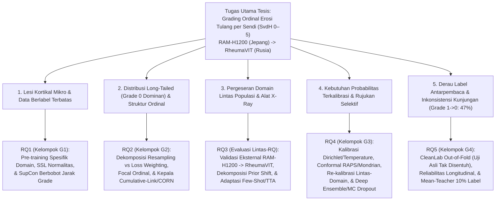

# BAB I: PENDAHULUAN

> **Judul Tesis (Utama):**  
> *Pembelajaran Representasi, Penanganan Ketidakseimbangan Ordinal, Kuantifikasi Ketidakpastian, dan Koreksi Derau Label untuk Grading Erosi Sendi Tangan pada Radiografi Artritis Reumatoid dengan Validasi Eksternal Lintas Populasi*  
> *(Representation Learning, Ordinal Imbalance Handling, Uncertainty Quantification, and Label-Noise Mitigation for Joint-Level Rheumatoid Arthritis Erosion Grading on Hand Radiographs with Cross-Population External Validation)*

---

## 1.1 Latar Belakang

Artritis Reumatoid (*Rheumatoid Arthritis* atau RA) merupakan penyakit autoimun inflamasi kronis sistemik yang secara progresif menyerang membran sinovial sendi periferal—terutama sendi-sendi kecil pada tangan dan pergelangan tangan—hingga mengakibatkan destruksi tulang rawan dan erosi tulang periartikular yang ireversibel [@vanderHeijde2000SvdH; @Yang2026RAMH1200]. Dalam praktik klinis reumatologi maupun uji klinis terapi pemodifikasi penyakit (*Disease-Modifying Antirheumatic Drugs*, DMARDs), radiografi konvensional (sinar-X polos) tetap menjadi modalitas pencitraan lini pertama untuk mendeteksi, memantau, dan mengkuantifikasi kerusakan struktural sendi karena ketersediaannya yang luas, biaya yang rendah, serta reprodusibilitas protokol akuisisinya [@vanderHeijde2000SvdH; @Stolpovsky2023RheumaVIT].

Standar emas internasional untuk mengkuantifikasi tingkat keparahan kerusakan struktural pada radiografi tangan dan kaki pasien RA adalah sistem skoring **Sharp/van der Heijde (SvdH)** atau *modified Total Sharp Score* (mTSS) [@vanderHeijde2000SvdH]. Untuk penilaian erosi tulang pada tangan, metode SvdH menilai 16 area sendi per tangan (mencakup sendi *metacarpophalangeal* [MCP], *proximal interphalangeal* [PIP], *interphalangeal* ibu jari, serta tulang-tulang karpal/pergelangan tangan) pada skala **ordinal diskret $0$ hingga $5$** per sendi (dengan $0$ = normal/tanpa erosi, $1$ = erosi diskret kecil, $2–3$ = erosi meluas sesuai persentase permukaan sendi yang terdampak, hingga $5$ = destruksi/kolaps tulang menyeluruh) [@vanderHeijde2000SvdH; @Yang2026RAMH1200]. Meskipun memiliki validitas klinis yang tinggi, pembacaan SvdH secara manual oleh radiolog atau reumatolog sangat memakan waktu (membutuhkan penilaian puluhan sendi per pasien), bersifat subjektif, dan rentan terhadap variabilitas intra-pengamat (*intra-reader*) maupun antar-pengamat (*inter-reader*) yang signifikan [@Stolpovsky2023RheumaVIT; @M005; @M222].

Perkembangan *deep learning*—baik berbasis *Convolutional Neural Networks* (CNN) maupun *Vision Transformers* (ViT)—telah mendorong berbagai upaya otomatisasi skoring kerusakan sendi RA [@M003; @M005; @M100; @M222; @C007]. Akan tetapi, ketika tugas **grading keparahan erosi tulang per *Region of Interest* (ROI) sendi (SvdH 0–5)** diformulasikan secara cermat pada data klinis nyata seperti benchmark multi-pusat **RAM-H1200** [@Yang2026RAMH1200] dan diuji lintas populasi pada kohort **RheumaVIT** [@Stolpovsky2023RheumaVIT], permasalahan ini memunculkan **empat tantangan statistik dan klinis fundamental** yang hadir secara simultan:

1. **Struktur Kelas Ordinal dengan Biaya Kesalahan Asimetris (*Ordinal Severity Structure*):**
   Derajat erosi SvdH $y \in \{0, 1, 2, 3, 4, 5\}$ merepresentasikan kontinum kerusakan biologis yang terurut [@Cao2020CORAL; @Shi2023CORN; @M089]. Kesalahan memprediksi sendi `Grade 4` sebagai `Grade 0` memiliki konsekuensi klinis yang jauh lebih fatal dibandingkan memprediksinya sebagai `Grade 3`. Namun, fungsi rugi *categorical cross-entropy* (CE) standar mengabaikan struktur urutan ini karena memperlakukan setiap kelas sebagai kategori nominal yang saling ortogonal [@M039; @M089; @M305].
2. **Ketimpangan Kelas Ekstrem yang Didominasi Sendi Normal (*Extreme Long-Tailed Imbalance*):**
   Pada populasi klinis RA, sebagian besar sendi tangan pada suatu waktu pemeriksaan tidak mengalami erosi (`Grade 0` mencakup $>75\%$ dari seluruh ROI sendi), sedangkan erosi derajat menengah hingga berat (`Grade 2–5`) membentuk ekor distribusi (*long tail*) dengan jumlah sampel yang sangat sedikit [@M100; @M222; @C007]. Pelatihan jaringan saraf dalam tanpa mekanisme penyeimbangan menyebabkan gradien pembaruan bobot didominasi oleh kelas `Grade 0`, sehingga menghasilkan akurasi keseluruhan (*overall accuracy*) yang tampak tinggi namun gagal mendeteksi kelas erosi aktif (*recall* kelas minoritas sangat rendah) [@Menon2021LogitAdjustment; @M041; @C093].
3. **Ukuran Lesi Mikro dan Ketidakstabilan Label (*Small Lesion Morphology & Label Noise*):**
   Berbeda dengan klasifikasi citra alami di mana objek utama menempati sebagian besar bidang gambar, erosi tulang dini (`Grade 1–2`) hanya tampak sebagai diskontinuitas kortikal berukuran beberapa piksel di tepi tulang [@Yang2026RAMH1200; @M100]. Subtilitas visual ini, ditambah variasi sudut proyeksi sinar-X saat pemosisian tangan, memicu ketidakstabilan label yang parah baik antarpembaca maupun antarkunjungan longitudinal. Analisis pendahuluan pada kohort longitudinal `RAM-H1200` menunjukkan bahwa **47% sendi yang dilabeli `Grade 1` pada suatu kunjungan tercatat kembali menjadi `Grade 0` pada kunjungan berikutnya**—suatu fenomena yang secara patofisiologis sebagian besar mencerminkan *label noise* di sekitar ambang batas normal/erosi dini, bukan penyembuhan tulang spontan.
4. **Pergeseran Domain Lintas Pusat dan Lintas Populasi (*Cross-Center & Cross-Population Domain Shift*):**
   Model *deep learning* radiografi sangat rentan mempelajari korelasi palsu (*shortcut learning* dari kontras latar belakang, artefak kolimator, atau densitas tulang global) yang spesifik terhadap rumah sakit tempat model dilatih [@M201; @M219; @M249]. Ketika model yang dilatih pada `RAM-H1200` (1.200 radiograf tangan dari 6 pusat medis di Sapporo, Jepang [@Yang2026RAMH1200]) diterapkan tanpa pelatihan ulang pada `RheumaVIT` (330 radiograf tangan bilateral dari *V.A. Nasonova Research Institute of Rheumatology* di Moskow, Rusia [@Stolpovsky2023RheumaVIT]), model menghadapi pergeseran kovariat $P(X)$ (perbedaan mesin sinar-X dan anatomi populasi Asia Timur vs. Eropa Timur), pergeseran prior kelas $P(Y)$, serta perbedaan karakteristik pembacaan radiolog $P(Y|X)$. Selain akurasi titik, jaminan kalibrasi probabilitas dan cakupan himpunan prediksi (*conformal prediction*) juga berisiko runtuh pada kohort eksternal [@M110; @M130].

Tinjauan sistematis awal terhadap 22 studi *deep learning* khusus erosi RA menunjukkan bahwa literatur RA sendiri hampir kosong dari solusi metodologis mutakhir: hanya 2 studi yang mengeksplorasi *self-supervised learning* (SSL) dan **tidak ada satu pun studi erosi RA yang secara eksplisit menangani *label noise* atau menguji ketahanan kalibrasi/conformal lintas populasi**. Sebaliknya, empat tantangan yang identik (skala keparahan ordinal, dominasi kelas normal, ketidaksepakatan antarpembaca, dan pergeseran domain antar-kohort) telah diteliti secara jauh lebih intensif pada tugas grading radiografi muskuloskeletal serumpun, khususnya grading **Kellgren-Lawrence (KL 0–4)** pada osteoartritis (OA) lutut dan tangan [@M015; @M041; @M044; @M061; @M197]. Oleh karena itu, tesis ini diawali dengan sebuah **Systematic Literature Review Metodologis (SLR-M)** periode 2021–2026 untuk memetakan, mengaudit secara forensik, dan menyeleksi kandidat metode terbaik dari empat kelompok metodologi (`G1` Pre-training/SSL, `G2` Imbalance/Ordinalitas, `G3` Kalibrasi/Uncertainty, dan `G4` Label Noise/Teacher-Student) sebagai dasar perancangan studi ablasi dan validasi eksternal yang ketat.

---

## 1.2 Identifikasi Masalah dan Celah Penelitian (*Research Gaps*)

Berdasarkan hasil sintesis dan audit verifikasi teks penuh atas 54 kandidat naskah dalam SLR-M (yang menghasilkan **44 studi unik valid** setelah mengeksklusi 10 berkas tidak memenuhi syarat, preprint belum peer-review, duplikat, atau terbukti fabrikasi; lihat Bab II), teridentifikasi **empat celah penelitian utama** yang belum terjawab oleh literatur saat ini:

1. **Absennya Studi Ablasi Terkontrol Lintas Empat Pilar Metodologi (`G1–G4`) pada Grading Erosi RA Tingkat Sendi:**
   Dari 44 studi valid dalam SLR-M, 39 studi (88,6%) berfokus pada OA lutut atau pinggul, dan hanya 5 studi (11,4%) yang meneliti RA tangan (`M003, M005, M100, M222, C007`). Dari kelima studi RA tersebut, dua studi hanya memprediksi regresi skor total tingkat tangan utuh (`M003` [@M003] dan `M005` [@M005]), satu studi berfokus pada deteksi anchor objek dengan *adaptive IoU* (`M100` [@M100]), satu studi mengklasifikasikan JSN ke dalam 3 kelas (`M222` [@M222]), dan satu studi kompetisi (`C007` [@C007]) menggunakan pengodean biner kumulatif tanpa ablasi komponen (`Q1_abl = N`). Selain itu, bukti di literatur OA menunjukkan kontradiksi menarik yang belum pernah diuji pada RA: misalnya, penambahan *class weighting* di atas kepala ordinal justru menurunkan Macro-F1 sebesar `-5,0%` pada `M071` [@M071], sementara *oversampling* murni dan kombinasinya dengan *Focal Loss* memberikan peningkatan paling konsisten pada sendi jari OA (`M041` [@M041]).
2. **Kelemahan Desain Eksperimen Literatur: Kebocoran Tingkat Pasien (*Patient-Level Leakage*) dan Ketiadaan Kuantifikasi Varians:**
   Audit kualitas bukti (`Q1–Q6`) pada 44 studi valid SLR-M mengungkap bahwa **70,5% (`31/44`) studi tidak memastikan pemisahan data pada tingkat pasien (`Q3_patient = N` atau `U`)**. Karena satu pasien memiliki dua tangan/lutut dan sering kali memiliki beberapa kunjungan longitudinal, pembagian acak pada tingkat citra (*image-level split*) menyebabkan citra dari pasien yang sama bocor antara data latih dan data uji, yang menggelembungkan akurasi secara semu (seperti terlihat pada `M071` [@M071], `M150` [@M150], dan `M201` [@M201]). Lebih buruk lagi, beberapa studi menerapkan *oversampling* atau SMOTE pada seluruh dataset *sebelum* pembagian data latih dan uji (`M160` [@M160], `M162` [@M162], `M275` [@M275], `C037` [@C037]). Di samping itu, **56,8% (`25/44`) studi hanya melaporkan satu kali pelatihan (*single run*) tanpa simpangan baku multi-seed ataupun interval kepercayaan (`Q2_runs = N/U`)**.
3. **Bias Sirkularitas akibat Modifikasi Label Himpunan Uji (*Test-Set Label Modification*) pada Literatur *Label Noise* (`G4`):**
   Temuan paling kritis dari audit forensik SLR-M terletak pada kelompok metode penanganan derau label (`G4`). Seluruh tiga studi yang mengklaim lonjakan akurasi dramatis (+13% hingga +24%) menggunakan *Confident Learning* (`CleanLab` [@Northcutt2021ConfidentLearning]) atau *cascade metric relabeling*—yaitu **`M042`** [@M042], **`M117`** [@M117], dan **`M272`** [@M272]—terbukti **mengubah atau membuang label pada himpunan uji**. Pada `M042`, penulis menggabungkan seluruh data latih, validasi, dan uji (8.260 citra) sebelum merelabeli 286 citra dengan VGG19 Cascade-I dan mengevaluasi VGG19 Cascade-II pada label yang telah diubah tersebut. Pada `M272`, `CleanLab` menimpa 22,0% (364/1.656) label uji; ketika model yang dilatih dengan `CleanLab` dievaluasi secara jujur pada **label himpunan uji asli yang tidak disentuh**, peningkatan akurasinya **tidak signifikan secara statistik (uji McNemar $p = 0,076$)** [@M272]. Dengan demikian, efektivitas sejati metode koreksi derau label pada grading radiografi muskuloskeletal—apabila dievaluasi secara ketat pada label uji asli dan divalidasi terhadap multi-radiolog eksternal—masih merupakan pertanyaan ilmiah yang belum terjawab.
4. **Kekosongan Validasi Eksternal Lintas Populasi pada RA serta Belum Terujinya Ketahanan *Conformal Prediction* Lintas Rumah Sakit:**
   Hanya **25,0% (`11/44`)** studi di SLR-M yang melakukan validasi eksternal lintas pusat atau lintas dataset (`M015, M039, M044, M061, M091, M106, M153, M155, M185, M201, M219`), dan **tidak ada satu pun (`0/5`) yang berasal dari domain RA**. Studi-studi OA yang melakukan uji eksternal membuktikan bahwa evaluasi internal saja menggelembungkan performa sebesar 8% hingga 32% (misalnya akurasi `M091` [@M091] turun dari `89–93%` di OAI menjadi `61,0%` *zero-shot* pada kohort eksternal; akurasi `M044` [@M044] turun dari `93,9%` di OAI menjadi `86,2%` di MOST). Lebih jauh lagi, belum ada studi di literatur yang memisahkan kontribusi *covariate shift* vs. *target prior shift*, maupun menguji apakah jaminan cakupan $1-\alpha = 90\%$ dari *Conformal Prediction* (`APS` / `RAPS` [@Angelopoulos2021RAPS; @M110]) tetap bertahan saat model dipindahkan ke rumah sakit di negara lain.

---

## 1.3 Rumusan Masalah dan Hipotesis Penelitian

Untuk menjawab keempat celah penelitian di atas secara sistematis, penelitian tesis ini merumuskan **lima Pertanyaan Penelitian (*Research Questions*, RQ1–RQ5)** beserta hipotesis kerjanya:

1. **RQ1 (Pre-training, Self-Supervised Learning, dan Strategi Transfer — Kelompok `G1`):**
   *Seberapa besar peningkatan kinerja grading ordinal erosi tulang per sendi (terutama pada rezim efisiensi label 10% dan kelas erosi minoritas) yang dihasilkan oleh pre-training spesifik-domain/tugas antara (`RSNA Bone Age`, foundation model MSK `SKELEX`), pembelajaran kontras terbimbing sadar-urutan (`SupCon` berbobot jarak grade), dan SSL berbasis normalitas sendi sehat (`SS-FewSOME`), serta strategi fine-tuning (`Linear Probe`, `LP-FT`, `LLRD`) dibandingkan dengan inisialisasi ImageNet standar?*
   - **Hipotesis H1:** Pre-training pada domain radiografi tangan/MSK (`M005, M015`), objektif `SupCon` dengan tolakan negatif proporsional terhadap jarak grade $|y_i - y_j|$ (`M219`), serta `SSL normalitas` yang memanfaatkan melimpahnya sendi `Grade 0` (`M197`) akan meningkatkan `BACC4` dan `QWK` secara bermakna dibanding inisialisasi ImageNet standar, dengan selisih keuntungan terbesar terjadi pada rezim **10% label**; selain itu, penyetelan penuh bertahap (`LP-FT` / `LLRD`) akan mengungguli *frozen linear probe* (`M157`).

2. **RQ2 (Penanganan Ketidakseimbangan Kelas dan Keparahan Ordinal — Kelompok `G2`):**
   *Bagaimana kontribusi terpisah maupun interaksi dari penyeimbangan tingkat data (`Oversampling` murni vs. `Undersampling Grade 0`), penyeimbangan tingkat fungsi rugi (`Class Weight` murni, `Balanced Softmax / Logit Adjustment`, `Focal / Focal Ordinal Loss`), kepala regresi ordinal (`Cumulative-Link ORM`, `CORN`, `Distance-Penalty / Soft Label`), serta kalibrasi inferensi pasca-latih (`Validation Threshold Tuning`, `FAISS k-NN`, `TTA`) terhadap keseimbangan sensitivitas antarkelas (`BACC4`) dan ketepatan urutan (`QWK`, `MAE`)?*
   - **Hipotesis H2:** Memisahkan `Oversampling` dari `Class Weight` akan membuktikan bahwa *oversampling* (`M041, M222`) dan *Balanced Softmax* (`B2`) lebih stabil daripada pembobotan loss kasar yang rentan merusak presisi kelas menengah (`M071`); penggabungan `Focal Loss + Oversampling` (`M041, C093`) serta penggantian kepala klasifikasi dengan *Cumulative-Link Ordinal Regression Module* (`M089`) atau *Soft Label Ordinal* (`M305`) akan memperbaiki `QWK` dan `MAE` tanpa mengorbankan `BACC4`.

3. **RQ3 (Ketahanan, Dekomposisi Pergeseran Domain, dan Adaptasi Lintas Populasi `RAM-H1200` $\to$ `RheumaVIT`):**
   *Seberapa besar penurunan kinerja (*domain drop*) dari seluruh varian model `RQ1`, `RQ2`, `RQ4`, dan `RQ5` ketika diuji lintas populasi dari `RAM-H1200` (Jepang) ke `RheumaVIT` (Rusia), berapa proporsi penurunan tersebut yang disebabkan oleh pergeseran prevalensi kelas (*prior shift*) dibandingkan pergeseran karakteristik citra (*covariate shift*), dan sejauh mana adaptasi tanpa label (`TTA`, `Test-Time BN`) maupun adaptasi few-shot (`5` dan `20` pasien dengan `Cross-Domain SupCon` berbobot jarak) mampu memulihkan kinerja hingga mendekati kesepakatan antar-radiolog manusia?*
   - **Hipotesis H3:** Model yang dilengkapi representasi SSL spesifik-domain (`RQ1`), regularisasi ordinal/penyesuaian prior `B2` (`RQ2`), dan mitigasi derau label (`RQ5`) akan mengalami *domain drop* yang lebih kecil dibanding baseline CE; koreksi prior kelas dan *Test-Time Adaptation* akan memulihkan sebagian degradasi tanpa label target, sementara adaptasi *few-shot* 5–20 pasien dengan *Cross-Domain SupCon* (`M219, M091`) akan mengangkat `QWK` eksternal ke dalam rentang kesepakatan antar-3 radiolog `RheumaVIT`.

4. **RQ4 (Kalibrasi Probabilitas, Prediksi Konformal, dan Rujukan Selektif — Kelompok `G3`):**
   *Metode kalibrasi pasca-latih (`Temperature Scaling` vs. `Vector/Dirichlet Calibration`), prediksi konformal (`Contiguous Ordinal APS`, `RAPS`, vs. `Class-Conditional Mondrian`), dan skor ketidakpastian (`Deep Ensemble` antar-seed vs. `MC Dropout` vs. `Evidential DL`) mana yang menghasilkan kesalahan kalibrasi (`ECE`) terendah, jaminan cakupan $\ge 90\%$ yang paling merata di setiap grade (baik internal maupun pasca-rekalibrasi ringan di `RheumaVIT`), serta kurva *risk-coverage* terbaik untuk merujuk kasus meragukan ke klinisi?*
   - **Hipotesis H4:** *Mondrian Conformal Prediction* dan `RAPS` (`M110`) akan mencegah keruntuhan cakupan pada kelas erosi minoritas ($\text{grade} \ge 2$) yang terjadi pada konformal marginal standar; di kohort eksternal `RheumaVIT`, re-kalibrasi kuantil konformal menggunakan hanya 5–20 pasien tanpa melatih ulang bobot jaringan akan memulihkan jaminan cakupan 90%; serta varians *Deep Ensemble* dan *MC Dropout* (`M130, M039`) akan memprediksi kesalahan model secara akurat (`AUROC Uncertainty` $\to$ `Error` $> 0,75$).

5. **RQ5 (Mitigasi Derau Label, Reliabilitas Longitudinal, dan Pembelajaran Semi-Terbimbing — Kelompok `G4`):**
   *Ketika dievaluasi secara jujur pada label himpunan uji asli yang tidak disentuh (`RAM-H1200`) serta pada konsensus dan distribusi probabilitas 3 radiolog eksternal (`RheumaVIT`), apakah penyaringan/koreksi label berbasis `CleanLab` Out-of-Fold (`Relabel`, `Prune`, `Down-weight`), pemisahan reliabilitas sampel berdasarkan konsistensi kunjungan longitudinal, `Label Smoothing / Soft Label`, serta pembelajaran semi-terbimbing `Mean-Teacher` (pada rezim 10% label) mampu meningkatkan generalisasi model?*
   - **Hipotesis H5:** Sesuai temuan audit forensik atas `M272` [@M272], modifikasi keras (*hard relabeling*) pada data latih dengan `CleanLab` hanya akan memberikan keuntungan marginal pada label uji asli yang *noisy*, sedangkan penurunan bobot (*down-weighting*) sampel yang tidak konsisten secara longitudinal (seperti transisi semu `Grade 1` $\to$ `Grade 0`), penggunaan *reader-informed ordinal soft labels* (`M238`), serta regularisasi konsistensi *Mean-Teacher* pada rezim 10% label (`M061, M077, M185`) akan meningkatkan generalisasi baik terhadap label konsensus maupun terhadap distribusi probabilitas 3 radiolog `RheumaVIT`.

---

## 1.4 Tujuan dan Kontribusi Penelitian

### 1.4.1 Tujuan Penelitian
1. Menyajikan sintesis bukti metodologis dan audit kualitas/forensik dari *Systematic Literature Review* (`SLR-M`, 2021–2026) atas 44 studi *deep learning* grading ordinal radiografi muskuloskeletal dalam empat kelompok metode (`G1–G4`).
2. Mengukur secara terkontrol (*single-axis ablation*) efek metode pre-training/SSL (`RQ1`) dan penanganan ketidakseimbangan/keparahan ordinal (`RQ2`) beserta interaksinya terhadap kinerja grading erosi sendi tangan RA pada rezim label penuh (100%) dan label terbatas (10%).
3. Mengevaluasi ketahanan lintas populasi (`RAM-H1200` Jepang $\to$ `RheumaVIT` Rusia, `RQ3`), memisahkan efek *prior shift* vs. *covariate shift*, menguji mekanisme *shortcut learning* dengan masker erosi piksel, serta mengukur efektivitas adaptasi *zero-label* dan *few-shot*.
4. Merancang dan mengevaluasi kerangka kerja kalibrasi probabilitas, *Conformal Prediction* (`APS`, `RAPS`, `Mondrian` beserta re-kalibrasi lintas-domain), dan rujukan selektif berbasis ketidakpastian (`RQ4`).
5. Membuktikan secara bebas-bocoran efektivitas strategi mitigasi derau label (`CleanLab OOF`, reliabilitas longitudinal, *soft labels*, dan *Mean-Teacher*, `RQ5`) pada himpunan uji asli dan terhadap distribusi multi-radiolog eksternal.

### 1.4.2 Kontribusi Ilmiah dan Kebaruan (*Novelty*)
1. **Kontribusi Literatur & Metodologi Evaluasi (Audit Forensik SLR-M):** Menetapkan tolok ukur kualitas baru melalui audit 6 kriteria (`Q1–Q6`) dan mengungkap bias sirkularitas *test-set label modification* (`M042, M117, M272`) serta *pre-split resampling leakage* (`M160, M162, M275`) yang selama ini mendistorsi klaim performa di literatur radiografi muskuloskeletal.
2. **Kontribusi Algoritmik Spesifik-Domain (`RQ1, RQ2, RQ5`):** Mengusulkan dan menguji (a) *SupCon berbobot jarak grade ordinal* dan *SSL normalitas berbasis sendi Grade 0* untuk radiografi tangan RA, (b) dekomposisi efek *oversampling* murni vs. *class weighting* murni vs. *Focal + Oversampling* dan kepala *Cumulative-Link*, serta (c) skema pembobotan reliabilitas sampel berbasis konsistensi transisi kunjungan longitudinal.
3. **Kontribusi Validasi Eksternal & Keandalan Klinis (`RQ3, RQ4`):** Melakukan validasi eksternal lintas-benua pertama untuk grading erosi RA tingkat sendi (`RAM-H1200` $\to$ `RheumaVIT`), memperkenalkan protokol *Cross-Domain Split-Conformal Re-calibration* yang memulihkan jaminan cakupan 90% di rumah sakit target hanya dengan 5–20 pasien tanpa pelatihan ulang bobot, serta mengevaluasi model terhadap distribusi empiris 3 radiolog independen dan uji diagnostik *pixel-level lesion masking*.

---

## 1.5 Ruang Lingkup, Batasan, dan Sistematika Penulisan

### 1.5.1 Ruang Lingkup dan Batasan Penelitian
1. **Fokus Tugas dan Anotasi:** Penelitian berfokus pada klasifikasi/grading derajat keparahan erosi tulang per ROI sendi tangan menurut skala ordinal SvdH (5 kelas pada konfigurasi eksperimen utama `RAM-H1200`: `Grade 0` hingga `Grade 4+`). Lokalisasi/deteksi kotak pembatas sendi menggunakan ROI yang telah terdefinisi pada dataset sehingga evaluasi terfokus murni pada kinerja representasi dan klasifikasi ordinal tanpa tercampur galat detektor.
2. **Kohort Data:** Pelatihan, validasi, dan pengujian internal dilakukan pada dataset publik multi-pusat **RAM-H1200** (1.200 radiograf tangan dari 6 pusat medis di Jepang [@Yang2026RAMH1200]) dengan pembagian *strict patient-level*. Validasi eksternal lintas populasi dilakukan pada dataset **RheumaVIT** (330 radiograf tangan bilateral dari Moskow, Rusia, dengan anotasi 3 radiolog ahli [@Stolpovsky2023RheumaVIT]).
3. **Batasan Komputasi dan Arsitektur:** Seluruh eksperimen dirancang agar dapat direproduksi pada satu unit GPU kelas konsumen/laboratorium (**NVIDIA RTX 3060 12 GB**), dengan arsitektur tulang punggung (*backbone*) utama `ResNet-34` dan `ViT-Small` (serta evaluasi efisiensi terukur pada `ViT-Large` untuk foundation model `SKELEX` [@M015]).

### 1.5.2 Sistematika Penulisan Tesis
- **Bab I (Pendahuluan):** Menguraikan latar belakang klinis dan teknis, empat sifat masalah grading erosi sendi RA, celah penelitian dari SLR, rumusan masalah (`RQ1–RQ5`), hipotesis, tujuan, kontribusi, serta ruang lingkup penelitian.
- **Bab II (Tinjauan Pustaka dan Systematic Literature Review Metodologis — SLR-M):** Menyajikan dasar teori skoring SvdH, protokol PRISMA-P dan hasil seleksi SLR-M (2021–2026), verifikasi antar-penilai, sintesis naratif terstruktur (SWiM) atas 44 studi valid pada kelompok `G1–G4`, audit kualitas bukti (`Q1–Q6`), analisis forensik bias metodologis literatur, serta pemetaan kandidat ablasi tesis.
- **Bab III (Metodologi Penelitian dan Desain Eksperimen):** Menjelaskan karakteristik dataset `RAM-H1200` dan `RheumaVIT`, protokol partisi tingkat pasien, konfigurasi rujukan (`RQ0`), formulasi matematis setiap kandidat metode pada `RQ1–RQ5`, protokol eksplorasi validasi eksternal, serta rencana analisis statistik pra-spesifikasi.
- **Bab IV (Hasil Eksperimen dan Analisis Ablasi Internal):** Melaporkan dan membahas hasil eksperimen pasca-latih (`RQ2-P`, `RQ4-P`) serta hasil ablasi terkontrol untuk `RQ1`, `RQ2`, `RQ4`, dan `RQ5` pada himpunan uji internal `RAM-H1200` (rezim 100% dan 10% label).
- **Bab V (Validasi Eksternal Lintas Populasi dan Analisis Diagnostik):** Membahas hasil evaluasi lintas populasi pada `RheumaVIT` (`RQ3`), dekomposisi *prior shift* vs. *covariate shift*, adaptasi *zero-label* dan *few-shot*, ketahanan dan re-kalibrasi *Conformal Prediction* lintas rumah sakit, evaluasi terhadap 3 radiolog independen, serta hasil uji diagnostik *shortcut learning* berbasis masker piksel erosi.
- **Bab VI (Kesimpulan dan Saran):** Merangkum jawaban atas kelima pertanyaan penelitian (`RQ1–RQ5`), menyusun pedoman praktis perancangan sistem AI grading ordinal radiografi muskuloskeletal, dan memaparkan arah penelitian lanjutan.
