# BAB VI: KESIMPULAN DAN SARAN

Bab penutup ini merangkum jawaban empiris definitif atas seluruh Pertanyaan Penelitian (**`RQ0` hingga `RQ5`**) berdasarkan hasil *Systematic Literature Review Metodologis* (`SLR-M`, 44 studi valid) serta `442` eksperimen ablasi terkontrol dan evaluasi validasi eksternal lintas-benua antara kohort internal **`RAM-H1200`** (Sapporo, Jepang [@Yang2026RAMH1200]) dan kohort eksternal **`RheumaVIT`** (Moskow, Rusia [@Stolpovsky2023RheumaVIT]). Selanjutnya, bab ini merumuskan pedoman praktis rekayasa sistem *deep learning* untuk grading ordinal radiografi muskuloskeletal yang andal secara klinis, menguraikan keterbatasan penelitian, serta memetakan arah penelitian lanjutan.

---

## 6.1 Kesimpulan per Pertanyaan Penelitian (`RQ0` – `RQ5`)

Berdasarkan pengujian hipotesis pra-spesifikasi menggunakan *Patient-Level Cluster Bootstrap* ($B = 5.000$ replikasi) dan koreksi *step-down Holm-Bonferroni* ($\alpha = 0,05$), diperoleh enam kesimpulan utama sebagai berikut:

### 1. Kesimpulan `RQ0` (Jangkar Rujukan & Arsitektur Visual pada `RAM-H1200`)
* Konfigurasi jangkar rujukan **`RQ0-01`** (`ResNet-34` pralatih ImageNet + kepala `B2` [*Prior Logit Adjustment* + *Inverse-Square-Root Sampler*]) menetapkan kinerja acuan yang bebas-kebocoran pasien sebesar **`Test BACC4 = 0.4855 [0.4362, 0.5141]`** dan **`Test QWK = 0.4832 [0.3822, 0.5683]`** pada rezim `100%` label (`f1.0`), serta **`Test BACC4 = 0.3619 [0.3346, 0.3836]`** dan **`Test QWK = 0.2352 [0.1537, 0.3222]`** pada rezim `10%` label (`f0.1`).
* Penggantian *backbone* dengan arsitektur konvolusional modern ber-kernel lebar **`ConvNeXt-Tiny` (`RQ0-02`)** menghasilkan peningkatan kesepakatan kuadratik ordinal (`Test QWK`) yang sangat signifikan secara statistik baik pada rezim 100% label (**`0.5515 [0.4648, 0.6258]`**, $\Delta = +0.0682, p_{\text{Holm}} = 0.0012^*$) maupun 10% label (**`0.3164 [0.2286, 0.3988]`**, $\Delta = +0.0812, p_{\text{Holm}} = 0.0004^*$), serta menurunkan `MAE` sebesar `-13,6%` (`0.3940` $\rightarrow$ `0.3404`), membuktikan pentingnya medan reseptif lokal $7 \times 7$ dalam menangkap kontinuitas tepi kortikal periartikular.

### 2. Kesimpulan `RQ1` (Pembelajaran Representasi, *Domain SSL*, Kontrastif Ordinal, Normalitas, & Strategi *Fine-Tuning*)
* **Efektivitas Spesifik-Rezim dari *Domain SSL* vs *Supervised Ordinal Contrastive*:**
  * Pada **rezim kelangkaan label (`10% label`, `f0.1`)**, pra-pelatihan rekonstruksi piksel bertopeng **`Domain SSL MAE ViT-S/16 + LLRD` (`RQ1-05`)** menjadi metode terbaik di seluruh `RQ1`, meningkatkan `Test BACC4` sebesar **`+5,29%`** (`0.3619` $\rightarrow$ **`0.4148 [0.3689, 0.4502]`**, $p_{\text{raw}} = 0.0216$) dan meningkatkan `Test QWK` secara signifikan sebesar **`+9,48%`** (`0.2352` $\rightarrow$ **`0.3300 [0.2240, 0.4369]`**, **$p_{\text{Holm}} = 0.0160^*$**), serta mempertahankan transfer *zero-shot* lintas-benua yang jauh lebih kuat di `RheumaVIT` (`External BACC4 = 0.3712` vs `0.2566` pada jangkar).
  * Pada **rezim label penuh (`100% label`, `f1.0`)**, penataan struktur ruang laten melalui **`SupCon-Ord` (*Grade-Distance-Weighted Supervised Contrastive*, `RQ1-13`, adaptasi `M219` [@M219])** memberikan kombinasi performa terbaik (**`Test BACC4 = 0.5034 [0.4615, 0.5291]`**, $\Delta = +0.0179$; **`Test QWK = 0.5111 [0.4163, 0.5912]`**, $\Delta = +0.0278$, **$p_{\text{Holm}} = 0.0384^*$**; `Macro-F1 = 0.4256`; `MAE = 0.3516`), mengungguli `SupCon` standar tanpa bobot jarak (`RQ1-12`: `BACC4 = 0.4733`, `QWK = 0.4959`).
* **Pembuktian Keruntuhan *Frozen Linear Probe* dan Pemulihan oleh `LP-FT`:** Pembekuan *encoder* (*Frozen Linear Probe*, `RQ1-17a` & `RQ1-17c`) terbukti meruntuhkan `Test QWK` secara signifikan ($\Delta\text{QWK} = -0.2525$ pada `ResNet-34` dan $-0.1465$ pada `MAE ViT-S`, keduanya $p_{\text{Holm}} = 0.0056^*$, mengonfirmasi `M157` [@M157]). Sebaliknya, strategi dua-tahap **`LP-FT` (*Linear Probe then Fine-Tune* [@Kumar2022LPFT])** mencegah distorsi fitur pralatih dan mengangkat kinerja `ImageNet ResNet-34` (`RQ1-17b`) ke **`BACC4 = 0.5012 / QWK = 0.5023`** serta mengangkat `Test BACC4` `MAE ViT-S/16` (`RQ1-17d`) sebesar **`+4,63%`** (`0.4548` $\rightarrow$ **`0.5011`**) dengan skor seleksi validasi tertinggi ($S_{\text{val}} = 0.4676$).
* **Bukti Refutasi Pendekatan Jarak Normalitas Satu-Kelas:** Metode berbasis jarak normalitas satu-kelas (`SS-FewSOME` `RQ1-14` [@M231] dan *2-Stage Normality Gate* `RQ1-15`) terbukti gagal pada grading multi-sendi tangan RA (`QWK = -0.0419` dan `0.1119`, $p_{\text{Holm}} = 0.0056^*$) karena variasi anatomi antar-jenis sendi normal (`PIP`, `MCP`, `Karpal`) mendominasi metrik jarak Euclidean satu-pusat.

### 3. Kesimpulan `RQ2` (Ketimpangan Kelas Ekstrem, Formulasi *Loss/Head* Ordinal, Metode *Post-Hoc* `0-GPU`, & Interaksi `RQ1 × RQ2`)
* **Dekomposisi Penanganan Ketimpangan Kelas:** Pelatihan tanpa kompensasi ketimpangan kelas (`RQ2-01` Plain CE) menjatuhkan `Test BACC4` sebesar `-7,23%` (`100%`) dan `-7,75%` (`10%`, $p_{\text{Holm}} = 0.0088^*$). Dalam perbandingan faktor tunggal, `Oversampling-only` (`RQ2-03`: `BACC4 = 0.4493 / 0.3292`, `QWK = 0.4652 / 0.2538`) konsisten mengungguli `Class-Weight-only` (`RQ2-04`: `BACC4 = 0.4463 / 0.3027`, `QWK = 0.4571 / 0.2251`) maupun penggabungan ganda naif `B1` (`RQ2-02`: `BACC4 = 0.4347 / 0.2757`), sedangkan kepala **`B2` (*Prior Logit Adjustment + InvSqrtSampler*, `RQ0-01`)** unggul secara signifikan di atas ketiganya ($p_{\text{Holm}} \le 0.0112^*$).
* **Sinergi *Conditional Ordinal Regression* dengan *Prior Logit Adjustment*:** Seluruh kepala ordinal murni tanpa kompensasi prior (`CORN` `RQ2-05`: `BACC4 = 0.3775`, `FOL` `RQ2-11`: `0.3863`, `Cumulative-Link ORM` `RQ2-12`: `0.3610`, `SORD` `RQ2-13`: `0.4107`) gagal mendeteksi kelas minoritas akibat peluruhan probabilitas berantai (*multiplicative minority decay*). Penambahan kompensasi log-prior kondisional ke dalam `CORN` (**`RQ2-06` `CORN + Logit Adjustment`**) berhasil memulihkan **`+9,11%` `Test BACC4`** (`0.3775` $\rightarrow$ **`0.4686`**) dan **`+12,15%` `Test QWK`** (`0.3700` $\rightarrow$ **`0.4915`**). Lebih jauh, regularisasi peringkat hibrida **`RQ2-16` (`B2 + CORN Regularizer`)** dan **`RQ2-17` (*Per-Joint Prior Logit Adjustment*)** meningkatkan `Test QWK` ke **`0.4973`** dan **`0.4986`**, sedangkan interaksi **`RQ2-18b` (`SupCon-Ord + B2_CORNreg`)** mengangkat `Test QWK` ke **`0.5066`** (`100%`) dan **`0.2606`** (`10%`).
* **Keunggulan Intervensi *Post-Hoc* `0-GPU` (`RQ2-P`):** *4-View Test-Time Augmentation* (**`RQ2-Pc`**, `C093` [@C093]) meningkatkan `BACC4` dan `QWK` secara konsisten tanpa pelatihan ulang, mencapai signifikansi statistik pada rezim 10% label (`Test QWK = 0.2581`, $\Delta = +0.0229$, **$p_{\text{Holm}} = 0.0216^*$**). *Cost-Sensitive Threshold Tuning* (**`RQ2-Pa`**) meningkatkan `Test BACC4` ke **`0.4882`** (`100%`) dan **`0.3799`** (`10%`) serta menaikkan `Recall>=2` dari `29,98%` menjadi **`37,68%`**. Sebaliknya, *Feature-Space k-NN* (**`RQ2-Pb`**, `M085` [@M085]) hanya memberikan efek marginal `+0,04%` s.d. `+0,13%` pada pembagian tingkat pasien yang ketat.

### 4. Kesimpulan `RQ3` (Validasi Eksternal Lintas-Populasi pada `RheumaVIT` Rusia & Benchmark 3 Radiolog)
* **Dekomposisi Eksak 52,1% *Target Prior Shift* vs 47,9% *Visual Covariate Shift* (`RQ3-01`):** Dari total penurunan `BACC4` sebesar `-15,81%` ketika model `RAM-H1200` dievaluasi dengan prior sumber di `RheumaVIT` (`0.4794` $\rightarrow$ `0.3213`), **sebesar `+8,23%` (`52,1%` dari total *domain drop*) berhasil dipulihkan seketika menjadi `BACC4 = 0.4036` (dengan lonjakan `Recall>=2` sebesar $3,39\times$ lipat dari `17,14%` $\rightarrow$ `58,10%`) hanya dengan beralih ke *Balanced/Uniform-Prior Logits* tanpa membutuhkan satu pun label atau citra pelatihan dari rumah sakit target (`0-GPU`)**.
* **Mitigasi *Visual Covariate Shift* (`RQ3-02..06`):**
  * Augmentasi fotometrik/kontras radiografik tahan-domain saat pelatihan di sisi sumber (**`RQ3-04`** dan **`RQ3-05`**) tidak hanya meningkatkan performa internal secara signifikan (`RQ3-04` internal `Test BACC4 = 0.5190`, $\Delta = +0.0335$, **$p_{\text{Holm}} = 0.0468^*$**; `10% Test QWK = 0.2774`, **$p_{\text{Holm}} = 0.0288^*$**), tetapi juga mengangkat transfer *zero-shot* `RheumaVIT` ke **`BACC4 = 0.4310`** dan **`0.4324`** (memangkas *domain drop* menjadi hanya `-3,81%`).
  * Pada rezim tanpa label target, `AdaBN` (`RQ3-02`) konsisten mengungguli *Histogram Matching* (`RQ3-03`), menaikkan `BACC4` model 10% label sebesar `+2,73%` (`0.2566` $\rightarrow$ `0.2839`).
  * Pada rezim *few-shot* (`RQ3-06`), adaptasi dengan hanya **5 pasien `RheumaVIT` (`65` sendi)** meningkatkan `QWK` dari `0.1619` $\rightarrow$ **`0.2269`** dan memangkas `MAE` sebesar `-34,5%` (`0.6558` $\rightarrow$ **`0.4294`**), sementara adaptasi dengan **20 pasien `RheumaVIT` (`260` sendi)** mengangkat `External BACC4` ke **`0.4411`** dan `External QWK` ke **`0.2721`** (`MAE = 0.4070`).
* **Posisi Kinerja terhadap Jangkar 3 Radiolog Independen (`RQ3-07`):** Pada $N = 1.551$ sendi uji `RheumaVIT`, rata-rata kesepakatan berpasangan antar-radiolog pakar ($R_0, R_1, R_2$) adalah **`BACC4 = 0.7843`** (`QWK = 0.8632`, dengan `BACC4` `R0 vs R1` sebesar `0.6997` dan `Recall>=2` sebesar `0.5625`), sedangkan batas atas manusia (*Human LORO Ceiling*) adalah **`BACC4 = 0.8145`** (`QWK = 0.8541`). Model *zero-shot* terbaik (`RQ3-04`) mencapai **`BACC4 = 0.4485`** terhadap konsensus (`0.4638` terhadap $R_1$) dengan sensitivitas erosi sedang-berat **`Recall>=2 = 0.8065` terhadap $R_1$**, melampaui sensitivitas berpasangan `R0 vs R1` (`0.5625`).

### 5. Kesimpulan `RQ4` (Kalibrasi Probabilistik, *Ordinal Conformal Prediction*, & Rujukan Selektif)
* **Kalibrasi Probabilistik (`RQ4-P1/P2`):** *Temperature Scaling* menurunkan `Top-1 ECE` sebesar **`-85,5%`** (`0.1361` $\rightarrow$ **`0.0197`**). Untuk estimasi risiko pada distribusi prevalensi klinis alami, ***Temperature Scaling + Log-Prior Recovery*** meraih **`NLL = 0.7627`**, **`Brier = 0.3994`**, dan **`cwECE = 0.0394`**, mengungguli *Vector/Dirichlet Calibration* (`NLL = 0.7879`, `cwECE = 0.0455`).
* **Pemecahan Kegagalan *Minority Coverage* dengan *Mondrian Ordinal Conformal Prediction* (`RQ4-P3/P4`):** *Marginal Ordinal-APS* dan *Marginal Ordinal-RAPS* terbukti melanggar target cakupan $90\%$ pada sendi bererosi sedang-berat (`Cov>=2 = 81,31%` pada `APS` dan `67,35%` pada `RAPS`, dengan cakupan `Grade 3` anjlok ke `46,67%`!). Sebaliknya, ***Mondrian Class-Conditional Ordinal-APS* (`RQ4-P3`)** dan ***Mondrian Joint$\times$Grade* (`RQ4-P4`)** memecahkan kegagalan ini secara tuntas, mengangkat `Cov>=2` ke **`93,75%`** dan **`91,76%`** ($\ge 90\%$ di seluruh kelas erosi). Di rumah sakit eksternal `RheumaVIT`, re-kalibrasi kuantil Mondrian dengan hanya **5 pasien lokal (`0-GPU`)** menjaga `Cov>=2 = 94,29%` sekaligus menyusutkan rata-rata ukuran himpunan prediksi sebesar **`-12,8%`** (`4.090` $\rightarrow$ **`3.566`**).
* **Rujukan Selektif (*Selective Referral*, `RQ4-P5`):** ***3-Seed Deep Ensemble*** mengungguli model tunggal maupun `MC Dropout` (`RQ4-01`), menurunkan `AURC` ke **`0.2409`**, dan pada cakupan `80%` (merujuk 20% sendi paling meragukan ke radiolog) meningkatkan kinerja menjadi **`BACC4 = 0.5228`** dan **`QWK = 0.5331`**.

### 6. Kesimpulan `RQ5` (Mitigasi Derau Label Bebas-Kebocoran, Reliabilitas Longitudinal, `Mean-Teacher`, & `RQ5-E`)
* **Pembuktian Empiris Efek Null `CleanLab Hard Relabeling` pada Label Uji Murni (`RQ5-01`):** Ketika diterapkan secara bebas-kebocoran murni di dalam himpunan latih melalui *5-fold patient-wise OOF* dan dievaluasi secara jujur pada himpunan uji asli yang tak disentuh (`100% label`), `CleanLab Hard Relabeling` menghasilkan efek **null** (**`Test BACC4 = 0.4889`**, $\Delta = +0.0034, p_{\text{raw}} = 0.8054, p_{\text{Holm}} = 1.0000$; `Test QWK = 0.4656`, $\Delta = -0.0177$). Hasil ini membuktikan secara empiris temuan audit forensik Bab II bahwa klaim lonjakan akurasi ekstrem pada studi literatur (`M042` [@M042], `M117` [@M117], `M272` [@M272]) merupakan artefak dari modifikasi label himpunan uji.
* **Keunggulan Signifikan *Soft Down-Weighting* dan *Longitudinal Visit-Reliability* (`RQ5-03`, `RQ5-06`, `RQ5-07`):** Peredaman lunak terhadap sampel meragukan dan sampel yang melanggar monotonisitas progresi longitudinal ($\Delta S < 0$) meningkatkan `Test QWK` secara signifikan pasca-koreksi Holm pada `100% label`:
  * **`RQ5-06` (*Confidence-Split Soft Label Regularization*):** `Test BACC4 = 0.5111`, **`Test QWK = 0.5299`** ($\Delta = +0.0467$, **$p_{\text{Holm}} = 0.0044^*$**), `Macro-F1 = 0.4431`, `MAE = 0.3511`.
  * **`RQ5-07` (*Longitudinal Visit-Reliability Down-Weighting*):** `Test BACC4 = 0.4987`, **`Test QWK = 0.5264`** ($\Delta = +0.0432$, **$p_{\text{Holm}} = 0.0044^*$**).
  * **`RQ5-03` (*OOF CleanLab Soft Quality Down-Weighting*):** `Test BACC4 = 0.5001`, **`Test QWK = 0.5194`** ($\Delta = +0.0362$, **$p_{\text{Holm}} = 0.0056^*$**).
* ***Semi-Supervised Mean-Teacher* (`RQ5-11`):** Pada rezim `25% label` (`f0.25`), pemanfaatan pasien tak berlabel melalui konsistensi EMA guru-murid meningkatkan `Test BACC4` secara signifikan menjadi **`0.4289 [0.3999, 0.4508]`** ($\Delta = +0.0670$ di atas baseline 10%, **$p_{\text{Holm}} = 0.0052^*$**) dengan `Recall>=2 = 0.4500`.
* **Bukti Evaluasi Distributional Multi-Radiolog (`RQ5-E`):** Pada `1.551` sendi uji 3-radiolog `RheumaVIT`, model memiliki `BACC4` lebih tinggi sebesar **`+13,56%` s.d. `+14,94%`** dan `KL-Divergence` hampir separuh lebih rendah pada `1.436` sendi yang disepakati bulat oleh ke-3 radiolog (*Unanimous*, `92,59%`) dibandingkan pada `115` sendi yang diperdebatkan antar-radiolog (*Disagreement*, `7,41%`), membuktikan bahwa ketidakpastian prediksi model berimpit erat dengan ambiguitas aleatorik antar-pakar manusia.

---

## 6.2 Implikasi Metodologis dan Pedoman Praktis Desain AI Grading Ordinal Radiografi

Berdasarkan sintesis temuan Bab II hingga Bab V, tesis ini merumuskan **Enam Prinsip Rekayasa Sistem AI Grading Ordinal Radiografi (*The Six-Pillar Trustworthy Ordinal Radiology AI Blueprint*)** yang direkomendasikan bagi peneliti dan pengembang perangkat lunak medis:

```mermaid
flowchart TD
    P1["Pilar 1: Tata Kelola Split & Evaluasi Bebas-Bocoran<br/>- Strict Patient-Level Split (Seluruh Sendi & Kunjungan Pasien di Satu Partisi)<br/>- Imutabilitas Mutlak Label Validasi & Uji (Tanpa Relabeling Uji)<br/>- Patient-Cluster Bootstrap (B=5.000) + Koreksi Holm-Bonferroni"]
    P2["Pilar 2: Pemilihan Backbone & Strategi Fine-Tuning Sesuai Rezim Data<br/>- Rezim Low-Label (<=10%): Domain SSL MAE ViT-S/16 + LLRD<br/>- Rezim Full-Label (100%): ConvNeXt-Tiny atau ResNet-34 + SupCon-Ord (M219)<br/>- Wajib Gunakan LP-FT (Linear Probe -> Fine-Tune) & Hindari Frozen Linear Probe"]
    P3["Pilar 3: Penanganan Imbalance Ekstrem & Struktur Kepala Ordinal<br/>- Gunakan B2 (Prior Logit Adjustment + InvSqrtSampler) atau B2 + CORN Regularizer<br/>- Jangan Gunakan CORN/ORM/FOL Murni Tanpa Logit Adjustment<br/>- Jangan Menggabungkan Class-Weight & Oversampling Secara Naif (B1)"]
    P4["Pilar 4: Mitigasi Label Noise & Pemanfaatan Data Longitudinal<br/>- Gunakan 5-Fold Patient-Wise OOF di Dalam Training Set Saja<br/>- Terapkan Confidence-Split Soft Regularization (RQ5-06) & Longitudinal Weighting (RQ5-07)<br/>- Hindari Hard Relabeling Deterministik di Perbatasan Grade 0/1"]
    P5["Pilar 5: Kalibrasi, Keamanan Conformal, & Rujukan Selektif<br/>- Temperature Scaling + Log-Prior Recovery untuk Estimasi Risiko Klinis<br/>- Wajib Gunakan Mondrian Class-Conditional Conformal (Bukan Marginal APS/RAPS)<br/>- Gunakan 3-Seed Deep Ensemble + 4-View TTA untuk Rujukan Selektif 20% Sendi Ambigu"]
    P6["Pilar 6: Protokol Deployment Lintas Rumah Sakit (Cross-Center Rollout)<br/>- Tahap 0-Label: Inferensi Balanced-Prior Logits + Augmentasi Radiografik Tahan-Domain<br/>- Tahap 5 Pasien Lokal (0-GPU): Re-Kalibrasi Kuantil Mondrian Conformal (-12,8% Set Size)<br/>- Tahap 20 Pasien Lokal: Few-Shot Adaptation (+11,02% QWK & -38,0% MAE)"]

    P1 --> P2 --> P3 --> P4 --> P5 --> P6
```

---

## 6.3 Keterbatasan Penelitian (*Limitations*)

Meskipun penelitian ini telah menerapkan protokol ablasi terkontrol dan validasi eksternal lintas-benua yang ketat, terdapat empat keterbatasan yang perlu dicatat secara transparan:
1. **Ketergantungan pada Kotak Pembatas ROI Sendi Teranotasi (*Pre-Cropped Joint ROIs*):** Untuk mengisolasi kinerja klasifikasi/regresi ordinal tingkat sendi dari kesalahan lokalisasi detektor objek (sebagaimana dipisahkan pada benchmark `ramscore` [@Yang2026RAMH1200]), seluruh eksperimen pada tesis ini menggunakan potongan ROI sendi yang diekstraksi dari koordinat sendi terverifikasi. Dalam alur kerja otomatis penuh dari radiograf tangan utuh (*end-to-end whole-hand pipeline*), ketidakakuratan lokalisasi sendi karpal yang saling bertumpuk dapat menambah varians prediksi.
2. **Keterbatasan Proyeksi Radiografi 2-Dimensi (*2D Planar Superposition*):** Radiografi proyeksi posteroanterior (PA) memampatkan struktur tulang 3-dimensi menjadi citra 2-dimensi. Pada sendi pergelangan tangan (`Wrist/Carpal`) dan sendi `PIP` yang mengalami fleksi atau subluksasi pada RA lanjut, superposisi kortikal secara fisik membatasi visibilitas cekungan erosi bahkan bagi radiolog manusia (`Human LORO Ceiling BACC4 = 0.8145`).
3. **Kelangkaan Sampel Kelas Destruksi Ekstrem (`Grade 3` dan `Grade 4+`) pada Kohort Eksternal:** Pada kohort eksternal `RheumaVIT`, proporsi sendi dengan destruksi lanjut (`Grade >= 3`) sangat kecil sehingga interval kepercayaan pada kelas tertinggi menjadi lebih lebar dibandingkan pada kohort internal `RAM-H1200`.
4. **Cakupan Anatomi Fokus pada Sendi Tangan dan Pergelangan Tangan:** Evaluasi pada tesis ini berfokus pada sendi tangan/pergelangan tangan (16–21 sendi di `RAM-H1200` dan 13 sendi irisan di `RheumaVIT`), dan belum mencakup sendi kaki depan (*forefoot* MTP 1–5 dan IP ibu jari kaki) yang juga termasuk dalam skema SvdH total klinis (maksimum skor erosi total 280).

---

## 6.4 Saran dan Arah Penelitian Lanjutan (*Future Work*)

Berdasarkan temuan dan keterbatasan di atas, empat arah penelitian lanjutan yang paling menjanjikan adalah:
1. **Arsitektur *Graph Neural Network* Multi-Sendi Sadar-Anatomi & Multi-Tugas (`Erosi + JSN`):** Mengingat kerusakan RA memiliki pola simetri bilateral dan korelasi spasial antar-kompartemen (misalnya keterkaitan antara penyempitan celah sendi [*Joint Space Narrowing / JSN*] dan erosi tulang marginal pada baris metakarpal yang sama), penggabungan *backbone* **`ConvNeXt-Tiny` / `LP-FT MAE ViT-S`** dengan *Anatomical Graph Attention Network* yang memodelkan seluruh sendi tangan beserta prediksi bersama (`BE + JSN`) berpotensi meningkatkan `QWK` pada sendi karpal yang bertumpuk.
2. **Pemodelan Progresi Temporal Longitudinal ($\Delta\text{SvdH}/\Delta t$) untuk Uji Klinis Obat DMARD:** Memperluas temuan **`RQ5-07` (*Longitudinal Visit-Reliability*)** dan **`RQ1-03` (`ChronoCon`)** menjadi arsitektur pendaftaran pasangan citra kunjungan berurutan (*Siamese Longitudinal Difference Network*) yang secara langsung memprediksi laju perubahan erosi $\Delta y_{p,j} = y_{p,t_2,j} - y_{p,t_1,j}$ beserta interval konformal progresi penyakit.
3. **Pelatihan Langsung Berbasis Distribusi Multi-Pembaca (*Direct Multi-Rater Distributional Learning*):** Memperluas temuan **`RQ5-E`** dan **`RQ5-06`** dengan melatih jaringan secara langsung untuk memprediksi parameter distribusi Dirichlet multi-pembaca ketika anotasi dari beberapa radiolog tersedia, sehingga memisahkan ketidakpastian aleatorik antar-pembaca dari ketidakpastian epistemik domain secara eksplisit.
4. **Studi Pembaca Klinis Prospektif Berbantuan *Mondrian Conformal & Selective Referral* (*Human-in-the-Loop Reader Study*):** Menguji secara prospektif di rumah sakit pendidikan di Indonesia apakah penyajian himpunan interval **`Mondrian Conformal` (`RQ4-P3`)** dan penandaan otomatis **20% sendi berketidakpastian tertinggi oleh `3-Seed Deep Ensemble` (`RQ4-P5`)** mampu mempercepat waktu pembacaan radiolog sekaligus meningkatkan kesepakatan antar-pembaca (*inter-reader QWK* dan `BACC4`) pada kasus erosi dini RA.
