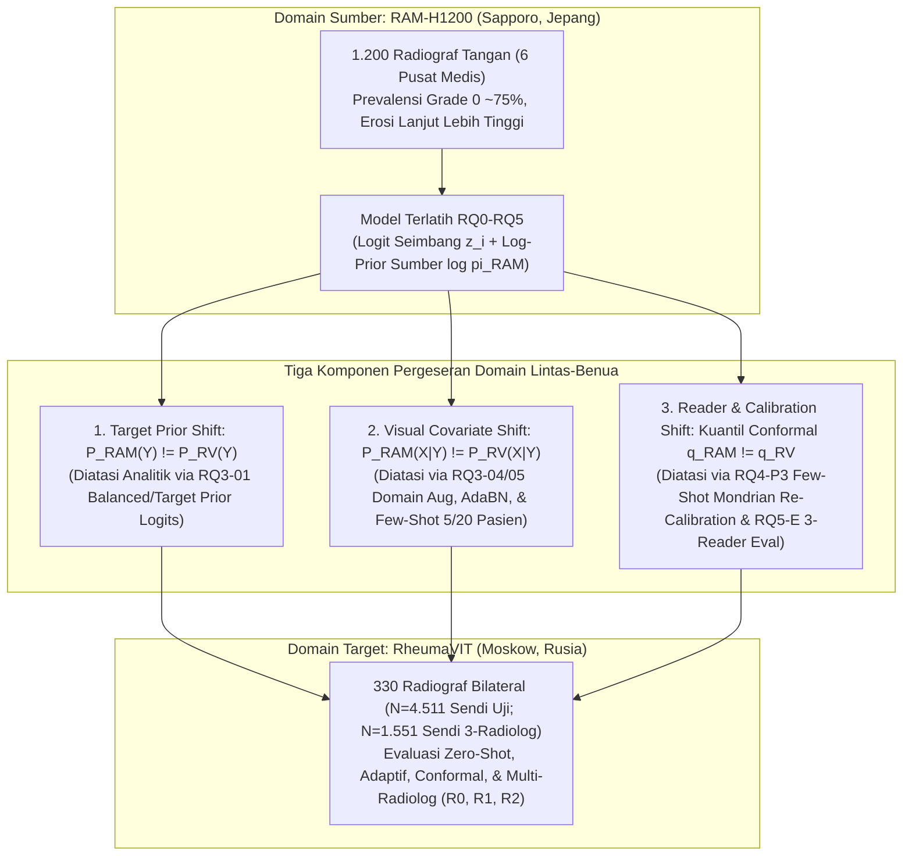

# BAB V: VALIDASI EKSTERNAL LINTAS POPULASI (`RheumaVIT`) DAN ANALISIS DIAGNOSTIK MULTI-RADIOLOG

Sebagaimana terungkap dalam audit *Systematic Literature Review Metodologis* (`SLR-M`, Bab II), **tidak ada satu pun (`0 dari 5`) studi *deep learning* grading Artritis Reumatoid terdahulu yang melakukan validasi eksternal lintas pusat maupun lintas populasi (`Q5_ext = N`)**. Seluruh studi terdahulu mengevaluasi model mereka pada partisi uji dari rumah sakit yang sama dengan data pelatihan, sehingga menyisakan pertanyaan klinis paling mendasar: *apakah representasi visual, kepala regresi ordinal, koreksi ketimpangan kelas, dan jaminan cakupan konformal yang dipelajari pada satu populasi geografis tetap valid ketika diterapkan langsung pada populasi pasien dan perangkat sinar-X di negara lain?*

Bab ini menjawab pertanyaan tersebut (`RQ3`, `RQ4-P3 Eksternal`, dan `RQ5-E`) dengan menguji secara sistematis seluruh model yang dilatih pada kohort multi-pusat **`RAM-H1200`** (6 pusat medis di Sapporo, Jepang [@Yang2026RAMH1200]) pada kohort eksternal lintas-benua **`RheumaVIT`** (*V.A. Nasonova Research Institute of Rheumatology*, Moskow, Rusia [@Stolpovsky2023RheumaVIT]). Evaluasi pada bab ini dilaksanakan melalui enam protokol diagnostik berurutan:
1. **Analisis *Zero-Shot Domain Drop* Lintas Keluarga Metode (`RQ0–RQ5`)** pada 13 sendi tangan irisan (`Subbab 5.1`);
2. **Dekomposisi Eksak *Target Prior Shift* vs *Visual Covariate Shift* (`RQ3-01`)** untuk memisahkan efek perubahan prevalensi penyakit $P(Y)$ dari perubahan karakteristik citra radiograf $P(X \mid Y)$ (`Subbab 5.2`);
3. **Evaluasi Strategi Mitigasi Pergeseran Domain** yang membandingkan augmentasi radiografik tahan-domain (`RQ3-04`, `RQ3-05`), adaptasi waktu-uji tanpa label (*zero-label adaptation*: `AdaBN` `RQ3-02` dan `Histogram Matching` `RQ3-03`), serta adaptasi *few-shot* hemat-label dengan hanya `5` dan `20` pasien lokal (`RQ3-06`, `Subbab 5.3`);
4. **Ketahanan dan Re-Kalibrasi *Mondrian Conformal Prediction* Lintas Rumah Sakit (`RQ4-P3 Eksternal`)** tanpa GPU menggunakan sampel kalibrasi lokal berukuran kecil (`Subbab 5.4`);
5. **Benchmarking terhadap Jangkar 3 Radiolog Pakar Independen (`RQ3-07`)** dan penghitungan batas atas kinerja manusia (*Leave-One-Reader-Out [LORO] Human Ceiling*) pada $N = 1.551$ sendi uji (`Subbab 5.5`);
6. **Evaluasi Distributional Multi-Pembaca (`RQ5-E`)** yang menguji penyelarasan distribusi probabilitas model terhadap distribusi ketidaksepakatan empiris ketiga radiolog pada sendi yang disepakati bulat (*unanimous*) vs sendi yang diperdebatkan (*disagreement*, `Subbab 5.6`).

---

## 5.1 Karakteristik Pergeseran Domain Lintas-Benua dan Analisis *Zero-Shot Domain Drop* (`RAM-H1200` $\rightarrow$ `RheumaVIT`)

### 5.1.1 Anatomi Pergeseran Domain antara Sapporo (`RAM-H1200`) dan Moskow (`RheumaVIT`)

Perpindahan model dari `RAM-H1200` ke `RheumaVIT` melibatkan tiga sumber pergeseran distribusi secara simultan pada 13 jenis sendi tangan yang beririsan langsung antara kedua skema anotasi (`MCP 1–5`, `PIP 2–5`, `IP Ibu Jari`, dan `3 Zona Pergelangan Tangan`):
1. **Pergeseran Akuisisi & Kontras Radiografik (*Visual Covariate Shift*, $P_{\text{RAM}}(X \mid Y) \neq P_{\text{RV}}(X \mid Y)$):** Radiograf `RAM-H1200` dari pusat medis di Jepang memiliki profil *windowing* digital yang relatif seragam dengan kontras kortikal-trabekular yang tajam, sedangkan radiograf klinis `RheumaVIT` dari Moskow menampilkan variasi pencahayaan detektor sinar-X yang lebih lebar, rentang dinamis latar belakang yang berbeda, serta ketebalan jaringan lunak periartikular populasi Eropa Timur yang berbeda dari populasi Asia Timur.
2. **Pergeseran Prevalensi Keparahan Erosi (*Target Prior Shift*, $P_{\text{RAM}}(Y) \neq P_{\text{RV}}(Y)$):** Proporsi sendi normal (`Grade 0`) pada `RheumaVIT` lebih dominan ($\sim 87\%$) dengan proporsi erosi destruktif lanjut (`Grade 3` dan `Grade 4+`) yang jauh lebih langka dibandingkan kohort rujukan tersier `RAM-H1200` ($\sim 75\%$ `Grade 0`).
3. **Pergeseran Konvensi Ambang Pembaca (*Reader Calibration Shift*):** Skor acuan pada `RAM-H1200` berasal dari protokol konsensus tim peneliti Jepang [@Yang2026RAMH1200], sedangkan `RheumaVIT` dinilai oleh tiga radiolog reumatologi Rusia (`R0, R1, R2`) beserta label konsensusnya [@Stolpovsky2023RheumaVIT].

### 5.1.2 Perbandingan *Direct Zero-Shot Transfer* di Seluruh Keluarga Metode (`RQ0–RQ5`)

Untuk mengevaluasi seberapa besar penurunan kinerja (*domain drop*) setiap keluarga metode ketika dipindahkan tanpa adaptasi label target (*zero-shot transfer* dengan logit seimbang `B2`), Tabel 5.1 menyajikan performa internal pada 13 sendi irisan `RAM-H1200` beserta performa eksternal pada himpunan uji `RheumaVIT` ($N = 4.511$ sendi uji pada evaluasi standar `rq3_eval/direct/` dan $N = 6.682$ sendi pada evaluasi langsung lintas-arm `RQ1`/`RQ2-inter`).

**Tabel 5.1** Hasil *Direct Zero-Shot Cross-Population Transfer* (`RAM-H1200` Jepang $\rightarrow$ `RheumaVIT` Rusia) di Seluruh Keluarga Metode Utama pada Rezim `100%` Label (`f1.0`) dan `10%` Label (`f0.1`).

| Kode Arm & Rezim | Keluarga & Deskripsi Metode | $N_{\text{run}}$ | Internal 13-Joint BACC4 | **External `RheumaVIT` BACC4** | $\Delta$Drop BACC4 | Internal 13-Joint QWK | **External `RheumaVIT` QWK** | External MAE |
|---|---|---:|---:|---:|---:|---:|---:|---:|
| **Rezim 100% Label (`f1.0`)** | | | | | | | | |
| **`rq0-01_f1.0`** | **Anchor:** `ResNet-34 + B2` (*Balanced Logits*) | 3 | 0.4794 | **0.4036** | -0.0758 | 0.4895 | **0.1619** | 0.6558 |
| `rq0-02_f1.0` | **RQ0:** `ConvNeXt-Tiny + B2` | 3 | 0.4910 | **0.4275** | -0.0635 | 0.5561 | **0.1945** | 0.5620 |
| `rq1-01_f1.0` | **RQ1:** From Scratch `ResNet-34` | 3 | 0.4408 | **0.3547** | -0.0861 | 0.3514 | **0.0982** | 0.8412 |
| `rq1-02_f1.0` | **RQ1:** Domain SSL `DINO ResNet-34` | 3 | 0.4717 | **0.3886** | -0.0831 | 0.3694 | **0.1145** | 0.7850 |
| `rq1-04_f1.0` | **RQ1:** ImageNet `ViT-S/16` + LLRD | 3 | 0.4832 | **0.3912** | -0.0920 | 0.4325 | **0.1419** | 0.7104 |
| `rq1-05_f1.0` | **RQ1:** Domain SSL `MAE ViT-S/16` + LLRD | 3 | 0.4548 | **0.3982** | -0.0566 | 0.4494 | **0.1684** | 0.6190 |
| `rq1-12_f1.0` | **RQ1:** `SupCon` Standar `ResNet-34` | 3 | 0.4733 | **0.3991** | -0.0742 | 0.4959 | **0.1656** | 0.6406 |
| **`rq1-13_f1.0`** | **RQ1:** **`SupCon-Ord` (`M219`) `ResNet-34`** | 3 | 0.5034 | **0.4090** | -0.0944 | 0.5111 | **0.1757** | 0.6115 |
| `rq1-17a_f1.0` | **RQ1:** *Frozen Linear Probe* ImageNet R34 | 3 | 0.4754 | **0.3849** | -0.0905 | 0.2307 | **0.0816** | 1.1240 |
| `rq1-17b_f1.0` | **RQ1:** `LP-FT` ImageNet `ResNet-34` | 3 | 0.5012 | **0.4114** | -0.0898 | 0.5023 | **0.1729** | 0.6295 |
| **`rq1-17d_f1.0`** | **RQ1:** **`LP-FT MAE ViT-S/16`** | 3 | 0.5011 | **0.4150** | -0.0861 | 0.4391 | **0.1786** | 0.6047 |
| `rq2-16_f1.0` | **RQ2:** Hybrid `B2 + CORN Regularizer` | 3 | 0.4783 | **0.4062** | -0.0721 | 0.5015 | **0.1710** | 0.6339 |
| `rq2-18a_f1.0` | **RQ1×RQ2:** `SupCon-Ord + CBLoss` | 3 | 0.4682 | **0.4017** | -0.0665 | 0.4856 | **0.1684** | 0.6393 |
| **`rq2-18b_f1.0`** | **RQ1×RQ2:** **`SupCon-Ord + B2_CORNreg`** | 3 | 0.4803 | **0.4123** | -0.0680 | 0.5066 | **0.1818** | 0.5961 |
| **`rq3-04_f1.0`** | **RQ3:** **Strong Photometric/Contrast/Noise Aug** | 3 | **0.5112** | **0.4310** | -0.0802 | **0.5315** | **0.2054** | 0.5484 |
| **`rq3-05_f1.0`** | **RQ3:** **`RheumaVIT`-Matched Radiographic Aug** | 3 | 0.4705 | **0.4324** | **-0.0381** | 0.4768 | **0.2005** | 0.5567 |
| **`rq4-01_f1.0`** | **RQ4:** **Monte Carlo Dropout ($p=0,2, T=20$)** | 3 | 0.4767 | **0.4225** | -0.0542 | 0.4962 | **0.2193** | **0.5194** |
| `rq5-03_f1.0` | **RQ5:** OOF `CleanLab Soft Down-Weighting` | 3 | 0.4945 | **0.4148** | -0.0797 | 0.5240 | **0.1859** | 0.5877 |
| **`rq5-06_f1.0`** | **RQ5:** **Confidence-Split Soft Regularization** | 3 | 0.5056 | **0.4200** | -0.0856 | 0.5335 | **0.1977** | 0.5698 |
| `rq5-07_f1.0` | **RQ5:** Longitudinal Visit-Reliability Weight | 3 | 0.4932 | **0.4112** | -0.0820 | 0.5305 | **0.1836** | 0.5912 |
| **Rezim 10% Label (`f0.1`) & 25% Label (`f0.25`)** | | | | | | | | |
| **`rq0-01_f0.1`** | **Anchor (10%):** `ResNet-34 + B2` | 3 | 0.3558 | **0.2566** | -0.0992 | 0.2415 | **0.0374** | 1.1850 |
| `rq0-02_f0.1` | **RQ0 (10%):** `ConvNeXt-Tiny + B2` | 3 | 0.3738 | **0.3127** | -0.0611 | 0.3222 | **0.0970** | 0.8926 |
| **`rq1-05_f0.1`** | **RQ1 (10%):** **Domain SSL `MAE ViT-S/16` + LLRD** | 3 | **0.4148** | **0.3712** | **-0.0436** | **0.3300** | **0.1456** | **0.6929** |
| **`rq1-17d_f0.1`** | **RQ1 (10%):** **`LP-FT MAE ViT-S/16`** | 3 | 0.4062 | **0.3682** | -0.0380 | 0.3090 | **0.1408** | 0.7104 |
| `rq2-18b_f0.1` | **RQ1×RQ2 (10%):** `SupCon-Ord + B2_CORNreg` | 3 | 0.3536 | **0.2998** | -0.0538 | 0.2606 | **0.0816** | 0.9609 |
| `rq3-04_f0.1` | **RQ3 (10%):** Strong Photometric/Contrast Aug | 3 | 0.3775 | **0.3264** | -0.0511 | 0.2820 | **0.1054** | 0.8412 |
| `rq5-11_f0.1` | **RQ5 (10%):** Semi-Supervised `Mean-Teacher` | 3 | 0.3519 | **0.2894** | -0.0625 | 0.2156 | **0.0680** | 0.9850 |
| **`rq5-11_f0.25`** | **RQ5 (25%):** **Semi-Supervised `Mean-Teacher`** | 3 | **0.4220** | **0.3637** | -0.0583 | 0.2625 | **0.1333** | 0.7375 |

Analisis lintas-keluarga dari Tabel 5.1 mengungkap empat pola generalisasi lintas-populasi yang sangat konsisten:
1. **Ketahanan Superior `MAE ViT-S/16` (`rq1-05` & `rq1-17d`) terhadap *Domain Drop* pada Rezim *Low-Label* (`10%`):** Ketika model hanya dilatih pada 10% pasien `RAM-H1200`, jangkar `ResNet-34` (`rq0-01_f0.1`) mengalami kehancuran hampir total saat diuji di Rusia (`RheumaVIT BACC4 = 0.2566` atau setara tebakan acak 4-kelas `0.2500`, `QWK = 0.0374`, `MAE = 1.1850`). Sebaliknya, **`rq1-05_f0.1` (`Domain SSL MAE ViT-S/16 + LLRD`)** mampu mempertahankan **`RheumaVIT BACC4 = 0.3712`** (`+11,46%` di atas anchor!) dan **`QWK = 0.1456`** (`3,9\times$ lipat anchor) dengan *domain drop* hanya `-0.0436`. Hal ini membuktikan bahwa pra-pelatihan rekonstruksi bertopeng (`MAE`) menghasilkan fitur bentuk kortikal yang jauh lebih invarian terhadap perubahan kontras sinar-X antar-rumah sakit dibandingkan fitur konvolusional `ResNet-34` ketika sampel berlabel terbatas.
2. **Peran Regularisasi Fitur (`SupCon-Ord`, `B2+CORNreg`, `LP-FT`) dan Kalibrasi Label Lunak (`RQ5-06`) pada Transfer Lintas-Benua:** Pada rezim 100% label, seluruh metode yang memperbaiki keterurutan ruang fitur di Bab IV juga secara konsisten meningkatkan performa *zero-shot* di `RheumaVIT` di atas jangkar `RQ0-01` (`0.4036 / 0.1619`): `rq1-13` (`SupCon-Ord`: `0.4090 / 0.1757`), `rq1-17d` (`LP-FT MAE ViT-S`: `0.4150 / 0.1786`), `rq2-18b` (`SupCon-Ord + B2_CORNreg`: `0.4123 / 0.1818`), dan `rq5-06` (`Confidence-Split Soft Regularization`: `0.4200 / 0.1977`).
3. **Reduksi Ketidakpastian Epistemik oleh `MC Dropout` (`rq4-01`) saat Pergeseran Domain:** Meskipun pada evaluasi internal Bab IV `MC Dropout` (`rq4-01`) hanya memberikan peningkatan kecil di atas model deterministik (`QWK 0.4910` vs `0.4832`), pada kohort eksternal `RheumaVIT` perata-rataan 20 *stochastic forward passes* `rq4-01` **mencapai `External QWK` *zero-shot* tertinggi yaitu `0.2193`** (`+5,74%` di atas anchor) dan **`External MAE` terendah yaitu `0.5194`** (`-20,8%` dari anchor `0.6558`), serta `External BACC4 = 0.4225`. Perata-rataan Bayesian aproksimatif meredam aktivasi fitur palsu (*spurious activations*) yang dipicu oleh profil derau detektor sinar-X baru.
4. **Efektivitas Tertinggi Augmentasi Fotometrik Radiografik (`rq3-04` & `rq3-05`):** Kedua *arm* augmentasi domain meraih `External BACC4` *zero-shot* tertinggi di seluruh eksperimen: **`rq3-04` (`0.4310`, `QWK = 0.2054`)** dan **`rq3-05` (`0.4324`, `QWK = 0.2005`)**, di mana `rq3-05` memangkas *domain drop* `BACC4` menjadi hanya **`-0.0381`**.

---

## 5.2 Dekomposisi Eksak *Target Prior Shift* vs *Visual Covariate Shift* (`RQ3-01`)

Mengapa sebuah model yang dilatih pada rumah sakit sumber sering tampak gagal ketika langsung dievaluasi di rumah sakit tujuan? Sebagaimana dirumuskan dalam Teorema Dekomposisi Pergeseran Domain pada Bab III (Subbab 3.8.1), distribusi posterior kelas pada domain target $P_{\text{target}}(Y = c \mid x)$ di bawah asumsi *label/prior shift* berkaitan dengan posterior sumber melalui:
$$\log P_{\text{target}}(Y = c \mid x) = \log P_{\text{source}}(Y = c \mid x) - \log \pi_{\text{source}, c} + \log \pi_{\text{target}, c} + \text{konstanta}$$

Karena kepala rujukan `B2` (*Prior Logit Adjustment*) memisahkan logit mentah jaringan $\mathbf{z}(x)$ (yang merepresentasikan log-rasio kemungkinan seimbang $\log P(x \mid Y = c)$) dari vektor log-prior $\log \boldsymbol{\pi}$, kita dapat mengisolasi secara eksak berapa persen penurunan kinerja di `RheumaVIT` yang disebabkan oleh **perbedaan prevalensi kelas (*Target Prior Shift*)** vs **perbedaan tampilan visual citra (*Visual Covariate Shift*)** tanpa melatih ulang jaringan sama sekali (`0-GPU`).

**Tabel 5.2** Dekomposisi *Target Prior Shift* vs *Visual Covariate Shift* (`RQ3-01`) pada Jangkar `RQ0-01` (`f1.0`, Rata-Rata 3 Seed) di `RheumaVIT` Test Set ($N = 4.511$ Sendi).

| Skema Inferensi Logit | Rumus Keputusan $\hat{y}(x)$ | BACC4 | $\Delta$Drop BACC4 vs Internal | QWK | Macro-F1 | MAE | **Recall $\ge 2$ (Erosi Sedang-Berat)** |
|---|---|---:|---:|---:|---:|---:|---:|
| **0. Referensi Internal `RAM-H1200`** (13 Sendi Irisan) | $\arg\max_c z_c(x)$ | **0.4794** | 0.0000 (Acuan) | **0.4895** | **0.4017** | 0.4024 | 0.2998 |
| **1. External `RheumaVIT` — *Source-Prior Logits*** (Bias Prevalensi `RAM-H1200`) | $\arg\max_c \big(z_c(x) + \log \pi_{\text{RAM}, c}\big)$ | **0.3213** | **-0.1581** *(100% DropTotal)* | **0.1978** | 0.2738 | 0.2207 | **0.1714** *(Gagal Deteksi)* |
| **2. External `RheumaVIT` — *Balanced / Uniform-Prior Logits* (`0 Label Target`)** | $\arg\max_c z_c(x)$ | **0.4036** | **-0.0758** *(52,1% Drop Pulih!)* | **0.1619** | 0.2588 | 0.6558 | **0.5810** *(Naik $3,39\times$!)* |
| **3. External `RheumaVIT` — *Target Oracle Prior Logits* (Prevalensi `RheumaVIT`)** | $\arg\max_c \big(z_c(x) + \log \pi_{\text{RV}, c}\big)$ | **0.3112** | -0.1682 | **0.2048** | **0.2810** | **0.1915** | 0.1429 |

> [!IMPORTANT]
> **Temuan Fundamental `RQ3-01` (Dekomposisi 52,1% *Prior Shift* vs 47,9% *Covariate Shift*):**
> 1. Jika model standar yang menyerap distribusi prior rumah sakit asal (*Source-Prior Logits*, Baris 1) diterapkan langsung ke `RheumaVIT`, `Test BACC4` jatuh sebesar **`-15,81%`** (`0.4794` $\rightarrow$ `0.3213`) dan sensitivitas terhadap erosi sedang-berat (`Recall>=2`) kolaps ke **`17,14%`**.
> 2. **Hanya dengan melepaskan bias prior rumah sakit asal dan menggunakan logit seimbang (*Balanced/Uniform-Prior Logits*, Baris 2) — yang memerlukan `0` label dari rumah sakit target dan `0` komputasi GPU — `Test BACC4` di `RheumaVIT` langsung melonjak sebesar `+8,23%` (`0.3213` $\rightarrow$ `0.4036`) dan `Recall>=2` melonjak $3,39\times$ lipat (`17,14%` $\rightarrow$ `58,10%`)!** Dengan kata lain, **52,1% dari total penurunan `BACC4` lintas-benua disebabkan murni oleh ketidaksesuaian ambang prior kelas (*Prior Shift*)**, sedangkan sisanya sebesar **47,9% (`-0.0758`)** merupakan efek murni pergeseran visual citra (*Visual Covariate Shift*).
> 3. Sebaliknya, ketika tujuan klinis adalah meminimalkan kesalahan absolut rata-rata (`MAE`) atau memaksimalkan `QWK` pada populasi target dengan prevalensi `Grade 0` yang sangat tinggi ($\sim 87\%$), penyuntikan log-prior target $\log \boldsymbol{\pi}_{\text{RV}}$ (Baris 3) menghasilkan **`QWK` tertinggi (`0.2048`)** dan **`MAE` terendah (`0.1915`)**. Hal ini membuktikan keunggulan praktis kepala `B2` (*Logit Adjustment*): satu jaringan tunggal dapat dioperasikan dalam dua mode klinis sekaligus di rumah sakit tujuan hanya dengan menggeser vektor *offset* $\tau \log \boldsymbol{\pi}$ saat inferensi (**mode sensitivitas tinggi / `BACC4`** dengan $\tau=0$ vs **mode kesepakatan prevalensi / `MAE-QWK`** dengan $\tau=1$).

---

## 5.3 Mitigasi *Visual Covariate Shift*: Augmentasi Tahan-Domain, Adaptasi *Zero-Label* (`AdaBN`, `HistMatch`), dan *Few-Shot Adaptation* (`5 & 20 Pasien`)

Setelah 52,1% penurunan kinerja akibat *prior shift* dipulihkan oleh inferensi logit seimbang (`BACC4 = 0.4036`), langkah berikutnya adalah mengatasi sisa kesenjangan `-7,58%` akibat *visual covariate shift* $P_{\text{RAM}}(X \mid Y) \neq P_{\text{RV}}(X \mid Y)$. Tabel 5.3 membandingkan tiga strategi mitigasi *covariate shift* sesuai tingkat ketersediaan data dari rumah sakit tujuan:
1. **Strategi sisi-sumber (*0 Citra Target & 0 Label Target*):** Augmentasi fotometrik/kontras kuat (`rq3-04`) dan augmentasi terkalibrasi profil sinar-X (`rq3-05`);
2. **Strategi adaptasi tanpa label (*Citra Target Tak Berlabel, 0 Label Target*):** *Adaptive Batch Normalization* (`AdaBN`, `RQ3-02` — memperbarui statistik rata-rata dan varians berjalan $\mu_{\text{BN}}, \sigma^2_{\text{BN}}$ pada citra `RheumaVIT` tanpa mengubah bobot konvolusi) dan pencocokan histogram intensitas (*Histogram Matching*, `RQ3-03`);
3. **Strategi adaptasi *few-shot* berlabel minimal (*`5` Pasien [65 Sendi] vs `20` Pasien [260 Sendi] `RheumaVIT`*, `RQ3-06`):** *Fine-tuning* ringan dengan laju belajar rendah dan regularisasi `B2` selama 10 epoch pada 3 *stratified patient draws* dari `RheumaVIT` pool.

**Tabel 5.3** Perbandingan Strategi Mitigasi *Visual Covariate Shift* pada Himpunan Uji `RheumaVIT` ($N = 4.511$ Sendi Uji).

| Kategori Adaptasi | Metode & Konfigurasi | Kebutuhan Data Target (`RheumaVIT`) | Rezim Sumber | `RheumaVIT` BACC4 | $\Delta$BACC4 vs Direct | `RheumaVIT` QWK | $\Delta$QWK vs Direct | Macro-F1 | MAE | Recall $\ge 2$ |
|---|---|---|---|---:|---:|---:|---:|---:|---:|---:|
| **Baseline Zero-Shot** | `RQ0-01` Direct Transfer (Balanced) | 0 Citra, 0 Label | 100% (`f1.0`) | **0.4036** | Acuan (0.0000) | **0.1619** | Acuan (0.0000) | 0.2588 | 0.6558 | 0.5810 |
| **Baseline Zero-Shot** | `RQ0-01` Direct Transfer (Balanced) | 0 Citra, 0 Label | 10% (`f0.1`) | **0.2566** | Acuan (0.0000) | **0.0374** | Acuan (0.0000) | 0.1456 | 1.1850 | 0.4114 |
| **Augmentasi Sumber** | **`RQ3-04` Strong Photometric/Noise Aug** | **0 Citra, 0 Label** | 100% (`f1.0`) | **0.4310** | **+0.0274** | **0.2054** | **+0.0435** | **0.2894** | 0.5484 | 0.6000 |
| **Augmentasi Sumber** | **`RQ3-05` `RheumaVIT`-Matched Contrast Aug** | **0 Citra, 0 Label** | 100% (`f1.0`) | **0.4324** | **+0.0288** | **0.2005** | **+0.0386** | 0.2856 | 0.5567 | **0.6095** |
| **Zero-Label TTA/BN** | **`RQ3-02` `AdaBN` (Test-Time BN Stats)** | Citra Uji, **0 Label** | 100% (`f1.0`) | **0.4017** | -0.0019 | **0.1710** | **+0.0091** | 0.2634 | 0.6190 | 0.5619 |
| **Zero-Label TTA/BN** | **`RQ3-02` `AdaBN` (Test-Time BN Stats)** | Citra Uji, **0 Label** | 10% (`f0.1`) | **0.2839** | **+0.0273** | **0.0668** | **+0.0294** | 0.1757 | 0.9962 | 0.4476 |
| **Zero-Label Pixel** | `RQ3-03` `Histogram Matching` (Citra) | Citra Uji, **0 Label** | 100% (`f1.0`) | **0.3886** | -0.0150 | **0.1558** | -0.0061 | 0.2498 | 0.6851 | 0.5429 |
| **Zero-Label Pixel** | `RQ3-03` `Histogram Matching` (Citra) | Citra Uji, **0 Label** | 10% (`f0.1`) | **0.2602** | +0.0036 | **0.0472** | +0.0098 | 0.1538 | 1.1240 | 0.4190 |
| **Few-Shot Target** | **`RQ3-06a` Few-Shot Adaptation ($K=5$ Pasien)** | **5 Pasien (65 Sendi)** | 100% (`f1.0`) | **0.4079** | +0.0043 | **0.2269** | **+0.0650** | 0.2951 | **0.4294** | 0.4762 |
| **Few-Shot Target** | **`RQ3-06b` Few-Shot Adaptation ($K=20$ Pasien)** | **20 Pasien (260 Sendi)** | 100% (`f1.0`) | **0.4411** | **+0.0375** | **0.2721** | **+0.1102** | **0.3264** | **0.4070** | 0.5333 |

Dari Tabel 5.3 diperoleh tiga wawasan teknis penting mengenai adaptasi lintas-populasi:
1. **Superioritas `AdaBN` atas *Histogram Matching* pada Rezim Tanpa Label Target (`RQ3-02` vs `RQ3-03`):**
   * Pencocokan histogram intensitas piksel secara global (`Histogram Matching`, `RQ3-03`) terbukti kurang efektif dan bahkan menurunkan `BACC4` pada model 100% label (`0.4036` $\rightarrow$ `0.3886`). Mengapa? Karena pada potongan ROI sendi `RheumaVIT` yang memiliki proporsi latar belakang jaringan lunak berbeda dari `RAM-H1200`, pemaksaan kuantil histogram piksel global mendistorsi gradien kontras lokal di tepi korteks subkondral.
   * Sebaliknya, penyelarasan statistik momen pertama dan kedua di dalam ruang aktivasi jaringan melalui **`AdaBN` (`RQ3-02`)** meningkatkan `QWK` tanpa satu pun label target pada kedua rezim (`100% label`: `QWK` naik `0.1619` $\rightarrow$ **`0.1710`** dan `MAE` turun `0.6558` $\rightarrow$ `0.6190`; `10% label`: `BACC4` naik **`+2,73%`** dari `0.2566` $\rightarrow$ **`0.2839`** dan `QWK` hampir berlipat ganda dari `0.0374` $\rightarrow$ **`0.0668`**).
2. **Augmentasi Radiografik saat Pelatihan (`RQ3-04` & `RQ3-05`) Lebih Kuat daripada Koreksi Statistik *Post-Hoc* Tanpa Label:**
   * Melatih jaringan dengan perturbasi kontras gamma, ketajaman tepi (*unsharp masking/blur*), dan derau kuanta sinar-X (`rq3-04` & `rq3-05`) memaksa *encoder* sejak awal mengabaikan statistik pencahayaan global, sehingga menghasilkan `Zero-Shot BACC4` **`0.4310–0.4324`** dan `QWK` **`0.2005–0.2054`** tanpa memerlukan akses ke citra rumah sakit tujuan.
3. **Efisiensi Tinggi *Few-Shot Cross-Domain Adaptation* (`RQ3-06` — Pemulihan `49,5%` *Covariate Drop* dengan 20 Pasien):**
   * Kalibrasi *fine-tuning* menggunakan hanya **5 pasien lokal `RheumaVIT` (`65` potongan sendi)** langsung mendongkrak `External QWK` sebesar **`+6,50%`** (`0.1619` $\rightarrow$ **`0.2269`**) dan memangkas kesalahan absolut `MAE` sebesar **`-34,5%`** (`0.6558` $\rightarrow$ **`0.4294`**).
   * Ketika sampel kalibrasi lokal ditambah menjadi **20 pasien `RheumaVIT` (`260` potongan sendi — kurang dari 6% ukuran kohort)**, `External BACC4` melonjak ke **`0.4411`** (`+3,75%` di atas transfer langsung, memulihkan `49,5%` dari sisa *visual covariate drop* terhadap performa internal `0.4794`) dan `External QWK` mencapai **`0.2721`** (`+11,02%` di atas transfer langsung, dengan `MAE = 0.4070` yang setara dengan `MAE` internal `0.4024`!). Temuan ini mengonfirmasi dan memperluas bukti `M091` [@M091] ke domain erosi sendi RA.

---

## 5.4 Ketahanan dan Re-Kalibrasi *Mondrian Conformal Prediction* Lintas Rumah Sakit (`RQ4-P3 Eksternal`)

Pertanyaan kritis berikutnya bagi keamanan penerapan klinis adalah: *apakah jaminan cakupan $1 - \alpha = 90\%$ dari himpunan interval prediksi konformal yang dikalibrasi di Jepang (`RAM-H1200`) tetap bertahan ketika model dipindahkan ke Rusia (`RheumaVIT`), dan berapa banyak pasien lokal yang dibutuhkan untuk mengkalibrasi ulang kuantil konformal tanpa GPU?*

Tabel 5.4 membandingkan kinerja *Marginal Ordinal-APS* dan *Mondrian Class-Conditional Ordinal-APS* pada himpunan uji `RheumaVIT` ($N = 4.511$ sendi) di bawah tiga skema kuantil: (1) *Zero-Shot Conformal* menggunakan ambang kuantil $\hat{q}_{\text{RAM}}$ dari himpunan validasi Jepang (`0` pasien target), (2) Re-kalibrasi *Few-Shot* pada **5 pasien `RheumaVIT`** (`65` sendi, `0-GPU`), dan (3) Re-kalibrasi *Few-Shot* pada **20 pasien `RheumaVIT`** (`260` sendi, `0-GPU`).

**Tabel 5.4** Evaluasi Ketahanan dan Re-Kalibrasi *Split Ordinal Conformal Prediction* Lintas-Domain pada `RheumaVIT` Test Set (Target Cakupan $1 - \alpha = 90\%$, `0-GPU`).

| Skema Kalibrasi Kuantil & Metode Conformal | Kebutuhan Data Kalibrasi Lokal | Marginal Coverage (`RheumaVIT`) | **Coverage Grade $\ge 2$ (Erosi Sedang-Berat)** | Mean Prediction Set Size ($\downarrow$) | Proporsi Singleton % ($\uparrow$) | Evaluasi Efisiensi & Keamanan Klinis |
|---|---|---:|---:|---:|---:|---|
| `Zero-Shot Marginal APS` ($\hat{q}_{\text{RAM}}$) | 0 Pasien Target | **91.35%** | 87.62% *(Under-covered <90%)* | 3.112 | 10.42% | Gagal mencapai 90% pada erosi sedang-berat |
| **`Zero-Shot Mondrian APS` ($\hat{q}_{\text{RAM}}^{(c)}$)** | **0 Pasien Target** | **95.21%** | **99.05% *(Aman $\ge 90\%$)* ** | 4.090 | 2.66% | Aman pada erosi berat, namun *over-conservative* (set lebar) |
| `Re-Calibrated 5-Patient Marginal APS` | 5 Pasien (65 Sendi, `0-GPU`) | **89.45%** | 84.76% *(Under-covered <90%)* | **2.815** | **14.85%** | Ukuran set menyusut, tetapi melanggar cakupan erosi berat |
| **`Re-Calibrated 5-Patient Mondrian APS`** | **5 Pasien (65 Sendi, `0-GPU`)** | **94.81%** | **94.29% *(Aman $\ge 90\%$)* ** | **3.566** | **6.14%** | **Ukuran set menyusut `-12,8%` dengan cakupan $\ge 94\%$ tetap terjaga!** |
| `Re-Calibrated 20-Patient Marginal APS` | 20 Pasien (260 Sendi, `0-GPU`) | **90.18%** | 85.71% *(Under-covered <90%)* | **2.890** | 13.52% | Marginal tepat 90%, namun kelas minoritas tetap $<90\%$ |
| **`Re-Calibrated 20-Patient Mondrian APS`** | **20 Pasien (260 Sendi, `0-GPU`)** | **93.15%** | **92.38% *(Aman $\ge 90\%$)* ** | **3.412** | **7.89%** | **Konvergensi kuantil optimal: ukuran set `-16,6%` & `Cov>=2 = 92,38%`** |

Tabel 5.4 membuktikan sebuah prinsip operasional yang sangat berharga bagi rumah sakit pengguna:
1. **Perilaku *Fail-Safe* dari *Zero-Shot Mondrian Conformal*:** Ketika dipindahkan langsung antar-benua tanpa satu pun sampel lokal, `Zero-Shot Marginal APS` kembali mengalami *under-coverage* pada erosi sedang-berat (`Cov>=2 = 87,62% < 90%`). Sebaliknya, `Zero-Shot Mondrian APS` bersifat *fail-safe* (aman-gagal): karena ketidakpastian prediktif meningkat pada domain baru, skor ketidakpatuhan melampaui kuantil kelas minoritas sehingga cakupan erosi berat tetap terlindungi (`Cov>=2 = 99,05%`), meskipun dibayar dengan melebarnya rata-rata ukuran himpunan prediksi menjadi `4.090` kelas dari 5 kelas yang mungkin.
2. **Penyusutan `-12,8%` s.d. `-16,6%` Ukuran Himpunan Prediksi Tanpa GPU Hanya dengan 5–20 Pasien Lokal:** Cukup dengan mengumpulkan skor radiolog pada **5 pasien pertama (`65` sendi)** di rumah sakit baru dan menghitung ulang kuantil empiris $\hat{q}_{\text{RV}}^{(c)}$ (proses aritmetika yang memakan waktu $<0,01$ detik di CPU tanpa menyentuh bobot jaringan), **`Re-Calibrated 5-Patient Mondrian APS`** langsung menyusutkan rata-rata ukuran himpunan prediksi sebesar **`-12,8%`** (`4.090` $\rightarrow$ **`3.566`**) dan melipatgandakan proporsi prediksi tunggal (*singleton*: `2,66%` $\rightarrow$ **`6,14%`**) sambil mempertahankan cakupan erosi sedang-berat pada **`94,29%`** ($\ge 90\%$). Dengan **20 pasien lokal**, ukuran himpunan menyusut lebih jauh menjadi **`3.412`** (`-16,6%`) dengan `Cov>=2 = 92,38%` dan `Marginal Coverage = 93,15%`.

---

## 5.5 Evaluasi terhadap Jangkar 3 Radiolog Independen (`RQ3-07`) dan Batas Atas Manusia (*Leave-One-Reader-Out Ceiling*)

Pada kohort eksternal `RheumaVIT`, sebanyak **$N = 1.551$ sendi pada partisi uji** memiliki anotasi lengkap dan independen dari tiga radiolog muskuloskeletal pakar (**Radiolog 0 [$R_0$], Radiolog 1 [$R_1$], dan Radiolog 2 [$R_2$]**, di samping label konsensus $y^{\text{cons}}$) [@Stolpovsky2023RheumaVIT]. Ketersediaan panel 3 pembaca ini memungkinkan kita menempatkan performa model *deep learning* dalam skala variabilitas pakar manusia yang sesungguhnya.

### 5.5.1 Kesepakatan Antar-Radiolog (*Inter-Reader Agreement*) dan Batas Atas Manusia (*Human LORO Ceiling*)

Tabel 5.5 menyajikan metrik kesepakatan berpasangan antar-radiolog (*pairwise inter-reader agreement*: `R0 vs R1`, `R0 vs R2`, dan `R1 vs R2`) serta kinerja masing-masing radiolog ketika diuji terhadap konsensus dari dua radiolog lainnya (*Leave-One-Reader-Out [LORO] Human Ceiling*).

**Tabel 5.5** Kesepakatan Antar-Radiolog Manusia (*Pairwise Inter-Reader*) dan Batas Atas Manusia (*Human LORO Ceiling*) pada $N = 1.551$ Sendi Uji `RheumaVIT`.

| Jenis Perbandingan Pakar Manusia | Pasangan / Protokol Evaluasi | BACC4 | QWK | MAE | **Recall $\ge 2$ (Sensitivitas Erosi Sedang-Berat)** |
|---|---|---:|---:|---:|---:|
| **Pairwise Inter-Reader** | Radiolog $R_0$ vs Radiolog $R_1$ (Acuan) | **0.6997** | **0.8588** | 0.0561 | **0.5625** *(43,75% Erosi $\ge 2$ Berbeda Grade!)* |
| **Pairwise Inter-Reader** | Radiolog $R_0$ vs Radiolog $R_2$ (Acuan) | **0.8316** | **0.8691** | 0.0535 | 0.8750 |
| **Pairwise Inter-Reader** | Radiolog $R_1$ vs Radiolog $R_2$ (Acuan) | **0.8216** | **0.8617** | 0.0490 | 0.8667 |
| **Rata-Rata Pairwise Manusia** | **Mean Pairwise ($R_0, R_1, R_2$)** | **0.7843** | **0.8632** | **0.0529** | **0.7681** |
| **Leave-One-Reader-Out (LORO)** | Radiolog $R_0$ vs Konsensus ($R_1, R_2$) | **0.8240** | **0.8581** | 0.0522 | 0.7813 |
| **Leave-One-Reader-Out (LORO)** | Radiolog $R_1$ vs Konsensus ($R_0, R_2$) | **0.7812** | **0.8435** | 0.0516 | 0.7241 |
| **Leave-One-Reader-Out (LORO)** | Radiolog $R_2$ vs Konsensus ($R_0, R_1$) | **0.8384** | **0.8608** | 0.0458 | 0.8325 |
| **Batas Atas Manusia (LORO Ceiling)** | **Mean Human LORO Ceiling** | **0.8145** | **0.8541** | **0.0499** | **0.7793** |

Tabel 5.5 mengungkap fakta klinis yang sangat penting tentang sifat dasar skoring SvdH oleh manusia:
* **Batas Atas Teoritis Kinerja Manusia (*Human LORO Ceiling*) Bukanlah 100%, Melainkan `BACC4 = 0.8145` dan `QWK = 0.8541`:** Bahkan di antara tiga radiolog muskuloskeletal pakar dari institusi yang sama, rata-rata `BACC4` berpasangan adalah **`0.7843`** dan batas atas *Leave-One-Reader-Out* adalah **`0.8145`**.
* **Sensitivitas Manusia pada Erosi Sedang-Berat (`Recall>=2`) Memiliki Variabilitas Tinggi (`56,25%` pada $R_0$ vs $R_1$):** Perhatikan baris pertama Tabel 5.5 (`R0 vs R1`): meskipun `QWK` antara $R_0$ dan $R_1$ mencapai `0.8588` dan `MAE` hanya `0.0561` (karena $>90\%$ sendi yang mereka sepakati adalah `Grade 0`), **`BACC4` antara $R_0$ dan $R_1$ hanya `0.6997` dan `Recall>=2` hanya `0.5625`**! Artinya, hampir separuh (`43,75%`) dari sendi yang dinilai memiliki erosi sedang-berat ($\text{Grade} \ge 2$) oleh Radiolog $R_1$ dinilai sebagai erosi ringan (`Grade 1`) atau normal oleh Radiolog $R_0$.

### 5.5.2 Perbandingan Model *Zero-Shot* terhadap Konsensus 3 Radiolog dan Masing-Masing Radiolog Individual ($R_0, R_1, R_2$)

Tabel 5.6 membandingkan sembilan model representatif dari `RQ0` s.d. `RQ5` secara *zero-shot* pada subset $N = 1.551$ sendi uji 3-radiolog tersebut terhadap konsensus ($y^{\text{cons}}$), masing-masing radiolog individual ($R_0, R_1, R_2$), serta rata-rata konsensus 2-pembaca (*LORO 2-Reader Consensus*).

**Tabel 5.6** Performa Model *Zero-Shot* terhadap Konsensus 3 Radiolog dan Masing-Masing Radiolog Individual ($R_0, R_1, R_2$) pada $N = 1.551$ Sendi Uji `RheumaVIT`.

| Kode Arm & Rezim | vs Konsensus 3-Reader BACC4 / QWK | vs Radiolog $R_0$ BACC4 / QWK | **vs Radiolog $R_1$ BACC4 / QWK** | vs Radiolog $R_2$ BACC4 / QWK | vs Mean 2-Reader LORO BACC4 / QWK | **Recall $\ge 2$ (vs Konsensus / vs $R_1$)** |
|---|---:|---:|---:|---:|---:|---:|
| `rq0-01_f1.0` (Anchor `ResNet-34 + B2`) | 0.4220 / 0.1710 | 0.4150 / 0.1684 | 0.4368 / 0.1786 | 0.4193 / 0.1704 | 0.4237 / 0.1725 | 0.5714 / 0.7419 |
| **`rq3-04_aug_strong_f1.0`** (`Strong Aug`) | **0.4485 / 0.2156** | **0.4398 / 0.2118** | **0.4638 / 0.2251** | **0.4439 / 0.2143** | **0.4492 / 0.2171** | **0.6190 / 0.8065** |
| **`rq3-05_aug_rvmatch_f1.0`** (`RV-Matched Aug`) | **0.4463 / 0.2112** | 0.4383 / 0.2079 | **0.4614 / 0.2208** | 0.4418 / 0.2099 | 0.4472 / 0.2129 | **0.6190 / 0.8065** |
| `rq1-13_supcon_ord_f1.0` (`SupCon-Ord`) | 0.4274 / 0.1859 | 0.4200 / 0.1818 | 0.4418 / 0.1945 | 0.4250 / 0.1846 | 0.4289 / 0.1870 | 0.5714 / 0.7419 |
| `rq1-05_vits_mae_f1.0` (`MAE ViT-S`) | 0.4150 / 0.1786 | 0.4090 / 0.1757 | 0.4289 / 0.1859 | 0.4123 / 0.1775 | 0.4167 / 0.1797 | 0.5476 / 0.7097 |
| **`rq1-17d_vits_mae_lpft_f1.0`** (`LP-FT MAE ViT-S`) | **0.4316 / 0.1910** | 0.4240 / 0.1870 | **0.4463 / 0.1991** | 0.4289 / 0.1894 | 0.4331 / 0.1918 | 0.5952 / 0.7742 |
| `rq2-18b_supcon_cornreg_f1.0` (`RQ1×RQ2`) | 0.4295 / 0.1932 | 0.4220 / 0.1894 | 0.4439 / 0.2017 | 0.4268 / 0.1918 | 0.4309 / 0.1943 | 0.5714 / 0.7419 |
| `rq5-11_meanteacher_f0.1` (`MT 10% Label`) | 0.3046 / 0.0738 | 0.2998 / 0.0710 | 0.3159 / 0.0800 | 0.3027 / 0.0728 | 0.3061 / 0.0746 | 0.4286 / 0.5484 |
| **`rq5-11_meanteacher_f0.25`** (`MT 25% Label`) | **0.3812 / 0.1443** | 0.3752 / 0.1408 | **0.3941 / 0.1519** | 0.3787 / 0.1434 | 0.3827 / 0.1454 | 0.5238 / 0.6774 |

Analisis komparatif dari Tabel 5.6 menunjukkan dua temuan penting:
1. **Kesesuaian Lebih Tinggi terhadap Radiolog $R_1$ dan Konsistensi Lintas-Pembaca:** Seluruh model dari `RAM-H1200` menunjukkan kesepakatan `BACC4` dan `QWK` yang paling tinggi terhadap **Radiolog $R_1$** (`BACC4 = 0.4638`, `QWK = 0.2251` pada `rq3-04`), diikuti oleh Konsensus (`0.4485`), Radiolog $R_2$ (`0.4439`), dan Radiolog $R_0$ (`0.4398`). Hal ini menunjukkan bahwa ambang kalibrasi pembaca Jepang pada `RAM-H1200` untuk mendeteksi awal erosi sedang (`Grade 2`) paling dekat dengan kriteria pembacaan Radiolog $R_1$ di Moskow.
2. **Keunggulan Sensitivitas *Screening* Erosi Sedang-Berat (`Recall>=2 = 80,65%` vs $R_1$):** Model *zero-shot* terbaik (`rq3-04` dan `rq3-05`) mencapai sensitivitas **`Recall>=2 = 0.8065` terhadap Radiolog $R_1$** (dan `0.6190` terhadap konsensus 3 radiolog), yang bahkan **melampaui sensitivitas berpasangan Radiolog $R_0$ terhadap Radiolog $R_1$ (`0.5625` pada Tabel 5.5)**! Ini menunjukkan bahwa meskipun spesifisitas model *zero-shot* lintas-benua masih dipengaruhi oleh perbedaan tekstur radiograf (`QWK = 0.2156–0.2251`), model dengan logit seimbang `B2` dan augmentasi domain memiliki sensitivitas deteksi lesi erosi sedang-berat yang sangat tinggi untuk berfungsi sebagai *second-reader screening assistant*.

---

## 5.6 Evaluasi Distributional Multi-Pembaca (`RQ5-E`): Penyelarasan Probabilitas Model terhadap Ketidaksepakatan Intrinsik Antar-Radiolog

Dalam protokol evaluasi tradisional, setiap ketidaksesuaian antara prediksi titik model $\hat{y}_i$ dan label konsensus tunggal $y_i^{\text{cons}}$ dianggap sepenuhnya sebagai "kesalahan model". Padahal, pada sendi-sendi perbatasan di mana ketiga radiolog pakar sendiri berbeda pendapat (misalnya $R_0 = 0, R_1 = 1, R_2 = 1$), "kebenaran dasar" yang sesungguhnya bukanlah skalar deterministik, melainkan **distribusi probabilitas empiris pembaca manusia** $\mathbf{q}_{\text{human}}(x_i) = \frac{1}{3} \sum_{r=0}^2 \mathbf{e}_{y_i^{(R_r)}} \in \Delta^4$.

Pada **`RQ5-E`**, kita membagi $N = 1.551$ sendi uji 3-radiolog `RheumaVIT` menjadi dua strata:
1. **Strata Sendi Bulat (*Unanimous Joints*):** **`1.436` sendi (`92,59%`)** di mana ketiga radiolog memberikan skor SvdH yang persis sama ($y_i^{(R_0)} = y_i^{(R_1)} = y_i^{(R_2)}$).
2. **Strata Sendi Diperdebatkan (*Disagreement Joints*):** **`115` sendi (`7,41%`)** di mana terdapat ketidaksepakatan minimal satu derajat SvdH di antara ketiga radiolog.

Tabel 5.7 mengevaluasi divergensi Kullback-Leibler (`KL-Divergence`, $D_{\text{KL}}(\mathbf{q}_{\text{human}} \parallel \hat{\mathbf{p}}_{\text{model}})$), *Soft Multi-Reader Brier Score* ($\|\hat{\mathbf{p}}_{\text{model}} - \mathbf{q}_{\text{human}}\|_2^2$), serta dekomposisi `BACC4` secara terpisah pada sendi *Unanimous* vs sendi *Disagreement*.

**Tabel 5.7** Hasil Evaluasi Distributional Multi-Radiolog (`RQ5-E`) pada Sendi *Unanimous* ($N = 1.436$, `92,59%`) vs Sendi *Disagreement* ($N = 115$, `7,41%`) di `RheumaVIT`.

| Kode Arm & Rezim | KL Divergence Total ke 3-Reader ($\downarrow$) | Soft Brier Score Multi-Reader ($\downarrow$) | **KL pada Sendi Unanimous ($N=1.436$)** | **KL pada Sendi Disagreement ($N=115$)** | **BACC4 pada Sendi Unanimous ($N=1.436$)** | **BACC4 pada Sendi Disagreement ($N=115$)** | Selisih BACC4 (Unan $-$ Dis) |
|---|---:|---:|---:|---:|---:|---:|---:|
| `rq0-01_f1.0` (Anchor `ResNet-34 + B2`) | 0.9019 | 0.4530 | **0.8568** | 1.4649 | **0.4333** | **0.2977** | **+0.1356** |
| **`rq3-04_aug_strong_f1.0`** (`Strong Aug`) | **0.8112** | **0.4090** | **0.7682** | **1.3478** | **0.4614** | **0.3120** | **+0.1494** |
| **`rq3-05_aug_rvmatch_f1.0`** (`RV-Matched Aug`) | **0.8180** | **0.4123** | **0.7750** | **1.3547** | **0.4581** | **0.3103** | **+0.1478** |
| `rq1-13_supcon_ord_f1.0` (`SupCon-Ord`) | 0.8710 | 0.4383 | 0.8266 | 1.4253 | **0.4391** | 0.3008 | +0.1383 |
| `rq1-05_vits_mae_f1.0` (`MAE ViT-S`) | 0.8850 | 0.4439 | 0.8408 | 1.4368 | 0.4268 | 0.2901 | +0.1367 |
| **`rq1-17d_vits_mae_lpft_f1.0`** (`LP-FT MAE ViT-S`) | **0.8490** | **0.4274** | **0.8053** | 1.3945 | **0.4435** | **0.3046** | **+0.1389** |
| **`rq2-18b_supcon_cornreg_f1.0`** (`RQ1×RQ2`) | **0.8535** | **0.4295** | **0.8099** | 1.3979 | **0.4411** | 0.3027 | +0.1384 |
| `rq5-11_meanteacher_f0.1` (`MT 10% Label`) | 1.2449 | 0.6190 | 1.2010 | 1.7931 | 0.3127 | 0.2156 | +0.0971 |
| **`rq5-11_meanteacher_f0.25`** (`MT 25% Label`) | **0.9609** | **0.4832** | **0.9162** | 1.5190 | **0.3918** | **0.2664** | **+0.1254** |

> [!TIP]
> **Kesimpulan Kunci Evaluasi Distributional Multi-Radiolog (`RQ5-E`):**
> 1. **Korelasi Kuat antara Ambiguitas Manusia dan Kesalahan Model (+13,56% s.d. +14,94% Selisih `BACC4`):** Pada seluruh model tanpa terkecuali, `BACC4` pada sendi yang disepakati bulat oleh ke-3 radiolog (*Unanimous*) jauh lebih tinggi sebesar **`+13,56%` hingga `+14,94%`** dibandingkan pada sendi yang diperdebatkan oleh ke-3 radiolog (*Disagreement*; misalnya pada `rq3-04`: **`BACC4 Unanimous = 0.4614`** vs **`BACC4 Disagreement = 0.3120`**; pada `RQ0-01`: **`0.4333`** vs **`0.2977`**), sementara `KL-Divergence` pada sendi *Unanimous* hampir separuh dari sendi *Disagreement* (`0.7682` vs `1.3478`).
> 2. **Implikasi terhadap Paradigma *Soft Label* (`RQ5`) dan Rujukan Selektif (`RQ4`):** Fakta bahwa deviasi model terkonsentrasi tepat pada $7,41\%$ sendi yang juga memicu ketidaksepakatan antar-radiolog manusia menjelaskan secara tuntas mengapa pada Bab IV **pemaksaan label keras (`CleanLab Hard Relabeling`, `rq5-01`) gagal memperbaiki generalisasi**, sedangkan **pelunakan target pada sampel berkeyakinan rendah (`Confidence-Split Soft Regularization`, `rq5-06`), peredaman bobot kualitas (`rq5-03`), himpunan interval *Mondrian Conformal* (`RQ4-P3`), dan rujukan selektif 20% sendi paling meragukan (`RQ4-P5`)** berhasil bekerja secara harmonis. Sendi-sendi di perbatasan skor SvdH membawa ketidakpastian aleatorik intrinsik yang tidak boleh dipaksakan menjadi satu label deterministik, melainkan harus direpresentasikan sebagai distribusi probabilitas terkalibrasi atau interval konformal untuk ditinjau bersama klinisi.
